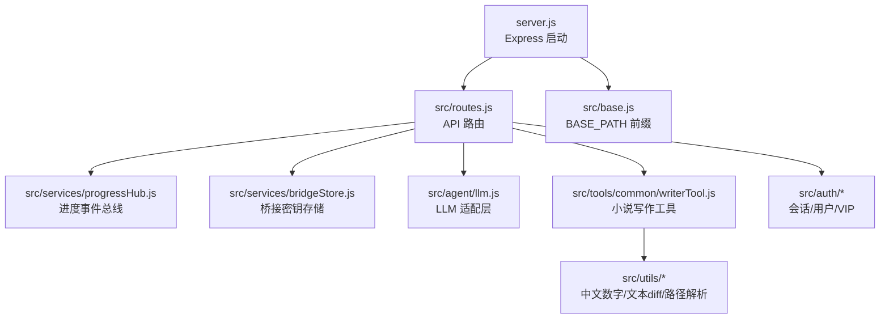
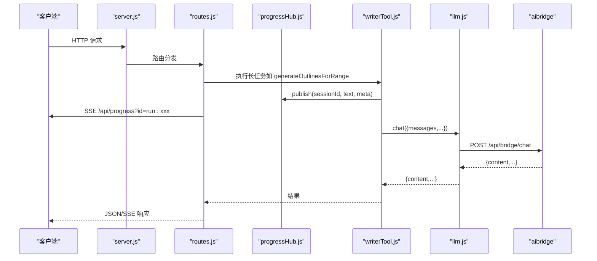
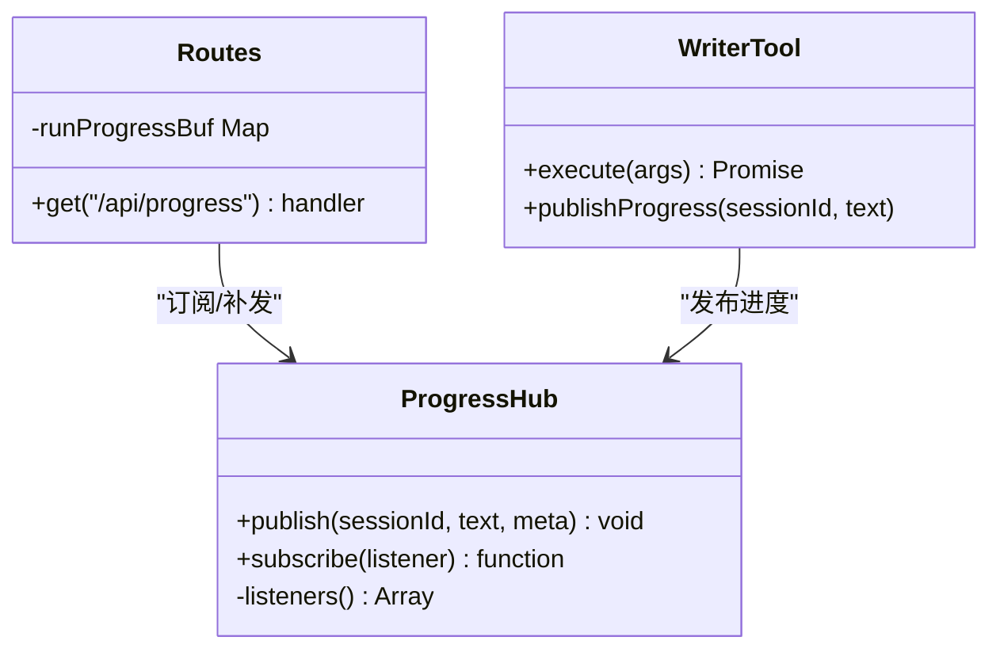
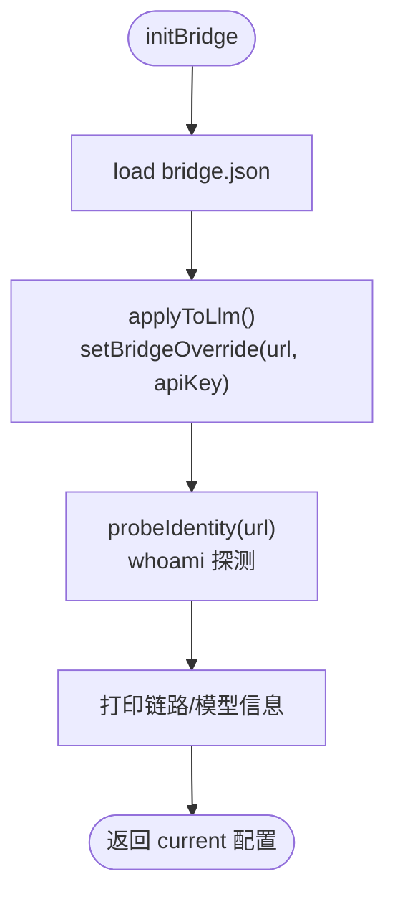
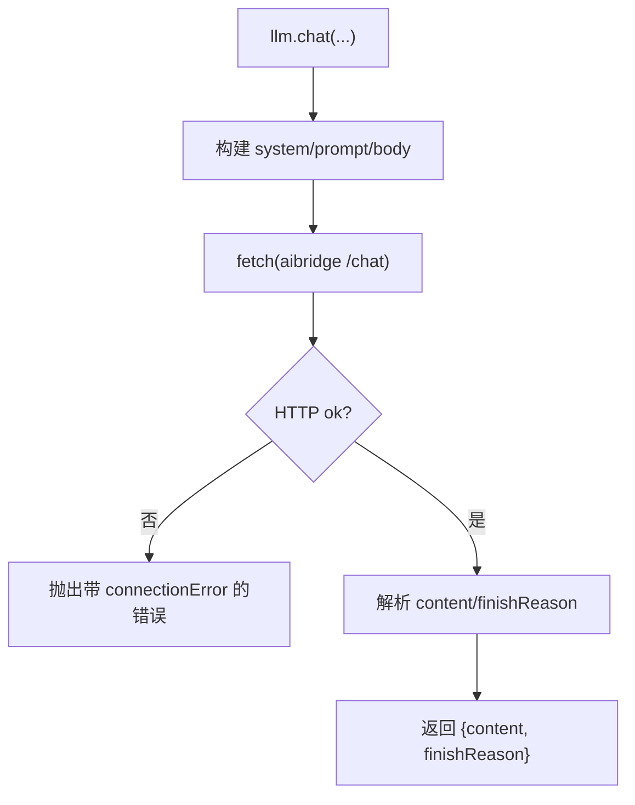
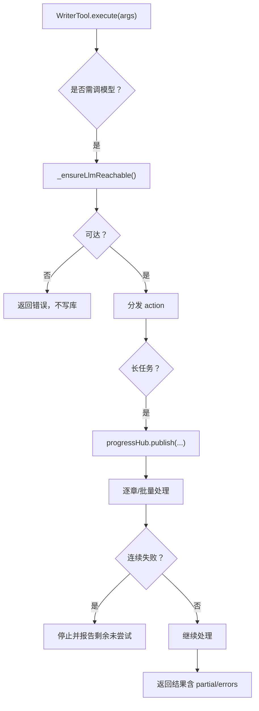
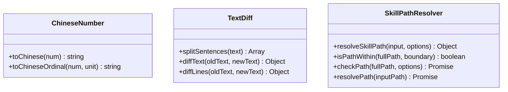
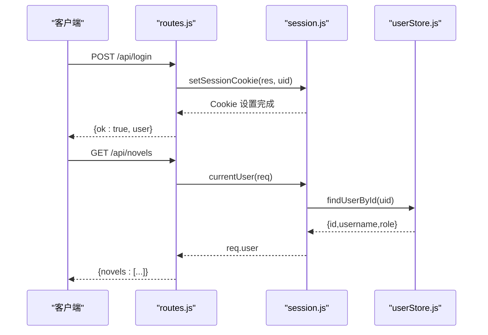
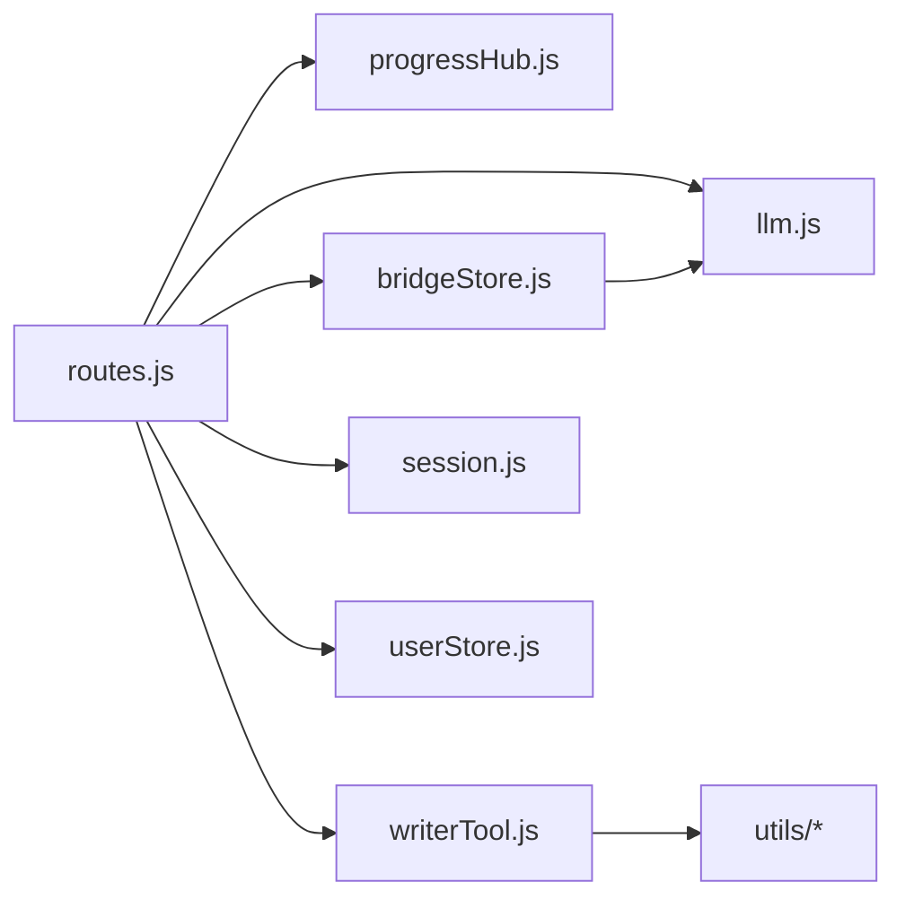

# 工具与服务

<cite>
**本文引用的文件**   
- [progressHub.js](file://src/services/progressHub.js)
- [bridgeStore.js](file://src/services/bridgeStore.js)
- [chineseNumber.js](file://src/utils/chineseNumber.js)
- [textDiff.js](file://src/utils/textDiff.js)
- [skillPathResolver.js](file://src/utils/skillPathResolver.js)
- [llm.js](file://src/agent/llm.js)
- [writerTool.js](file://src/tools/common/writerTool.js)
- [routes.js](file://src/routes.js)
- [session.js](file://src/auth/session.js)
- [userStore.js](file://src/auth/userStore.js)
- [base.js](file://src/base.js)
- [server.js](file://server.js)
</cite>

## 目录
1. [引言](#引言)
2. [项目结构](#项目结构)
3. [核心组件](#核心组件)
4. [架构总览](#架构总览)
5. [详细组件分析](#详细组件分析)
6. [依赖关系分析](#依赖关系分析)
7. [性能与扩展性](#性能与扩展性)
8. [故障排查指南](#故障排查指南)
9. [结论](#结论)
10. [附录：使用示例与扩展指南](#附录使用示例与扩展指南)

## 引言
本文面向“工具与服务”这一主题，聚焦以下目标：
- 解释进度跟踪服务：长任务监控、实时进度推送、事件总线机制。
- 说明桥接服务：外部服务集成、密钥管理、错误处理与探测策略。
- 文档化工具函数库：中文数字转换、文本差异比较、路径解析等实用能力。
- 梳理服务间通信机制、错误处理模式、日志记录策略。
- 提供具体使用示例与扩展指南，帮助读者快速上手并安全扩展。

## 项目结构
本项目采用分层组织方式：
- 服务层：`src/services` 提供进程内事件总线与桥接配置存储。
- 代理层：`src/agent` 封装 LLM 调用与桥接地址/密钥解析。
- 工具层：`src/tools` 提供 WriterTool 等可复用业务工具。
- 工具函数：`src/utils` 提供纯函数型通用能力（中文数字、文本 diff、路径解析）。
- 认证与会话：`src/auth` 负责用户、会话、VIP 授权等元数据。
- 路由与入口：`src/routes.js` 暴露 HTTP API；`server.js` 启动 Express 应用。
- 站点前缀：`src/base.js` 统一 BASE_PATH 与命名空间剥离逻辑。

**图示来源**
- [server.js:1-64](file://server.js#L1-L64)
- [routes.js:1-120](file://src/routes.js#L1-L120)
- [progressHub.js:1-59](file://src/services/progressHub.js#L1-L59)
- [bridgeStore.js:1-120](file://src/services/bridgeStore.js#L1-L120)
- [llm.js:1-60](file://src/agent/llm.js#L1-L60)
- [writerTool.js:1-80](file://src/tools/common/writerTool.js#L1-L80)
- [base.js:1-42](file://src/base.js#L1-L42)

**章节来源**
- [server.js:1-64](file://server.js#L1-L64)
- [routes.js:1-120](file://src/routes.js#L1-L120)
- [base.js:1-42](file://src/base.js#L1-L42)

## 核心组件
本节概述关键组件的职责与交互：
- 进度事件总线（ProgressHub）：发布/订阅进度事件，隔离订阅方异常，供 Web 层转发 SSE。
- 桥接存储（BridgeStore）：持久化 aibridge API Key 清单、当前生效项与可选 URL 覆盖，对外脱敏。
- LLM 适配层（llm.js）：将内部 messages 转为 aibridge 请求体，处理超时、连接错误与 whoami 探测。
- WriterTool：小说大纲/正文生成、批量操作、字数治理等复杂流程，并在长任务中发布进度。
- 工具函数：中文数字转换、文本差异计算、路径解析与安全边界检查。
- 认证与会话：HMAC-SHA256 签名 cookie、用户登录态、VIP 授权判定。
- 路由层：鉴权、限流、租户隔离、SSE 进度通道、外部服务代理。

**章节来源**
- [progressHub.js:1-59](file://src/services/progressHub.js#L1-L59)
- [bridgeStore.js:1-120](file://src/services/bridgeStore.js#L1-L120)
- [llm.js:1-120](file://src/agent/llm.js#L1-L120)
- [writerTool.js:1-120](file://src/tools/common/writerTool.js#L1-L120)
- [chineseNumber.js:1-55](file://src/utils/chineseNumber.js#L1-L55)
- [textDiff.js:1-156](file://src/utils/textDiff.js#L1-L156)
- [skillPathResolver.js:1-120](file://src/utils/skillPathResolver.js#L1-L120)
- [session.js:1-118](file://src/auth/session.js#L1-L118)
- [userStore.js:1-120](file://src/auth/userStore.js#L1-L120)
- [routes.js:330-420](file://src/routes.js#L330-L420)

## 架构总览
系统以 Express 为入口，路由层承担鉴权、限流、租户隔离与 SSE 进度通道；WriterTool 作为核心业务编排器，通过 LLM 适配层访问 aibridge；BridgeStore 在启动时注入当前生效的桥接密钥；ProgressHub 提供进程内事件总线，Web 层将其转成 SSE 推送给前端。

**图示来源**
- [server.js:1-64](file://server.js#L1-L64)
- [routes.js:573-627](file://src/routes.js#L573-L627)
- [progressHub.js:16-55](file://src/services/progressHub.js#L16-L55)
- [writerTool.js:520-672](file://src/tools/common/writerTool.js#L520-L672)
- [llm.js:102-171](file://src/agent/llm.js#L102-L171)

## 详细组件分析

### 进度跟踪服务（ProgressHub）
- 设计要点：
  - 单例 EventEmitter，限制最大监听数，避免内存泄漏。
  - publish 逐个调用监听器并捕获异常，确保订阅方失败不影响主链路与其他订阅方。
  - subscribe 返回取消订阅函数，便于资源清理。
- 与 Web 层协作：
  - routes.js 订阅 progressHub，按 sessionId 缓冲近期事件，SSE 先补发再转实流，避免竞态丢消息。
  - 对 delta 类高频增量事件进行过滤，防止刷屏。
- 适用场景：
  - 长任务（批量生成大纲、字数治理、区间补大纲）期间持续推送“正在做什么”。

**图示来源**
- [progressHub.js:16-55](file://src/services/progressHub.js#L16-L55)
- [routes.js:573-627](file://src/routes.js#L573-L627)
- [writerTool.js:520-672](file://src/tools/common/writerTool.js#L520-L672)

**章节来源**
- [progressHub.js:1-59](file://src/services/progressHub.js#L1-L59)
- [routes.js:573-627](file://src/routes.js#L573-L627)

### 桥接服务（BridgeStore）
- 功能职责：
  - 持久化 aibridge API Key 清单、当前生效项与可选 URL 覆盖。
  - 对外接口一律脱敏，仅返回 keyPrefix，不泄露明文密钥。
  - 启动时 initBridge 把控制台选择的链路推给 llm，并探测上游模型身份。
- 密钥管理与安全：
  - 落盘 data/system/bridge.json，权限 0600，敏感性与 .env 同级。
  - secretOf 仅供服务端内部取明文发起真实请求，绝不在响应中直接返回。
- 错误处理与探测：
  - 文件损坏或 activeId 指向已删除条目时回退到环境变量，并发出告警。
  - probeIdentity 用 whoami 探测 Provider/Model，缓存探测结果用于列表展示。

**图示来源**
- [bridgeStore.js:85-99](file://src/services/bridgeStore.js#L85-L99)
- [bridgeStore.js:101-124](file://src/services/bridgeStore.js#L101-L124)
- [llm.js:44-56](file://src/agent/llm.js#L44-L56)

**章节来源**
- [bridgeStore.js:1-221](file://src/services/bridgeStore.js#L1-L221)
- [llm.js:17-60](file://src/agent/llm.js#L17-L60)

### LLM 适配层（llm.js）
- 职责：
  - 将内部 messages 拆分为 system/prompt，构造 aibridge 请求体。
  - 支持 runtime 覆盖（URL/Key），优先级：控制台 > 环境变量 > .env > 内置默认。
  - checkReachable 探测健康端点，chat 处理超时、连接错误与 HTTP 错误。
  - probeIdentity 查询 whoami，用于 Key 有效性及模型识别。
- 错误处理：
  - fetch 失败时附加 connectionError 标记，便于上层熔断。
  - 超时与 AbortSignal 配合，避免长时间阻塞。

**图示来源**
- [llm.js:102-171](file://src/agent/llm.js#L102-L171)
- [llm.js:179-201](file://src/agent/llm.js#L179-L201)

**章节来源**
- [llm.js:1-205](file://src/agent/llm.js#L1-L205)

### WriterTool（小说写作工具）
- 职责：
  - 提供多种 action：generate、add、modify、delete、批量大纲、字数治理等。
  - 对需要调模型的 action 做链路预检，失败则中止且不写库。
  - 在长任务中通过 progressHub.publish 推送阶段性进度。
  - 对超长内容采用自由扩展（拆章）与降序处理，保证章号稳定。
- 错误处理：
  - 连续失败熔断（MAX_CONSECIVE_FAILURES），避免长时间挂起。
  - 部分失败仍返回成功+partial，附带错误明细，便于前端提示。

**图示来源**
- [writerTool.js:254-262](file://src/tools/common/writerTool.js#L254-L262)
- [writerTool.js:520-672](file://src/tools/common/writerTool.js#L520-L672)

**章节来源**
- [writerTool.js:1-800](file://src/tools/common/writerTool.js#L1-L800)

### 工具函数库
- 中文数字转换（chineseNumber.js）：
  - toChinese(num)：1–999 整数转中文数字，越界抛错。
  - toChineseOrdinal(num, unit)：生成“第X部/第X章”标题。
- 文本差异比较（textDiff.js）：
  - splitSentences：按段落和句末标点切句，保留段落编号。
  - diffText：句级 LCS 差异，超限退化整段替换，输出 ops/stats。
  - diffLines：行级差异，适用于 HTML/配置文本。
- 路径解析（skillPathResolver.js）：
  - expandHome：展开 ~ 为用户主目录。
  - resolveSkillPath：占位符替换、~ 展开、相对路径基准解析。
  - isPathWithin：基于 path.relative 的安全边界判断。
  - checkPath：存在性/类型预检，附相似文件名提示。
  - SkillPathResolver：兼容旧 DefaultPathResolver 的实例 API。

**图示来源**
- [chineseNumber.js:17-52](file://src/utils/chineseNumber.js#L17-L52)
- [textDiff.js:45-153](file://src/utils/textDiff.js#L45-L153)
- [skillPathResolver.js:24-123](file://src/utils/skillPathResolver.js#L24-L123)
- [skillPathResolver.js:177-332](file://src/utils/skillPathResolver.js#L177-L332)

**章节来源**
- [chineseNumber.js:1-55](file://src/utils/chineseNumber.js#L1-L55)
- [textDiff.js:1-156](file://src/utils/textDiff.js#L1-L156)
- [skillPathResolver.js:1-332](file://src/utils/skillPathResolver.js#L1-L332)

### 认证与会话（session.js、userStore.js）
- 会话（session.js）：
  - HMAC-SHA256 签名 cookie，HttpOnly、SameSite=Lax，Path 受 BASE_PATH 影响。
  - requireAuth/requireSuperadmin 中间件保护 /api 路由。
- 用户与 VIP（userStore.js）：
  - global.db 维护 user/novel/vip_grant/preview 表。
  - hasVipAccess 判定读者是否有权阅读 VIP 书。
  - bootstrap/migrateExistingNovels 幂等初始化与存量迁移。

**图示来源**
- [session.js:75-110](file://src/auth/session.js#L75-L110)
- [userStore.js:181-188](file://src/auth/userStore.js#L181-L188)
- [routes.js:342-350](file://src/routes.js#L342-L350)

**章节来源**
- [session.js:1-118](file://src/auth/session.js#L1-L118)
- [userStore.js:1-120](file://src/auth/userStore.js#L1-L120)
- [routes.js:342-350](file://src/routes.js#L342-L350)

## 依赖关系分析
- 组件耦合：
  - routes.js 依赖 progressHub、bridgeStore、llm、writerTool、auth/session、auth/userStore。
  - writerTool 依赖 llm、utils/*、services/progressHub。
  - bridgeStore 依赖 agent/llm（setBridgeOverride/probeIdentity）。
- 外部依赖：
  - aibridge（/api/bridge/chat、/api/health、/api/bridge/whoami）。
  - 文件系统（data/system/bridge.json、global.db、public/novel）。
- 潜在循环依赖：
  - 无直接循环；bridgeStore 与 llm 通过函数导入解耦。

**图示来源**
- [routes.js:1-120](file://src/routes.js#L1-L120)
- [bridgeStore.js:1-20](file://src/services/bridgeStore.js#L1-L20)
- [writerTool.js:1-20](file://src/tools/common/writerTool.js#L1-L20)

**章节来源**
- [routes.js:1-120](file://src/routes.js#L1-L120)
- [bridgeStore.js:1-20](file://src/services/bridgeStore.js#L1-L20)
- [writerTool.js:1-20](file://src/tools/common/writerTool.js#L1-L20)

## 性能与扩展性
- 进度推送：
  - 事件总线单例，限制监听数；SSE 缓冲近期事件，避免竞态丢消息。
  - 过滤 delta 类高频事件，减少前端渲染压力。
- 文本差异：
  - 句级 LCS DP，设置 SAFETY_LIMIT，超限退化整段替换，避免进程卡死。
- 路径解析：
  - 使用 path.relative 判断边界，修复 startsWith 漏洞。
  - 支持 ~ 展开与占位符替换，提升灵活性。
- 扩展建议：
  - 新增长任务时，优先通过 progressHub.publish 推送进度。
  - 新增外部服务集成时，参考 bridgeStore 的脱敏与探测模式。
  - 新增工具函数时，保持纯函数导出，便于测试与复用。

[本节为一般性指导，无需特定文件引用]

## 故障排查指南
- LLM 不可达：
  - 检查 aibridge 是否启动，确认 AIBRIDGE_URL/AIBRIDGE_API_KEY。
  - 使用 /api/llm-status 查看可达性。
- 进度丢失：
  - 确认 SSE id 格式为 run:xxx，且客户端在任务开始后尽快连接。
  - 检查 progressHub 订阅是否被提前取消。
- 密钥无效：
  - 使用 bridgeStore.test(id) 探测 whoami，查看 provider/model/keyName。
  - 确认 bridge.json 权限为 0600，activeId 指向有效条目。
- 路径错误：
  - 使用 checkPath 获取 suggestions，修正拼写或目录名。
  - 使用 isPathWithin 验证安全边界。

**章节来源**
- [llm.js:75-100](file://src/agent/llm.js#L75-L100)
- [bridgeStore.js:202-211](file://src/services/bridgeStore.js#L202-L211)
- [skillPathResolver.js:177-218](file://src/utils/skillPathResolver.js#L177-L218)

## 结论
本项目的工具与服务围绕“长任务可视化、外部服务集成、通用工具函数”三大主题展开。进度事件总线与 SSE 结合，使长任务过程透明；桥接服务集中管理密钥与地址，保障安全与可切换；工具函数提供稳定可靠的底层能力。整体架构清晰、职责分离，便于扩展与维护。

[本节为总结性内容，无需特定文件引用]

## 附录：使用示例与扩展指南

### 进度跟踪使用示例
- 后端发布进度：
  - 在长任务中调用 progressHub.publish(sessionId, text, meta)。
- 前端订阅进度：
  - 连接 /api/progress?id=run:xxx，接收 SSE 事件，渲染进度条或日志。

**章节来源**
- [progressHub.js:28-55](file://src/services/progressHub.js#L28-L55)
- [routes.js:599-627](file://src/routes.js#L599-L627)

### 桥接服务使用示例
- 添加 Key：
  - 调用 bridgeStore.add({name,key,probe})，成功后返回脱敏信息。
- 启用 Key：
  - 调用 bridgeStore.activate(id)，立即应用到 llm。
- 探测 Key：
  - 调用 bridgeStore.test(id)，查看 provider/model/keyName。

**章节来源**
- [bridgeStore.js:126-211](file://src/services/bridgeStore.js#L126-L211)

### 工具函数使用示例
- 中文数字：
  - toChinese(11) → “十一”
  - toChineseOrdinal(3, “章”) → “第三章”
- 文本差异：
  - diffText(oldHtml, newHtml) → {ops, stats}
- 路径解析：
  - resolveSkillPath("~/workspace/file.txt", {workspace:"/app"}) → {fullPath,isDefault,...}
  - isPathWithin("/app/data/file","/app/data") → true

**章节来源**
- [chineseNumber.js:17-52](file://src/utils/chineseNumber.js#L17-L52)
- [textDiff.js:84-153](file://src/utils/textDiff.js#L84-L153)
- [skillPathResolver.js:52-123](file://src/utils/skillPathResolver.js#L52-L123)
- [skillPathResolver.js:133-137](file://src/utils/skillPathResolver.js#L133-L137)

### 扩展指南
- 新增长任务：
  - 在 WriterTool 或其他服务中调用 progressHub.publish 推送进度。
  - 在 routes.js 中注册 SSE 端点，缓冲并转发事件。
- 新增外部服务：
  - 参考 bridgeStore 的 add/activate/test 模式，实现密钥管理与探测。
  - 使用 llm.js 的 setBridgeOverride 动态切换运行时配置。
- 新增工具函数：
  - 保持纯函数导出，编写单元测试，确保输入校验与错误处理。

[本节为扩展性指导，无需特定文件引用]