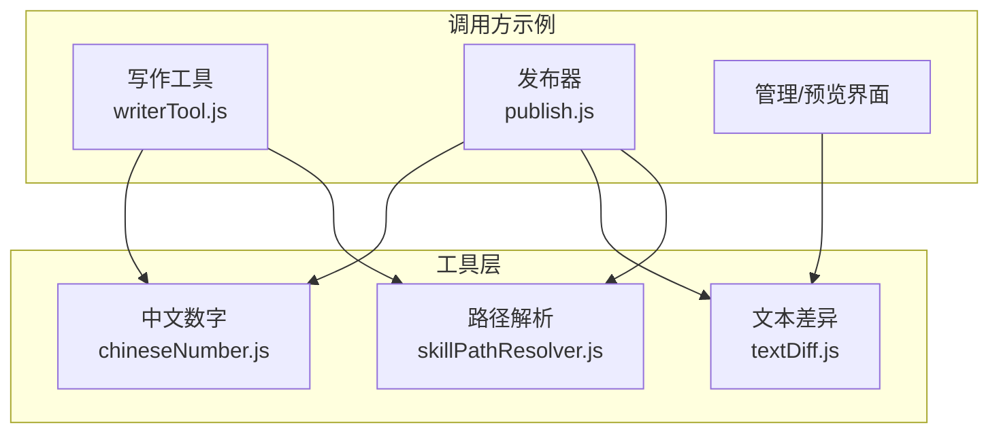
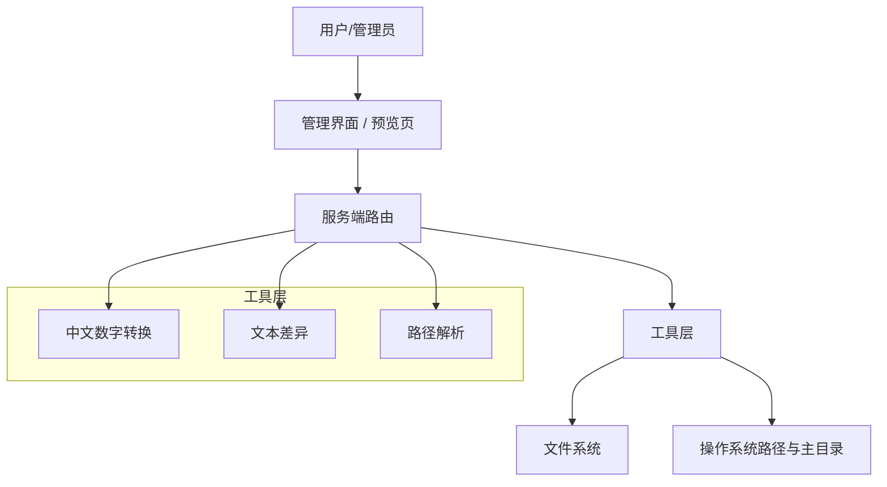
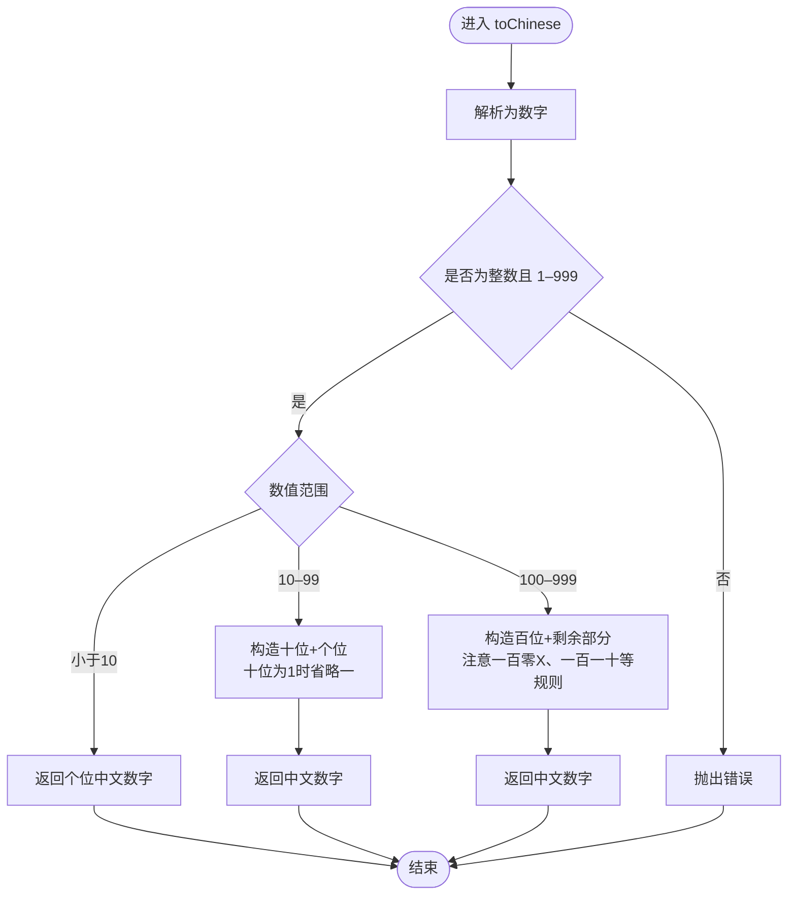
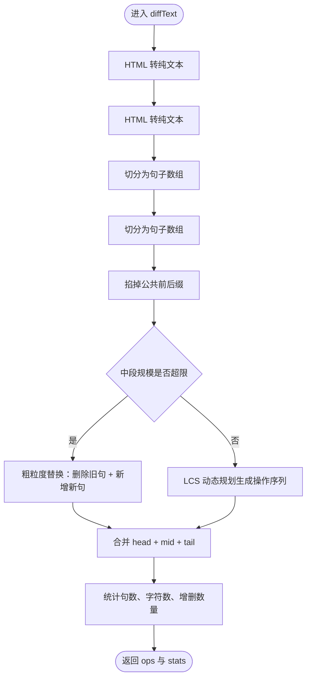
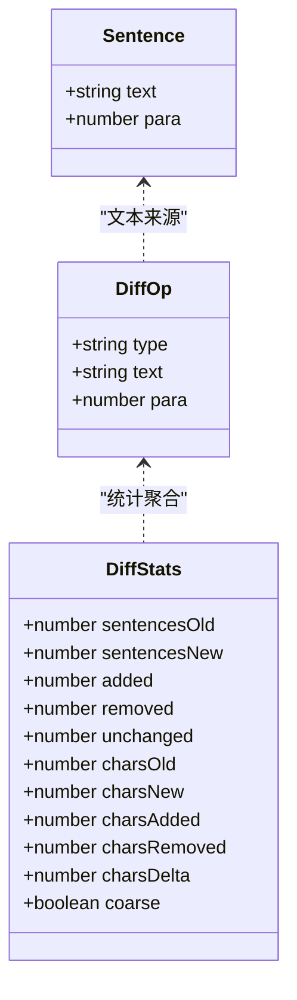
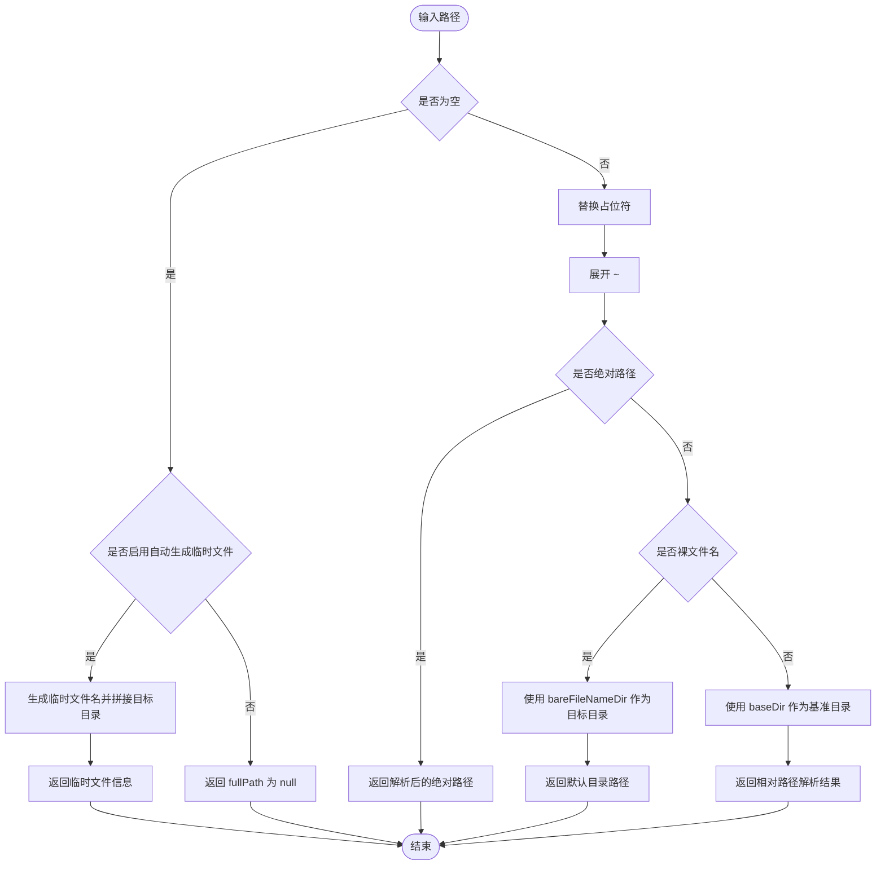
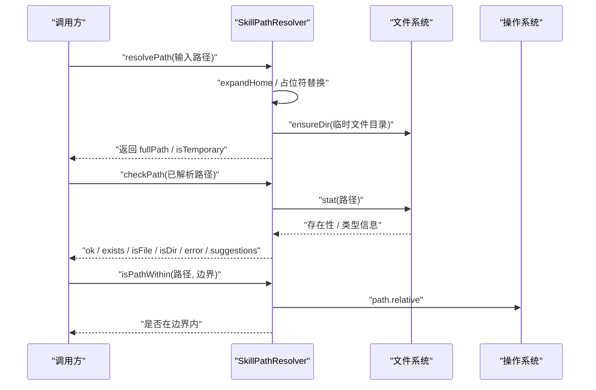
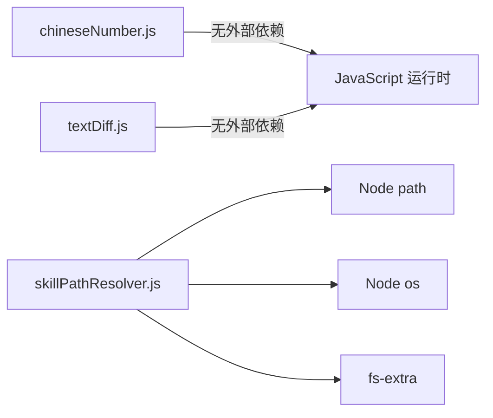

# 工具函数库

<cite>
**本文引用的文件**   
- [chineseNumber.js](file://src/utils/chineseNumber.js)
- [textDiff.js](file://src/utils/textDiff.js)
- [skillPathResolver.js](file://src/utils/skillPathResolver.js)
- [README.md](file://README.md)
</cite>

## 目录
1. [引言](#引言)
2. [项目结构](#项目结构)
3. [核心组件](#核心组件)
4. [架构总览](#架构总览)
5. [详细组件分析](#详细组件分析)
6. [依赖关系分析](#依赖关系分析)
7. [性能与复杂度](#性能与复杂度)
8. [故障排查指南](#故障排查指南)
9. [结论](#结论)

## 引言
本文件面向“工具函数库”的使用者与二次开发者，聚焦三个公共工具模块：
- 中文数字转换：阿拉伯数字转中文数字、序数标题生成。
- 文本差异比较：中文正文句级 diff、行级 diff、句子切分与 HTML 清理。
- 路径解析工具：技能路径解析、~ 展开、占位符替换、存在性与类型预检、安全边界判断。

这些工具被写作侧、发布侧与管理端复用，目标是统一口径、避免多处实现不一致，并提供稳定可预测的返回值格式。

## 项目结构
本次文档涉及的代码位于 `src/utils` 下，属于纯工具层，不耦合业务路由或数据库：
- `src/utils/chineseNumber.js`：中文数字转换。
- `src/utils/textDiff.js`：中文文本差异计算。
- `src/utils/skillPathResolver.js`：统一路径解析与安全校验。

**图表来源**
- [chineseNumber.js:1-55](file://src/utils/chineseNumber.js#L1-L55)
- [textDiff.js:1-156](file://src/utils/textDiff.js#L1-L156)
- [skillPathResolver.js:1-332](file://src/utils/skillPathResolver.js#L1-L332)

**章节来源**
- [README.md:166-193](file://README.md#L166-L193)

## 核心组件
本节按工具模块给出职责、入口函数、参数约定与返回值说明。

### 中文数字转换
- 主要能力
  - 阿拉伯数字到中文数字转换，支持 1–999。
  - 生成“第X章 / 第X部”等中文序数标题。
- 关键函数
  - `toChinese(num)`：将整数转为中文数字。
  - `toChineseOrdinal(num, unit?)`：生成“第X量词”形式标题。
- 输入输出
  - 输入：整数或可转换为整数的字符串；单位默认“章”。
  - 输出：中文数字字符串或带“第”前缀的标题字符串。
  - 异常：非整数或超出范围会抛出错误，不做静默近似。
- 使用建议
  - 用于章节标题、分部编号、提示词中的中文序号。
  - 若需要更宽范围，应在上层扩展并明确规则，不要绕过异常。

**章节来源**
- [chineseNumber.js:1-55](file://src/utils/chineseNumber.js#L1-L55)

### 文本差异比较
- 主要能力
  - 对小说正文做“句级 diff”，最小粒度是一句话，避免整段红绿替换。
  - 提供“行级 diff”，适合配置类或 HTML 结构文本。
  - 提供句子切分、HTML 去标签、归一化键等底层工具。
- 关键函数
  - `diffText(oldText, newText)`：句级 diff，返回操作序列与统计。
  - `diffLines(oldText, newText)`：行级 diff，返回操作序列与统计。
  - `splitSentences(text)`：把文本拆成句子数组。
  - `htmlToText(html)`：HTML 转纯文本。
  - `normKey(s)`：归一化比较键，忽略空白与标点差异。
- 输入输出
  - 输入：旧版与新版的文本（可为 HTML 或纯文本）。
  - 输出：包含 `ops` 与 `stats` 的对象；`ops` 中每个元素有 `type`、`text`、`para`。
- 使用场景
  - 发布前预览页展示“改了什么、改了哪些句”。
  - 管理端对比大纲、正文、配置的变更。

**章节来源**
- [textDiff.js:1-156](file://src/utils/textDiff.js#L1-L156)

### 路径解析工具
- 主要能力
  - 统一处理 `~` 展开、占位符替换、相对路径基准解析。
  - 提供路径存在性检查、类型校验、相似文件名提示。
  - 提供基于 `path.relative` 的安全边界判断。
  - 提供兼容旧接口的实例化解析器。
- 关键函数与类
  - `expandHome(inputPath)`：展开 `~`。
  - `resolveSkillPath(input, options)`：统一路径解析。
  - `checkPath(fullPath, options)`：异步存在性与类型预检。
  - `isPathWithin(fullPath, boundary)`：判断路径是否在边界内。
  - `SkillPathResolver`：带默认目录状态的解析器实例 API。
- 输入输出
  - 输入：原始路径、工作区/会话目录、占位符、是否自动生成临时文件等选项。
  - 输出：解析结果对象，包含完整路径、是否默认目录、是否临时文件、原始输入等字段；检查接口返回存在性、类型、错误信息与相似文件建议。
- 使用建议
  - 所有技能脚本、发布流程、工具层都应通过该模块解析路径，避免硬编码。
  - 对外暴露的路径必须经过 `isPathWithin` 安全校验。

**章节来源**
- [skillPathResolver.js:1-332](file://src/utils/skillPathResolver.js#L1-L332)

## 架构总览
下图展示工具层在系统中的位置与典型调用方向：

**图表来源**
- [textDiff.js:1-156](file://src/utils/textDiff.js#L1-L156)
- [skillPathResolver.js:1-332](file://src/utils/skillPathResolver.js#L1-L332)
- [chineseNumber.js:1-55](file://src/utils/chineseNumber.js#L1-L55)

## 详细组件分析

### 中文数字转换组件
#### 设计要点
- 使用固定映射表表示个位中文数字。
- 分别处理个位、十位、百位分支，保证“十一”“一百零五”“一百一十”等常见写法正确。
- 序数标题由“第 + 中文数字 + 量词”组合而成。

**图表来源**
- [chineseNumber.js:17-42](file://src/utils/chineseNumber.js#L17-L42)

#### 使用示例（描述性）
- 将 `1` 转为“一”。
- 将 `11` 转为“十一”。
- 将 `105` 转为“一百零五”。
- 将 `110` 转为“一百一十”。
- 将 `5` 传入 `toChineseOrdinal` 得到“第五章”。
- 将 `12` 传入 `toChineseOrdinal` 并指定单位为“部”，得到“第十二部”。

**章节来源**
- [chineseNumber.js:1-55](file://src/utils/chineseNumber.js#L1-L55)

### 文本差异比较组件
#### 算法总览
- 先清洗 HTML，再按段落和中文句末标点切分为句子。
- 去掉两端相同的公共前后缀，缩小动态规划规模。
- 对中段使用 LCS 动态规划生成 add/del/same 操作序列。
- 超过安全阈值时退化为“整段替换”，避免长时间阻塞。

**图表来源**
- [textDiff.js:84-123](file://src/utils/textDiff.js#L84-L123)
- [textDiff.js:125-145](file://src/utils/textDiff.js#L125-L145)

#### 数据结构与复杂度
- 句子数组元素包含原文片段与段落编号，便于前端按阅读顺序渲染。
- LCS 使用二维状态表，时间复杂度约为 O(n×m)，空间复杂度可通过倒序填表优化。
- 安全限制防止超长文本导致内存或 CPU 占用过高。

**图表来源**
- [textDiff.js:40-61](file://src/utils/textDiff.js#L40-L61)
- [textDiff.js:77-123](file://src/utils/textDiff.js#L77-L123)

#### 使用示例（描述性）
- 比较两版正文，得到“相同句、新增句、删除句”的操作序列。
- 在预览页中，按 `same/add/del` 渲染红绿对照。
- 对配置或 HTML 使用行级 diff，获得更粗粒度的变更列表。

**章节来源**
- [textDiff.js:1-156](file://src/utils/textDiff.js#L1-L156)

### 路径解析工具组件
#### 核心流程
- 空输入可选择自动生成临时文件名，或返回空路径。
- 支持 `{baseDir}`、`{workspace}`、`{session}`、`{home}` 等占位符。
- 支持 `~` 展开为用户主目录。
- 裸文件名落入默认目录，含分隔符的相对路径以工作区或会话目录为基准。
- 绝对路径直接解析并返回。

**图表来源**
- [skillPathResolver.js:52-123](file://src/utils/skillPathResolver.js#L52-L123)

#### 安全边界与存在性检查
- `isPathWithin` 使用 `path.relative` 判断路径是否位于边界目录内，避免 `startsWith` 前缀漏洞。
- `checkPath` 异步检查路径是否存在、是否为文件或目录，并可返回相似文件名建议。

**图表来源**
- [skillPathResolver.js:125-218](file://src/utils/skillPathResolver.js#L125-L218)
- [skillPathResolver.js:224-332](file://src/utils/skillPathResolver.js#L224-L332)

#### 使用示例（描述性）
- 将 `~/novel/output` 解析为用户主目录下的绝对路径。
- 将 `{workspace}/data/file.txt` 解析为工作区下的具体文件路径。
- 将裸文件名 `chapter_001.html` 解析到默认输出目录。
- 检查某路径是否存在且为文件，若不存在则获取相似文件建议。
- 校验最终路径是否位于允许的工作目录内。

**章节来源**
- [skillPathResolver.js:1-332](file://src/utils/skillPathResolver.js#L1-L332)

## 依赖关系分析
工具层之间的依赖较弱，主要依赖 Node 标准库与文件系统：

**图表来源**
- [chineseNumber.js:1-55](file://src/utils/chineseNumber.js#L1-L55)
- [textDiff.js:1-156](file://src/utils/textDiff.js#L1-L156)
- [skillPathResolver.js:14-16](file://src/utils/skillPathResolver.js#L14-L16)

**章节来源**
- [skillPathResolver.js:14-16](file://src/utils/skillPathResolver.js#L14-L16)

## 性能与复杂度
- 中文数字转换
  - 时间复杂度 O(1)，空间复杂度 O(1)。
  - 适合高频调用，如批量生成章节标题。
- 文本差异比较
  - 句级 diff 使用 LCS，时间复杂度约 O(n×m)，n、m 为句子数量。
  - 通过公共前后缀裁剪与安全阈值退化降低极端情况风险。
  - 行级 diff 更适合配置或 HTML，粒度更粗但更快。
- 路径解析
  - 解析过程主要为字符串处理与路径拼接，开销较低。
  - 存在性检查涉及文件系统 I/O，应缓存或减少重复调用。
  - 安全边界判断依赖 `path.relative`，应避免频繁创建大量短路径对象。

[本节为通用性能讨论，不直接分析具体代码行]

## 故障排查指南
### 中文数字转换
- 现象：传入非整数或超出 1–999 时报错。
- 原因：工具严格校验输入，避免生成错误标题。
- 处理：在上层确保传入合法整数；如需更大范围，需扩展工具并明确规则。

**章节来源**
- [chineseNumber.js:17-21](file://src/utils/chineseNumber.js#L17-L21)

### 文本差异比较
- 现象：超长文本 diff 很慢或卡住。
- 原因：LCS 动态规划规模过大。
- 处理：系统会在超过安全阈值时退化为整段替换；若仍需句级精度，应先拆分章节或段落。

**章节来源**
- [textDiff.js:8-10](file://src/utils/textDiff.js#L8-L10)
- [textDiff.js:90-98](file://src/utils/textDiff.js#L90-L98)

### 路径解析
- 现象：路径解析后不在预期目录。
- 原因：未区分裸文件名与相对路径，或未设置 `bareFileNameDir`。
- 处理：明确输入是裸文件名还是相对路径；必要时传入 `bareFileNameDir`。

**章节来源**
- [skillPathResolver.js:105-122](file://src/utils/skillPathResolver.js#L105-L122)

- 现象：安全检查误放行危险路径。
- 原因：使用 `startsWith` 而非 `path.relative`。
- 处理：始终使用 `isPathWithin` 进行边界判断。

**章节来源**
- [skillPathResolver.js:125-137](file://src/utils/skillPathResolver.js#L125-L137)

- 现象：路径不存在时缺少帮助信息。
- 原因：未开启 mustExist 或未读取 suggestions。
- 处理：在 mustExist 模式下消费 `suggestions`，向用户或 LLM 提供相似文件名。

**章节来源**
- [skillPathResolver.js:177-218](file://src/utils/skillPathResolver.js#L177-L218)

## 结论
本工具函数库围绕“中文数字转换”“文本差异比较”“路径解析”三类高频需求，提供稳定、可测试、可复用的实现：
- 中文数字转换保证标题语义一致，避免多处映射不一致。
- 文本差异比较以句级粒度呈现改动，兼顾可读性与性能。
- 路径解析统一处理占位符、~ 展开、默认目录与安全边界，降低路径相关风险。

在实际使用中，建议：
- 所有标题生成走 `toChinese` / `toChineseOrdinal`。
- 正文预览与修改报告走 `diffText`，配置与 HTML 走 `diffLines`。
- 所有路径生成与校验走 `resolveSkillPath`、`checkPath`、`isPathWithin`。

[本节为总结性内容，不直接分析具体代码行]