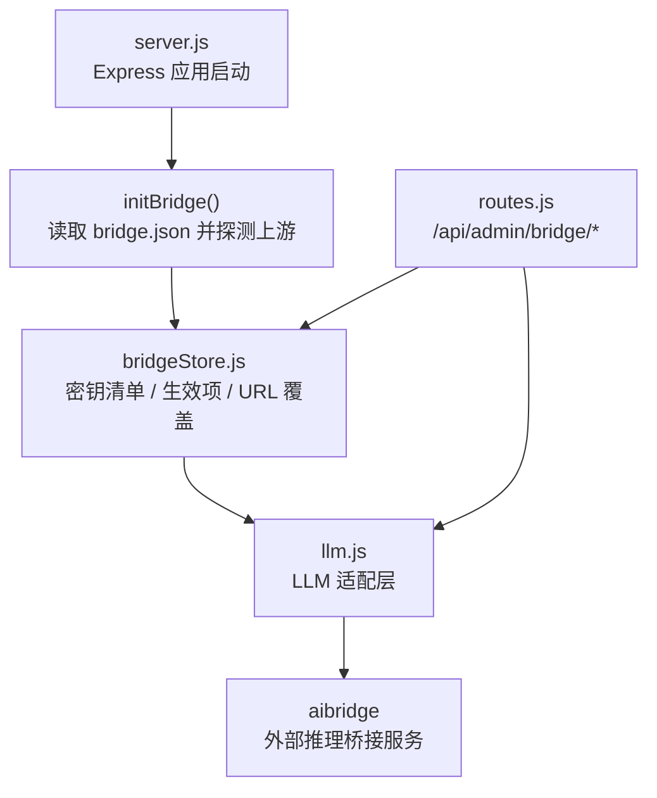
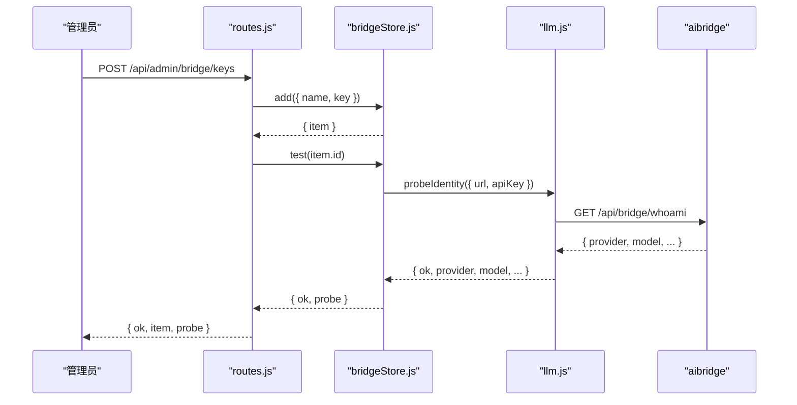
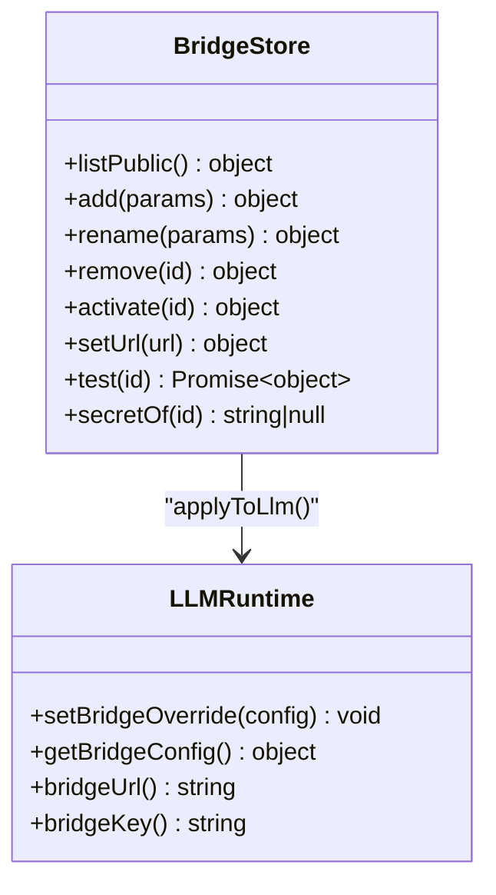
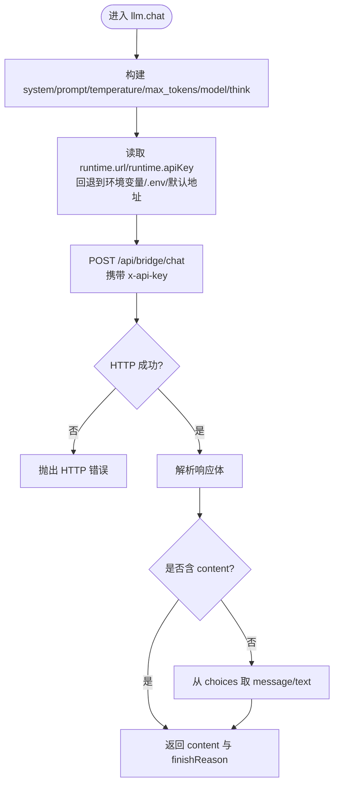
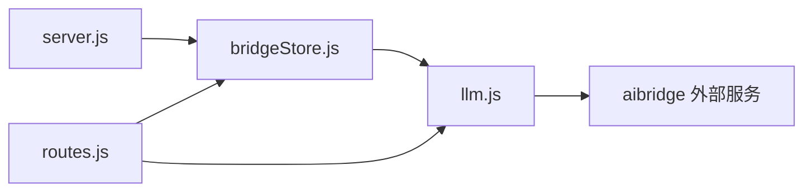

# 桥接服务

<cite>
**本文引用的文件**   
- [bridgeStore.js](file://src/services/bridgeStore.js)
- [llm.js](file://src/agent/llm.js)
- [routes.js](file://src/routes.js)
- [server.js](file://server.js)
</cite>

## 目录
1. [引言](#引言)
2. [项目结构定位](#项目结构定位)
3. [核心组件总览](#核心组件总览)
4. [架构概览](#架构概览)
5. [详细组件分析](#详细组件分析)
6. [依赖关系分析](#依赖关系分析)
7. [性能与可靠性特征](#性能与可靠性特征)
8. [使用示例](#使用示例)
9. [安全考虑](#安全考虑)
10. [故障恢复与排障指南](#故障恢复与排障指南)
11. [结论](#结论)

## 引言
本文件面向“桥接服务”这一外部集成层，重点解释 `BridgeStore`（即 `bridgeStore`）如何管理外部推理服务的连接、密钥、配置与运行时切换，并说明它与 LLM 适配层、路由层和服务启动流程之间的关系。文档还涵盖密钥管理、配置存储、错误处理、超时机制、重试建议、安全策略以及可操作的接入和排障步骤。

需要特别说明的是：当前仓库中的桥接实现采用进程内状态 + 本地 JSON 文件落盘的方式管理密钥与生效项，并未内置连接池或自动重试逻辑；对外部 API 的调用由 LLM 适配层通过原生 `fetch` 发起，具备基础超时控制与结构化错误包装。因此，“连接池管理”“自动重试策略”在本仓库中属于待增强能力，而非已实现特性。

## 项目结构定位
桥接相关代码主要分布在以下位置：
- 桥接配置与密钥存储：`src/services/bridgeStore.js`
- LLM 适配层与外部 API 调用封装：`src/agent/llm.js`
- 管理端 API 路由：`src/routes.js`
- 服务启动入口与桥接初始化：`server.js`

**图表来源**
- [server.js:15-42](file://server.js#L15-L42)
- [bridgeStore.js:85-99](file://src/services/bridgeStore.js#L85-L99)
- [routes.js:1296-1340](file://src/routes.js#L1296-L1340)
- [llm.js:30-56](file://src/agent/llm.js#L30-L56)

**章节来源**
- [server.js:1-64](file://server.js#L1-L64)
- [bridgeStore.js:1-221](file://src/services/bridgeStore.js#L1-L221)
- [llm.js:1-205](file://src/agent/llm.js#L1-L205)
- [routes.js:1290-1340](file://src/routes.js#L1290-L1340)

## 核心组件总览
- `bridgeStore`：负责桥接密钥清单、当前生效密钥、URL 覆盖的增删改查、持久化、脱敏输出，以及与 LLM 运行时配置的联动。
- `llm`：将内部消息格式转换为 aibridge 请求体，负责鉴权头、超时、错误包装、身份探测等。
- 管理路由：提供超管权限下的桥接配置接口，包括查询、新增 Key、启用、测试、改名、删除、覆盖地址、连通性探测。
- 启动流程：在服务启动时加载桥接配置并打印当前链路，避免“控制台切换后重启不生效”的问题。

**章节来源**
- [bridgeStore.js:126-218](file://src/services/bridgeStore.js#L126-L218)
- [llm.js:67-171](file://src/agent/llm.js#L67-L171)
- [routes.js:1296-1340](file://src/routes.js#L1296-L1340)
- [server.js:41-42](file://server.js#L41-L42)

## 架构概览
桥接服务整体分为三层：
1. 配置管理层：`bridgeStore` 维护 `data/system/bridge.json`，保存密钥清单、当前生效项、可选 URL 覆盖。
2. 运行时适配层：`llm.js` 根据运行时覆盖、环境变量、`.env`、默认值决定最终调用的 aibridge 地址与密钥。
3. 外部集成层：通过 HTTP 调用 aibridge 的 `/chat`、`/health`、`/whoami` 等端点。

**图表来源**
- [routes.js:1303-1308](file://src/routes.js#L1303-L1308)
- [bridgeStore.js:130-145](file://src/services/bridgeStore.js#L130-L145)
- [bridgeStore.js:202-211](file://src/services/bridgeStore.js#L202-L211)
- [llm.js:179-201](file://src/agent/llm.js#L179-L201)

## 详细组件分析

### BridgeStore：密钥管理与配置存储
`bridgeStore` 是桥接配置的核心对象，职责包括：
- 从 `data/system/bridge.json` 加载配置，包含 `url`、`activeId`、`keys`。
- 对明文密钥做脱敏处理，对外只返回前缀。
- 支持新增、重命名、删除、启用密钥条目。
- 支持设置或清除 URL 覆盖。
- 将当前生效项推给 LLM 运行时，使切换立即生效。
- 提供 `secretOf(id)` 供服务端内部获取明文密钥，但明确要求不得直接返回给前端。

关键行为要点：
- 文件不存在或解析失败不会让服务崩溃，而是按“未配置”处理并告警。
- 如果 `activeId` 指向已被删除的条目，会清空生效项并回落 `.env`。
- 所有写操作都会尝试以 `0o600` 权限写入文件，降低密钥泄露风险。
- 列表接口 `listPublic()` 永远不包含明文密钥。

**图表来源**
- [bridgeStore.js:126-218](file://src/services/bridgeStore.js#L126-L218)
- [llm.js:37-56](file://src/agent/llm.js#L37-L56)

**章节来源**
- [bridgeStore.js:31-66](file://src/services/bridgeStore.js#L31-L66)
- [bridgeStore.js:101-124](file://src/services/bridgeStore.js#L101-L124)
- [bridgeStore.js:130-218](file://src/services/bridgeStore.js#L130-L218)

### LLM 适配层：外部 API 调用封装
`llm.js` 承担以下职责：
- 决定最终 aibridge 地址与密钥：优先级为“控制台覆盖 > 环境变量 > `.env` > 内置默认”。
- 将内部 `messages` 拆成 `system` 与 `prompt`，构造 aibridge 请求体。
- 在请求头中携带 `x-api-key`。
- 对网络错误进行结构化包装，标记 `connectionError`。
- 对非 2xx 响应抛出带状态码和摘要的错误。
- 提供 `checkReachable` 用于健康检查，以及 `probeIdentity` 用于探测密钥对应的上游模型。

**图表来源**
- [llm.js:102-171](file://src/agent/llm.js#L102-L171)
- [llm.js:37-56](file://src/agent/llm.js#L37-L56)

**章节来源**
- [llm.js:16-56](file://src/agent/llm.js#L16-L56)
- [llm.js:67-171](file://src/agent/llm.js#L67-L171)
- [llm.js:179-201](file://src/agent/llm.js#L179-L201)

### 管理路由：桥接配置的外部暴露
管理路由集中在 `/api/admin/bridge*`，全部要求超管权限，并提供：
- 查询当前桥接状态与密钥清单。
- 新增密钥并自动探测。
- 启用或取消启用某条密钥。
- 测试某条密钥的身份信息。
- 修改密钥名称。
- 删除密钥。
- 覆盖桥接地址。
- 探测桥接服务可达性。

这些路由统一遵循一个安全原则：返回值中绝不包含明文密钥，仅使用 `prefix` 展示。

**章节来源**
- [routes.js:1296-1340](file://src/routes.js#L1296-L1340)

### 启动流程：确保运行时配置生效
服务启动时会调用 `initBridge()`，其作用包括：
- 加载 `bridge.json`。
- 打印当前正文生成链路与上游模型信息。
- 异步探测桥接侧身份，不影响服务启动。
- 把当前生效项推给 LLM 运行时，避免“控制台切换后重启仍用 `.env`”的问题。

**章节来源**
- [server.js:15-42](file://server.js#L15-L42)
- [bridgeStore.js:85-99](file://src/services/bridgeStore.js#L85-L99)

## 依赖关系分析
- `server.js` 依赖 `bridgeStore.initBridge()` 完成启动期配置注入。
- `routes.js` 依赖 `bridgeStore` 暴露管理接口，并依赖 `llm.checkReachable()` 做连通性探测。
- `bridgeStore` 依赖 `llm.setBridgeOverride`、`llm.getBridgeConfig`、`llm.probeIdentity` 完成运行时联动与身份探测。
- `llm` 依赖环境变量、`.env` 文件与外部 aibridge 服务。

**图表来源**
- [server.js:15-42](file://server.js#L15-L42)
- [routes.js:1296-1340](file://src/routes.js#L1296-L1340)
- [bridgeStore.js:19-19](file://src/services/bridgeStore.js#L19-L19)
- [llm.js:37-56](file://src/agent/llm.js#L37-L56)

**章节来源**
- [server.js:1-64](file://server.js#L1-L64)
- [routes.js:1290-1340](file://src/routes.js#L1290-L1340)
- [bridgeStore.js:1-221](file://src/services/bridgeStore.js#L1-L221)
- [llm.js:1-205](file://src/agent/llm.js#L1-L205)

## 性能与可靠性特征

### 外部 API 调用封装
- 地址与密钥选择：运行时覆盖优先，其次环境变量，再次 `.env`，最后内置默认地址。
- 请求头：使用 `x-api-key` 传递密钥。
- 超时：
  - 健康检查默认 3 秒。
  - 身份探测默认 6 秒。
  - 聊天请求默认 600 秒；若调用方传入 `timeout`，则同时发给桥接服务，并在本地再放宽 15 秒以避免客户端与服务端超时不一致。
- 错误分类：
  - 网络异常会被包装为带 `connectionError` 的错误。
  - HTTP 非 2xx 会抛出包含状态码和响应摘要的错误。
  - 业务错误会透传 aibridge 返回的 `error`。

### 连接池管理
当前实现没有显式连接池。每次调用都通过原生 `fetch` 发起 HTTP 请求。若需要高并发场景下的连接复用，应在更上层引入连接池或 HTTP 客户端库，而不是直接在 `bridgeStore` 中耦合。

### 错误重试策略
当前实现没有自动重试逻辑。对于批量生成或多次调用场景，建议在调用方实现指数退避重试，并结合 `connectionError` 标记区分“网络不可达”与“上游业务错误”，只对可重试类型重试。

### 配置持久化与一致性
- 配置文件路径：`data/system/bridge.json`。
- 权限：写入时尝试 `0o600`，降低其他用户读取风险。
- 容错：文件损坏或不存在时按未配置处理，并记录警告。
- 一致性：删除当前生效项时会清空 `activeId` 并重新应用 LLM 运行时配置。

**章节来源**
- [llm.js:67-171](file://src/agent/llm.js#L67-L171)
- [llm.js:179-201](file://src/agent/llm.js#L179-L201)
- [bridgeStore.js:31-66](file://src/services/bridgeStore.js#L31-L66)
- [bridgeStore.js:157-168](file://src/services/bridgeStore.js#L157-L168)

## 使用示例

### 注册新的外部服务密钥
目标：通过管理接口添加一条新的 aibridge 密钥，并自动探测它对应哪个 Provider 与模型。

推荐步骤：
1. 调用 `POST /api/admin/bridge/keys`，传入 `name` 与 `key`。
2. 后端会调用 `bridgeStore.add`，校验名称、密钥长度、重复性。
3. 成功后自动调用 `bridgeStore.test`，触发 `probeIdentity` 探测上游模型。
4. 返回新增条目及其探测结果。

注意事项：
- 密钥长度不足会报错。
- 重复密钥会拒绝添加。
- 探测失败不会阻止添加，但会在列表中显示探测结果为空或失败。

**章节来源**
- [routes.js:1303-1308](file://src/routes.js#L1303-L1308)
- [bridgeStore.js:130-145](file://src/services/bridgeStore.js#L130-L145)
- [bridgeStore.js:202-211](file://src/services/bridgeStore.js#L202-L211)
- [llm.js:179-201](file://src/agent/llm.js#L179-L201)

### 调用第三方 API
目标：通过 LLM 适配层调用 aibridge 的 `/chat` 端点。

推荐步骤：
1. 确保已通过 `bridgeStore.activate` 启用某条密钥，或通过环境变量配置密钥。
2. 调用 `llm.chat`，传入消息、温度、最大 token、可选超时与思考开关。
3. 适配层会构造请求体并发送 HTTP 请求。
4. 成功时返回内容；失败时抛出结构化错误。

注意事项：
- 如果上游服务较慢，应合理设置 `timeout`，避免客户端与服务端超时不一致。
- 如果只需要快速任务，可以关闭思考以提升速度。

**章节来源**
- [llm.js:102-171](file://src/agent/llm.js#L102-L171)
- [bridgeStore.js:170-183](file://src/services/bridgeStore.js#L170-L183)

### 处理响应数据
目标：从 aibridge 响应中提取内容并完成后续处理。

推荐步骤：
1. 捕获 `llm.chat` 抛出的错误，区分网络错误与业务错误。
2. 成功时读取 `content`，必要时根据 `finishReason` 判断生成是否完整。
3. 如果上游返回结构变化，适配层会从 `choices` 中 fallback 取内容。

注意事项：
- 不要假设响应一定是标准 OpenAI 风格，适配层已经做了兼容。
- 对长文本生成，建议结合业务层做分段处理与进度反馈。

**章节来源**
- [llm.js:156-171](file://src/agent/llm.js#L156-L171)

## 安全考虑
- 密钥不落库：密钥保存在本地 JSON 文件中，不进入数据库。
- 文件权限：写入时尝试 `0o600`，限制其他用户读取。
- 脱敏输出：对外接口只返回密钥前缀，不返回明文。
- 最小权限：管理接口要求超管权限。
- 运行时隔离：运行时覆盖不写回 `process.env`，避免混淆“用户显式设置”和“兜底值”。
- 内部密钥访问：`secretOf` 仅供服务端内部使用，严禁直接返回给前端。

**章节来源**
- [bridgeStore.js:1-13](file://src/services/bridgeStore.js#L1-L13)
- [bridgeStore.js:56-60](file://src/services/bridgeStore.js#L56-L60)
- [bridgeStore.js:101-124](file://src/services/bridgeStore.js#L101-L124)
- [bridgeStore.js:213-217](file://src/services/bridgeStore.js#L213-L217)
- [routes.js:1296-1299](file://src/routes.js#L1296-L1299)
- [llm.js:30-56](file://src/agent/llm.js#L30-L56)

## 故障恢复与排障指南

### 常见问题与定位
- 启动后控制台切换不生效：
  - 原因：未在启动时调用 `initBridge()`，导致运行时未推送生效项。
  - 解决：确保服务启动流程调用 `initBridge()`。
- 密钥存在但生成失败：
  - 先调用 `/api/admin/bridge/keys/:id/test` 确认密钥有效。
  - 再调用 `/api/admin/bridge/ping` 确认桥接服务可达。
- 网络错误频繁：
  - 检查 `connectionError` 标记，区分 DNS、拒连、超时。
  - 调整 `timeout`，避免客户端与服务端超时不一致。
- 上游模型不确定：
  - 查看 `listPublic().current.identity` 与 `probe` 结果。
  - 使用 `probeIdentity` 明确当前密钥对应的 Provider 与模型。

### 恢复策略建议
- 配置回滚：如果新密钥无效，可通过 `activate(null)` 回落到 `.env`。
- 地址回滚：通过 `setUrl('')` 清除 URL 覆盖，回落到环境变量或默认地址。
- 批量失败处理：在调用方实现可重试逻辑，对网络错误重试，对业务错误直接失败。
- 监控与日志：保留 `[bridge]` 与 `[llm]` 相关日志，便于追踪链路归属与失败原因。

**章节来源**
- [bridgeStore.js:85-99](file://src/services/bridgeStore.js#L85-L99)
- [bridgeStore.js:170-200](file://src/services/bridgeStore.js#L170-L200)
- [llm.js:75-100](file://src/agent/llm.js#L75-L100)
- [llm.js:143-154](file://src/agent/llm.js#L143-L154)
- [routes.js:1337-1340](file://src/routes.js#L1337-L1340)

## 结论
`bridgeStore` 提供了桥接密钥与运行时的集中管理能力，配合 `llm.js` 的外部 API 封装与管理路由，形成了“配置—运行时—外部服务”的清晰分层。当前实现强调安全性与可观测性：密钥脱敏、文件权限、启动时链路打印、身份探测与健康检查。对于连接池与自动重试，建议在调用方或更上层扩展，以保持 `bridgeStore` 的职责单一与可维护性。