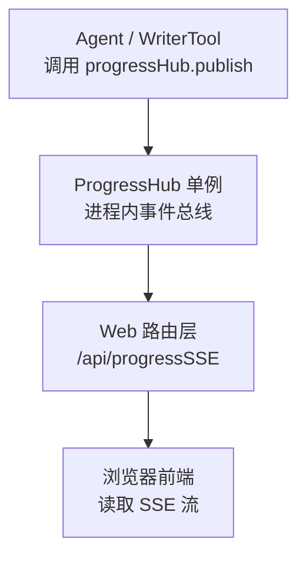
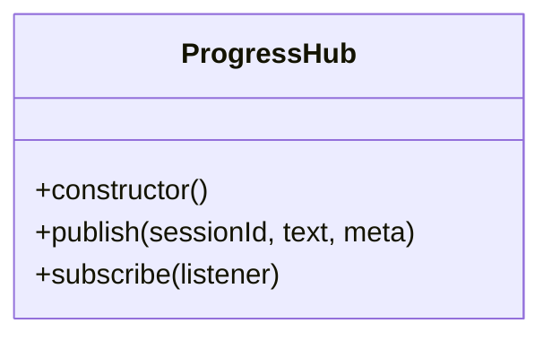
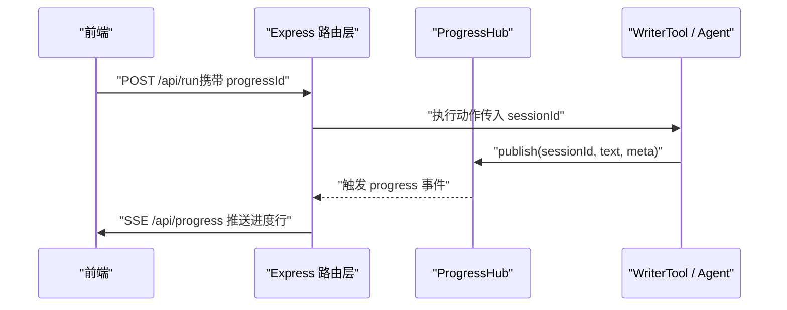
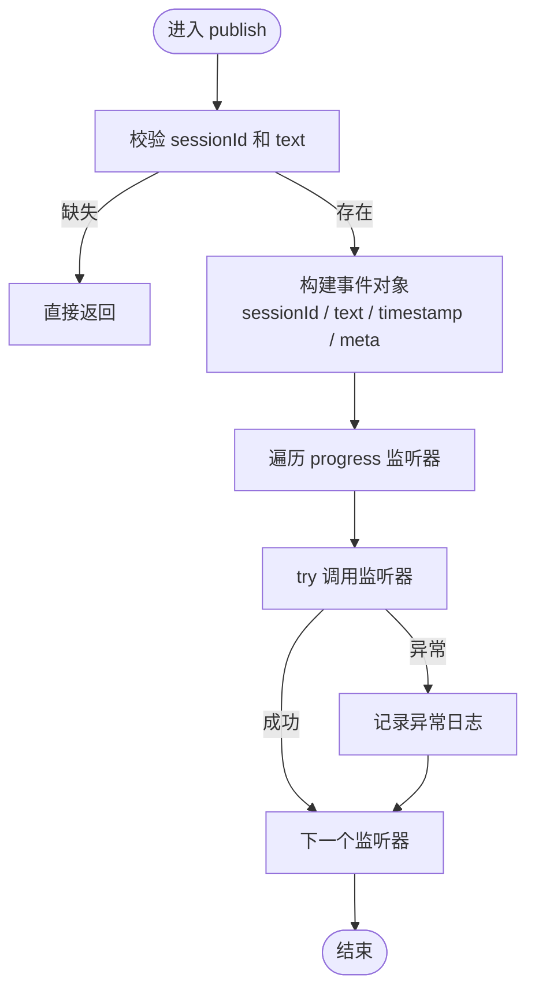
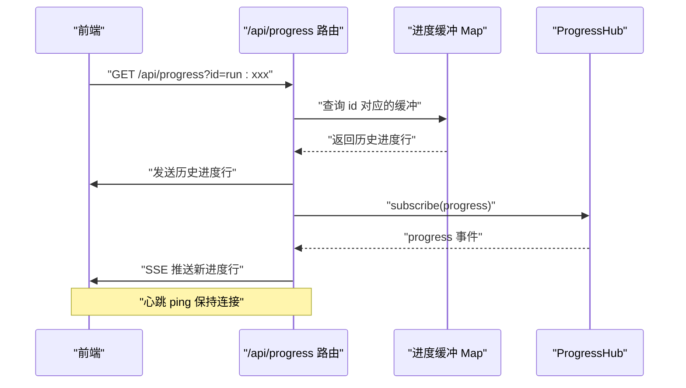
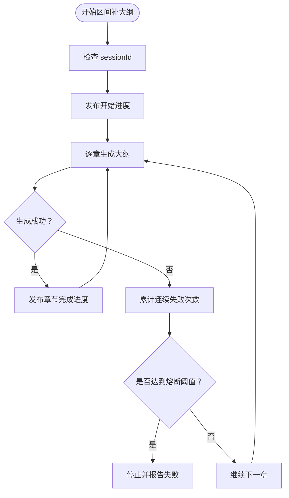
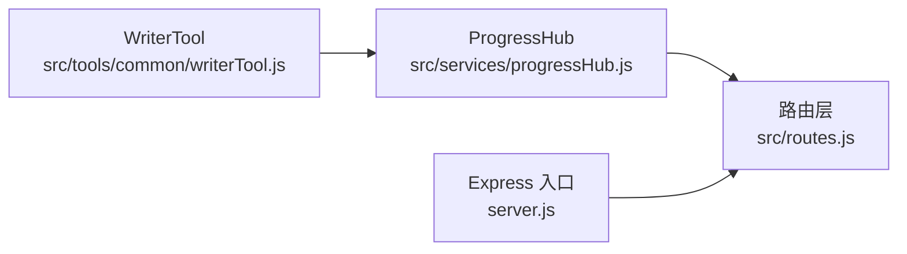

# 进度跟踪服务

<cite>
**本文引用的文件**   
- [progressHub.js](file://src/services/progressHub.js)
- [routes.js](file://src/routes.js)
- [writerTool.js](file://src/tools/common/writerTool.js)
- [server.js](file://server.js)
</cite>

## 目录
1. [引言](#引言)
2. [项目结构中的位置](#项目结构中的位置)
3. [核心组件：ProgressHub 单例](#核心组件progresshub-单例)
4. [架构总览](#架构总览)
5. [详细组件分析](#详细组件分析)
6. [依赖关系分析](#依赖关系分析)
7. [性能与可靠性特性](#性能与可靠性特性)
8. [使用示例](#使用示例)
9. [故障排查指南](#故障排查指南)
10. [结论](#结论)

## 引言
本文件面向“进度跟踪服务”，重点解释 `ProgressHub` 单例类的设计模式、事件总线机制、长任务监控、实时进度推送能力，以及它与 Web 服务器和 Agent 执行链路的协作方式。文档同时说明 `publish` 方法的参数格式（`sessionId`、`text`、`meta`）、`subscribe` 方法的使用方式、异常隔离机制，并给出在 Agent 执行链路中发布进度事件、在 Web 服务器中订阅并转发事件的完整流程。

需要特别说明的是：当前仓库中 Web 层通过 **SSE（Server-Sent Events）** 暴露 `/api/progress` 接口进行进度推送，而不是 socket.io；前端应基于 SSE 接收 `chat:progress` 语义的进度行。

## 项目结构中的位置
进度跟踪服务位于 `src/services/progressHub.js`，由以下模块共同构成端到端链路：

**图表来源**
- [progressHub.js:1-59](file://src/services/progressHub.js#L1-L59)
- [routes.js:573-627](file://src/routes.js#L573-L627)
- [writerTool.js:531-601](file://src/tools/common/writerTool.js#L531-L601)

**章节来源**
- [progressHub.js:1-59](file://src/services/progressHub.js#L1-L59)
- [routes.js:573-627](file://src/routes.js#L573-L627)
- [writerTool.js:531-601](file://src/tools/common/writerTool.js#L531-L601)

## 核心组件：ProgressHub 单例
`ProgressHub` 是一个基于 Node.js `EventEmitter` 的轻量级进程内事件总线，作为全局单例导出，供 Agent 侧发布进度、Web 侧订阅并转发给前端。

### 设计要点
- **单例模式**：模块末尾直接 `new ProgressHub()` 并导出，保证整个进程只有一个实例。
- **纯事件转发**：不持有业务状态，只负责把进度事件广播给已注册的监听器。
- **异常隔离**：逐个调用订阅者时包裹 `try/catch`，单个订阅者抛错不会影响其他订阅者和主执行链路。
- **最大监听数限制**：构造函数中设置最大监听器数量，避免无界注册导致内存或性能问题。
- **CLI 友好**：如果没有 Web 订阅方，发布只是空操作，不会产生副作用。

### 关键行为
- `publish(sessionId, text, meta = {})`：校验必要字段后构造标准事件对象，包含 `sessionId`、`text`、`timestamp` 以及合并后的 `meta`，然后触发 `progress` 事件。
- `subscribe(listener)`：注册 `progress` 事件监听器，并返回取消订阅函数，便于生命周期管理。

**图表来源**
- [progressHub.js:16-55](file://src/services/progressHub.js#L16-L55)

**章节来源**
- [progressHub.js:1-59](file://src/services/progressHub.js#L1-L59)

## 架构总览
整体数据流如下：

**图表来源**
- [routes.js:914-973](file://src/routes.js#L914-L973)
- [routes.js:573-627](file://src/routes.js#L573-L627)
- [writerTool.js:531-601](file://src/tools/common/writerTool.js#L531-L601)
- [progressHub.js:28-55](file://src/services/progressHub.js#L28-L55)

## 详细组件分析

### ProgressHub 实现原理
`ProgressHub` 继承自 `EventEmitter`，核心逻辑集中在两个方法上：

#### publish 方法
- 参数：
  - `sessionId`：会话标识，通常对应 socket 房间名或 SSE 任务 ID，例如 `run:` 前缀的任务 ID。
  - `text`：用户可见的进度描述文本。
  - `meta`：可选附加元数据，如阶段、Agent 名称、工具名称等。
- 行为：
  - 若缺少 `sessionId` 或 `text`，直接返回，不做任何处理。
  - 构造标准事件对象，包含 `sessionId`、`text`、`timestamp`，并展开 `meta`。
  - 遍历所有 `progress` 监听器，逐个调用并捕获异常，确保订阅方错误不会污染主执行链路。

**图表来源**
- [progressHub.js:28-45](file://src/services/progressHub.js#L28-L45)

#### subscribe 方法
- 注册 `progress` 事件监听器。
- 返回一个取消订阅函数，用于移除监听器，适合在请求结束或连接关闭时清理资源。

**章节来源**
- [progressHub.js:28-55](file://src/services/progressHub.js#L28-L55)

### Web 服务器中的进度订阅与 SSE 转发
Web 路由层在启动时订阅 `progressHub` 的 `progress` 事件，并将匹配的事件写入缓冲，再通过 `/api/progress` 以 SSE 形式推送到前端。

#### 进度缓冲机制
由于 `/api/run` 和 `/api/progress` 是两个独立请求，可能出现“先发布、后订阅”的竞态。为此，路由层维护了一个按 `progressId` 分组的缓冲表：
- 键：`progressId`，形如 `run:` 前缀的任务 ID。
- 值：包含最近进度行的数组和时间戳。
- 容量控制：每个任务最多保留固定行数，超过则丢弃最早行。
- 过期清理：定时清理长时间未更新的缓冲项。

#### SSE 接口 `/api/progress`
- 校验 `id` 参数是否符合 `run:` 前缀加合法长度范围。
- 设置 SSE 响应头，包括 `Content-Type: text/event-stream`、`Cache-Control: no-cache`、`Connection: keep-alive`，并在 nginx 场景下禁用缓冲。
- 首次连接时先补发缓冲中的历史进度行，再订阅实时事件。
- 定期发送心跳 ping，保持连接活跃。
- 客户端断开时清理定时器、取消订阅。

**图表来源**
- [routes.js:573-627](file://src/routes.js#L573-L627)

**章节来源**
- [routes.js:573-627](file://src/routes.js#L573-L627)

### Agent 执行链路中的进度发布
Agent 侧通过 `WriterTool` 在执行长任务时调用 `progressHub.publish`，将阶段性进度推送给 Web 层。

#### 典型场景：区间补大纲
当执行“为某章节区间补写大纲”的动作时：
1. 解析目标章节区间。
2. 如果存在 `sessionId`，发布开始提示。
3. 逐章调用模型生成大纲。
4. 每章成功后发布完成提示。
5. 连续失败达到阈值时停止并报告熔断。
6. 自由扩展新增章节后统一落库。

**图表来源**
- [writerTool.js:531-601](file://src/tools/common/writerTool.js#L531-L601)

**章节来源**
- [writerTool.js:531-601](file://src/tools/common/writerTool.js#L531-L601)

## 依赖关系分析

**图表来源**
- [progressHub.js:1-59](file://src/services/progressHub.js#L1-L59)
- [routes.js:1-30](file://src/routes.js#L1-L30)
- [writerTool.js:1-20](file://src/tools/common/writerTool.js#L1-L20)
- [server.js:1-20](file://server.js#L1-L20)

**章节来源**
- [progressHub.js:1-59](file://src/services/progressHub.js#L1-L59)
- [routes.js:1-30](file://src/routes.js#L1-L30)
- [writerTool.js:1-20](file://src/tools/common/writerTool.js#L1-L20)
- [server.js:1-20](file://server.js#L1-L20)

## 性能与可靠性特性
- **异常隔离**：`publish` 对每个订阅者单独 `try/catch`，避免单个订阅者崩溃影响其他订阅者和主流程。
- **最大监听数限制**：通过 `setMaxListeners(50)` 防止无界监听器注册。
- **进度缓冲限流**：每个任务的进度行数量有限制，避免内存无限增长。
- **TTL 清理**：定时清理过期的进度缓冲，降低长期运行时的内存压力。
- **SSE 心跳**：定期发送心跳，帮助前端检测连接状态。
- **Delta 过滤**：路由层跳过高频增量事件（如 `type === 'delta'`），避免刷屏。

[本节为通用性能讨论，不直接分析具体代码片段]

## 使用示例

### 在 Agent 执行链路中发布进度事件
Agent 侧应在长任务的关键阶段调用 `progressHub.publish`，示例场景包括：
- 开始处理某个章节区间。
- 每章生成完成后更新进度。
- 遇到连续失败时报告熔断。
- 自由扩展章节后通知最终结果。

参考路径：
- [writerTool.js:531-601](file://src/tools/common/writerTool.js#L531-L601)

### 在 Web 服务器中订阅并转发事件
Web 层在启动时订阅 `progressHub`，并通过 `/api/progress` 暴露 SSE 接口：
- 校验 `id` 参数。
- 设置 SSE 响应头。
- 补发历史进度。
- 订阅实时事件。
- 发送心跳。
- 清理资源。

参考路径：
- [routes.js:573-627](file://src/routes.js#L573-L627)

### 前端接收与处理逻辑
前端应：
1. 发起 `/api/run` 时携带 `progressId`（形如 `run:xxx`）。
2. 建立到 `/api/progress?id=run:xxx` 的 SSE 连接。
3. 解析 `data` 字段中的进度行。
4. 更新 UI 显示当前正在做什么。
5. 连接关闭时清理状态。

注意：当前实现使用 SSE，而非 socket.io。前端不应依赖 socket.io 的 `chat:progress` 事件，而应基于 SSE 的 `data` 字段处理进度。

[本节为概念性使用指导，不直接引用具体代码内容]

## 故障排查指南
- **进度丢失**：检查 `/api/run` 和 `/api/progress` 的请求顺序，确认 `progressId` 一致。
- **订阅者异常**：查看控制台日志中的 `[ProgressHub] 订阅方异常已隔离` 消息。
- **SSE 连接中断**：检查心跳是否正常，确认网络代理未缓冲响应。
- **进度刷屏**：确认是否误传高频 delta 事件，路由层会过滤 `type === 'delta'` 的事件。
- **内存增长**：检查是否有未清理的 SSE 连接或订阅者。

**章节来源**
- [progressHub.js:36-44](file://src/services/progressHub.js#L36-L44)
- [routes.js:573-627](file://src/routes.js#L573-L627)

## 结论
`ProgressHub` 提供了一个简单可靠的进程内事件总线，使 Agent 能够在长任务执行过程中发布进度，Web 层能够订阅并转发给前端。其设计强调异常隔离、资源控制和可观测性，适合在 Node.js 单进程环境中使用。虽然当前实现使用 SSE 而非 socket.io，但其事件驱动模式和参数约定仍可作为未来扩展到其他实时通信方案的基础。

[本节为总结性内容，不直接分析具体代码文件]