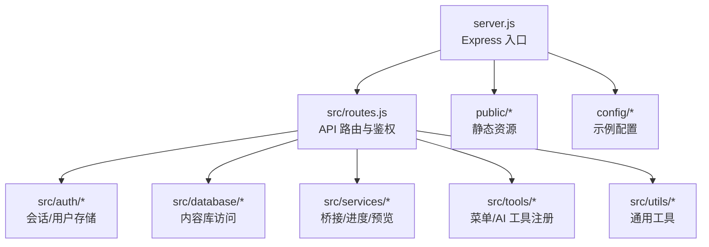
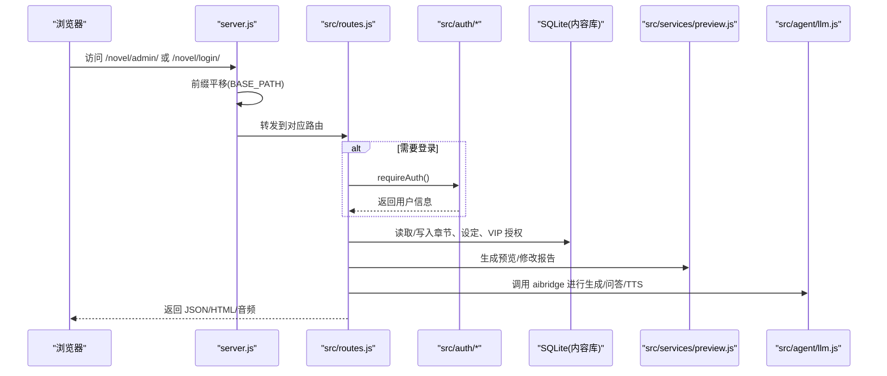
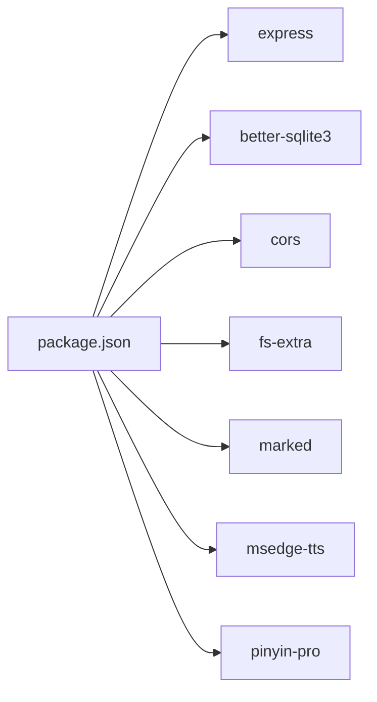

# 开发指南

<cite>
**本文引用的文件**   
- [README.md](file://README.md)
- [package.json](file://package.json)
- [.env.example](file://.env.example)
- [server.js](file://server.js)
- [src/base.js](file://src/base.js)
- [src/routes.js](file://src/routes.js)
- [config/users.json.example](file://config/users.json.example)
- [config/writer.json](file://config/writer.json)
</cite>

## 目录
1. [简介](#简介)
2. [项目结构](#项目结构)
3. [核心组件](#核心组件)
4. [架构总览](#架构总览)
5. [详细组件分析](#详细组件分析)
6. [依赖分析](#依赖分析)
7. [性能与可观测性](#性能与可观测性)
8. [测试策略](#测试策略)
9. [代码规范](#代码规范)
10. [贡献流程](#贡献流程)
11. [故障排查](#故障排查)
12. [结论](#结论)

## 简介
本指南面向新加入的开发者，目标是帮助你在最短时间内完成环境搭建、理解系统架构、掌握调试技巧，并遵循统一的编码与提交规范。本项目是一个“阅读 + 管理 + 学习”一体化的 AI 小说平台，后端基于 Node.js + Express，数据库使用 SQLite，前端包含管理后台与阅读器资源；iOS 端为独立 Swift 应用，通过 API 与后端交互。

## 项目结构
仓库采用“按职责分层 + 少量功能域”的组织方式：
- server.js：Express 服务入口，负责静态资源挂载、前缀平移、会话与桥接初始化。
- src：服务端业务逻辑，包括路由、鉴权、数据访问、工具注册、发布与预览等。
- public：静态页面与资源（登录页、管理页、阅读器资源、已发布书页）。
- config：示例配置（用户播种、Writer 行为开关）。
- ios：Swift iOS 客户端工程。
- scripts：辅助脚本（如修复引用、裁剪回填产物等）。

图表来源
- [server.js:1-64](file://server.js#L1-L64)
- [src/routes.js:1-800](file://src/routes.js#L1-L800)

章节来源
- [README.md:166-202](file://README.md#L166-L202)
- [server.js:1-64](file://server.js#L1-L64)

## 核心组件
- 服务入口与静态资源：Express 应用启动、CORS、JSON 解析、BASE_PATH 前缀平移、静态目录挂载。
- 路由与鉴权：统一 /api 净化输出、登录/登出/当前用户、VIP 闸门、读者 AI 接口、TTS、长任务 SSE 进度、小说 CRUD、章节列表/正文、设定读写、发布与预览。
- 多用户与会话：global.db 维护用户、小说登记、VIP 授权；会话 Cookie 带 BASE_PATH 作用域。
- 推理服务桥接：aibridge Key 管理与切换、链路探测、图片代理。
- 字数治理与发布：目标字数区间、拆章/扩写/压缩、预览站与修改报告、本地发布。

章节来源
- [server.js:1-64](file://server.js#L1-L64)
- [src/routes.js:1-800](file://src/routes.js#L1-L800)
- [src/base.js:1-42](file://src/base.js#L1-L42)

## 架构总览
下图展示请求从浏览器到服务端主要路径，以及关键子系统之间的协作关系。

图表来源
- [server.js:25-53](file://server.js#L25-L53)
- [src/routes.js:331-350](file://src/routes.js#L331-L350)
- [src/base.js:17-39](file://src/base.js#L17-L39)

## 详细组件分析

### 开发环境搭建
- Node.js 版本要求：项目声明 type=module，需支持 ES 模块语法；建议使用较新的 LTS 版本。
- 安装依赖：执行 npm install。
- 环境变量：复制 .env.example 为 .env，填写 aibridge 地址与密钥、会话密钥、可选的 BASE_PATH。
- 初始超管账号：将 config/users.json.example 作为 config/users.json，首次启动会播种。
- 启动服务：npm start；开发热重载可用 npm dev。
- 默认端口：3400；默认挂载前缀：/novel。

章节来源
- [package.json:1-29](file://package.json#L1-L29)
- [.env.example:1-10](file://.env.example#L1-L10)
- [config/users.json.example:1-4](file://config/users.json.example#L1-L4)
- [README.md:155-164](file://README.md#L155-L164)

### 本地运行与调试
- 启动后控制台会打印：
  - 站点地址、挂载前缀、登录/管理/阅读入口。
  - 已播种账号数与存量迁移的小说数量。
  - 当前使用的桥接地址与上游模型来源。
- 常见端口冲突：可使用 kill-port.sh 清理占用端口后再启动。
- 前缀问题：若线上由 nginx 原样转发 /novel，则 BASE_PATH 必须为 /novel 或空串；否则启动即报错。

章节来源
- [server.js:55-63](file://server.js#L55-L63)
- [src/base.js:17-28](file://src/base.js#L17-L28)

### 代码规范

#### JavaScript 编码规范
- 模块格式：ESM（type=module），统一使用 import/export。
- 命名风格：变量与函数使用小驼峰；常量使用大写加下划线；类名使用大驼峰。
- 错误处理：对外接口统一返回结构化 JSON，避免泄露敏感字段；对路径、参数做严格校验。
- 安全：输出净化（scrubValue）过滤绝对路径、IP、URL、密码等；删除操作强制二次确认。
- 日志与可观测性：长任务通过 SSE 推送进度；关键状态在启动时打印。

章节来源
- [src/routes.js:67-95](file://src/routes.js#L67-L95)
- [src/routes.js:45-53](file://src/routes.js#L45-L53)
- [src/routes.js:573-627](file://src/routes.js#L573-L627)

#### Swift 编码规范（iOS 客户端）
- 视图组织：以 SwiftUI 为主，按功能域划分目录（App/Auth/Manage/Reader/Networking 等）。
- 网络层：集中定义 Endpoints 与 APIError，统一错误处理。
- 安全：KeychainStore 用于敏感信息存储。
- 配置：AppConfig 统一管理应用配置项。
- 建议：新增功能优先复用现有 ViewModel 模式，保持 MVVM 结构清晰。

章节来源
- [ios/AINovel/Networking/Endpoints.swift](file://ios/AINovel/Networking/Endpoints.swift)
- [ios/AINovel/Networking/APIError.swift](file://ios/AINovel/Networking/APIError.swift)
- [ios/AINovel/Security/KeychainStore.swift](file://ios/AINovel/Security/KeychainStore.swift)
- [ios/AINovel/Config/AppConfig.swift](file://ios/AINovel/Config/AppConfig.swift)

#### Git 提交规范
- 分支策略：
  - main：稳定分支，仅合并已通过审查的版本。
  - develop：集成开发分支。
  - feature/*：新功能分支。
  - fix/*：缺陷修复分支。
  - release/*：预发布分支。
- 提交信息：
  - 类型：feat/fix/docs/style/refactor/test/chore。
  - 范围：模块或功能域（如 routes、reader、bridge）。
  - 描述：简洁说明变更目的与影响面。
- 提交前检查：
  - 确保 .env 未入库。
  - 确认无敏感信息泄露（路径、密钥、IP）。
  - 长任务相关改动需验证 SSE 进度与互斥锁。

[本节为概念性规范，不直接分析具体文件]

### 测试策略
- 单元测试：
  - 针对工具函数（如文本差异、拼音、词汇存储）编写单测，覆盖边界条件与异常输入。
  - 建议对字数治理算法（effectiveBand/bandText）增加断言，确保目标区间计算一致。
- 集成测试：
  - 对 /api/novels、/api/novels/:id/chapters、/api/novels/:id/settings 等核心接口进行端到端校验。
  - 验证 VIP 授权、会话鉴权、删除二次确认、限流与 429 响应。
- E2E 测试：
  - 使用 Playwright/Cypress 模拟管理员创建小说、生成大纲、预览、发布的完整流程。
  - 模拟读者侧学习模式：生词讲解、章节测试、TTS 播放。
- 回归与自检：
  - 利用 README 中提到的自检脚本（如 word-check.mjs、verify-split.mjs）在 CI 中执行。
  - 发布后核对磁盘产物（index.html、chapter_*.html）与章节数一致性。

[本节为概念性策略，不直接分析具体文件]

### 贡献流程
- 分支管理：
  - 从 develop 拉取 feature/* 分支开发。
  - 完成后发起 Pull Request 至 develop，需至少一名 reviewer 批准。
- 代码审查：
  - 关注安全（路径穿越、鉴权、输出净化）、性能（内存占用、超时）、可观测性（日志、进度）。
  - 对长任务相关改动，需验证并发互斥与 SSE 进度补发。
- 发布流程：
  - 合并至 main 后打 tag，构建 iOS 包与 Web 静态资源。
  - 部署前执行自检脚本，确认数据库与磁盘产物一致。
  - 灰度发布，观察 LLM 链路状态与 TTS 合成成功率。

[本节为概念性流程，不直接分析具体文件]

### 开发工具与调试技巧
- 端口管理：kill-port.sh 快速释放 3400 端口。
- 环境变量：.env 中配置 AIBRIDGE_URL、AIBRIDGE_API_KEY、SESSION_SECRET、BASE_PATH。
- 调试建议：
  - 查看启动日志中的 LLM 链路来源与上游模型。
  - 使用浏览器 Network 面板检查 SSE 进度事件。
  - 对 VIP 权限问题，先确认 global.db 中 vip_grant 是否生效。
  - 对 TTS 失败，检查音色白名单与语速参数是否在允许集合内。

章节来源
- [kill-port.sh](file://kill-port.sh)
- [.env.example:1-10](file://.env.example#L1-L10)
- [server.js:55-63](file://server.js#L55-L63)
- [src/routes.js:430-513](file://src/routes.js#L430-L513)

## 依赖分析
项目依赖集中在 package.json 中，核心依赖如下：
- better-sqlite3：SQLite 数据库访问。
- express：Web 框架。
- cors：跨域支持。
- fs-extra：文件系统增强。
- marked：Markdown 渲染。
- msedge-tts：微软边缘 TTS。
- pinyin-pro：拼音转换。

图表来源
- [package.json:19-27](file://package.json#L19-L27)

章节来源
- [package.json:1-29](file://package.json#L1-L29)

## 性能与可观测性
- 限流：读者 AI 接口与 TTS 接口分别设置不同限流阈值，防止批量请求压垮服务。
- 长任务：按书互斥，避免并发生成导致正文与章号错乱；SSE 提供逐章进度反馈。
- 超时：LLM 调用根据目标字数动态计算超时预算，避免上游硬切 502。
- 缓存：生词讲解与测试题按内容哈希缓存，减少重复 LLM 调用。
- 可观测性：启动日志打印桥接地址与上游模型；SSE 心跳保活。

章节来源
- [src/routes.js:289-306](file://src/routes.js#L289-L306)
- [src/routes.js:573-627](file://src/routes.js#L573-L627)
- [src/routes.js:629-637](file://src/routes.js#L629-L637)

## 测试策略
- 单元与集成测试：
  - 对 routes.js 中的核心接口（novels、chapters、settings、publish）编写用例。
  - 验证 VIP 授权、会话鉴权、删除二次确认、限流与 429。
- E2E 测试：
  - 模拟管理员全流程：创建小说 → 生成大纲 → 预览 → 发布。
  - 模拟读者侧：学习模式开启 → 生词讲解 → 章节测试 → TTS 播放。
- 回归自检：
  - 使用 README 中提到的自检脚本（word-check.mjs、verify-split.mjs）在 CI 中执行。
  - 发布后核对磁盘产物与章节数一致性。

[本节为概念性策略，不直接分析具体文件]

## 代码规范
- JavaScript：
  - ESM 模块，统一 import/export。
  - 严格参数校验与路径安全（decodeSeg、resolveChapterFile）。
  - 输出净化（scrubValue）避免敏感信息泄露。
- Swift：
  - MVVM 架构，ViewModel 与 View 分离。
  - 网络层集中管理 Endpoints 与错误处理。
  - 安全存储使用 KeychainStore。
- Git：
  - 分支命名规范（feature/*、fix/*、release/*）。
  - 提交信息遵循 Conventional Commits。
  - PR 审查关注安全、性能、可观测性。

章节来源
- [src/routes.js:313-329](file://src/routes.js#L313-L329)
- [src/routes.js:67-95](file://src/routes.js#L67-L95)
- [ios/AINovel/Networking/Endpoints.swift](file://ios/AINovel/Networking/Endpoints.swift)
- [ios/AINovel/Security/KeychainStore.swift](file://ios/AINovel/Security/KeychainStore.swift)

## 贡献流程
- 分支管理：
  - 从 develop 拉取 feature/* 分支。
  - 完成后发起 PR 至 develop，需至少一名 reviewer 批准。
- 代码审查：
  - 关注安全（路径穿越、鉴权、输出净化）、性能（内存占用、超时）、可观测性（日志、进度）。
  - 对长任务相关改动，需验证并发互斥与 SSE 进度补发。
- 发布流程：
  - 合并至 main 后打 tag，构建 iOS 包与 Web 静态资源。
  - 部署前执行自检脚本，确认数据库与磁盘产物一致。
  - 灰度发布，观察 LLM 链路状态与 TTS 合成成功率。

[本节为概念性流程，不直接分析具体文件]

## 故障排查
- 端口占用：使用 kill-port.sh 清理 3400 端口。
- 前缀错误：BASE_PATH 只能为空或 /novel，否则启动报错。
- LLM 不可用：检查 .env 中 AIBRIDGE_URL 与 AIBRIDGE_API_KEY；查看启动日志中的链路来源。
- VIP 无法访问：确认 global.db 中 vip_grant 是否生效；读者登录后实时校验。
- TTS 失败：检查音色与语速是否在白名单内；查看合成失败的具体原因。
- 发布不一致：核对磁盘产物（index.html、chapter_*.html）与章节数；使用 verify-publish.mjs 逐项核对。

章节来源
- [kill-port.sh](file://kill-port.sh)
- [src/base.js:17-28](file://src/base.js#L17-L28)
- [server.js:55-63](file://server.js#L55-L63)
- [src/routes.js:430-513](file://src/routes.js#L430-L513)
- [README.md:41-42](file://README.md#L41-L42)

## 结论
本指南提供了从环境搭建到代码规范、测试策略、贡献流程的全面说明。开发者应重点关注安全（路径穿越、鉴权、输出净化）、性能（限流、超时、缓存）与可观测性（日志、SSE 进度）。通过遵循统一的编码与提交规范，结合自动化测试与自检脚本，可显著提升项目的稳定性与可维护性。