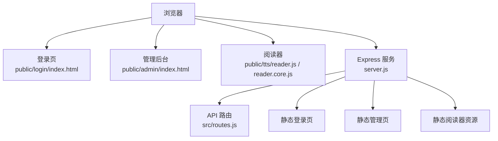
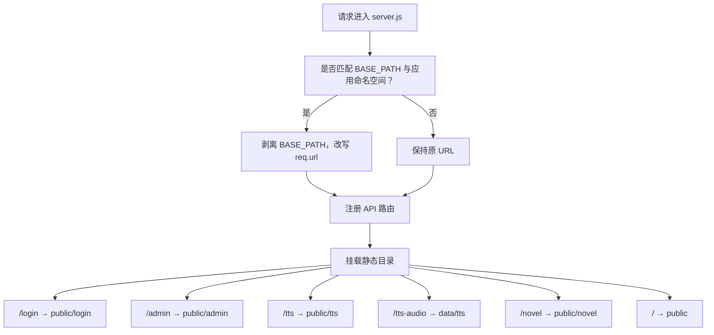
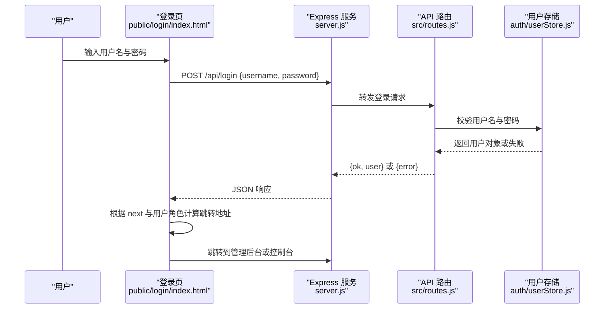
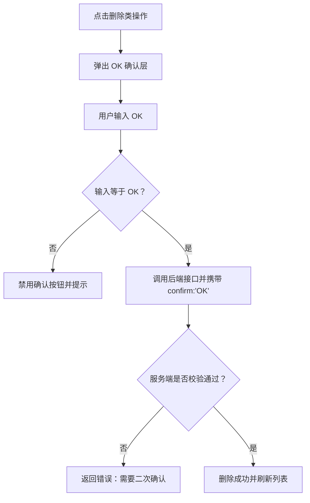
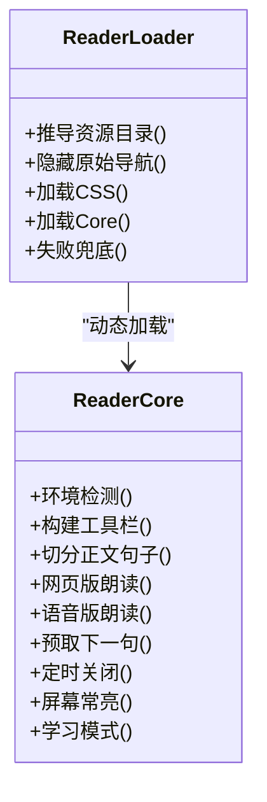
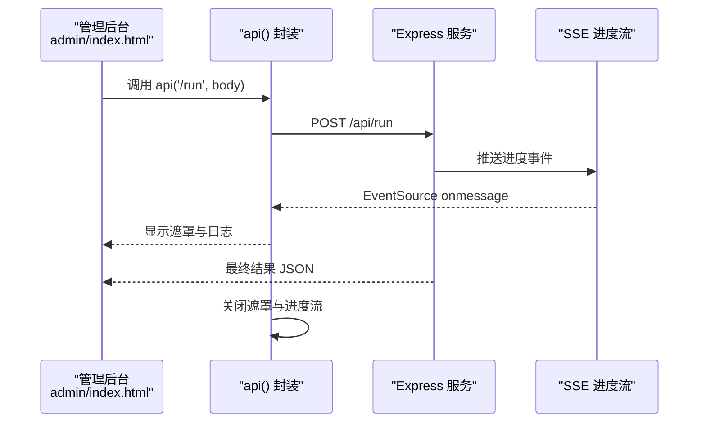
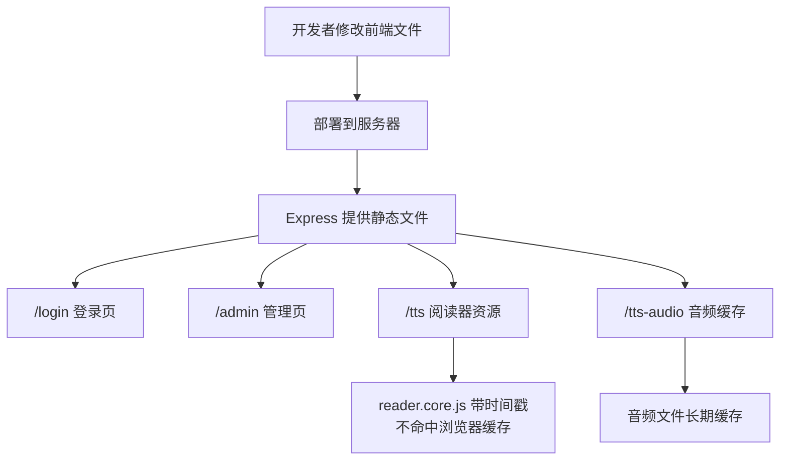

# Web 前端结构

<cite>
**本文引用的文件**   
- [server.js](file://server.js)
- [package.json](file://package.json)
- [routes.js](file://src/routes.js)
- [login/index.html](file://public/login/index.html)
- [admin/index.html](file://public/admin/index.html)
- [tts/reader.js](file://public/tts/reader.js)
- [tts/reader.core.js](file://public/tts/reader.core.js)
</cite>

## 目录
1. [引言](#引言)
2. [项目结构与静态资源组织](#项目结构与静态资源组织)
3. [核心页面与职责划分](#核心页面与职责划分)
4. [登录认证流程](#登录认证流程)
5. [管理后台布局与交互](#管理后台布局与交互)
6. [TTS 阅读器模块化设计](#tts-阅读器模块化设计)
7. [前后端通信机制](#前后端通信机制)
8. [错误处理与状态同步](#错误处理与状态同步)
9. [构建、部署与静态资源优化](#构建部署与静态资源优化)
10. [常见问题排查](#常见问题排查)
11. [结论](#结论)

## 引言
AINovel Web 前端以“多页 HTML + 内联样式 + 轻量 JavaScript”的方式组织，配合 Node.js Express 后端提供登录鉴权、小说管理、阅读器和发布预览等能力。前端没有使用现代打包框架，而是通过服务器挂载多个静态路径，把登录页、管理后台和 TTS 阅读器作为独立入口暴露给浏览器；同时由 `server.js` 统一做前缀平移、会话初始化、API 路由注册与静态资源托管。

从架构角度看，Web 前端可划分为三类：
- 登录页：负责用户身份输入、调用 `/api/login`、根据角色跳转到管理后台或控制台。
- 管理后台：负责小说创建、设定、章节增删改、大纲生成、正文生成、预览与发布等创作与管理操作。
- TTS 阅读器：负责章节朗读、学习模式、词汇讲解、章节测试、AI 问答、音频预取与播放控制。

**图表来源**
- [server.js:25-53](file://server.js#L25-L53)
- [routes.js:331-350](file://src/routes.js#L331-L350)

**章节来源**
- [server.js:1-64](file://server.js#L1-L64)
- [package.json:1-29](file://package.json#L1-L29)

## 项目结构与静态资源组织
仓库的 Web 前端主要位于 `public` 目录，按功能域拆分为：
- `public/login`：登录页。
- `public/admin`：管理后台页面，包括小说管理、控制台、预览报告。
- `public/tts`：阅读器加载器、核心逻辑与样式。
- `public` 根目录：站点首页与通用入口。

服务端在 `server.js` 中通过 `express.static` 分别挂载这些目录，并对外暴露以下路径：
- `/login`：登录页。
- `/tts`：阅读器 JS/CSS。
- `/tts-audio`：服务端合成的 TTS 音频，长期缓存。
- `/admin`：管理后台 HTML。
- `/novel`：已发布的读者站产物。
- `/`：默认静态目录，用于首页和其他公开资源。

此外，`server.js` 还做了“前缀平移”：当应用挂在 `BASE_PATH`（例如 `/novel`）下时，会把请求中的前缀剥掉，让内部路由可以继续使用根级路径；但书页路径 `/novel/<uid>/<书名>/...` 不参与平移，避免产生双前缀。

**图表来源**
- [server.js:25-53](file://server.js#L25-L53)

**章节来源**
- [server.js:1-64](file://server.js#L1-L64)

## 核心页面与职责划分
### 登录页
登录页是一个单文件 HTML，包含表单、基础样式和一段内联脚本。它的主要职责是：
- 读取当前页面所在路径，反推站点前缀 `BASE`，保证无论站点挂在 `/novel` 还是根路径，接口调用和跳转都正确。
- 校验用户名和密码非空。
- 调用 `/api/login` 提交登录。
- 登录成功后根据返回的用户信息决定跳转目标：优先走 `next` 参数，否则超管进控制台，普通管理员进管理后台。
- 页面加载时先检查是否已有会话，有则直接跳转。

### 管理后台
管理后台由 `public/admin/index.html` 承载，是一个大型单页应用式 HTML，包含：
- 顶部导航：当前用户、控制台入口、退出按钮。
- 小说选择区：下拉列表、刷新、新建、AI 链路状态灯。
- 两个主标签：“流程管理”和“菜单 + AI”。
- “流程管理”包含小说设定、VIP 设置、大纲生成、加章补大纲、章节列表、预览、发布、分享、删除等。
- 底部命令栏和结果区域，以及长任务遮罩、OK 二次确认弹层。

该页面通过统一的 `api()` 封装发起所有后端请求，并集中处理：
- 401 自动跳回登录。
- 长任务遮罩与计时。
- SSE 进度推送。
- 删除类操作的 OK 二次确认。
- 章节编辑弹层、翻章动画、未保存提示。

### TTS 阅读器
TTS 阅读器采用“稳定加载器 + 动态核心”的两层结构：
- `reader.js`：稳定入口，负责推导资源目录、注入 CSS、带时间戳加载 `reader.core.js`，并在 core 未就绪前隐藏原始章节导航，避免闪烁。
- `reader.core.js`：阅读器核心逻辑，负责工具栏、朗读引擎、章节面板、学习模式、词汇讲解、章节测试、AI 问答、定时关闭、屏幕常亮、Media Session 等。

这种设计让历史已发布章节页不需要重新发布，只要更新 `reader.core.js` 和 `reader.css` 即可生效。

**章节来源**
- [login/index.html:1-69](file://public/login/index.html#L1-L69)
- [admin/index.html:1-800](file://public/admin/index.html#L1-L800)
- [tts/reader.js:1-47](file://public/tts/reader.js#L1-L47)
- [tts/reader.core.js:1-800](file://public/tts/reader.core.js#L1-L800)

## 登录认证流程
登录流程从前端的登录页开始，到后端的会话 Cookie 结束。

**图表来源**
- [login/index.html:35-65](file://public/login/index.html#L35-L65)
- [routes.js:341-350](file://src/routes.js#L341-L350)

关键行为说明：
- 登录页通过 `location.pathname.replace(/\/login(\/.*)?$/, '')` 反推 `BASE`，因此即使站点挂在 `/novel`，也能正确访问 `/api/login` 和 `/api/me`。
- 登录后去向优先解析 `next` 参数，只允许站内 `/novel/` 或 `/admin/` 开头的路径，防止开放重定向。
- 超管登录后默认进入控制台，普通管理员进入管理后台。
- 后端 `/api/login` 成功时设置会话 Cookie，失败时返回 401 与错误消息。
- 管理后台启动时会调用 `/api/me`，未登录则强制跳转登录页。

**章节来源**
- [login/index.html:35-65](file://public/login/index.html#L35-L65)
- [routes.js:341-350](file://src/routes.js#L341-L350)
- [admin/index.html:419-440](file://public/admin/index.html#L419-L440)

## 管理后台布局与交互
管理后台不是传统多页系统，而是一个“HTML 壳 + 大量内联脚本”的单页界面。其布局可以分为以下几个层次：

| 区域 | 职责 | 主要元素 |
| --- | --- | --- |
| 顶部栏 | 显示当前用户、角色、控制台入口、退出 | 标题、用户名、控制台按钮、退出按钮 |
| 小说选择区 | 选择当前小说、新建、刷新、检测 AI 链路 | 下拉框、刷新按钮、新建按钮、AI 链路状态灯 |
| 标签区 | 切换“流程管理”和“菜单 + AI” | 两个 tab 按钮 |
| 流程管理面板 | 小说设定、VIP、大纲生成、加章、章节列表、预览、发布 | 表单、按钮、章节列表、分页条 |
| 菜单 + AI 面板 | 动态渲染菜单项与 AI 工具 | 按钮容器 |
| 底部命令栏 | 自然语言操作入口 | 输入框、发送按钮 |
| 结果区 | 显示操作结果、错误、成功提示 | 结果文本区域 |
| 遮罩层 | 长任务反馈、OK 二次确认 | 忙碌遮罩、OK 确认层 |

### 长任务反馈
管理后台对耗时操作使用统一的遮罩机制：
- 快于 600ms 的请求不显示遮罩。
- 慢请求显示转圈、已用秒数和日志区域。
- 支持服务端逐章进度推送，通过 EventSource 连接 `/api/progress?id=run:...`。
- 同一本书的生成类任务在服务端互斥，前端通过遮罩与后端 409 共同防止重复提交。

### 删除二次确认
删除整本小说、删除章节、区间删除等操作需要用户在弹层中输入 `OK`。前端对输入进行规范化（全角、空格、大小写），但传给服务端的始终是常量 `OK`；服务端也再次校验，形成双重保护。

**图表来源**
- [admin/index.html:502-537](file://public/admin/index.html#L502-L537)
- [routes.js:45-53](file://src/routes.js#L45-L53)

**章节来源**
- [admin/index.html:1-800](file://public/admin/index.html#L1-L800)
- [routes.js:45-53](file://src/routes.js#L45-L53)

## TTS 阅读器模块化设计
TTS 阅读器的模块边界非常清晰：`reader.js` 是加载器，`reader.core.js` 是核心逻辑，`reader.css` 是样式。

### 加载器职责
`reader.js` 的核心职责是：
- 从自身 `<script>` 标签推导资源目录，兼容站点挂在任意子路径。
- 提前插入一个临时样式，隐藏原始章节导航，避免 core 尚未加载时出现“导航闪一下再消失”的问题。
- 动态加载 `reader.css` 和 `reader.core.js`，并为 core 脚本加上 `?v=Date.now()` 时间戳，确保每次打开章节页都能拿到最新实现。
- 如果 core 加载失败，恢复原始导航，保证离线或资源不可用时用户仍能看到基础内容。

### 核心逻辑职责
`reader.core.js` 负责阅读器运行时能力：
- 环境检测：不支持 Web Speech API 时给出提示。
- 工具栏与面板：朗读面板、章节目录、AI 问答、学习设置、词汇讲解、章节测试。
- 正文切句：按中文标点拆分句子，跳过代码块和标记为 `tts-skip` 的元素。
- 双引擎朗读：网页版使用浏览器 `speechSynthesis`，语音版使用服务端合成 mp3。
- 音频预取：边播边预取下一句，降低跨句延迟。
- 定时关闭：支持 15/30/60 分钟和本章结束时停止。
- 屏幕常亮与息屏省电：结合 Wake Lock 和静音保活音频。
- 学习模式：按年龄挑选生词、高亮标注、点词讲解、章节测试。

**图表来源**
- [tts/reader.js:11-46](file://public/tts/reader.js#L11-L46)
- [tts/reader.core.js:15-185](file://public/tts/reader.core.js#L15-L185)

**章节来源**
- [tts/reader.js:1-47](file://public/tts/reader.js#L1-L47)
- [tts/reader.core.js:1-800](file://public/tts/reader.core.js#L1-L800)

## 前后端通信机制
前端与后端的通信主要通过 `fetch` 调用 REST API，部分长任务通过 SSE 获取进度。

### API 分类
| 类别 | 典型接口 | 用途 |
| --- | --- | --- |
| 认证 | `/api/login`、`/api/logout`、`/api/me` | 登录、登出、查询当前用户 |
| 阅读器公开接口 | `/api/reader/*` | 测试、讲解、生词、问答、反馈，无需登录但有速率限制 |
| TTS 接口 | `/api/tts/sentence`、`/api/tts/explain` | 句子级音频合成、讲解音频合成 |
| 小说管理 | `/api/novels`、`/api/novels/:id/chapters`、`/api/novels/:id/settings` | 小说列表、章节列表、设定读写 |
| 长任务 | `/api/run`、`/api/progress` | 执行生成类动作、SSE 推送进度 |
| 菜单与工具 | `/api/menu`、`/api/tools` | 管理后台动态渲染菜单与 AI 工具 |

### 请求封装
管理后台的 `api()` 函数统一处理：
- 自动拼接 `BASE + '/api' + path`。
- 对 401 自动跳转登录。
- 对非 2xx 响应抛出错误。
- 对慢请求显示遮罩。
- 对长任务附加 `progressId` 并连接 SSE。

**图表来源**
- [admin/index.html:358-379](file://public/admin/index.html#L358-L379)
- [routes.js:573-627](file://src/routes.js#L573-L627)

**章节来源**
- [routes.js:331-350](file://src/routes.js#L331-L350)
- [routes.js:352-428](file://src/routes.js#L352-L428)
- [routes.js:456-513](file://src/routes.js#L456-L513)
- [routes.js:573-627](file://src/routes.js#L573-L627)
- [admin/index.html:358-379](file://public/admin/index.html#L358-L379)

## 错误处理与状态同步
### 前端错误处理
- 登录页：捕获 fetch 异常，显示错误消息，恢复按钮状态。
- 管理后台：`apiRaw` 统一处理 401 跳转和非 2xx 错误；长任务遮罩在 `finally` 中关闭；SSE 连接出错时关闭进度流。
- TTS 阅读器：浏览器不支持语音合成时显示提示；音频播放失败时回落到网页版 TTS；网络请求失败时显示具体原因。

### 后端错误处理
- 认证失败返回 401。
- VIP 无权访问返回专用 HTML 页面。
- 预览链接仅创作者本人可见，未授权返回预览专用提示页。
- TTS 合成失败返回 503，并附带 fallback 建议。
- 删除操作缺少 `confirm:"OK"` 返回 400。
- 限流返回 429，并带 `Retry-After`。

### 状态同步
- 用户状态：通过 `/api/me` 判断登录态，未登录强制跳转。
- 小说状态：切换小说时更新 URL，刷新章节列表与设定。
- 长任务状态：遮罩计数、计时、SSE 进度行。
- TTS 状态：播放/暂停、进度条、语速、音色、定时关闭、连读下一章。

**章节来源**
- [login/index.html:49-65](file://public/login/index.html#L49-L65)
- [admin/index.html:358-379](file://public/admin/index.html#L358-L379)
- [routes.js:212-261](file://src/routes.js#L212-L261)
- [routes.js:289-306](file://src/routes.js#L289-L306)
- [routes.js:456-513](file://src/routes.js#L456-L513)
- [tts/reader.core.js:43-53](file://public/tts/reader.core.js#L43-L53)

## 构建、部署与静态资源优化
### 构建流程
该项目没有复杂的构建步骤，`package.json` 的脚本非常简单：
- `npm start`：运行 `node server.js`。
- `npm dev`：使用 `node --watch server.js` 开发热重载。

这意味着前端资源主要是“直接部署静态文件”，而不是经过 webpack、Vite 等打包工具编译。

### 部署配置
- 默认端口 3400。
- 可通过环境变量 `PORT` 修改端口。
- 可通过 `BASE_PATH` 控制站点前缀，默认 `/novel`。
- 静态资源由 `server.js` 直接挂载，生产环境通常放在 nginx 或反向代理后面。
- 已发布书籍位于 `public/novel`，由发布流程生成。

### 静态资源优化
- 登录页、管理后台、阅读器核心都是静态 HTML/JS/CSS。
- `/tts-audio` 使用 `immutable: true` 和 `maxAge: '1y'`，因为音频文件名带哈希，适合长期缓存。
- `reader.js` 通过 `?v=Date.now()` 加载 `reader.core.js`，避免浏览器缓存旧版本。
- 其他静态资源使用 `max-age=0` 和 ETag，文件变化时 ETag 变化，浏览器会重新拉取。

**图表来源**
- [server.js:47-53](file://server.js#L47-L53)
- [tts/reader.js:19-44](file://public/tts/reader.js#L19-L44)

**章节来源**
- [package.json:1-29](file://package.json#L1-L29)
- [server.js:18-64](file://server.js#L18-L64)
- [tts/reader.js:1-47](file://public/tts/reader.js#L1-L47)

## 常见问题排查
### 登录成功但无法进入管理后台
可能原因：
- 会话 Cookie 未正确设置。
- 管理后台启动时 `/api/me` 返回未登录。
- 站点前缀配置导致接口路径错误。

排查建议：
- 检查浏览器是否收到会话 Cookie。
- 查看 `/api/me` 响应。
- 确认 `BASE_PATH` 与前端反推路径一致。

### 管理后台显示“AI 不通”
可能原因：
- aibridge 服务不可达。
- API Key 未启用或无效。
- 上游模型不可用。

注意：状态灯只探测桥接服务可达性，不代表上游模型一定可用。

### TTS 朗读无声
可能原因：
- 浏览器不支持 Web Speech API。
- 语音版合成失败，自动回落到网页版。
- 移动端浏览器要求手势触发播放。
- 息屏模式下未保活音频会话。

排查建议：
- 检查浏览器控制台是否有语音合成错误。
- 尝试切换到网页版 TTS。
- 手动点击播放按钮触发手势策略。
- 开启屏幕常亮或使用语音版。

### 章节页样式或逻辑未更新
可能原因：
- 浏览器缓存了旧版 `reader.core.js`。
- 服务器未同步最新资源。

解决方式：
- 确认 `reader.js` 能加载带时间戳的 `reader.core.js?v=...`。
- 重新部署 `public/tts` 下的资源。

**章节来源**
- [login/index.html:49-65](file://public/login/index.html#L49-L65)
- [admin/index.html:400-417](file://public/admin/index.html#L400-L417)
- [tts/reader.core.js:43-53](file://public/tts/reader.core.js#L43-L53)
- [tts/reader.core.js:777-796](file://public/tts/reader.core.js#L777-L796)
- [tts/reader.js:19-44](file://public/tts/reader.js#L19-L44)

## 结论
AINovel Web 前端采用简单直接的静态资源组织方式：登录页、管理后台、TTS 阅读器各自独立，通过 Express 静态目录挂载暴露给浏览器。前端没有依赖复杂构建工具，而是依靠清晰的目录划分、稳定的加载器、统一的 API 封装和 SSE 进度通道来维持可维护性。

对于后续扩展，建议继续保持以下原则：
- 新增页面优先放在 `public` 对应目录下，并在 `server.js` 中明确挂载。
- 新增 API 放在 `src/routes.js`，并做好鉴权、租户隔离和错误处理。
- 阅读器相关逻辑尽量放在 `reader.core.js`，并通过 `reader.js` 动态加载，避免影响已发布章节。
- 对敏感数据输出做净化，对删除类操作保留前后端双重确认。
- 对长任务提供遮罩与进度反馈，避免用户重复提交。