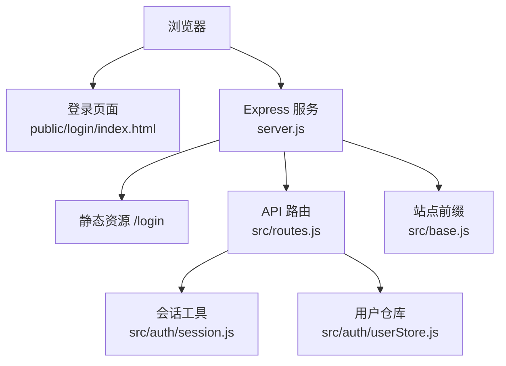
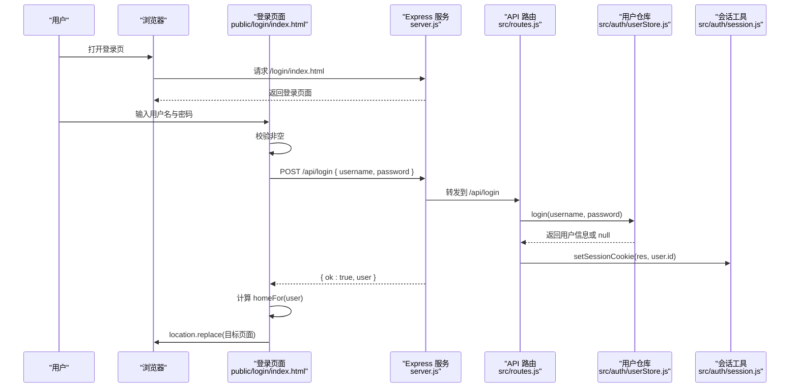
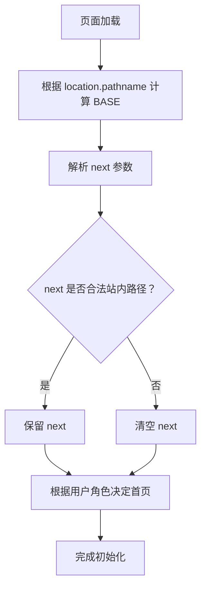
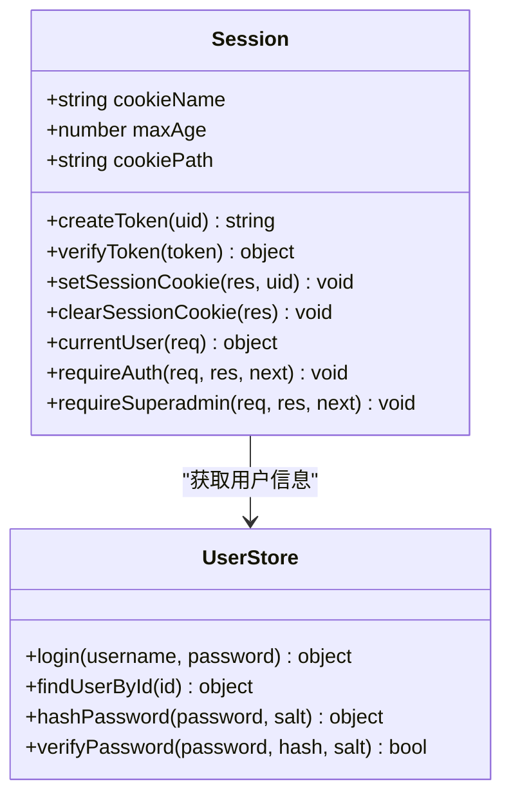
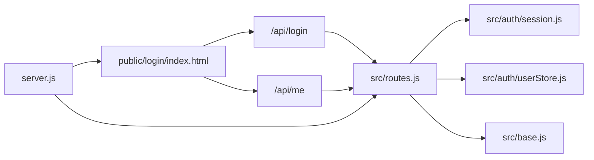

# 登录页面

<cite>
**本文引用的文件**   
- [public/login/index.html](file://public/login/index.html)
- [server.js](file://server.js)
- [src/routes.js](file://src/routes.js)
- [src/auth/session.js](file://src/auth/session.js)
- [src/auth/userStore.js](file://src/auth/userStore.js)
- [src/base.js](file://src/base.js)
</cite>

## 目录
1. [简介](#简介)
2. [项目结构与入口](#项目结构与入口)
3. [用户界面设计](#用户界面设计)
4. [认证流程总览](#认证流程总览)
5. [登录逻辑实现细节](#登录逻辑实现细节)
6. [会话与权限控制](#会话与权限控制)
7. [安全考虑](#安全考虑)
8. [用户体验优化](#用户体验优化)
9. [依赖关系分析](#依赖关系分析)
10. [故障排查指南](#故障排查指南)
11. [最佳实践建议](#最佳实践建议)
12. [结论](#结论)

## 简介
本文面向 AINovel 的“登录页面”，从前端界面、后端接口、会话管理到安全策略，完整说明该页面的设计目标、交互流程与实现要点。文档同时覆盖：
- 表单布局、样式设计与移动端适配
- 用户名密码校验、API 调用、错误提示与加载状态
- BASE 路径计算、next 参数处理、角色路由跳转
- Cookie 会话、HMAC 签名、超时与禁用账号处理
- 输入验证、重定向防护、密码哈希存储等安全措施

## 项目结构与入口
登录功能涉及前端静态页面与后端 Express 服务：
- 前端登录页位于 `public/login/index.html`，由服务器以静态资源方式提供。
- 后端在 `server.js` 中挂载 `/login` 静态目录，并注册 `/api/login`、`/api/logout`、`/api/me` 等鉴权相关接口。
- 路由与鉴权中间件集中在 `src/routes.js`，会话工具集中在 `src/auth/session.js`，用户数据与密码哈希集中在 `src/auth/userStore.js`。
- 站点前缀 `BASE_PATH` 统一来自 `src/base.js`，用于保证登录页、接口与管理页在代理环境下路径一致。

**图表来源**
- [public/login/index.html:35-65](file://public/login/index.html#L35-L65)
- [server.js:44-53](file://server.js#L44-L53)
- [src/routes.js:331-350](file://src/routes.js#L331-L350)
- [src/auth/session.js:75-101](file://src/auth/session.js#L75-L101)
- [src/auth/userStore.js:181-188](file://src/auth/userStore.js#L181-L188)
- [src/base.js:17-39](file://src/base.js#L17-L39)

**章节来源**
- [public/login/index.html:1-69](file://public/login/index.html#L1-L69)
- [server.js:1-64](file://server.js#L1-L64)
- [src/routes.js:331-350](file://src/routes.js#L331-L350)
- [src/auth/session.js:1-118](file://src/auth/session.js#L1-L118)
- [src/auth/userStore.js:1-501](file://src/auth/userStore.js#L1-L501)
- [src/base.js:1-42](file://src/base.js#L1-L42)

## 用户界面设计
登录页面是一个简洁的深色主题卡片式表单，适合桌面与移动端使用。

### 表单布局
- 页面主体是一个居中的卡片容器，包含标题、副标题、用户名输入框、密码输入框和登录按钮。
- 用户名输入框启用浏览器自动填充，属性为 `username`；密码输入框启用当前密码自动填充，属性为 `current-password`。
- 登录按钮默认显示“登 录”，提交过程中会变为“登录中…”并禁用，防止重复提交。
- 消息区域用于显示成功或失败提示，成功时颜色变绿，失败时为红色。

### 样式设计
- 背景色为深色，文字为浅色，整体风格偏向现代暗色 UI。
- 输入框边框在聚焦时高亮，按钮点击态加深，禁用态降低透明度。
- 卡片圆角较大，内边距适中，提升可读性与触控体验。
- 字体优先使用系统字体栈，确保在不同平台下表现稳定。

### 响应式适配
- 通过 viewport meta 标签禁止缩放，避免移动端误触放大。
- 卡片宽度设为百分比并限制最大宽度，在小屏设备上自动收缩。
- 按钮和内边距采用相对单位，便于不同屏幕尺寸下的自适应。
- 移动端点击高亮被隐藏，减少误触视觉干扰。

**章节来源**
- [public/login/index.html:7-34](file://public/login/index.html#L7-L34)

## 认证流程总览
登录流程分为前端准备、表单提交、后端校验、会话设置与页面跳转五个阶段。

**图表来源**
- [public/login/index.html:49-65](file://public/login/index.html#L49-L65)
- [src/routes.js:342-348](file://src/routes.js#L342-L348)
- [src/auth/userStore.js:181-188](file://src/auth/userStore.js#L181-L188)
- [src/auth/session.js:75-78](file://src/auth/session.js#L75-L78)

**章节来源**
- [public/login/index.html:49-65](file://public/login/index.html#L49-L65)
- [src/routes.js:342-348](file://src/routes.js#L342-L348)
- [src/auth/userStore.js:181-188](file://src/auth/userStore.js#L181-L188)
- [src/auth/session.js:75-78](file://src/auth/session.js#L75-L78)

## 登录逻辑实现细节

### BASE 路径计算
登录页面通过当前 URL 反推站点前缀，使接口请求与跳转链接始终基于正确的前缀：
- 将当前路径中 `/login` 及其后续部分替换为空，得到 BASE。
- 所有 API 请求与跳转都拼接 BASE，例如 `BASE + '/api/login'`、`BASE + '/admin/dashboard.html'`。
- 这种设计允许站点部署在任意子路径下，无需重新生成页面。

**图表来源**
- [public/login/index.html:37-44](file://public/login/index.html#L37-L44)

**章节来源**
- [public/login/index.html:37-44](file://public/login/index.html#L37-L44)
- [src/base.js:17-39](file://src/base.js#L17-L39)

### next 参数处理
next 参数用于登录后回跳原页面，但存在开放重定向风险，因此进行严格校验：
- 仅允许以 `/novel/` 或 `/admin/` 开头的路径作为 next。
- 如果 next 不合法，则忽略它，改用角色默认首页。
- 这样既支持正常回跳，又防止跳转到外部网站或危险路径。

**章节来源**
- [public/login/index.html:40-44](file://public/login/index.html#L40-L44)

### 角色路由跳转
登录后跳转目标由 `homeFor` 函数决定：
- 优先使用合法的 next。
- 如果没有 next，超级管理员跳转到 `/admin/dashboard.html`。
- 普通用户跳转到 `/admin/`。
- 跳转使用 `location.replace`，避免产生多余的历史记录。

**章节来源**
- [public/login/index.html:44-45](file://public/login/index.html#L44-L45)

### 表单验证
前端对用户名和密码做基础非空校验：
- 如果任一字段为空，直接显示提示信息，不发起网络请求。
- 校验失败时不会禁用按钮，也不会改变加载状态。
- 该层校验主要提升用户体验，不能替代后端校验。

**章节来源**
- [public/login/index.html:52-54](file://public/login/index.html#L52-L54)

### API 调用
登录请求使用 `fetch` 发送 JSON 数据：
- 方法为 POST。
- Content-Type 为 `application/json`。
- 请求体包含 `username` 和 `password`。
- 成功后读取响应 JSON，检查 `ok` 字段。
- 失败时捕获异常并显示错误信息。

**章节来源**
- [public/login/index.html:55-58](file://public/login/index.html#L55-L58)
- [src/routes.js:342-348](file://src/routes.js#L342-L348)

### 错误处理
登录错误分为两类：
- 前端错误：如网络异常、JSON 解析失败。
- 后端错误：如用户名或密码错误、未登录、权限不足。

前端会将错误消息显示在消息区域，并恢复按钮状态；后端会在登录失败时返回 401 与错误描述。

**章节来源**
- [public/login/index.html:58-63](file://public/login/index.html#L58-L63)
- [src/routes.js:342-348](file://src/routes.js#L342-L348)

## 会话与权限控制

### 会话 Cookie
登录后服务端设置一个名为 `ainovel_session` 的 Cookie：
- 使用 HMAC-SHA256 签名，防止客户端篡改。
- 设置为 HttpOnly，避免 JavaScript 直接读取。
- SameSite 为 Lax，限制跨站携带。
- Path 为 `BASE_PATH`，避免与其他子系统串扰。
- Max-Age 为 7 天，支持长期登录。

**图表来源**
- [src/auth/session.js:26-91](file://src/auth/session.js#L26-L91)
- [src/auth/userStore.js:30-45](file://src/auth/userStore.js#L30-L45)
- [src/auth/userStore.js:181-188](file://src/auth/userStore.js#L181-L188)

**章节来源**
- [src/auth/session.js:26-91](file://src/auth/session.js#L26-L91)
- [src/auth/userStore.js:181-188](file://src/auth/userStore.js#L181-L188)

### 鉴权中间件
除 `/api/login`、`/api/logout`、`/api/me` 外，所有 `/api` 请求都需要有效会话：
- `requireAuth` 中间件检查 Cookie 中的会话令牌。
- 如果令牌无效、过期或用户被禁用，返回 401。
- 成功时将用户信息注入 `req.user`，供后续路由使用。
- 超管接口额外需要 `requireSuperadmin` 校验角色。

**章节来源**
- [src/auth/session.js:93-110](file://src/auth/session.js#L93-L110)
- [src/routes.js:341-350](file://src/routes.js#L341-L350)

### 自动登录检测
登录页面加载时会尝试调用 `/api/me`：
- 如果已有有效会话，直接跳转到对应首页。
- 如果未登录，继续显示登录表单。
- 该机制提升用户体验，避免已登录用户重复登录。

**章节来源**
- [public/login/index.html:45-48](file://public/login/index.html#L45-L48)
- [src/routes.js:350](file://src/routes.js#L350)

## 安全考虑

### 输入验证
- 前端对用户名和密码做非空校验，减少无效请求。
- 后端通过用户仓库校验用户名是否存在、密码是否正确。
- 用户仓库使用 scrypt 哈希存储密码，每个用户有独立 salt。
- 密码比较使用恒定时间比较，防止时序攻击。

**章节来源**
- [public/login/index.html:52-54](file://public/login/index.html#L52-L54)
- [src/auth/userStore.js:30-45](file://src/auth/userStore.js#L30-L45)
- [src/auth/userStore.js:181-188](file://src/auth/userStore.js#L181-L188)

### 重定向防护
- next 参数仅允许站内 `/novel/` 或 `/admin/` 路径。
- 非法 next 会被忽略，防止开放重定向漏洞。
- 跳转使用 `location.replace`，避免历史污染。

**章节来源**
- [public/login/index.html:40-44](file://public/login/index.html#L40-L44)

### 密码处理
- 密码不在前端加密，传输仍依赖 HTTPS 保障机密性。
- 后端使用 scrypt 加盐哈希存储密码。
- 重置密码或创建用户时强制最小长度校验。
- 用户被禁用后无法登录，即使密码正确。

**章节来源**
- [src/auth/userStore.js:30-45](file://src/auth/userStore.js#L30-L45)
- [src/auth/userStore.js:147-159](file://src/auth/userStore.js#L147-L159)
- [src/auth/userStore.js:181-188](file://src/auth/userStore.js#L181-L188)

### 会话安全
- 会话令牌使用 HMAC-SHA256 签名，防止篡改。
- Cookie 设置为 HttpOnly，避免 XSS 直接读取。
- SameSite=Lax 限制跨站请求携带 Cookie。
- Path 限定为 `BASE_PATH`，避免多子系统间 Cookie 串扰。
- 会话有效期 7 天，支持合理长期登录。

**章节来源**
- [src/auth/session.js:26-78](file://src/auth/session.js#L26-L78)

## 用户体验优化

### 加载状态
- 提交后立即禁用按钮并修改文案为“登录中…”，防止重复提交。
- 成功后显示“登录成功，进入中…”再跳转。
- 失败时恢复按钮状态与原始文案。

**章节来源**
- [public/login/index.html:54-63](file://public/login/index.html#L54-L63)

### 错误提示
- 前端错误与后端错误统一显示在消息区域。
- 成功提示使用绿色，失败提示使用红色。
- 错误信息简洁明确，便于用户理解。

**章节来源**
- [public/login/index.html:58-63](file://public/login/index.html#L58-L63)

### 自动登录检测
- 页面加载时调用 `/api/me`，已登录用户直接跳转。
- 未登录用户继续显示登录表单。
- 减少重复登录操作，提升流畅度。

**章节来源**
- [public/login/index.html:45-48](file://public/login/index.html#L45-L48)

## 依赖关系分析

**图表来源**
- [public/login/index.html:45-65](file://public/login/index.html#L45-L65)
- [server.js:44-53](file://server.js#L44-L53)
- [src/routes.js:331-350](file://src/routes.js#L331-L350)
- [src/auth/session.js:75-101](file://src/auth/session.js#L75-L101)
- [src/auth/userStore.js:181-188](file://src/auth/userStore.js#L181-L188)
- [src/base.js:17-39](file://src/base.js#L17-L39)

**章节来源**
- [public/login/index.html:45-65](file://public/login/index.html#L45-L65)
- [server.js:44-53](file://server.js#L44-L53)
- [src/routes.js:331-350](file://src/routes.js#L331-L350)
- [src/auth/session.js:75-101](file://src/auth/session.js#L75-L101)
- [src/auth/userStore.js:181-188](file://src/auth/userStore.js#L181-L188)
- [src/base.js:17-39](file://src/base.js#L17-L39)

## 故障排查指南

### 登录失败
- 检查用户名和密码是否正确。
- 确认用户未被禁用。
- 查看后端是否返回 401 与错误消息。
- 检查网络请求是否成功到达 `/api/login`。

**章节来源**
- [public/login/index.html:58-63](file://public/login/index.html#L58-L63)
- [src/routes.js:342-348](file://src/routes.js#L342-L348)
- [src/auth/userStore.js:181-188](file://src/auth/userStore.js#L181-L188)

### 登录后跳转异常
- 检查 next 参数是否符合 `/novel/` 或 `/admin/` 规则。
- 确认用户角色是否为超级管理员。
- 检查 BASE 路径计算是否正确。
- 查看是否使用了 `location.replace` 而非 `location.href`。

**章节来源**
- [public/login/index.html:40-45](file://public/login/index.html#L40-L45)
- [src/base.js:17-39](file://src/base.js#L17-L39)

### 会话失效
- 检查 Cookie 是否被浏览器清除。
- 确认 SESSION_SECRET 是否配置固定值。
- 查看会话是否超过 7 天。
- 检查用户是否被禁用。

**章节来源**
- [src/auth/session.js:32-36](file://src/auth/session.js#L32-L36)
- [src/auth/session.js:75-78](file://src/auth/session.js#L75-L78)
- [src/auth/session.js:84-91](file://src/auth/session.js#L84-L91)

### 自动登录不生效
- 检查 `/api/me` 是否返回用户信息。
- 确认 Cookie 是否正确携带。
- 查看是否因跨域或代理问题导致会话丢失。
- 检查 BASE_PATH 是否与部署环境一致。

**章节来源**
- [public/login/index.html:45-48](file://public/login/index.html#L45-L48)
- [src/routes.js:350](file://src/routes.js#L350)
- [src/base.js:17-39](file://src/base.js#L17-L39)

## 最佳实践建议

### 前端开发
- 保持表单字段语义化，使用 `autocomplete` 提升可用性。
- 对用户输入做基础校验，但不可依赖前端校验作为唯一安全边界。
- 使用明确的加载状态与错误提示，提升可感知性。
- 避免硬编码路径，统一通过 BASE 计算接口与跳转地址。

### 后端开发
- 对所有敏感接口实施会话校验。
- 使用安全的密码哈希算法，如 scrypt。
- 对重定向参数进行白名单校验。
- 会话 Cookie 应设置 HttpOnly、SameSite 与合理 Path。
- 对外暴露的用户信息应脱敏，不包含密码或内部标识。

### 运维与安全
- 配置固定的 SESSION_SECRET，避免重启后会话失效。
- 使用 HTTPS 保护登录请求与 Cookie。
- 定期审查用户权限与 VIP 授权。
- 监控登录失败率与异常跳转行为。

## 结论
AINovel 登录页面以简洁的深色 UI 为基础，结合严格的 next 参数校验、角色路由跳转与 HMAC 签名的会话机制，提供了安全、易用且可扩展的登录体验。前端负责输入校验与用户反馈，后端负责身份验证与会话管理，两者通过清晰的 API 契约协作。通过 BASE 路径抽象，系统在本地开发与生产部署之间保持一致的行为。未来可在保持现有安全基线的前提下，进一步增强错误提示、国际化与无障碍支持。