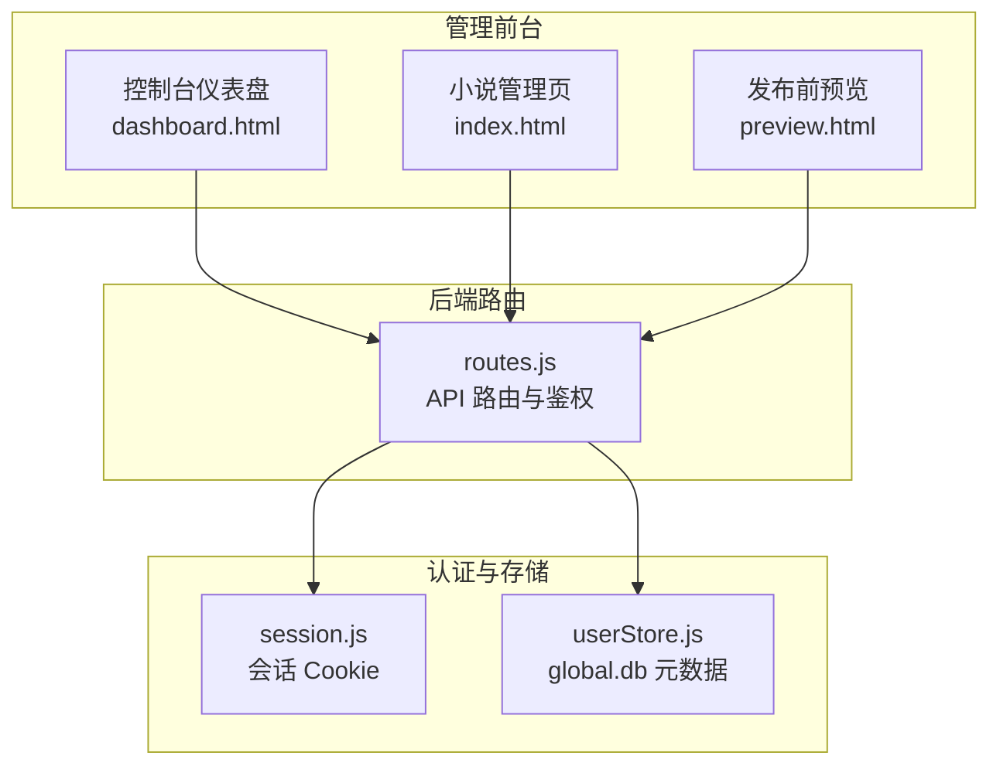
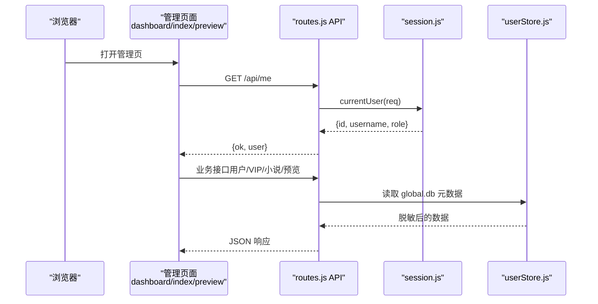
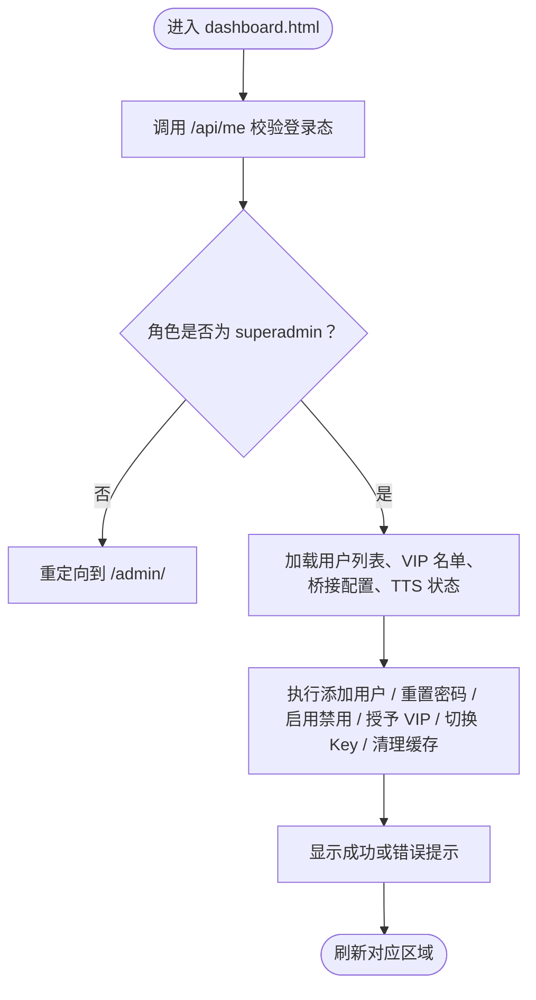
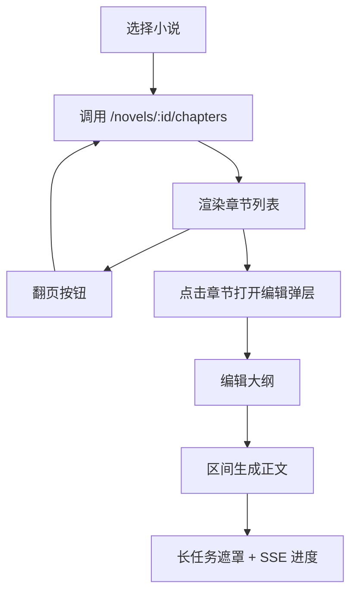
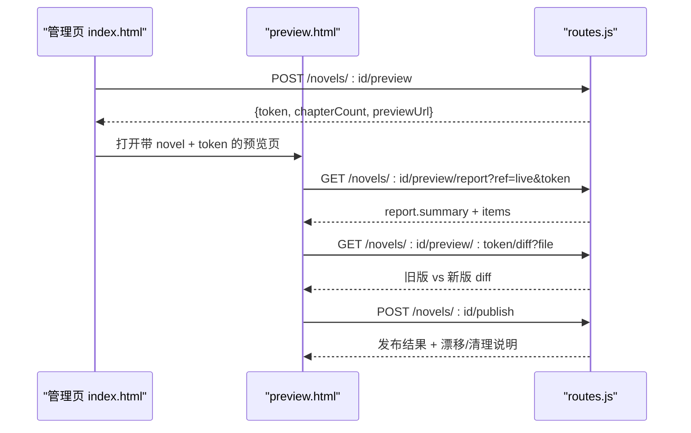
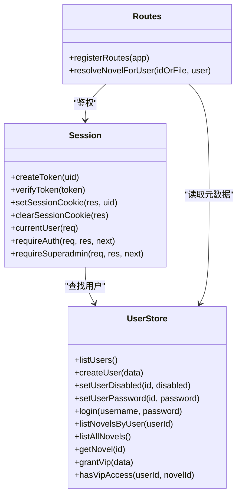
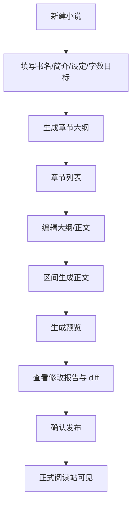
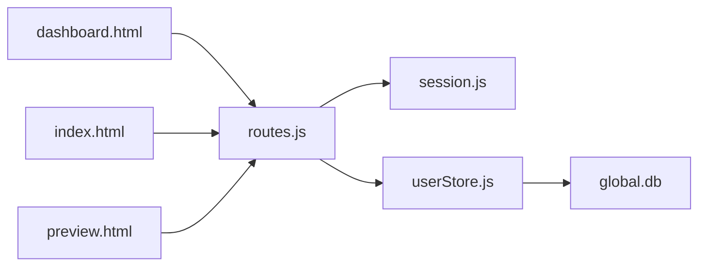

# 管理后台

<cite>
**本文引用的文件**   
- [dashboard.html](file://public/admin/dashboard.html)
- [index.html](file://public/admin/index.html)
- [preview.html](file://public/admin/preview.html)
- [routes.js](file://src/routes.js)
- [session.js](file://src/auth/session.js)
- [userStore.js](file://src/auth/userStore.js)
</cite>

## 目录
1. [引言](#引言)
2. [项目结构与管理界面总览](#项目结构与管理界面总览)
3. [核心功能模块](#核心功能模块)
4. [架构总览](#架构总览)
5. [详细组件分析](#详细组件分析)
6. [权限控制机制](#权限控制机制)
7. [数据展示与交互设计](#数据展示与交互设计)
8. [管理操作工作流](#管理操作工作流)
9. [依赖关系分析](#依赖关系分析)
10. [性能与稳定性考虑](#性能与稳定性考虑)
11. [故障排查指南](#故障排查指南)
12. [结论与建议](#结论与建议)

## 引言
本文件为 AINovel 管理后台的完整技术文档，面向产品、前端、后端与维护人员。文档围绕三个核心管理页面展开：控制台仪表盘、小说内容管理、发布前预览；同时说明用户与权限模型、VIP 授权机制、长任务进度反馈、TTS 音频缓存体检、推理服务连接管理等运维能力。目标是让读者既能理解整体架构，也能定位具体实现路径。

## 项目结构与管理界面总览
管理后台由三张静态 HTML 页面组成，统一通过后端 `/api` 接口获取数据并执行操作：
- 控制台仪表盘：`public/admin/dashboard.html`
- 小说内容管理：`public/admin/index.html`
- 发布前预览：`public/admin/preview.html`

所有页面都基于同一站点前缀 `BASE` 发起请求，并在未登录或会话过期时跳转到 `/login/`。

**图表来源**
- [dashboard.html:134-179](file://public/admin/dashboard.html#L134-L179)
- [index.html:267-440](file://public/admin/index.html#L267-L440)
- [preview.html:98-121](file://public/admin/preview.html#L98-L121)
- [routes.js:331-560](file://src/routes.js#L331-L560)
- [session.js:83-110](file://src/auth/session.js#L83-L110)
- [userStore.js:47-113](file://src/auth/userStore.js#L47-L113)

**章节来源**
- [dashboard.html:1-179](file://public/admin/dashboard.html#L1-L179)
- [index.html:1-440](file://public/admin/index.html#L1-L440)
- [preview.html:1-121](file://public/admin/preview.html#L1-L121)
- [routes.js:331-560](file://src/routes.js#L331-L560)

## 核心功能模块
| 模块 | 主要职责 | 对应页面 / 接口 | 关键能力 |
|---|---|---|---|
| 控制台仪表盘 | 平台概览、用户管理、VIP 授权、推理服务连接、TTS 音频缓存 | `dashboard.html` + `/admin/*` 接口 | 统计卡片、用户增删改禁、VIP 名单、aibridge Key 管理、音频清理 |
| 小说内容管理 | 小说创建、设定、大纲生成、章节编辑、区间生成、预览与发布 | `index.html` + `/novels`、`/run`、`/preview`、`/publish` | 流程化创作、长任务遮罩、SSE 进度、菜单工具、一致性检查 |
| 发布前预览 | 渲染暂存站、修改报告、逐页 diff、确认发布 | `preview.html` + `/novels/:id/preview*` | 新增/改动/待下线分类、diff 查看、漂移检测、作废与发布 |
| 认证与会话 | 登录、登出、当前用户、会话 Cookie、超管守卫 | `session.js` + `/api/login`、`/api/logout`、`/api/me` | HMAC-SHA256 签名、禁用账号拦截、Path 隔离 |
| 用户与 VIP 元数据 | 用户表、小说归属表、VIP 授权表、预览登记 | `userStore.js` + `/admin/users`、`/admin/vip` | scrypt 密码、软删除、到期/撤销、按用户隔离 |

**章节来源**
- [dashboard.html:59-130](file://public/admin/dashboard.html#L59-L130)
- [index.html:144-252](file://public/admin/index.html#L144-L252)
- [preview.html:81-96](file://public/admin/preview.html#L81-L96)
- [routes.js:341-350](file://src/routes.js#L341-L350)
- [userStore.js:53-101](file://src/auth/userStore.js#L53-L101)

## 架构总览
管理后台采用“前端静态页面 + Node 后端路由”的轻量架构。前端不直接访问数据库，所有数据读写都经过后端校验、租户隔离和权限控制。

**图表来源**
- [dashboard.html:141-179](file://public/admin/dashboard.html#L141-L179)
- [index.html:358-440](file://public/admin/index.html#L358-L440)
- [preview.html:107-121](file://public/admin/preview.html#L107-L121)
- [routes.js:341-350](file://src/routes.js#L341-L350)
- [session.js:83-110](file://src/auth/session.js#L83-L110)
- [userStore.js:116-143](file://src/auth/userStore.js#L116-L143)

## 详细组件分析

### 控制台仪表盘 dashboard.html
仪表盘是超级管理员的核心入口，承担以下职责：
- 平台概览统计：用户总数、已禁用数、小说总数、有效 VIP 授权数。
- 用户管理：新建用户、重置密码、启用/禁用。
- VIP 读者授权：选择读者账号、选择全站或单书范围、设置有效期与备注。
- 推理服务连接：保存多条 aibridge API Key，切换生效项，测试连通性，覆盖桥接地址。
- TTS 音频缓存体检：统计缓存条数、磁盘占用、按音色/语速维度清理。

#### 仪表盘关键流程

**图表来源**
- [dashboard.html:160-179](file://public/admin/dashboard.html#L160-L179)
- [dashboard.html:182-229](file://public/admin/dashboard.html#L182-L229)
- [dashboard.html:235-280](file://public/admin/dashboard.html#L235-L280)
- [dashboard.html:309-400](file://public/admin/dashboard.html#L309-L400)
- [dashboard.html:412-466](file://public/admin/dashboard.html#L412-L466)

**章节来源**
- [dashboard.html:59-130](file://public/admin/dashboard.html#L59-L130)
- [dashboard.html:160-466](file://public/admin/dashboard.html#L160-L466)

### 小说内容管理 index.html
小说管理页是创作者的主要工作台，负责从“设定 → 大纲 → 正文 → 预览 → 发布”的全流程。

#### 主要职责
- 小说选择与新建：下拉列表、URL 同步、新建弹窗。
- 小说设定：书名、简介、世界观、每章目标字数、浮动比例、超长处理策略、VIP 开关。
- 大纲管理：一键重建全部大纲、批量加章、自动补大纲、回填空大纲。
- 章节管理：分页列表、区间生成正文、区间删除、重排编号、一致性检查、预览、分享、删除整书。
- 长任务反馈：遮罩、计时、日志、SSE 进度。
- AI 链路状态灯：预检桥接服务是否可达。

#### 章节列表与分页
章节列表采用固定每页 50 章的分页模式，前端维护当前页码，服务端返回结构化章节信息，包含章节号、标题、大纲、是否有正文、字数等。

**图表来源**
- [index.html:442-467](file://public/admin/index.html#L442-L467)
- [index.html:795-800](file://public/admin/index.html#L795-L800)
- [index.html:301-373](file://public/admin/index.html#L301-L373)

**章节来源**
- [index.html:144-252](file://public/admin/index.html#L144-L252)
- [index.html:442-500](file://public/admin/index.html#L442-L500)
- [index.html:558-654](file://public/admin/index.html#L558-L654)
- [index.html:669-793](file://public/admin/index.html#L669-L793)
- [index.html:795-800](file://public/admin/index.html#L795-L800)

### 发布前预览 preview.html
预览页用于在正式发布前查看渲染结果与修改报告，避免直接上线造成线上混乱。

#### 主要职责
- 读取预览报告：统计页数、章节、新增、正文改动、连带影响、待下线、句级变化、字数差、章号顺延、章名变更、目录页变化。
- 逐页说明：可折叠查看原因与正文 diff。
- 操作栏：打开预览站、重新生成预览、只看变化、作废预览、确认发布。
- 发布保护：若预览后又有变更，发布时会检测漂移并重渲染。

**图表来源**
- [index.html:656-667](file://public/admin/index.html#L656-L667)
- [preview.html:123-255](file://public/admin/preview.html#L123-L255)
- [preview.html:257-301](file://public/admin/preview.html#L257-L301)

**章节来源**
- [preview.html:81-96](file://public/admin/preview.html#L81-L96)
- [preview.html:123-301](file://public/admin/preview.html#L123-L301)

## 权限控制机制
管理后台的权限体系分为三层：
1. 登录态校验：除 `/api/login`、`/api/logout`、`/api/me` 外，所有 `/api` 必须携带有效会话 Cookie。
2. 用户身份解析：从 Cookie 中解析用户 ID，查询用户是否存在且未被禁用。
3. 角色与资源隔离：普通用户只能访问自己拥有的小说；超级管理员可访问全部小说、控制台、部分超管接口。

### 会话与会 Cookie
- Cookie 名称固定，使用 HMAC-SHA256 签名，负载包含用户 ID 与过期时间。
- Cookie 仅在本站点前缀下可见，避免与其他子系统串味。
- 会话默认最长 7 天，支持登出清除。

### 用户与角色
- 用户表记录用户名、密码哈希、盐、角色、禁用状态、最后登录时间。
- 普通用户角色为 `user`，超级管理员角色为 `superadmin`。
- 禁用用户无法登录，即使 Cookie 未过期也会被拒绝。

### 资源访问控制
- 小说以 `novel.id` 定位，后端根据 `user_id` 判断拥有者。
- 非超管访问他人小说会返回无权错误。
- VIP 书对读者侧另有授权名单校验，与管理后台的“创作者权限”不同。

**图表来源**
- [session.js:42-110](file://src/auth/session.js#L42-L110)
- [userStore.js:116-188](file://src/auth/userStore.js#L116-L188)
- [userStore.js:190-349](file://src/auth/userStore.js#L190-L349)
- [routes.js:97-116](file://src/routes.js#L97-L116)
- [routes.js:341-350](file://src/routes.js#L341-L350)

**章节来源**
- [session.js:1-118](file://src/auth/session.js#L1-L118)
- [userStore.js:1-113](file://src/auth/userStore.js#L1-L113)
- [userStore.js:116-188](file://src/auth/userStore.js#L116-L188)
- [routes.js:97-116](file://src/routes.js#L97-L116)
- [routes.js:341-350](file://src/routes.js#L341-L350)

## 数据展示与交互设计

### 表格渲染
- 用户列表：用户名、角色、状态、上次登录、小说数量、操作列。
- VIP 授权列表：读者、范围、状态、到期时间、备注、操作。
- 桥接 Key 列表：名称、Key 前缀、连通状态、启用/停用、测试、改名、删除。
- TTS 音频列表：按音色汇总、按音色×语速明细，提供清理按钮。

表格渲染统一使用轻量 DOM 拼接，配合 CSS 类区分启用、禁用、VIP、警告等状态。

### 分页处理
- 章节列表固定每页 50 章，前端维护页码变量，服务端返回章节数组。
- 分页按钮控制上一页/下一页，避免一次性加载整本书导致卡顿。

### 搜索过滤
- 控制台仪表盘未内置全局搜索，但通过 URL hash 快速定位 VIP、桥接、TTS 区块。
- 小说管理页通过顶部小说下拉选择、章节范围输入框、覆盖已有正文复选框进行筛选。
- 预览页提供“显示未改动页面”复选框，隐藏无变化的行。

### 用户体验优化建议
- 长任务遮罩延迟 600ms 出现，避免短请求闪烁。
- 删除类操作要求输入 OK，防止误删。
- 失败提示使用 toast，成功与失败分别用不同样式。
- 章节编辑弹层支持方向动画，增强翻页感。
- 预览 diff 懒加载，点击才拉取正文差异，减少首屏压力。

**章节来源**
- [dashboard.html:182-466](file://public/admin/dashboard.html#L182-L466)
- [index.html:46-114](file://public/admin/index.html#L46-L114)
- [index.html:502-537](file://public/admin/index.html#L502-L537)
- [preview.html:35-58](file://public/admin/preview.html#L35-L58)
- [preview.html:172-239](file://public/admin/preview.html#L172-L239)

## 管理操作工作流

### 小说管理流程

**图表来源**
- [index.html:477-500](file://public/admin/index.html#L477-L500)
- [index.html:558-654](file://public/admin/index.html#L558-L654)
- [index.html:669-793](file://public/admin/index.html#L669-L793)
- [index.html:656-667](file://public/admin/index.html#L656-L667)
- [preview.html:257-301](file://public/admin/preview.html#L257-L301)

### 章节编辑流程
- 选择小说后加载章节列表。
- 点击章节打开编辑弹层，可修改标题与大纲。
- 使用“区间生成正文”触发长任务，显示遮罩与进度。
- 完成后刷新章节列表与设定。

**章节来源**
- [index.html:795-800](file://public/admin/index.html#L795-L800)
- [index.html:301-373](file://public/admin/index.html#L301-L373)

### 用户权限设置流程
- 超级管理员进入控制台。
- 新建用户时选择角色：普通用户或超级管理员。
- 可对用户重置密码、启用/禁用。
- 对 VIP 书授予读者账号访问权限，支持全站或单书范围、有效期与备注。

**章节来源**
- [dashboard.html:69-82](file://public/admin/dashboard.html#L69-L82)
- [dashboard.html:182-229](file://public/admin/dashboard.html#L182-L229)
- [dashboard.html:235-280](file://public/admin/dashboard.html#L235-L280)

## 依赖关系分析

**图表来源**
- [dashboard.html:141-179](file://public/admin/dashboard.html#L141-L179)
- [index.html:358-440](file://public/admin/index.html#L358-L440)
- [preview.html:107-121](file://public/admin/preview.html#L107-L121)
- [routes.js:331-560](file://src/routes.js#L331-L560)
- [session.js:83-110](file://src/auth/session.js#L83-L110)
- [userStore.js:47-113](file://src/auth/userStore.js#L47-L113)

**章节来源**
- [routes.js:331-560](file://src/routes.js#L331-L560)
- [userStore.js:47-113](file://src/auth/userStore.js#L47-L113)

## 性能与稳定性考虑
- 长任务互斥：按小说维度锁定生成类任务，避免并发改写正文与章号。
- SSE 进度缓冲：服务器端缓冲近期进度事件，客户端连上后先补发再订阅实流，避免开头几行丢失。
- 限流：读者侧 AI 与 TTS 接口按真实 IP 分桶限流，防止单用户压垮服务。
- 输出净化：API 响应清洗绝对路径、密钥、内部地址等敏感信息。
- 预览 TTL：预览产物默认保留 24 小时，避免长期占用磁盘。
- TTS 缓存审计：体检统计有行无文件、有文件无行、按音色/语速维度清理，降低无效缓存膨胀。

**章节来源**
- [routes.js:573-637](file://src/routes.js#L573-L637)
- [routes.js:263-306](file://src/routes.js#L263-L306)
- [routes.js:67-95](file://src/routes.js#L67-L95)
- [userStore.js:351-378](file://src/auth/userStore.js#L351-L378)
- [dashboard.html:402-466](file://public/admin/dashboard.html#L402-L466)

## 故障排查指南
- 登录失败：检查用户名密码、账号是否被禁用、SESSION_SECRET 是否稳定。
- 401 未登录：Cookie 过期或被其他系统覆盖，重新登录后重试。
- 403 无权访问：普通用户访问他人小说，或尝试超管接口。
- 404 小说不存在：小说未登记或库文件缺失。
- 预览无法打开：缺少 token 或未登录创作者账号。
- VIP 不可读：读者账号未获授权、授权已撤销或已到期。
- TTS 合成失败：音色或语速不支持、章节无正文、上游服务异常。
- 桥接 Key 不通：Key 错误或地址不可达，使用“测试”按钮诊断。

**章节来源**
- [session.js:83-110](file://src/auth/session.js#L83-L110)
- [routes.js:341-350](file://src/routes.js#L341-L350)
- [routes.js:456-513](file://src/routes.js#L456-L513)
- [dashboard.html:141-179](file://public/admin/dashboard.html#L141-L179)
- [preview.html:107-121](file://public/admin/preview.html#L107-L121)

## 结论与建议
AINovel 管理后台以简洁的前端页面与清晰的 Node 路由为核心，围绕“用户—小说—章节—预览—发布”的主线构建完整创作与发布流程。控制台仪表盘提供平台级运维能力，小说管理页聚焦创作效率，预览页保障发布质量。权限模型以会话 Cookie 与 global.db 元数据为基础，结合角色与资源隔离，既满足多用户协作，又保证数据安全。

建议后续优化方向：
- 在控制台增加用户列表搜索与分页，提升大规模用户场景下的可操作性。
- 将章节列表分页逻辑与服务端分页对齐，减少前端状态复杂度。
- 为预览报告增加导出功能，便于归档与评审。
- 为桥接 Key 管理增加用量统计与失败率监控，辅助模型选型。
- 为 TTS 清理增加定时回收策略，降低人工干预成本。