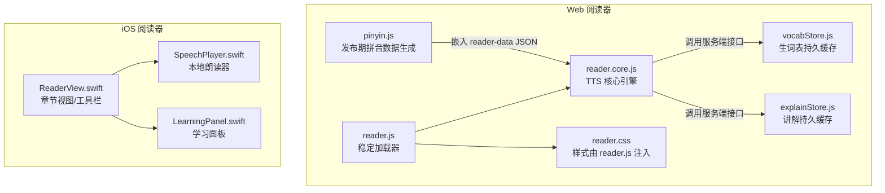
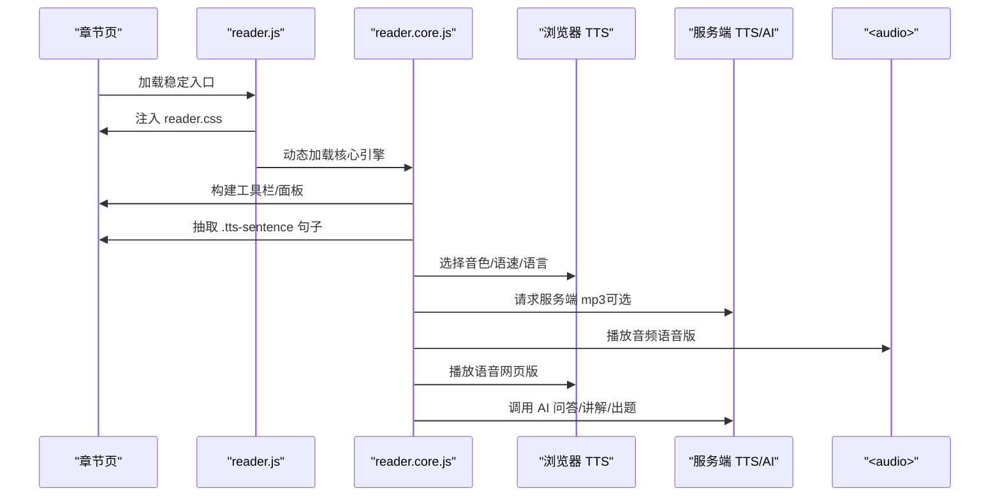
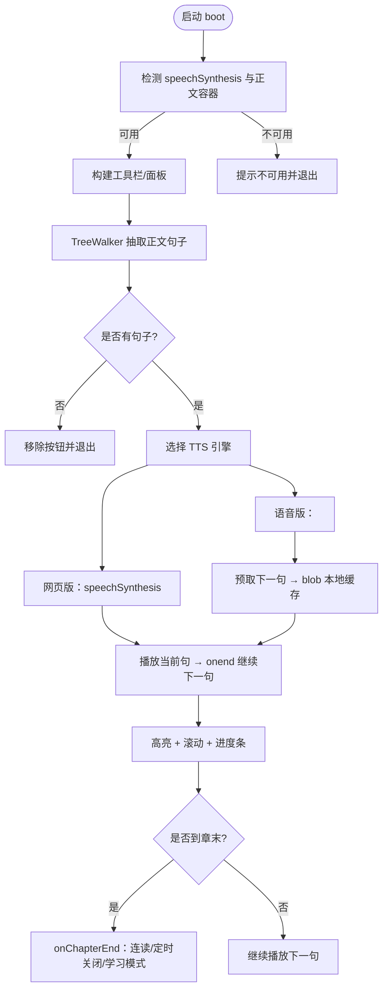
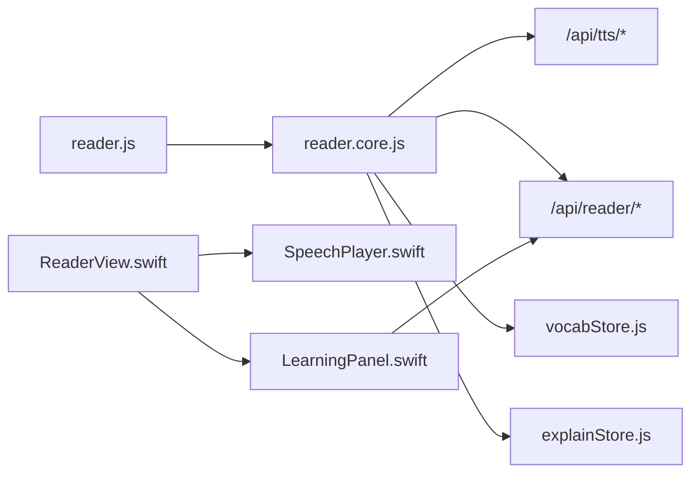

# 阅读器界面

<cite>
**本文引用的文件**   
- [reader.core.js](file://public/tts/reader.core.js)
- [reader.js](file://public/tts/reader.js)
- [pinyin.js](file://src/reader/pinyin.js)
- [vocabStore.js](file://src/reader/vocabStore.js)
- [explainStore.js](file://src/reader/explainStore.js)
- [SpeechPlayer.swift](file://ios/AINovel/Reader/SpeechPlayer.swift)
- [ReaderView.swift](file://ios/AINovel/Reader/ReaderView.swift)
- [LearningPanel.swift](file://ios/AINovel/Reader/LearningPanel.swift)
</cite>

## 目录
1. [引言](#引言)
2. [项目结构](#项目结构)
3. [核心组件](#核心组件)
4. [架构总览](#架构总览)
5. [详细组件分析](#详细组件分析)
6. [依赖关系分析](#依赖关系分析)
7. [性能与优化](#性能与优化)
8. [故障排查指南](#故障排查指南)
9. [结论](#结论)

## 引言
本文件面向 AINovel 阅读器的读者端实现，目标是帮助开发者与维护者理解“网页版 TTS 阅读器”和“iOS 原生阅读器”两套界面的职责边界、交互流程与学习功能。重点覆盖：
- 网页版核心引擎 reader.core.js 与加载器 reader.js 的职责划分
- TTS 双引擎（浏览器语音合成与服务端 mp3）的播放控制、进度同步、多语言支持
- 阅读体验优化：字体调整、主题切换、夜间模式、屏幕常亮与息屏省电
- 交互式学习：生词标注、词汇高亮、拼音显示、AI 问答与章节测试
- 移动端适配与触摸手势：左右滑动翻页、长按朗读、双击朗读
- 性能策略：音频预取、缓存、内存回收、流畅性保证

## 项目结构
本项目在 Web 侧提供可嵌入任意小说章节页的 TTS 阅读器，在 iOS 侧提供原生 SwiftUI 阅读器与本地朗读能力。关键路径如下：
- public/tts/reader.js：稳定入口，动态加载 reader.core.js 与样式
- public/tts/reader.core.js：TTS 核心引擎，负责 UI、播放、手势、学习面板等
- src/reader/pinyin.js：发布期生成段落级拼音数据
- src/reader/vocabStore.js：服务端持久化生词表缓存
- src/reader/explainStore.js：服务端持久化单词讲解缓存
- ios/AINovel/Reader/SpeechPlayer.swift：iOS 本地朗读器
- ios/AINovel/Reader/ReaderView.swift：iOS 阅读器视图与工具栏
- ios/AINovel/Reader/LearningPanel.swift：iOS 学习面板（测试、生词、提问）

**图表来源**
- [reader.js:1-47](file://public/tts/reader.js#L1-L47)
- [reader.core.js:1-100](file://public/tts/reader.core.js#L1-L100)
- [pinyin.js:1-57](file://src/reader/pinyin.js#L1-L57)
- [vocabStore.js:1-101](file://src/reader/vocabStore.js#L1-L101)
- [explainStore.js:1-113](file://src/reader/explainStore.js#L1-L113)
- [SpeechPlayer.swift:1-75](file://ios/AINovel/Reader/SpeechPlayer.swift#L1-L75)
- [ReaderView.swift:1-169](file://ios/AINovel/Reader/ReaderView.swift#L1-L169)
- [LearningPanel.swift:1-211](file://ios/AINovel/Reader/LearningPanel.swift#L1-L211)

**章节来源**
- [reader.js:1-47](file://public/tts/reader.js#L1-L47)
- [reader.core.js:1-120](file://public/tts/reader.core.js#L1-L120)

## 核心组件
- reader.js：作为唯一被章节页引用的脚本，负责引入样式与核心引擎，并通过时间戳避免历史页面缓存旧逻辑；同时提前隐藏原始章节导航，避免闪烁。
- reader.core.js：构建悬浮工具栏、控制面板、章节面板、AI 问答面板、设置面板、词汇讲解面板、章节测试面板；实现句子切分、TTS 播放、Media Session、手势翻页、学习模式、拼音模式、自动开播等。
- pinyin.js：将 Markdown 正文清洗后按段落生成逐字拼音数组，发布时嵌入 reader-data JSON，供前端 ruby 标注。
- vocabStore.js：基于 SQLite 的有界缓存，按 (年龄, 正文哈希) 存储生词表，防止重复 LLM 调用并限制表大小。
- explainStore.js：基于 SQLite 的有界缓存，按 (词, 年龄, 语言) 存储讲解文本，跨读者复用。
- SpeechPlayer.swift：iOS 本地朗读器，使用 AVSpeechSynthesizer，按段落朗读，暴露 speaking 与 currentParagraph 状态。
- ReaderView.swift：展示章节内容、打开发布站、打开学习面板、字号调节、底部工具栏播放/翻页。
- LearningPanel.swift：提供测试、生词、提问三种模式，调用服务端 API 获取题目、词汇、讲解与反馈。

**章节来源**
- [reader.js:1-47](file://public/tts/reader.js#L1-L47)
- [reader.core.js:1-120](file://public/tts/reader.core.js#L1-L120)
- [pinyin.js:1-57](file://src/reader/pinyin.js#L1-L57)
- [vocabStore.js:1-101](file://src/reader/vocabStore.js#L1-L101)
- [explainStore.js:1-113](file://src/reader/explainStore.js#L1-L113)
- [SpeechPlayer.swift:1-75](file://ios/AINovel/Reader/SpeechPlayer.swift#L1-L75)
- [ReaderView.swift:1-169](file://ios/AINovel/Reader/ReaderView.swift#L1-L169)
- [LearningPanel.swift:1-211](file://ios/AINovel/Reader/LearningPanel.swift#L1-L211)

## 架构总览
Web 阅读器采用“稳定入口 + 动态核心”的解耦设计：reader.js 长期命中缓存，reader.core.js 带时间戳刷新，确保更新无需重新发布章节。核心引擎通过 DOM 遍历与 TreeWalker 抽取正文句子，分别走浏览器 TTS 或服务端 mp3 播放；同时集成 Media Session、Wake Lock、静音保活、定时关闭、连读下一章、手势翻页、学习面板与 AI 问答。

iOS 阅读器则通过 SwiftUI 渲染章节，结合 SpeechPlayer 进行本地朗读，并提供学习面板与发布站跳转。

**图表来源**
- [reader.js:1-47](file://public/tts/reader.js#L1-L47)
- [reader.core.js:327-611](file://public/tts/reader.core.js#L327-L611)
- [reader.core.js:712-797](file://public/tts/reader.core.js#L712-L797)
- [reader.core.js:1369-1425](file://public/tts/reader.core.js#L1369-L1425)

## 详细组件分析

### 网页版 TTS 核心引擎（reader.core.js）
该文件是阅读器的中枢，承担以下职责：
- 环境检测：不支持 speechSynthesis 时提示不可用
- 构建 UI：悬浮工具栏、朗读面板、章节面板、AI 问答面板、设置面板、词汇讲解面板、章节测试面板
- 正文切句：TreeWalker 跳过 PRE/CODE 与 tts-skip 元素，按中文标点切句并包裹为 .tts-sentence
- TTS 引擎：
  - 网页版：speechSynthesis，支持音色选择、语速、自动连读、定时关闭、屏幕常亮
  - 语音版：服务端 /api/tts/sentence 返回 mp3，使用 <audio> 播放，支持预取下一句、尾静音裁剪、句间停顿
- 进度同步：当前句高亮、自动滚动、进度条拖动跳转
- 媒体会话：Media Session 支持锁屏控件、上一首/下一首、seekto
- 手势与键盘：左右滑动翻页、方向键翻页、双击/长按从某句开始朗读
- 学习模式：生词标注、词汇讲解、自动生成讲解、章节测试
- 拼音模式：ruby 标注汉字拼音
- 偏好持久化：音色、语速、句间停顿、自动连读、屏幕常亮、引擎类型、拼音模式、学习语言与年龄

**图表来源**
- [reader.core.js:33-54](file://public/tts/reader.core.js#L33-L54)
- [reader.core.js:272-325](file://public/tts/reader.core.js#L272-L325)
- [reader.core.js:574-611](file://public/tts/reader.core.js#L574-L611)
- [reader.core.js:754-797](file://public/tts/reader.core.js#L754-L797)
- [reader.core.js:542-573](file://public/tts/reader.core.js#L542-L573)

**章节来源**
- [reader.core.js:33-120](file://public/tts/reader.core.js#L33-L120)
- [reader.core.js:272-325](file://public/tts/reader.core.js#L272-L325)
- [reader.core.js:574-611](file://public/tts/reader.core.js#L574-L611)
- [reader.core.js:754-797](file://public/tts/reader.core.js#L754-L797)
- [reader.core.js:542-573](file://public/tts/reader.core.js#L542-L573)

### 加载器（reader.js）
- 推导资源目录，兼容站点挂在子路径
- 注入 reader.css 与 reader.core.js（带时间戳）
- 提前隐藏原始章节导航，避免首次绘制闪烁
- 加载失败时还原导航

**章节来源**
- [reader.js:1-47](file://public/tts/reader.js#L1-L47)

### 拼音生成（pinyin.js）
- 清理 Markdown 标记
- 对每个中文字符生成带声调的拼音
- 按空行分段，输出段落级拼音数组
- 发布时嵌入 reader-data JSON，供前端 ruby 标注

**章节来源**
- [pinyin.js:1-57](file://src/reader/pinyin.js#L1-L57)

### 生词表持久缓存（vocabStore.js）
- 使用 better-sqlite3 打开全局数据库
- 建表 reader_vocab，字段 key(words,char_count,updated_at)
- getCachedWords/putCachedWords 读写，写失败不影响本次返回
- evict 按 updated_at 淘汰最冷行，限制 MAX_ROWS

**章节来源**
- [vocabStore.js:1-101](file://src/reader/vocabStore.js#L1-L101)

### 讲解持久缓存（explainStore.js）
- 使用 better-sqlite3 打开全局数据库
- 建表 reader_word_explain，主键 (word, age, lang)
- getExplanation/putExplanation 读写，批量 wordsWithExplanation 查询已有讲解的词
- evict 按 updated_at 淘汰最冷行，限制 MAX_ROWS

**章节来源**
- [explainStore.js:1-113](file://src/reader/explainStore.js#L1-L113)

### iOS 本地朗读器（SpeechPlayer.swift）
- 使用 AVSpeechSynthesizer 按段落朗读
- start(text, rate) 清空队列并依次 speak
- stop() 立即停止并重置状态
- delegate 回调更新 speaking 与 currentParagraph

**章节来源**
- [SpeechPlayer.swift:1-75](file://ios/AINovel/Reader/SpeechPlayer.swift#L1-L75)

### iOS 阅读器视图（ReaderView.swift）
- 加载章节详情与分享信息
- 打开发布站页面
- 打开学习面板
- 弹出字号调节面板
- 底部工具栏：上一章、播放/停止、下一章

**章节来源**
- [ReaderView.swift:1-169](file://ios/AINovel/Reader/ReaderView.swift#L1-L169)

### iOS 学习面板（LearningPanel.swift）
- 模式：测试、生词、提问
- loadQuiz/loadVocab/explain/ask/grade 调用服务端 API
- 答题后鼓励式讲解

**章节来源**
- [LearningPanel.swift:1-211](file://ios/AINovel/Reader/LearningPanel.swift#L1-L211)

## 依赖关系分析
- reader.js 依赖 reader.core.js 与 reader.css
- reader.core.js 依赖浏览器 Web Speech API、Media Session、Wake Lock、Speech Recognition（可选）
- reader.core.js 调用服务端接口：
  - /api/tts/sentence：逐句合成 mp3
  - /api/tts/explain：讲解文本转语音
  - /api/reader/ask：AI 问答
  - /api/reader/explain：整句讲解
  - /api/reader/explain-word：单词讲解
  - /api/reader/vocab：生词表
  - /api/reader/quiz：章节测试
  - /api/reader/feedback：答题反馈
  - /api/reader/word-status：批量查询已有讲解的词
- iOS 阅读器依赖系统 AVSpeechSynthesizer，并通过 APIClient 调用服务端接口

**图表来源**
- [reader.js:1-47](file://public/tts/reader.js#L1-L47)
- [reader.core.js:1369-1425](file://public/tts/reader.core.js#L1369-L1425)
- [reader.core.js:1669-1787](file://public/tts/reader.core.js#L1669-L1787)
- [vocabStore.js:1-101](file://src/reader/vocabStore.js#L1-L101)
- [explainStore.js:1-113](file://src/reader/explainStore.js#L1-L113)
- [ReaderView.swift:1-169](file://ios/AINovel/Reader/ReaderView.swift#L1-L169)
- [LearningPanel.swift:1-211](file://ios/AINovel/Reader/LearningPanel.swift#L1-L211)

**章节来源**
- [reader.core.js:1369-1425](file://public/tts/reader.core.js#L1369-L1425)
- [reader.core.js:1669-1787](file://public/tts/reader.core.js#L1669-L1787)

## 性能与优化

### 音频预取与内存管理
- 语音版在播放当前句的同时预取下一句，拉成 blob 本地缓存，换源时仅替换 src，减少网络等待
- 预取失败静默处理，轮到那句时再正常请求
- 每换一次源都清理旧的 liveObjUrl，避免 blob 累积
- 取消预取时递增 token，作废在途请求，避免陈旧响应污染

**章节来源**
- [reader.core.js:622-752](file://public/tts/reader.core.js#L622-L752)

### 句间停顿与尾静音裁剪
- 服务端合成音频自带约 120ms 尾静音作为安全余量
- 前端根据 tailPadMs 计算跨句时机，避免吃掉最后一个字
- timeupdate 轮询位置，ended 兜底补差，确保不同停顿档位听感一致

**章节来源**
- [reader.core.js:648-702](file://public/tts/reader.core.js#L648-L702)

### 浏览器 TTS 保活与息屏省电
- 默认息屏省电：使用 0.05s 静音 WAV 循环保持音频会话，避免 iOS/Android 息屏挂起合成
- 可选屏幕常亮：使用 Wake Lock 请求锁屏，失败或不受支持时回退静音保活
- visibilitychange 回前台校准倒计时与锁屏状态

**章节来源**
- [reader.core.js:346-383](file://public/tts/reader.core.js#L346-L383)
- [reader.core.js:471-475](file://public/tts/reader.core.js#L471-L475)

### 全章音频生成并发与限流
- 并发数 CONC=3，间隔 GAP=200ms，避免上游限流
- 429/503 重试，读取 Retry-After 头退避
- 失败统计并报告首个错误原因，提升可观测性

**章节来源**
- [reader.core.js:1219-1299](file://public/tts/reader.core.js#L1219-L1299)

### 缓存与有界淘汰
- 生词表与讲解缓存均使用 SQLite，按最近更新时间淘汰最冷行
- 进程内 Map 重启清零，落库避免重复 LLM 调用
- 键口径严格：生词表按 (年龄, 正文哈希)，讲解按 (词, 年龄, 语言)

**章节来源**
- [vocabStore.js:1-101](file://src/reader/vocabStore.js#L1-L101)
- [explainStore.js:1-113](file://src/reader/explainStore.js#L1-L113)

## 故障排查指南

### 浏览器不支持语音合成
- 现象：顶部提示“当前浏览器不支持语音合成”，朗读按钮不可用
- 原因：window.speechSynthesis 不存在
- 处理：建议改用 Chrome/Edge/Safari；检查是否在内联 iframe 或受限上下文

**章节来源**
- [reader.core.js:43-53](file://public/tts/reader.core.js#L43-L53)

### 语音版合成失败回落网页版
- 现象：提示“语音版合成失败（...），回落到网页版”
- 原因：/api/tts/sentence 返回 ok=false 或无 audioPath
- 处理：检查服务端 TTS 接口、网络、参数（voice/rate/chapterUrl）

**章节来源**
- [reader.core.js:777-796](file://public/tts/reader.core.js#L777-L796)

### 音频播放被浏览器拦截
- 现象：提示“音频播放被浏览器拦截（需手势触发）”
- 原因：未用户手势直接 play
- 处理：引导用户点击播放按钮；自动开播场景受 userActivation 保护

**章节来源**
- [reader.core.js:730-732](file://public/tts/reader.core.js#L730-L732)
- [reader.core.js:2051-2059](file://public/tts/reader.core.js#L2051-L2059)

### 定时关闭不生效
- 现象：设定 15/30/60 分钟或本章结束未停
- 原因：后台标签页 setTimeout 节流导致迟到；已翻章但“本章结束”档未撤
- 处理：检查 sleepDeadline 与 sleepAtChapterEnd；确认 goChapter 会撤档；visibilitychange 回前台会校准

**章节来源**
- [reader.core.js:385-475](file://public/tts/reader.core.js#L385-L475)
- [reader.core.js:1000-1012](file://public/tts/reader.core.js#L1000-L1012)

### 手势翻页误判
- 现象：滑动未翻页或误触
- 原因：位移不足、非水平主导、在控件区内起手、左缘 24px 系统返回区
- 处理：确认手势条件；检查 gestureBlocked 目标；查看提示反馈

**章节来源**
- [reader.core.js:965-1087](file://public/tts/reader.core.js#L965-L1087)

### iOS 朗读状态不同步
- 现象：朗读中 UI 未更新或停止后仍显示 speaking
- 原因：delegate 回调未回到 MainActor 或队列异常
- 处理：检查 didStart/didFinish/didCancel 回调；确认 stop 重置状态

**章节来源**
- [SpeechPlayer.swift:46-75](file://ios/AINovel/Reader/SpeechPlayer.swift#L46-L75)

## 结论
AINovel 阅读器通过“稳定入口 + 动态核心”的 Web 架构与 iOS 原生朗读能力，提供了完整的 TTS 阅读体验。核心引擎在网页端实现了双引擎播放、进度同步、手势翻页、学习模式与 AI 问答；iOS 端提供本地朗读与学习面板。性能方面通过音频预取、尾静音裁剪、缓存与有界淘汰、并发与限流等策略保障流畅性与稳定性。建议在部署时关注浏览器兼容性、服务端 TTS/AI 接口可用性，以及移动端手势与权限限制。