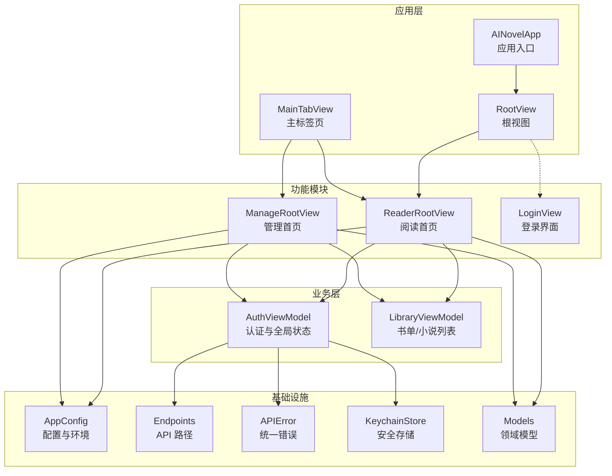
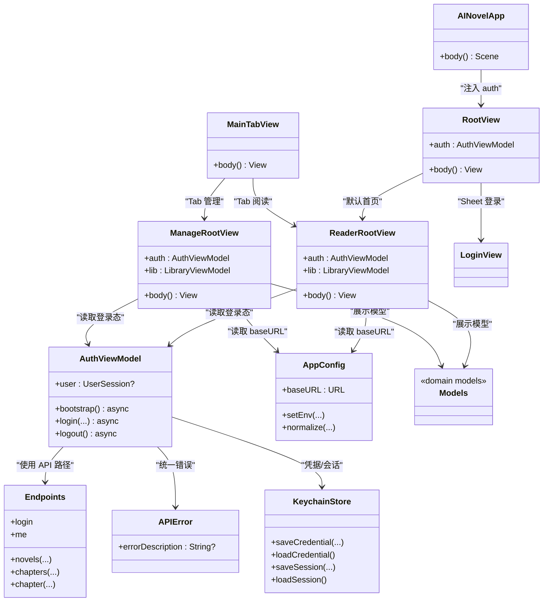
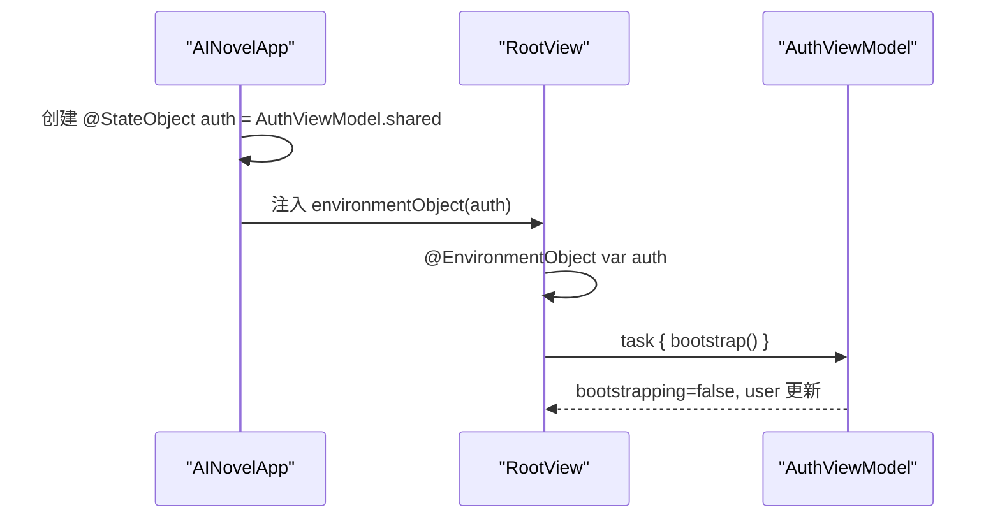
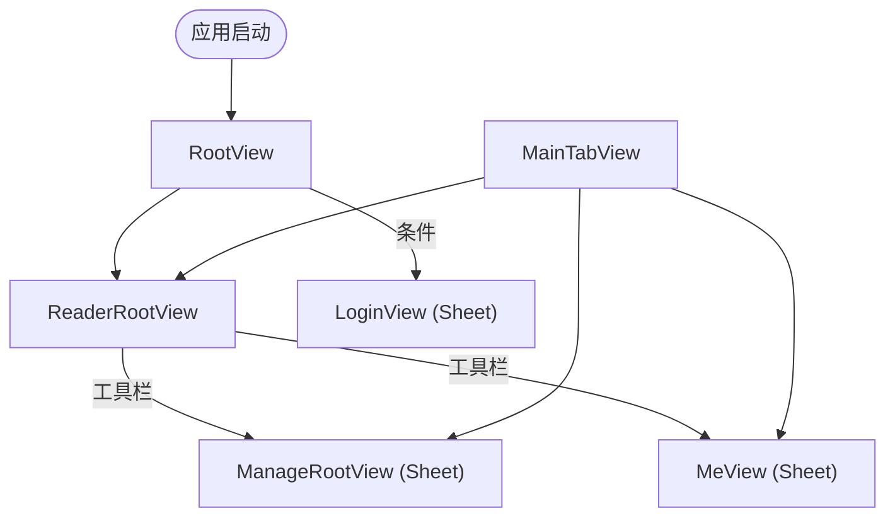
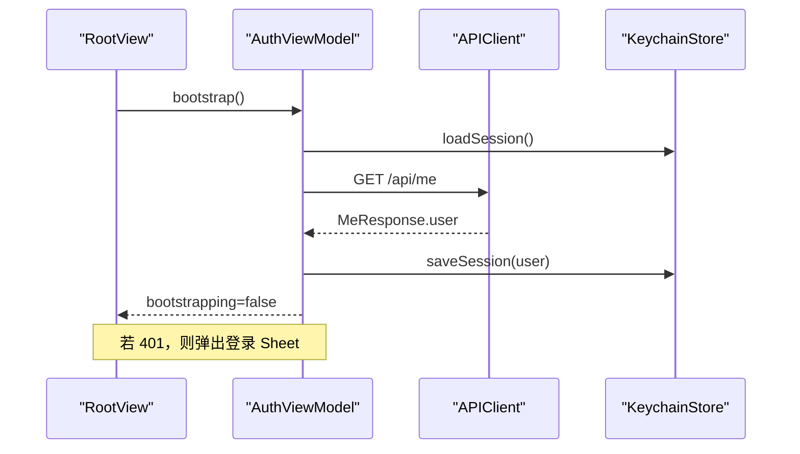
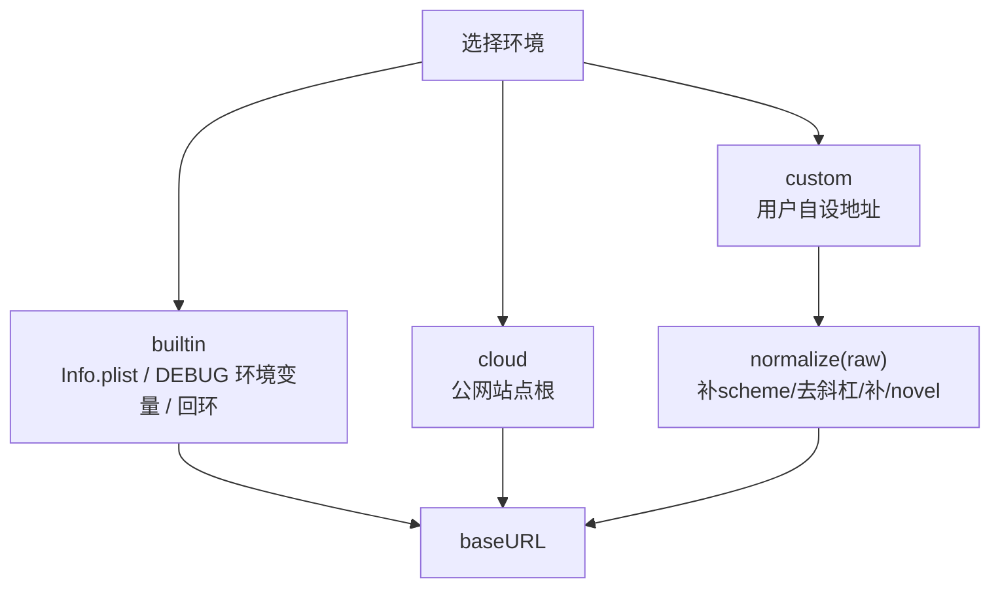
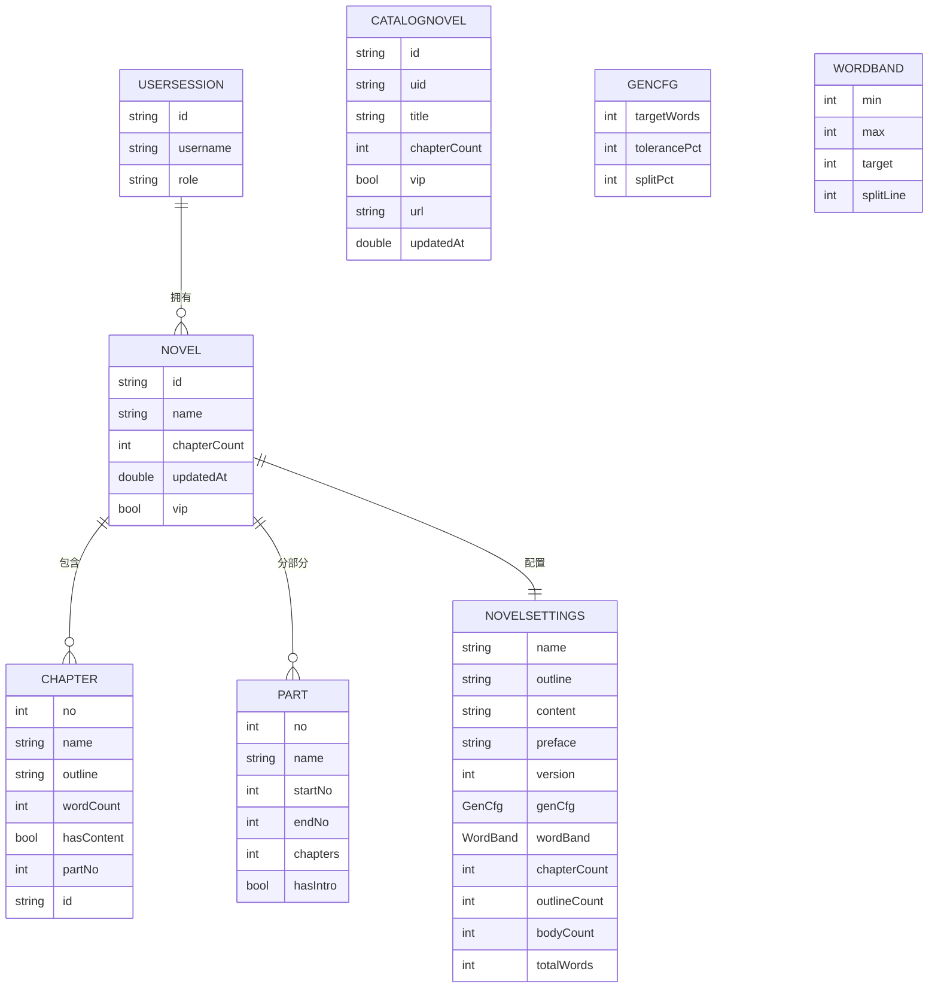
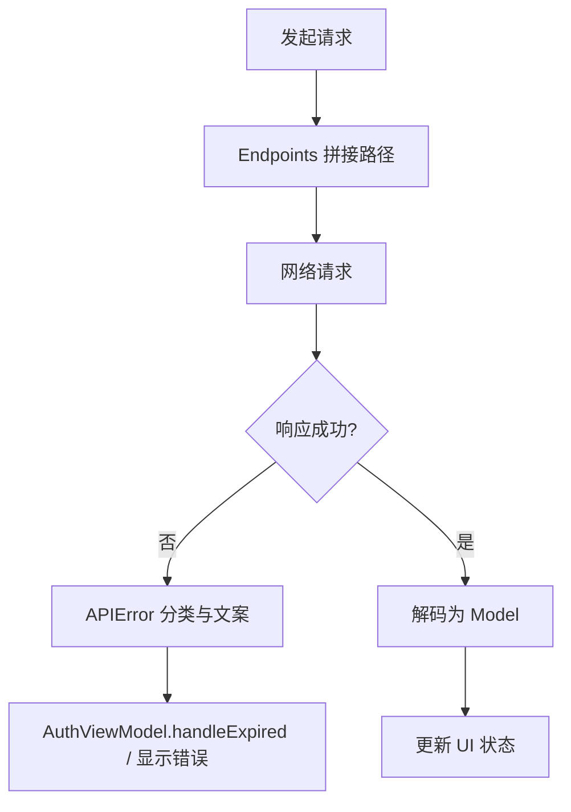
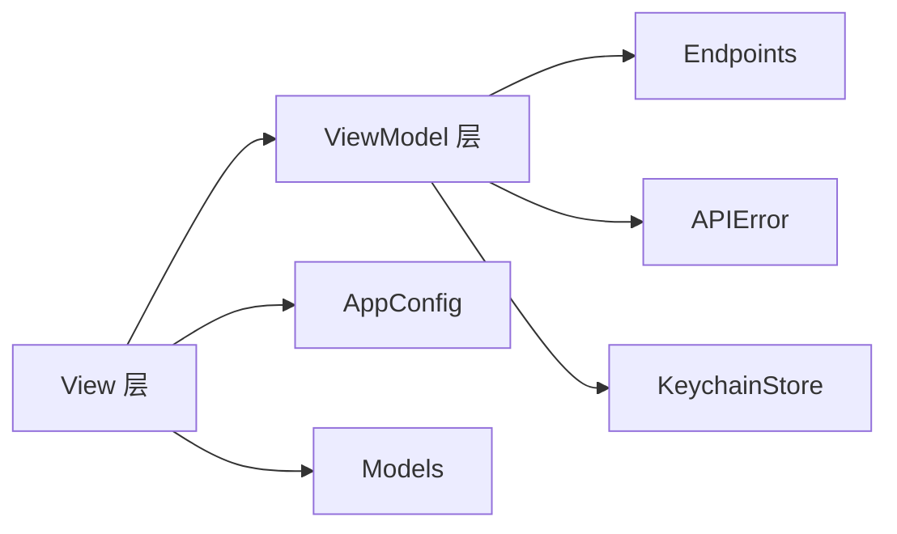

# iOS 应用架构

<cite>
**本文引用的文件**   
- [AINovelApp.swift](file://ios/AINovel/AINovelApp.swift)
- [RootView.swift](file://ios/AINovel/App/RootView.swift)
- [MainTabView.swift](file://ios/AINovel/App/MainTabView.swift)
- [ReaderRootView.swift](file://ios/AINovel/Reader/ReaderRootView.swift)
- [ManageRootView.swift](file://ios/AINovel/Manage/ManageRootView.swift)
- [AuthViewModel.swift](file://ios/AINovel/Auth/AuthViewModel.swift)
- [LoginView.swift](file://ios/AINovel/Auth/LoginView.swift)
- [AppConfig.swift](file://ios/AINovel/Config/AppConfig.swift)
- [Models.swift](file://ios/AINovel/Models/Models.swift)
- [APIError.swift](file://ios/AINovel/Networking/APIError.swift)
- [Endpoints.swift](file://ios/AINovel/Networking/Endpoints.swift)
- [KeychainStore.swift](file://ios/AINovel/Security/KeychainStore.swift)
</cite>

## 目录
1. [引言](#引言)
2. [项目结构](#项目结构)
3. [核心组件](#核心组件)
4. [架构总览](#架构总览)
5. [详细组件分析](#详细组件分析)
6. [依赖关系分析](#依赖关系分析)
7. [性能与可靠性考虑](#性能与可靠性考虑)
8. [故障排查指南](#故障排查指南)
9. [结论](#结论)

## 引言
本文件面向 AINovel iOS 应用的架构文档，聚焦 SwiftUI MVVM 模式在工程中的落地方式。内容覆盖：
- App 入口点配置、全局状态管理与依赖注入
- RootView 与 MainTabView 的导航结构与路由逻辑
- TabBar 组织方式与页面跳转策略
- AppConfig 的配置管理机制与环境变量处理
- 应用启动流程、生命周期管理与错误处理策略
- View / ViewModel / Model 分层关系与数据流向

该文档既适合初次接触项目的开发者快速上手，也便于资深工程师定位问题与扩展功能。

## 项目结构
iOS 端采用 SwiftUI + Combine 的 MVVM 架构，按功能域划分目录：
- App：应用级视图（根视图、主标签页）
- Reader：阅读相关视图与模型
- Manage：作品管理相关视图与模型
- Auth：认证与登录界面
- Config：应用配置与多环境支持
- Networking：网络请求错误类型与 API 端点定义
- Security：Keychain 安全存储封装
- Models：领域模型与响应体

**图表来源**
- [AINovelApp.swift:3-13](file://ios/AINovel/AINovelApp.swift#L3-L13)
- [RootView.swift:3-20](file://ios/AINovel/App/RootView.swift#L3-L20)
- [MainTabView.swift:3-16](file://ios/AINovel/App/MainTabView.swift#L3-L16)
- [ReaderRootView.swift:6-78](file://ios/AINovel/Reader/ReaderRootView.swift#L6-L78)
- [ManageRootView.swift:3-81](file://ios/AINovel/Manage/ManageRootView.swift#L3-L81)
- [AuthViewModel.swift:9-106](file://ios/AINovel/Auth/AuthViewModel.swift#L9-L106)
- [AppConfig.swift:11-110](file://ios/AINovel/Config/AppConfig.swift#L11-L110)
- [Endpoints.swift:5-50](file://ios/AINovel/Networking/Endpoints.swift#L5-L50)
- [APIError.swift:9-47](file://ios/AINovel/Networking/APIError.swift#L9-L47)
- [KeychainStore.swift:7-82](file://ios/AINovel/Security/KeychainStore.swift#L7-L82)
- [Models.swift:6-233](file://ios/AINovel/Models/Models.swift#L6-L233)

**章节来源**
- [AINovelApp.swift:3-13](file://ios/AINovel/AINovelApp.swift#L3-L13)
- [RootView.swift:3-20](file://ios/AINovel/App/RootView.swift#L3-L20)
- [MainTabView.swift:3-16](file://ios/AINovel/App/MainTabView.swift#L3-L16)

## 核心组件
- AINovelApp：应用入口，创建并注入全局 AuthViewModel，挂载 RootView。
- RootView：应用根视图，默认进入 ReaderRootView；按需弹出登录 Sheet；冷启动时触发认证引导。
- MainTabView：传统三栏 TabBar（阅读、管理、我的），用于旧版或特定场景下的导航。
- ReaderRootView：阅读首页，展示公开书单，未登录也可浏览；登录后显示“管理”“我的”工具栏入口。
- ManageRootView：管理首页，展示已登录用户拥有的小说列表，支持新建、删除等管理操作。
- AuthViewModel：认证与全局状态中心，负责登录态探测、登录/登出、记住密码、401 自动登出。
- AppConfig：配置中心，提供多环境 baseURL、超时时间、UI 语言等。
- Endpoints：集中化 API 路径枚举，与后端路由对齐。
- APIError：统一错误类型，将网络、HTTP、解码等异常转换为可读文案。
- KeychainStore：Keychain 封装，保存凭据与会话快照。
- Models：领域模型与响应体，包括用户会话、小说、章节、设置、通用 JSONValue 等。

**章节来源**
- [AINovelApp.swift:3-13](file://ios/AINovel/AINovelApp.swift#L3-L13)
- [RootView.swift:3-20](file://ios/AINovel/App/RootView.swift#L3-L20)
- [MainTabView.swift:3-16](file://ios/AINovel/App/MainTabView.swift#L3-L16)
- [ReaderRootView.swift:6-78](file://ios/AINovel/Reader/ReaderRootView.swift#L6-L78)
- [ManageRootView.swift:3-81](file://ios/AINovel/Manage/ManageRootView.swift#L3-L81)
- [AuthViewModel.swift:9-106](file://ios/AINovel/Auth/AuthViewModel.swift#L9-L106)
- [AppConfig.swift:11-110](file://ios/AINovel/Config/AppConfig.swift#L11-L110)
- [Endpoints.swift:5-50](file://ios/AINovel/Networking/Endpoints.swift#L5-L50)
- [APIError.swift:9-47](file://ios/AINovel/Networking/APIError.swift#L9-L47)
- [KeychainStore.swift:7-82](file://ios/AINovel/Security/KeychainStore.swift#L7-L82)
- [Models.swift:6-233](file://ios/AINovel/Models/Models.swift#L6-L233)

## 架构总览
下图展示 SwiftUI MVVM 的分层关系与数据流向：View 层通过 EnvironmentObject 获取 AuthViewModel，调用 APIClient（由 Endpoints 提供路径）访问后端；Model 层承载领域数据；AppConfig 提供运行时配置；KeychainStore 提供安全存储。

**图表来源**
- [AINovelApp.swift:3-13](file://ios/AINovel/AINovelApp.swift#L3-L13)
- [RootView.swift:3-20](file://ios/AINovel/App/RootView.swift#L3-L20)
- [MainTabView.swift:3-16](file://ios/AINovel/App/MainTabView.swift#L3-L16)
- [ReaderRootView.swift:6-78](file://ios/AINovel/Reader/ReaderRootView.swift#L6-L78)
- [ManageRootView.swift:3-81](file://ios/AINovel/Manage/ManageRootView.swift#L3-L81)
- [AuthViewModel.swift:9-106](file://ios/AINovel/Auth/AuthViewModel.swift#L9-L106)
- [AppConfig.swift:11-110](file://ios/AINovel/Config/AppConfig.swift#L11-L110)
- [Endpoints.swift:5-50](file://ios/AINovel/Networking/Endpoints.swift#L5-L50)
- [APIError.swift:9-47](file://ios/AINovel/Networking/APIError.swift#L9-L47)
- [KeychainStore.swift:7-82](file://ios/AINovel/Security/KeychainStore.swift#L7-L82)
- [Models.swift:6-233](file://ios/AINovel/Models/Models.swift#L6-L233)

## 详细组件分析

### App 入口与全局状态注入
- AINovelApp 使用 @StateObject 持有 AuthViewModel.shared，并通过 .environmentObject(auth) 注入到整个视图树。
- RootView 通过 @EnvironmentObject var auth: AuthViewModel 消费全局状态。
- 这种设计实现了“单一可信源”的全局登录态，避免在各 View 中重复维护状态。

**图表来源**
- [AINovelApp.swift:3-13](file://ios/AINovel/AINovelApp.swift#L3-L13)
- [RootView.swift:3-20](file://ios/AINovel/App/RootView.swift#L3-L20)
- [AuthViewModel.swift:37-54](file://ios/AINovel/Auth/AuthViewModel.swift#L37-L54)

**章节来源**
- [AINovelApp.swift:3-13](file://ios/AINovel/AINovelApp.swift#L3-L13)
- [RootView.swift:3-20](file://ios/AINovel/App/RootView.swift#L3-L20)

### RootView 与 MainTabView 导航结构
- RootView 默认进入 ReaderRootView，并在需要时弹出 LoginView Sheet。
- MainTabView 提供三个 Tab：阅读、管理、我的，适用于传统底部导航场景。
- 当前推荐入口是 RootView → ReaderRootView，管理/我的通过工具栏按钮以 Sheet 形式打开，保持阅读体验优先。

**图表来源**
- [RootView.swift:3-20](file://ios/AINovel/App/RootView.swift#L3-L20)
- [MainTabView.swift:3-16](file://ios/AINovel/App/MainTabView.swift#L3-L16)
- [ReaderRootView.swift:6-78](file://ios/AINovel/Reader/ReaderRootView.swift#L6-L78)
- [ManageRootView.swift:3-81](file://ios/AINovel/Manage/ManageRootView.swift#L3-L81)

**章节来源**
- [RootView.swift:3-20](file://ios/AINovel/App/RootView.swift#L3-L20)
- [MainTabView.swift:3-16](file://ios/AINovel/App/MainTabView.swift#L3-L16)
- [ReaderRootView.swift:6-78](file://ios/AINovel/Reader/ReaderRootView.swift#L6-L78)
- [ManageRootView.swift:3-81](file://ios/AINovel/Manage/ManageRootView.swift#L3-L81)

### 认证流程与生命周期管理
- 冷启动：RootView 在 .task 中调用 AuthViewModel.bootstrap()，先尝试从 Keychain 恢复会话快照，再请求 /api/me 确认权威登录态。
- 登录：LoginView 调用 AuthViewModel.login(...)，成功后保存会话快照与可选凭据，关闭 Sheet。
- 401 处理：APIClient 触发 onUnauthorized 回调，AuthViewModel 清理本地会话并弹出登录 Sheet。
- 登出：AuthViewModel.logout() 调用服务端登出接口，清理本地会话。

**图表来源**
- [RootView.swift:14-18](file://ios/AINovel/App/RootView.swift#L14-L18)
- [AuthViewModel.swift:26-54](file://ios/AINovel/Auth/AuthViewModel.swift#L26-L54)
- [KeychainStore.swift:31-44](file://ios/AINovel/Security/KeychainStore.swift#L31-L44)

**章节来源**
- [AuthViewModel.swift:9-106](file://ios/AINovel/Auth/AuthViewModel.swift#L9-L106)
- [LoginView.swift:3-78](file://ios/AINovel/Auth/LoginView.swift#L3-L78)
- [KeychainStore.swift:7-82](file://ios/AINovel/Security/KeychainStore.swift#L7-L82)

### 配置管理（AppConfig）
- 优先级：用户选择的接入环境 > 用户自设地址 > Info.plist / 编译默认。
- 环境变量：DEBUG 模式下可从进程环境变量读取 AINovel_BASE_URL。
- 规范化：自动补 scheme、去尾斜杠、无路径时补 /novel 前缀。
- 多环境：内置 builtin、公网 cloud、自定义 custom，切换时清除不兼容的自设地址。
- 超时：通用请求超时与 LLM 长耗时接口超时分别配置。

**图表来源**
- [AppConfig.swift:24-40](file://ios/AINovel/Config/AppConfig.swift#L24-L40)
- [AppConfig.swift:51-67](file://ios/AINovel/Config/AppConfig.swift#L51-L67)
- [AppConfig.swift:89-102](file://ios/AINovel/Config/AppConfig.swift#L89-L102)

**章节来源**
- [AppConfig.swift:11-110](file://ios/AINovel/Config/AppConfig.swift#L11-L110)

### 数据模型与领域对象
- 认证：UserSession、MeResponse、LoginResponse。
- 小说：Novel、CatalogNovel、CreateNovelResponse。
- 章节：Chapter、ChapterDetail、ChaptersResponse、ChapterResponse。
- 设定：GenCfg、WordBand、NovelSettings、SaveSettingsResponse。
- 分部：Part、PartsResponse。
- 阅读器 AI：QuizQuestion、VocabResponse、ExplainResponse、AskResponse、FeedbackResponse、WordStatusResponse。
- 分享/发布/检查：ShareResponse、PublishResponse、CheckResponse。
- 通用动作：RunResponse、LLMStatus、RenumberResponse、OkResponse。
- 宽松 JSON：JSONValue 用于 /api/run 的 result 与体检 report 的多变形状兜底。

**图表来源**
- [Models.swift:6-233](file://ios/AINovel/Models/Models.swift#L6-L233)

**章节来源**
- [Models.swift:6-233](file://ios/AINovel/Models/Models.swift#L6-L233)

### 网络与错误处理
- Endpoints：集中定义所有 API 路径，与后端路由对齐，参数化拼接。
- APIError：统一错误类型，涵盖网络、无效响应、解码失败、未授权、取消、HTTP 状态码等，并提供本地化描述。
- AuthViewModel：注册 401 回调，统一处理过期与匿名访问受限场景。

**图表来源**
- [Endpoints.swift:5-50](file://ios/AINovel/Networking/Endpoints.swift#L5-L50)
- [APIError.swift:9-47](file://ios/AINovel/Networking/APIError.swift#L9-L47)
- [AuthViewModel.swift:89-96](file://ios/AINovel/Auth/AuthViewModel.swift#L89-L96)

**章节来源**
- [Endpoints.swift:5-50](file://ios/AINovel/Networking/Endpoints.swift#L5-L50)
- [APIError.swift:9-47](file://ios/AINovel/Networking/APIError.swift#L9-L47)
- [AuthViewModel.swift:89-96](file://ios/AINovel/Auth/AuthViewModel.swift#L89-L96)

## 依赖关系分析
- View 层依赖 ViewModel 提供的状态与方法，通过 EnvironmentObject 注入。
- ViewModel 依赖 Endpoints 提供 API 路径，依赖 APIError 统一错误，依赖 KeychainStore 持久化凭据与会话快照。
- 配置层 AppConfig 被多个 View 与 ViewModel 共享，确保 baseURL 一致性。
- Model 层作为纯数据结构，被 View 与 ViewModel 共同消费。

**图表来源**
- [RootView.swift:3-20](file://ios/AINovel/App/RootView.swift#L3-L20)
- [ReaderRootView.swift:6-78](file://ios/AINovel/Reader/ReaderRootView.swift#L6-L78)
- [ManageRootView.swift:3-81](file://ios/AINovel/Manage/ManageRootView.swift#L3-L81)
- [AuthViewModel.swift:9-106](file://ios/AINovel/Auth/AuthViewModel.swift#L9-L106)
- [AppConfig.swift:11-110](file://ios/AINovel/Config/AppConfig.swift#L11-L110)
- [Endpoints.swift:5-50](file://ios/AINovel/Networking/Endpoints.swift#L5-L50)
- [APIError.swift:9-47](file://ios/AINovel/Networking/APIError.swift#L9-L47)
- [KeychainStore.swift:7-82](file://ios/AINovel/Security/KeychainStore.swift#L7-L82)
- [Models.swift:6-233](file://ios/AINovel/Models/Models.swift#L6-L233)

**章节来源**
- [AuthViewModel.swift:9-106](file://ios/AINovel/Auth/AuthViewModel.swift#L9-L106)
- [AppConfig.swift:11-110](file://ios/AINovel/Config/AppConfig.swift#L11-L110)
- [Endpoints.swift:5-50](file://ios/AINovel/Networking/Endpoints.swift#L5-L50)
- [APIError.swift:9-47](file://ios/AINovel/Networking/APIError.swift#L9-L47)
- [KeychainStore.swift:7-82](file://ios/AINovel/Security/KeychainStore.swift#L7-L82)
- [Models.swift:6-233](file://ios/AINovel/Models/Models.swift#L6-L233)

## 性能与可靠性考虑
- 冷启动优化：先用 Keychain 快照回填界面，再异步探测 /api/me，避免闪屏与白屏。
- 超时控制：通用请求与 LLM 长耗时接口分别配置超时，提升用户体验与稳定性。
- 错误本地化：APIError 将网络与 HTTP 状态映射为中文提示，降低用户困惑。
- 会话持久化：httpOnly Cookie 维持权威会话，Keychain 仅存快照与凭据，减少敏感信息暴露面。
- 配置即时生效：每次动态读取 baseURL，切换环境无需重启应用。

[本节为通用指导，不涉及具体代码片段]

## 故障排查指南
- 无法连接服务器：检查 AppConfig.baseURL 是否正确，确认 Info.plist 或环境变量是否配置正确。
- 登录失败：查看 AuthViewModel.errorMessage，确认用户名/密码与服务器地址；必要时切换到 ServerSettingsView 调整 baseURL。
- 401 自动登出：确认 Cookie 是否有效；更换服务器地址后需重新登录。
- 数据解析失败：检查后端返回体是否与 Models 定义一致；必要时放宽 JSONValue 的使用。
- 网络超时：根据接口类型调整超时配置；LLM 类接口建议更长超时。

**章节来源**
- [APIError.swift:9-47](file://ios/AINovel/Networking/APIError.swift#L9-L47)
- [AuthViewModel.swift:56-80](file://ios/AINovel/Auth/AuthViewModel.swift#L56-L80)
- [AppConfig.swift:24-40](file://ios/AINovel/Config/AppConfig.swift#L24-L40)
- [AppConfig.swift:89-102](file://ios/AINovel/Config/AppConfig.swift#L89-L102)

## 结论
AINovel iOS 应用采用清晰的 SwiftUI MVVM 架构：
- App 入口集中注入全局状态，RootView 作为默认入口，ReaderRootView 承担主要阅读体验。
- AuthViewModel 统一管理认证与全局状态，结合 KeychainStore 实现凭据与会话快照的安全存储。
- AppConfig 提供多环境 baseURL 与超时配置，保证运行期灵活性与可维护性。
- Endpoints 与 APIError 统一网络契约与错误处理，提升健壮性与可观测性。
- Models 作为领域层，清晰表达业务实体与响应结构。

该架构具备良好的可扩展性与可测试性，便于后续新增功能与优化体验。