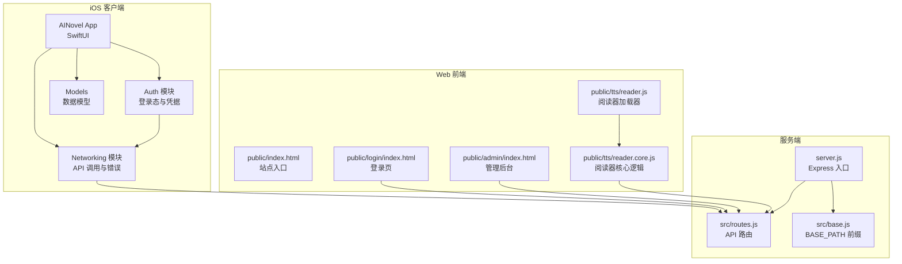
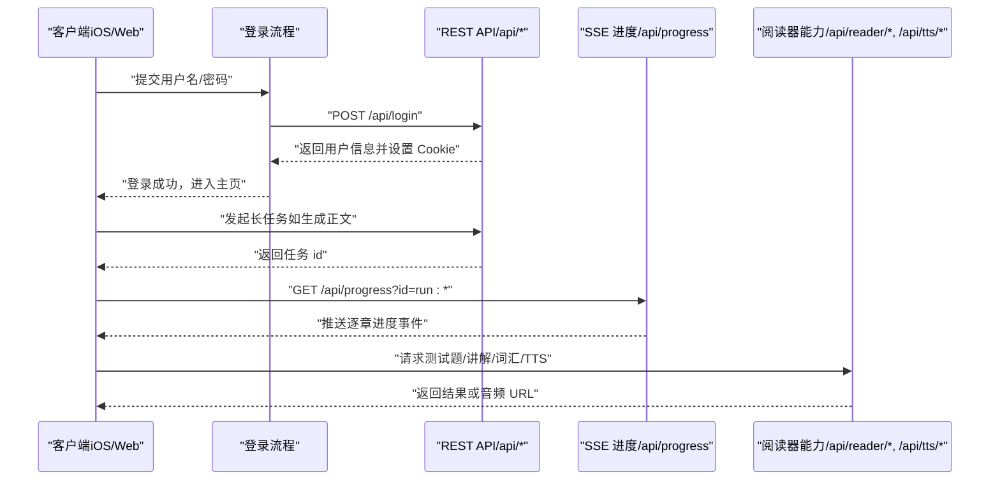
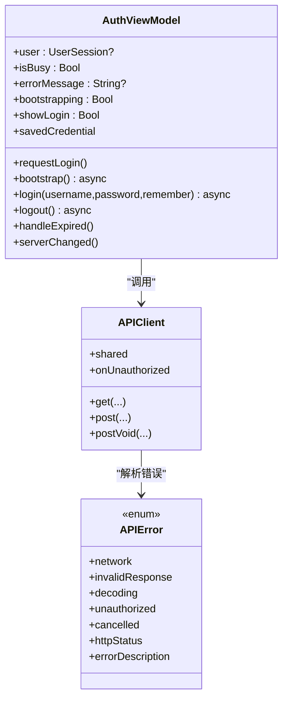
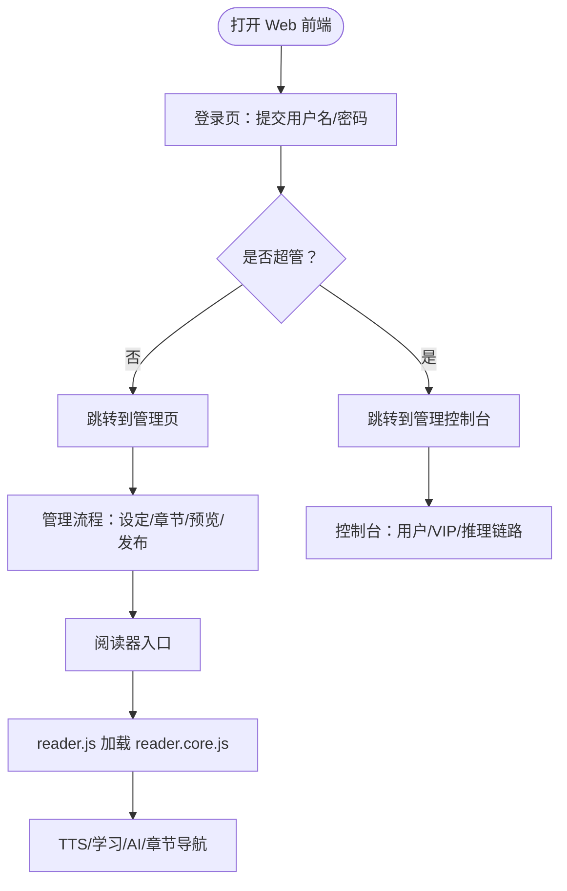
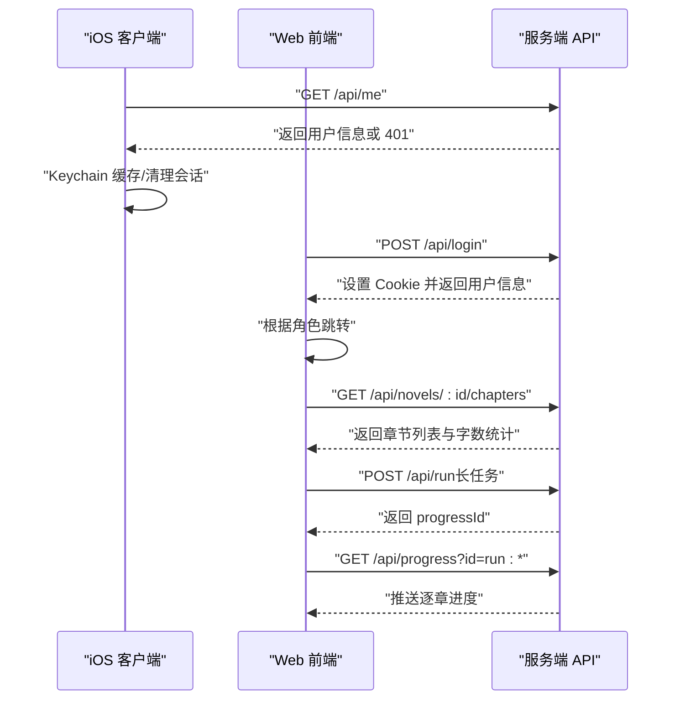
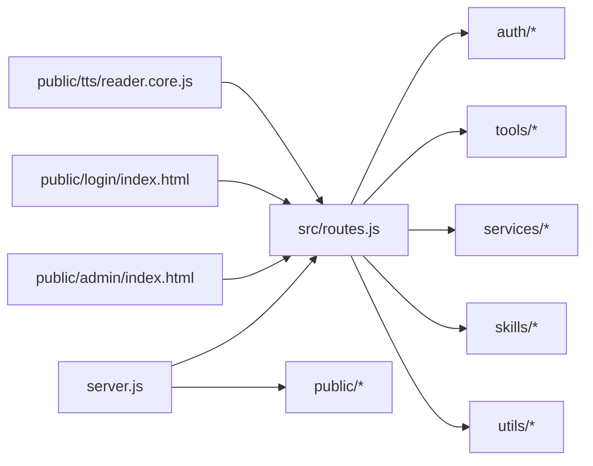

# 前端架构设计

<cite>
**本文引用的文件**   
- [README.md](file://README.md)
- [package.json](file://package.json)
- [server.js](file://server.js)
- [src/base.js](file://src/base.js)
- [src/routes.js](file://src/routes.js)
- [public/index.html](file://public/index.html)
- [public/login/index.html](file://public/login/index.html)
- [public/admin/index.html](file://public/admin/index.html)
- [public/tts/reader.js](file://public/tts/reader.js)
- [public/tts/reader.core.js](file://public/tts/reader.core.js)
- [ios/AINovel/Auth/AuthViewModel.swift](file://ios/AINovel/Auth/AuthViewModel.swift)
- [ios/AINovel/Networking/APIError.swift](file://ios/AINovel/Networking/APIError.swift)
</cite>

## 目录
1. [引言](#引言)
2. [项目结构](#项目结构)
3. [核心组件](#核心组件)
4. [架构总览](#架构总览)
5. [详细组件分析](#详细组件分析)
6. [依赖关系分析](#依赖关系分析)
7. [性能与可用性考虑](#性能与可用性考虑)
8. [故障排查指南](#故障排查指南)
9. [结论](#结论)
10. [附录：跨平台适配策略](#附录跨平台适配策略)

## 引言
本文件为 AINovel 前端架构文档，覆盖 iOS SwiftUI 应用与 Web 前端的整体设计。iOS 端采用 MVVM 分层（View / ViewModel / Model），Web 端由登录页、管理后台与阅读器三部分组成，通过 RESTful API 与后端服务通信，统一处理鉴权、限流、长任务进度与错误提示。文档同时说明前后端通信机制、状态同步与跨平台一致性策略，并给出架构图与组件关系图。

## 项目结构
- iOS SwiftUI 工程位于 ios/AINovel，按功能域划分模块：Auth、Manage、Reader、Models、Networking、Security、App 等。
- Web 静态资源位于 public，包含首页入口、登录页、管理后台与阅读器资源；服务端通过 Express 提供 API 与静态页面。
- 后端路由集中在 src/routes.js，负责鉴权、租户隔离、VIP 授权、章节与发布接口、TTS 与阅读器 AI 能力。
- 站点挂载前缀由 src/base.js 统一管理，对外暴露的 API、登录、管理与阅读资源均遵循同一前缀规则。

**图表来源**
- [server.js:1-64](file://server.js#L1-L64)
- [src/base.js:1-42](file://src/base.js#L1-L42)
- [src/routes.js:1-800](file://src/routes.js#L1-L800)
- [public/index.html:1-42](file://public/index.html#L1-L42)
- [public/login/index.html:1-69](file://public/login/index.html#L1-L69)
- [public/admin/index.html:1-800](file://public/admin/index.html#L1-L800)
- [public/tts/reader.js:1-47](file://public/tts/reader.js#L1-L47)
- [public/tts/reader.core.js:1-200](file://public/tts/reader.core.js#L1-L200)

**章节来源**
- [README.md:166-202](file://README.md#L166-L202)
- [package.json:1-29](file://package.json#L1-L29)

## 核心组件
- iOS 认证与网络层：AuthViewModel 负责会话冷启动、登录、记住密码、登出与 401 自动登出；APIError 统一解析后端错误体与 HTTP 状态码。
- Web 登录与管理：login/index.html 实现用户名密码登录、角色跳转；admin/index.html 提供小说管理、章节增删改、预览与发布、长任务遮罩与 SSE 进度。
- Web 阅读器：reader.js 作为稳定加载器，动态引入 reader.core.js 与样式；reader.core.js 实现 TTS 朗读、学习模式、AI 问答、章节导航与设置持久化。
- 服务端路由：routes.js 集中定义登录、读者 AI、TTS、章节、发布、VIP 授权、进度通道与限流；base.js 提供 BASE_PATH 与 sitePath 工具。

**章节来源**
- [ios/AINovel/Auth/AuthViewModel.swift:1-107](file://ios/AINovel/Auth/AuthViewModel.swift#L1-L107)
- [ios/AINovel/Networking/APIError.swift:1-51](file://ios/AINovel/Networking/APIError.swift#L1-L51)
- [public/login/index.html:1-69](file://public/login/index.html#L1-L69)
- [public/admin/index.html:1-800](file://public/admin/index.html#L1-L800)
- [public/tts/reader.js:1-47](file://public/tts/reader.js#L1-L47)
- [public/tts/reader.core.js:1-200](file://public/tts/reader.core.js#L1-L200)
- [src/routes.js:1-800](file://src/routes.js#L1-L800)
- [src/base.js:1-42](file://src/base.js#L1-L42)

## 架构总览
系统采用“多端前端 + 单一服务端”的架构：
- iOS 客户端通过 URLSession 调用 REST API，使用 Cookie 维持会话，结合 Keychain 存储会话快照与凭据。
- Web 前端以 HTML/CSS/JS 组织，登录与管理后台直接调用 /api/*，阅读器通过 reader.core.js 调用 /api/reader/* 与 /api/tts/*。
- 服务端统一处理鉴权、租户隔离、VIP 授权、长任务互斥与 SSE 进度推送，静态资源由 Express 托管。

**图表来源**
- [public/login/index.html:35-69](file://public/login/index.html#L35-L69)
- [src/routes.js:341-350](file://src/routes.js#L341-L350)
- [src/routes.js:573-627](file://src/routes.js#L573-L627)
- [src/routes.js:352-428](file://src/routes.js#L352-L428)
- [src/routes.js:456-513](file://src/routes.js#L456-L513)

## 详细组件分析

### iOS SwiftUI 应用（MVVM）
- View：各功能视图（登录、管理、阅读器）绑定 ViewModel 的 @Published 属性，展示状态与触发操作。
- ViewModel：AuthViewModel 管理登录态、会话缓存、错误消息与 UI 交互；其他业务 ViewModel（如 Manage、Reader）负责数据获取与状态更新。
- Model：Models.swift 定义 UserSession 等数据结构；Networking 封装 APIClient、Endpoint 与 APIError。

**图表来源**
- [ios/AINovel/Auth/AuthViewModel.swift:1-107](file://ios/AINovel/Auth/AuthViewModel.swift#L1-L107)
- [ios/AINovel/Networking/APIError.swift:1-51](file://ios/AINovel/Networking/APIError.swift#L1-L51)

**章节来源**
- [ios/AINovel/Auth/AuthViewModel.swift:1-107](file://ios/AINovel/Auth/AuthViewModel.swift#L1-L107)
- [ios/AINovel/Networking/APIError.swift:1-51](file://ios/AINovel/Networking/APIError.swift#L1-L51)

### Web 前端（HTML/CSS/JS）
- 登录页：读取 BASE 前缀，提交 /api/login，成功后根据角色跳转到管理控制台或管理页；支持 next 参数回跳站内路径。
- 管理后台：提供小说列表、设定编辑、章节增删改、预览与发布、长任务遮罩与 SSE 进度；统一 api() 封装 fetch，处理 401 重定向与错误提示。
- 阅读器：reader.js 作为稳定入口，动态加载 reader.core.js 与样式；reader.core.js 构建悬浮工具栏、TTS 面板、学习设置、AI 问答与章节导航，并通过 /api/reader/* 与 /api/tts/* 调用后端能力。

**图表来源**
- [public/login/index.html:35-69](file://public/login/index.html#L35-L69)
- [public/admin/index.html:267-800](file://public/admin/index.html#L267-L800)
- [public/tts/reader.js:1-47](file://public/tts/reader.js#L1-L47)
- [public/tts/reader.core.js:1-200](file://public/tts/reader.core.js#L1-L200)

**章节来源**
- [public/login/index.html:1-69](file://public/login/index.html#L1-L69)
- [public/admin/index.html:1-800](file://public/admin/index.html#L1-L800)
- [public/tts/reader.js:1-47](file://public/tts/reader.js#L1-L47)
- [public/tts/reader.core.js:1-200](file://public/tts/reader.core.js#L1-L200)

### 前后端通信机制
- RESTful API：登录、用户信息、小说 CRUD、章节列表与正文、设定读写、预览与发布、VIP 授权、菜单与工具清单、LLM 链路预检、进度通道、读者 AI 与 TTS。
- 状态同步：Cookie 维持会话；iOS 侧用 Keychain 缓存会话快照，冷启动探测 /api/me 确认权威登录态；Web 侧在 401 时重定向到登录页。
- 错误处理：iOS 端 APIError 统一解析网络错误、解码失败、未授权与 HTTP 状态码；Web 端 api() 捕获非 2xx 响应并抛出错误，401 自动跳转登录。

**图表来源**
- [src/routes.js:341-350](file://src/routes.js#L341-L350)
- [src/routes.js:639-708](file://src/routes.js#L639-L708)
- [src/routes.js:573-627](file://src/routes.js#L573-L627)
- [ios/AINovel/Auth/AuthViewModel.swift:37-54](file://ios/AINovel/Auth/AuthViewModel.swift#L37-L54)

**章节来源**
- [src/routes.js:1-800](file://src/routes.js#L1-L800)
- [ios/AINovel/Auth/AuthViewModel.swift:1-107](file://ios/AINovel/Auth/AuthViewModel.swift#L1-L107)
- [public/admin/index.html:358-379](file://public/admin/index.html#L358-L379)

## 依赖关系分析
- server.js 初始化 Express、CORS、JSON 解析、BASE_PATH 前缀平移、全局数据库引导与桥接服务初始化，随后注册 routes 并提供静态资源。
- src/base.js 提供 BASE_PATH 与 APP_NAMESPACES，确保对外 API、登录、管理与阅读资源路径一致。
- src/routes.js 依赖 auth/session、auth/userStore、services/bridgeStore、tools/registry、skills/novelPublisher/publish、services/preview、utils/wordTarget 等模块，集中实现业务逻辑。
- Web 前端依赖服务端提供的 /api/* 与静态资源；阅读器 reader.core.js 通过自定位推导 BASE 前缀，避免硬编码路径。

**图表来源**
- [server.js:1-64](file://server.js#L1-L64)
- [src/base.js:1-42](file://src/base.js#L1-L42)
- [src/routes.js:1-800](file://src/routes.js#L1-L800)
- [public/admin/index.html:1-800](file://public/admin/index.html#L1-L800)
- [public/login/index.html:1-69](file://public/login/index.html#L1-L69)
- [public/tts/reader.core.js:1-200](file://public/tts/reader.core.js#L1-L200)

**章节来源**
- [server.js:1-64](file://server.js#L1-L64)
- [src/base.js:1-42](file://src/base.js#L1-L42)
- [src/routes.js:1-800](file://src/routes.js#L1-L800)

## 性能与可用性考虑
- 长任务反馈：管理后台使用遮罩与计时，SSE 推送逐章进度；快速任务延迟显示遮罩以避免闪烁。
- 限流与并发：读者 AI 与 TTS 接口按 IP 定窗限流；长任务按书互斥，防止并发改写正文与章号。
- 资源缓存：阅读器 core 与样式通过时间戳加载，历史章节页无需重新发布即可生效；静态资源使用 ETag 与 max-age 控制缓存。
- 超时与预算：TTS 与 LLM 调用设置合理超时；正文生成按目标字数计算预算，避免上游服务硬切。

**章节来源**
- [public/admin/index.html:301-373](file://public/admin/index.html#L301-L373)
- [src/routes.js:289-306](file://src/routes.js#L289-L306)
- [src/routes.js:629-637](file://src/routes.js#L629-L637)
- [public/tts/reader.js:1-47](file://public/tts/reader.js#L1-L47)
- [public/tts/reader.core.js:1-200](file://public/tts/reader.core.js#L1-L200)

## 故障排查指南
- 登录失败：检查 /api/login 响应与 Cookie；iOS 端查看 APIError.unauthorized 与 handleExpired 逻辑；Web 端 401 会重定向到登录页。
- 章节 404：确认 chapterUrl 解码与路径校验；服务端 resolveChapterFile 对非法路径与不存在文件返回明确错误。
- TTS 合成失败：检查音色与语速白名单、章节正文存在性；服务端 ttsFail 返回具体阶段与原因。
- 长任务无进度：确认 progressId 格式与会话；SSE 连接需保留心跳与缓冲补发。

**章节来源**
- [public/login/index.html:49-69](file://public/login/index.html#L49-L69)
- [ios/AINovel/Networking/APIError.swift:9-47](file://ios/AINovel/Networking/APIError.swift#L9-L47)
- [src/routes.js:308-329](file://src/routes.js#L308-L329)
- [src/routes.js:456-513](file://src/routes.js#L456-L513)
- [src/routes.js:573-627](file://src/routes.js#L573-L627)

## 结论
AINovel 前端通过 iOS SwiftUI 的 MVVM 与 Web 的模块化 HTML/CSS/JS 共同支撑阅读、管理与学习三大场景。服务端统一提供鉴权、租户隔离、VIP 授权、长任务与阅读器能力，前后端通过 RESTful API 与 SSE 保持状态一致。跨平台适配通过统一的 BASE_PATH 与稳定的资源加载策略，确保移动端与 Web 端体验一致。

## 附录：跨平台适配策略
- 统一前缀：BASE_PATH 决定对外 API、登录、管理与阅读资源路径，开发环境与线上环境 URL 一致，避免代理后路径漂移。
- 会话一致性：iOS 与 Web 共用 Cookie 会话；iOS 用 Keychain 缓存会话快照，冷启动探测 /api/me 确认权威登录态。
- 阅读器一致性：reader.js 作为稳定加载器，reader.core.js 动态加载并自定位 BASE 前缀，历史章节页无需重新发布。
- 错误与限流：iOS 端 APIError 统一错误文案；Web 端 api() 统一错误处理；服务端按 IP 限流与长任务互斥，保证多端并发安全。

**章节来源**
- [src/base.js:1-42](file://src/base.js#L1-L42)
- [ios/AINovel/Auth/AuthViewModel.swift:37-54](file://ios/AINovel/Auth/AuthViewModel.swift#L37-L54)
- [public/tts/reader.js:1-47](file://public/tts/reader.js#L1-L47)
- [public/tts/reader.core.js:18-31](file://public/tts/reader.core.js#L18-L31)
- [src/routes.js:289-306](file://src/routes.js#L289-L306)