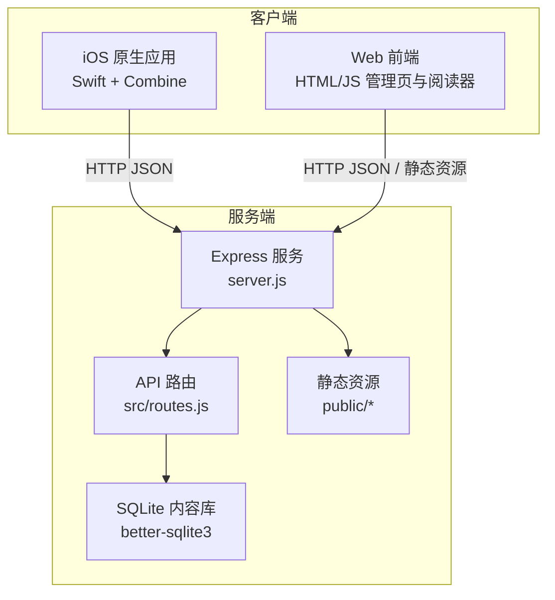
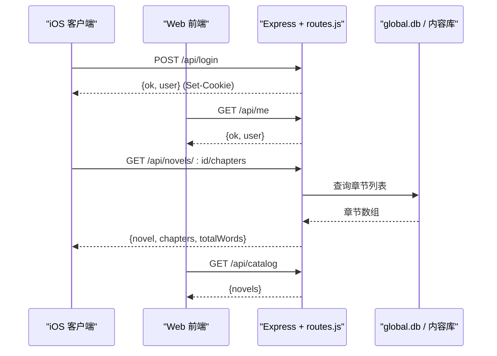
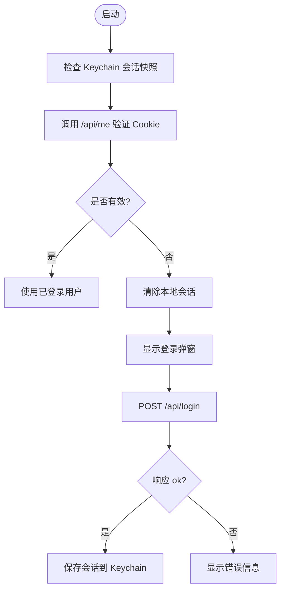
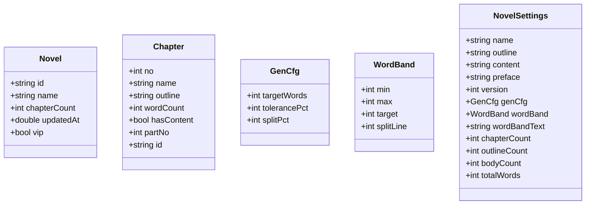
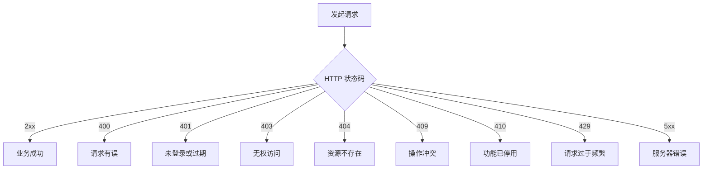
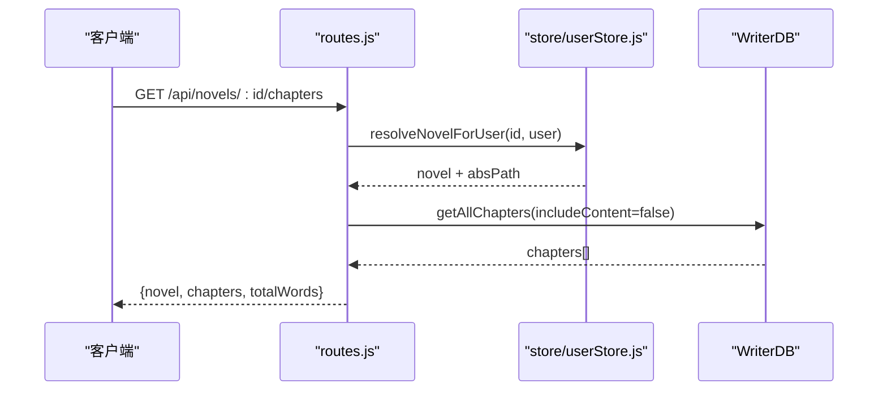
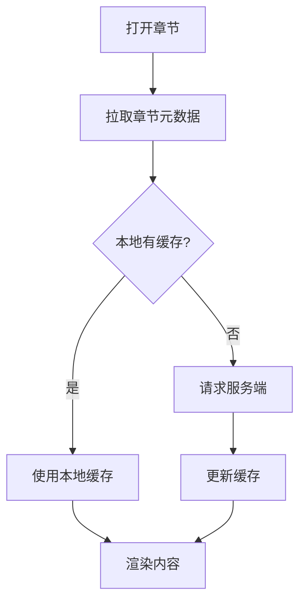
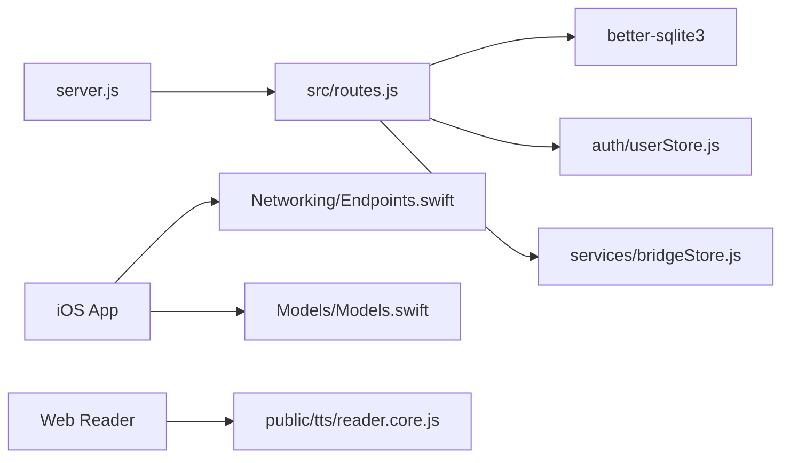

# 跨平台设计

<cite>
**本文引用的文件**   
- [server.js](file://server.js)
- [src/routes.js](file://src/routes.js)
- [package.json](file://package.json)
- [README.md](file://README.md)
- [ios/AINovel/Networking/Endpoints.swift](file://ios/AINovel/Networking/Endpoints.swift)
- [ios/AINovel/Networking/APIError.swift](file://ios/AINovel/Networking/APIError.swift)
- [ios/AINovel/Auth/AuthViewModel.swift](file://ios/AINovel/Auth/AuthViewModel.swift)
- [ios/AINovel/Models/Models.swift](file://ios/AINovel/Models/Models.swift)
- [ios/AINovel/Config/AppConfig.swift](file://ios/AINovel/Config/AppConfig.swift)
- [public/tts/reader.core.js](file://public/tts/reader.core.js)
</cite>

## 目录
1. [引言](#引言)
2. [项目结构](#项目结构)
3. [核心组件](#核心组件)
4. [架构总览](#架构总览)
5. [详细组件分析](#详细组件分析)
6. [依赖关系分析](#依赖关系分析)
7. [性能与可扩展性](#性能与可扩展性)
8. [故障排查指南](#故障排查指南)
9. [结论](#结论)
10. [附录：API 契约与数据格式](#附录api-契约与数据格式)

## 引言
本文件面向 AINovel 的跨平台设计，目标是统一 iOS 原生应用与 Web 前端（管理页、阅读器）的用户体验。文档从系统架构、前后端通信协议、RESTful API 设计原则、认证机制、状态同步策略、平台适配方案、最佳实践与性能优化等维度展开，帮助读者在 iOS 与 Web 两端保持一致的数据语义、错误处理与交互行为。

## 项目结构
AINovel 采用“Node.js + Express 后端 + SQLite”作为统一服务层，对外暴露 REST API；iOS 通过 URLSession 调用同一套接口；Web 侧由静态 HTML/JS 直接访问 API 或读取已发布的书页资源。

**图表来源**
- [server.js:9-53](file://server.js#L9-L53)
- [src/routes.js:331-339](file://src/routes.js#L331-L339)

**章节来源**
- [server.js:1-64](file://server.js#L1-L64)
- [package.json:1-29](file://package.json#L1-L29)
- [README.md:166-202](file://README.md#L166-L202)

## 核心组件
- 服务入口与静态资源挂载：Express 启动、CORS、JSON 解析、BASE_PATH 前缀剥离、静态目录挂载。
- API 路由与鉴权：登录/登出、会话 Cookie、租户隔离、VIP 授权、长任务 SSE 进度、通用动作执行。
- iOS 网络层：Endpoint 枚举、APIError 统一错误体、AuthViewModel 会话生命周期、AppConfig 多环境 baseURL。
- Web 阅读器：reader.core.js 动态加载、TTS 双引擎、学习模式、AI 问答、缓存键设计。

**章节来源**
- [server.js:22-53](file://server.js#L22-L53)
- [src/routes.js:341-350](file://src/routes.js#L341-L350)
- [ios/AINovel/Networking/Endpoints.swift:1-51](file://ios/AINovel/Networking/Endpoints.swift#L1-L51)
- [ios/AINovel/Networking/APIError.swift:1-51](file://ios/AINovel/Networking/APIError.swift#L1-L51)
- [ios/AINovel/Auth/AuthViewModel.swift:1-107](file://ios/AINovel/Auth/AuthViewModel.swift#L1-L107)
- [ios/AINovel/Config/AppConfig.swift:1-111](file://ios/AINovel/Config/AppConfig.swift#L1-L111)
- [public/tts/reader.core.js:1-200](file://public/tts/reader.core.js#L1-L200)

## 架构总览
整体采用“单一后端 + 多客户端”的跨平台架构：
- 后端提供统一的 REST API，负责用户认证、小说元数据、章节读写、发布、预览、VIP 授权、TTS、阅读 AI 能力。
- iOS 客户端通过 Endpoint 枚举集中维护 API 路径，使用统一的 APIError 映射 HTTP 状态码为可读文案，并通过 Keychain 保存会话快照与凭据。
- Web 前端直接消费 API，同时通过 `/novel` 前缀下的静态资源提供读者站页面；阅读器核心逻辑以独立 JS 文件按时间戳加载，避免缓存问题。

**图表来源**
- [src/routes.js:341-350](file://src/routes.js#L341-L350)
- [src/routes.js:519-557](file://src/routes.js#L519-L557)
- [src/routes.js:686-708](file://src/routes.js#L686-L708)

## 详细组件分析

### 认证与会话机制
- 后端登录返回 Set-Cookie，后续请求自动携带 httpOnly Cookie；除公开接口外，所有 `/api` 需登录态。
- iOS 冷启动用 Keychain 快照回填界面，再调 `/api/me` 校验权威登录态；401 时清空本地会话并拉起登录弹窗。
- Web 端通过浏览器 Cookie 维持会话；未登录访问受保护页面会被重定向到登录页。

**图表来源**
- [ios/AINovel/Auth/AuthViewModel.swift:26-54](file://ios/AINovel/Auth/AuthViewModel.swift#L26-L54)
- [src/routes.js:341-350](file://src/routes.js#L341-L350)

**章节来源**
- [ios/AINovel/Auth/AuthViewModel.swift:1-107](file://ios/AINovel/Auth/AuthViewModel.swift#L1-L107)
- [src/routes.js:341-350](file://src/routes.js#L341-L350)

### API 设计与数据格式
- RESTful 风格：资源名词化（novels、chapters）、动词用 HTTP 方法表达（GET/POST/PUT/DELETE）。
- 统一错误体：后端多数错误返回 `{ error: "中文文案" }`；iOS 将 HTTP 状态码映射为本地化错误描述。
- 数据一致性：章节字数统计口径统一为存储字符数；章节列表不返回正文，仅返回 contentLength 与 hasContent。

**图表来源**
- [ios/AINovel/Models/Models.swift:20-126](file://ios/AINovel/Models/Models.swift#L20-L126)
- [src/routes.js:747-775](file://src/routes.js#L747-L775)

**章节来源**
- [ios/AINovel/Models/Models.swift:1-234](file://ios/AINovel/Models/Models.swift#L1-L234)
- [src/routes.js:686-708](file://src/routes.js#L686-L708)
- [src/routes.js:747-823](file://src/routes.js#L747-L823)

### 错误处理一致性
- iOS 端定义 `APIError`，将网络异常、超时、401/403/404/409/410/429 等状态码映射为用户可读文案。
- 后端对参数校验失败返回 400，资源不存在返回 404，权限不足返回 403，并发冲突返回 409，功能停用返回 410，限流返回 429。
- 建议客户端根据 HTTP 状态码与后端 error 字段组合提示，避免重复实现错误分支。

**图表来源**
- [ios/AINovel/Networking/APIError.swift:9-47](file://ios/AINovel/Networking/APIError.swift#L9-L47)
- [src/routes.js:341-350](file://src/routes.js#L341-L350)

**章节来源**
- [ios/AINovel/Networking/APIError.swift:1-51](file://ios/AINovel/Networking/APIError.swift#L1-L51)
- [src/routes.js:341-350](file://src/routes.js#L341-L350)

### 前后端通信协议
- 认证：POST `/api/login` 成功后设置 Cookie；后续请求自动携带。
- 书单：GET `/api/catalog` 无需登录，返回已发布作品列表。
- 小说与章节：GET `/api/novels`、GET `/api/novels/:id/chapters`、GET `/api/novels/:id/chapter/:no`。
- 设定：GET/PUT `/api/novels/:id/settings`。
- 分部：GET `/api/novels/:id/parts`。
- 发布与预览：POST `/api/novels/:id/publish`、POST `/api/novels/:id/preview`、GET `/api/novels/:id/preview/report`。
- TTS：POST `/api/tts/sentence`、POST `/api/tts/explain`。
- 阅读 AI：POST `/api/reader/quiz`、`/explain`、`/vocab`、`/explain-word`、`/word-status`、`/ask`、`/feedback`。

**图表来源**
- [src/routes.js:686-708](file://src/routes.js#L686-L708)

**章节来源**
- [src/routes.js:686-708](file://src/routes.js#L686-L708)

### 状态同步策略
- 本地存储：iOS 使用 Keychain 保存会话快照与凭据；Web 端使用浏览器 Cookie 与 localStorage（阅读器设置）。
- 缓存机制：TTS 音频缓存于 `data/tts`，按 hash 去重；阅读器生词表、测试题、讲解文本持久化到数据库，带淘汰策略。
- 离线支持：Web 阅读器可预生成全章音频，结合 Media Session 与屏幕常亮控制；iOS 端可通过本地缓存提升首开速度。

**图表来源**
- [public/tts/reader.core.js:1-200](file://public/tts/reader.core.js#L1-L200)
- [src/routes.js:448-513](file://src/routes.js#L448-L513)

**章节来源**
- [public/tts/reader.core.js:1-200](file://public/tts/reader.core.js#L1-L200)
- [src/routes.js:448-513](file://src/routes.js#L448-L513)

### 平台特定适配方案
- iOS 原生特性：Keychain 安全存储、Combine 异步流、MainActor UI 线程调度、URLSession 自动处理 Cookie。
- Web 兼容性：reader.core.js 动态加载避免缓存、Media Session 锁屏控件、Screen Wake Lock API 保持屏幕常亮。
- 前缀兼容：服务端支持 BASE_PATH 前缀（默认 `/novel`），iOS AppConfig 自动补全 `/novel` 前缀。

**章节来源**
- [ios/AINovel/Config/AppConfig.swift:1-111](file://ios/AINovel/Config/AppConfig.swift#L1-L111)
- [server.js:25-36](file://server.js#L25-L36)
- [public/tts/reader.core.js:18-31](file://public/tts/reader.core.js#L18-L31)

## 依赖关系分析
- server.js 依赖 express、cors、path、url，并注册 src/routes.js 提供的路由。
- routes.js 依赖 better-sqlite3、WriterTool、userStore、bridgeStore、progressHub、publish 等模块。
- iOS 端依赖 Foundation、Combine，通过 APIClient 调用后端 API。
- Web 端依赖浏览器原生 API（SpeechSynthesis、Media Session、Wake Lock）。

**图表来源**
- [server.js:9-16](file://server.js#L9-L16)
- [src/routes.js:10-28](file://src/routes.js#L10-L28)
- [ios/AINovel/Networking/Endpoints.swift:1-51](file://ios/AINovel/Networking/Endpoints.swift#L1-L51)
- [ios/AINovel/Models/Models.swift:1-234](file://ios/AINovel/Models/Models.swift#L1-L234)
- [public/tts/reader.core.js:1-200](file://public/tts/reader.core.js#L1-L200)

**章节来源**
- [server.js:9-16](file://server.js#L9-L16)
- [src/routes.js:10-28](file://src/routes.js#L10-L28)
- [ios/AINovel/Networking/Endpoints.swift:1-51](file://ios/AINovel/Networking/Endpoints.swift#L1-L51)
- [ios/AINovel/Models/Models.swift:1-234](file://ios/AINovel/Models/Models.swift#L1-L234)
- [public/tts/reader.core.js:1-200](file://public/tts/reader.core.js#L1-L200)

## 性能与可扩展性
- 限流：基于 IP 的滑动窗口限流，防止恶意刷接口；TTS 与阅读器 AI 接口分别配置不同阈值。
- 长任务：SSE 推送逐章进度，前端缓冲近期事件避免竞态丢消息；按书互斥锁防止并发生成任务。
- 缓存：TTS 音频按 hash 去重，阅读器词汇与测试题按内容哈希键缓存，带淘汰策略。
- 超时：LLM 调用动态计算超时预算，避免上游服务硬切导致 502。

**章节来源**
- [src/routes.js:289-306](file://src/routes.js#L289-L306)
- [src/routes.js:573-627](file://src/routes.js#L573-L627)
- [src/routes.js:629-637](file://src/routes.js#L629-L637)
- [README.md:102-103](file://README.md#L102-L103)

## 故障排查指南
- 登录失败：检查后端 `/api/login` 返回 401 或错误文案；iOS 端查看 `AuthViewModel.errorMessage`。
- 401 未登录：确认 Cookie Path 匹配 `/novel`；iOS 切换服务器地址后需重新登录。
- 429 限流：检查 `Retry-After` 头，前端应退避重试。
- TTS 合成失败：查看后端日志 `[tts] 合成失败`，确认音色与语速在白名单内。
- LLM 链路不通：调用 `/api/llm-status` 探测桥接服务可达性。

**章节来源**
- [src/routes.js:341-350](file://src/routes.js#L341-L350)
- [src/routes.js:448-513](file://src/routes.js#L448-L513)
- [src/routes.js:566-571](file://src/routes.js#L566-L571)
- [ios/AINovel/Auth/AuthViewModel.swift:56-80](file://ios/AINovel/Auth/AuthViewModel.swift#L56-L80)

## 结论
AINovel 通过统一后端 API、标准化数据格式与一致的错误处理，实现了 iOS 与 Web 端的跨平台一致性。认证与会话机制、状态同步策略、平台适配方案共同保障了用户体验的一致性。未来可进一步抽象 API 客户端 SDK，强化类型安全与错误分类，提升开发效率与可维护性。

## 附录：API 契约与数据格式

### 认证接口
- POST `/api/login`
  - 请求体：`{ username, password }`
  - 响应：`{ ok, user }`
- POST `/api/logout`
  - 响应：`{ ok }`
- GET `/api/me`
  - 响应：`{ ok, user }`

**章节来源**
- [src/routes.js:341-350](file://src/routes.js#L341-L350)

### 小说与章节接口
- GET `/api/novels`
  - 响应：`{ novels: [{ id, name, chapterCount, updatedAt, vip }] }`
- GET `/api/novels/:id/chapters`
  - 响应：`{ novel, chapters: [{ no, name, outline, wordCount, hasContent, partNo, id }], totalWords }`
- GET `/api/novels/:id/chapter/:no`
  - 响应：`{ chapter: { no, name, outline, content, wordCount, outlineCount } }`

**章节来源**
- [src/routes.js:639-644](file://src/routes.js#L639-L644)
- [src/routes.js:686-708](file://src/routes.js#L686-L708)
- [src/routes.js:710-725](file://src/routes.js#L710-L725)

### 设定与分部接口
- GET `/api/novels/:id/settings`
  - 响应：`{ name, outline, content, preface, version, genCfg, wordBand, wordBandText, chapterCount, outlineCount, bodyCount, totalWords }`
- PUT `/api/novels/:id/settings`
  - 请求体：`{ name?, outline?, content?, preface?, genCfg? }`
  - 响应：`{ ok, action, version, genCfg?, wordBand? }`
- GET `/api/novels/:id/parts`
  - 响应：`{ parts: [{ no, name, startNo, endNo, chapters, hasIntro }] }`

**章节来源**
- [src/routes.js:747-823](file://src/routes.js#L747-L823)
- [src/routes.js:727-745](file://src/routes.js#L727-L745)

### 发布与预览接口
- POST `/api/novels/:id/publish`
  - 请求体：`{ title?, previewToken?, premakeQuiz?, quizAge? }`
  - 响应：`{ success, pages, chapters, pruned, pruneSkipped, url }`
- POST `/api/novels/:id/preview`
  - 请求体：`{ title?, premakeQuiz?, quizAge? }`
  - 响应：`{ success, ... }`
- GET `/api/novels/:id/preview/report`
  - 查询参数：`token?`, `ref?`
  - 响应：`{ success, report }`

**章节来源**
- [src/routes.js:991-1033](file://src/routes.js#L991-L1033)
- [src/routes.js:1120-1157](file://src/routes.js#L1120-L1157)

### TTS 与阅读 AI 接口
- POST `/api/tts/sentence`
  - 请求体：`{ chapterUrl, text, voice, rate }`
  - 响应：`{ ok, hash, audioPath, bytes, tailPadMs }`
- POST `/api/tts/explain`
  - 请求体：`{ text, voice, rate }`
  - 响应：`{ ok, hash, audioPath, bytes, tailPadMs }`
- POST `/api/reader/quiz`
  - 请求体：`{ document, age, force? }`
  - 响应：`{ ok, questions }`
- POST `/api/reader/explain`
  - 请求体：`{ sentence, age, lang }`
  - 响应：`{ ok, explanation }`
- POST `/api/reader/vocab`
  - 请求体：`{ document, age }`
  - 响应：`{ ok, words }`
- POST `/api/reader/explain-word`
  - 请求体：`{ word, age, lang, context? }`
  - 响应：`{ ok, explanation }`
- POST `/api/reader/word-status`
  - 请求体：`{ words, age, lang }`
  - 响应：`{ ok, have }`
- POST `/api/reader/ask`
  - 请求体：`{ question, document }`
  - 响应：`{ ok, answer }`
- POST `/api/reader/feedback`
  - 请求体：`{ text }`
  - 响应：`{ ok, feedback }`

**章节来源**
- [src/routes.js:448-513](file://src/routes.js#L448-L513)
- [src/routes.js:352-390](file://src/routes.js#L352-L390)