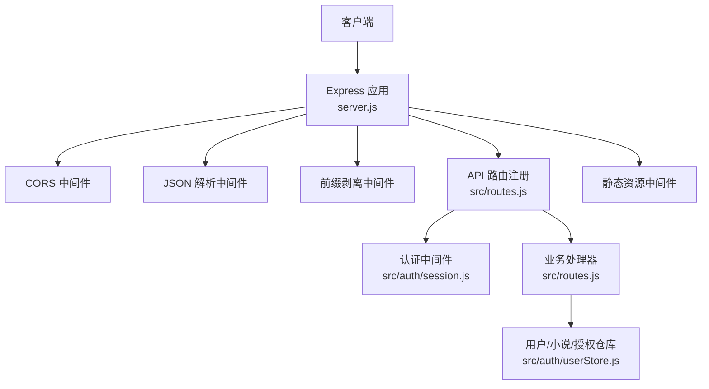
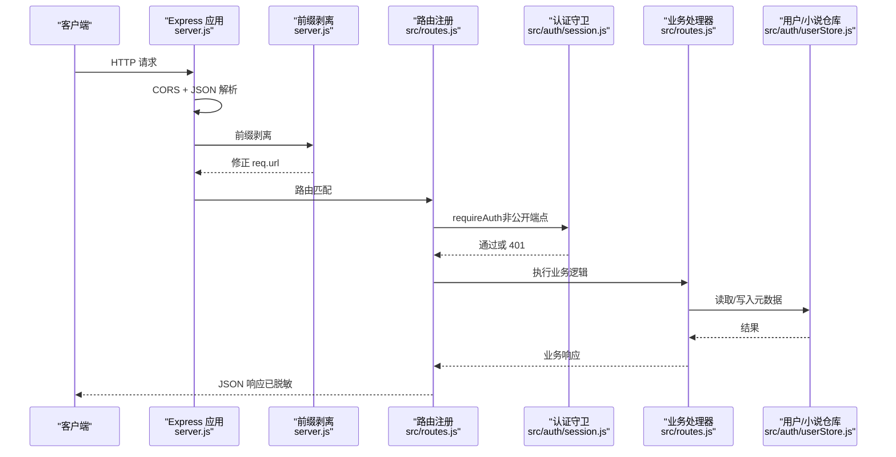
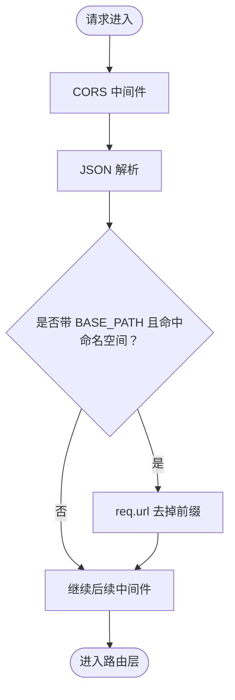
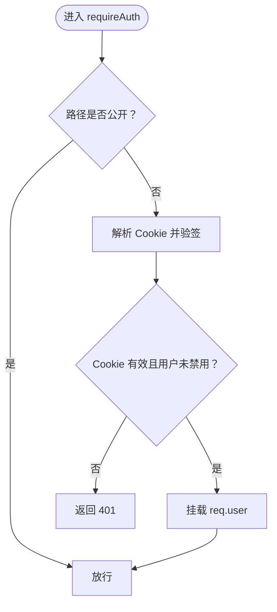
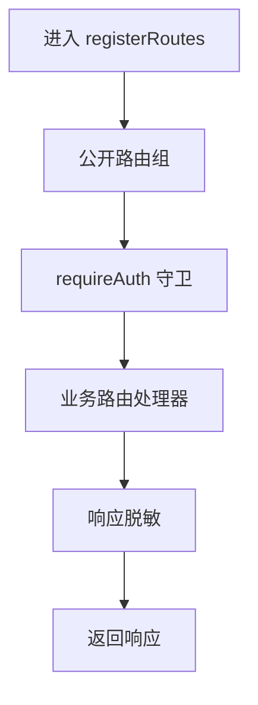
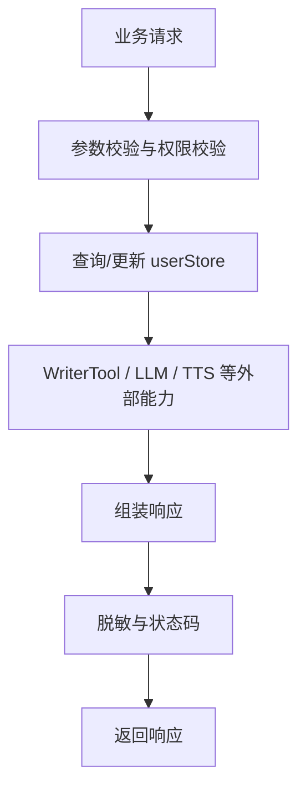
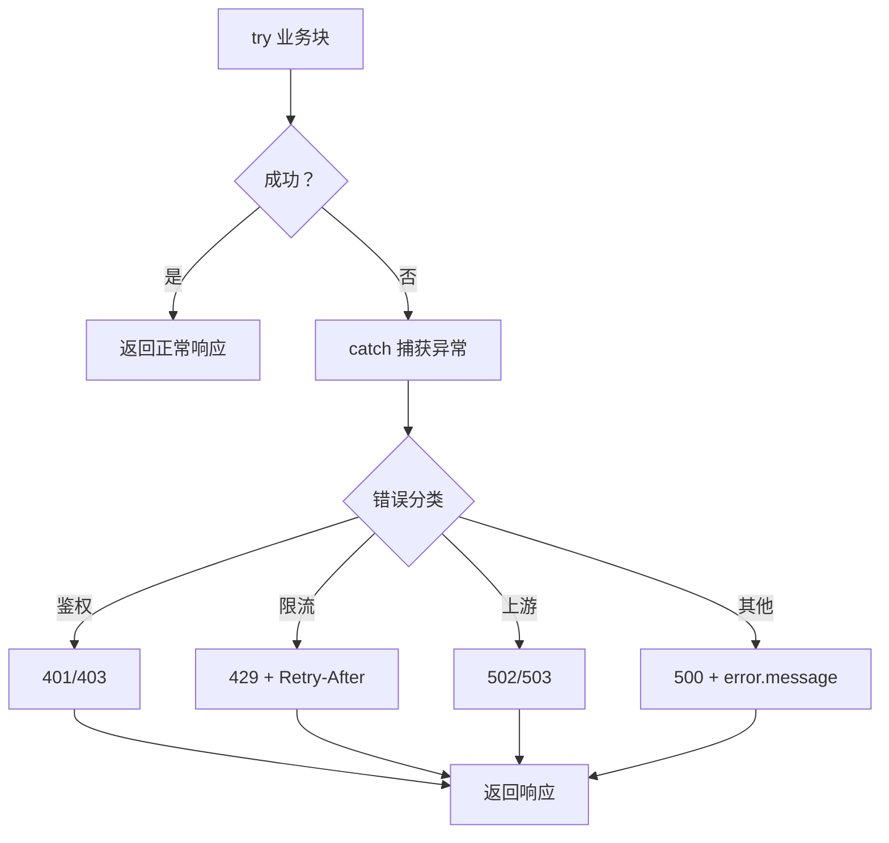
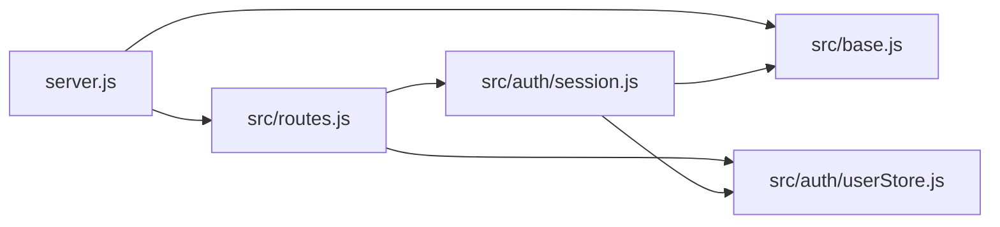

# 中间件执行流程

<cite>
**本文引用的文件**   
- [server.js](file://server.js)
- [src/routes.js](file://src/routes.js)
- [src/base.js](file://src/base.js)
- [src/auth/session.js](file://src/auth/session.js)
- [src/auth/userStore.js](file://src/auth/userStore.js)
</cite>

## 目录
1. [引言](#引言)
2. [项目结构](#项目结构)
3. [核心组件](#核心组件)
4. [架构总览](#架构总览)
5. [详细组件分析](#详细组件分析)
6. [依赖关系分析](#依赖关系分析)
7. [性能与限流特性](#性能与限流特性)
8. [故障排查指南](#故障排查指南)
9. [结论](#结论)

## 引言
本文面向 AINovel 后端服务，系统性梳理“请求进入服务器到返回响应”的完整中间件链执行过程。重点覆盖：
- 请求预处理：跨域、JSON 解析、前缀剥离、静态资源挂载
- 鉴权与会话：登录态校验、超管权限校验
- 路由匹配：API 分组、公开接口、需登录接口、长任务进度通道
- 业务处理：小说元数据、章节读写、TTS、读者 AI、发布预览等
- 响应后处理：输出脱敏、错误传播、限流与重试提示

目标是帮助开发者理解请求在 Express 中间件管道中的流转顺序、调用栈、异常传播路径以及关键安全与性能控制点。

## 项目结构
AINovel 使用 Express 作为 HTTP 服务入口，核心中间件集中在应用启动阶段；具体 API 路由集中在路由注册模块中。基础配置（站点前缀、命名空间）由独立模块提供。

**图表来源**
- [server.js:9-53](file://server.js#L9-L53)
- [src/routes.js:331-560](file://src/routes.js#L331-L560)
- [src/auth/session.js:93-110](file://src/auth/session.js#L93-L110)
- [src/auth/userStore.js:48-114](file://src/auth/userStore.js#L48-L114)

**章节来源**
- [server.js:9-53](file://server.js#L9-L53)
- [src/base.js:17-41](file://src/base.js#L17-L41)

## 核心组件
- 应用启动与全局中间件：负责跨域、JSON 解析、前缀平移、数据库初始化、桥接服务初始化、API 路由注册与静态资源托管。
- 前缀与命名空间：统一对外挂载前缀与内部命名空间，避免代理层不剥前缀导致的路径错位。
- 会话与鉴权：基于 HMAC-SHA256 签名的 httpOnly Cookie，提供登录、登出、当前用户解析、通用鉴权守卫与超管守卫。
- 路由与业务：按公开 /api 子集、需登录 /api 子集划分；内置限流、输出净化、VIP 授权判定、TTS、读者 AI、长任务 SSE 进度、小说与章节 CRUD。
- 多用户元数据仓库：SQLite 存储用户、小说登记、VIP 授权、预览暂存等元数据，提供幂等初始化、播种与存量迁移。

**章节来源**
- [server.js:9-63](file://server.js#L9-L63)
- [src/base.js:17-41](file://src/base.js#L17-L41)
- [src/auth/session.js:1-118](file://src/auth/session.js#L1-L118)
- [src/routes.js:331-560](file://src/routes.js#L331-L560)
- [src/auth/userStore.js:48-114](file://src/auth/userStore.js#L48-L114)

## 架构总览
下图展示一个典型受保护 API 请求从进入 Express 到返回响应的完整中间件链。

**图表来源**
- [server.js:22-45](file://server.js#L22-L45)
- [src/routes.js:331-560](file://src/routes.js#L331-L560)
- [src/auth/session.js:93-110](file://src/auth/session.js#L93-L110)
- [src/auth/userStore.js:48-114](file://src/auth/userStore.js#L48-L114)

## 详细组件分析

### 1. 请求预处理阶段
- 跨域：启用 CORS，允许前端跨站访问。
- JSON 解析：解析 application/json 请求体，限制最大体积。
- 前缀剥离：当外部请求带有 BASE_PATH（如 /novel），且路径属于应用命名空间（api/login/tts/tts-audio/admin）时，将前缀从 req.url 中移除，使内部路由无需感知前缀。书页路径不受影响，避免双前缀。
- 静态资源：为 login、tts、tts-audio、admin、novel 与 public 提供静态文件服务。

**图表来源**
- [server.js:22-36](file://server.js#L22-L36)
- [server.js:47-53](file://server.js#L47-L53)
- [src/base.js:17-34](file://src/base.js#L17-L34)

**章节来源**
- [server.js:22-53](file://server.js#L22-L53)
- [src/base.js:17-41](file://src/base.js#L17-L41)

### 2. 鉴权与会话中间件
- 会话 Cookie：采用 HMAC-SHA256 签名，包含用户 ID 与过期时间，httpOnly、SameSite=Lax，Path 绑定 BASE_PATH，避免与其他子系统串味。
- 当前用户解析：从 Cookie 解析并验证签名与有效期，再查库获取用户信息；若用户被禁用则视为未登录。
- 通用鉴权守卫：对 /api 下除 /login、/logout、/me 外的所有路由强制要求有效会话；失败返回 401。
- 超管守卫：在 requireAuth 之后检查角色是否为 superadmin，否则返回 403。

**图表来源**
- [src/auth/session.js:26-45](file://src/auth/session.js#L26-L45)
- [src/auth/session.js:62-91](file://src/auth/session.js#L62-L91)
- [src/auth/session.js:93-110](file://src/auth/session.js#L93-L110)

**章节来源**
- [src/auth/session.js:1-118](file://src/auth/session.js#L1-L118)

### 3. 路由匹配与分组
- 公开 API：/api/login、/api/logout、/api/me、读者 AI 相关接口、TTS 接口、公开书单 /api/catalog 等，不需要登录。
- 需登录 API：/api 下其余路由全部经 requireAuth 守卫。
- 输出净化：对 /api 响应进行敏感字段清洗，防止泄露绝对路径、密钥、内网地址等。
- 长任务进度通道：SSE 推送 /api/progress，带心跳与缓冲补发机制。

**图表来源**
- [src/routes.js:331-350](file://src/routes.js#L331-L350)
- [src/routes.js:352-557](file://src/routes.js#L352-L557)
- [src/routes.js:559-627](file://src/routes.js#L559-L627)

**章节来源**
- [src/routes.js:331-627](file://src/routes.js#L331-L627)

### 4. 业务处理阶段
- 小说列举与新建：按登录用户列出小说，新建小说分配 UUID 文件名并登记归属。
- 删除与对账：删除整本小说需要二次确认；超管可对账 data 目录与 novel 表。
- 章节列表与正文：按章号查询，优化为只读统计与按需拉取正文。
- VIP 授权：读者账号授权制，hasVipAccess 判定是否可访问 VIP 书。
- TTS 合成：句子级 mp3 合成，支持音色与语速白名单，带存在性校验与失败回退策略。
- 读者 AI：测验、讲解、生词标注、问答等接口，均带限流。

**图表来源**
- [src/routes.js:639-684](file://src/routes.js#L639-L684)
- [src/routes.js:686-775](file://src/routes.js#L686-L775)
- [src/routes.js:456-513](file://src/routes.js#L456-L513)
- [src/auth/userStore.js:335-349](file://src/auth/userStore.js#L335-L349)

**章节来源**
- [src/routes.js:639-775](file://src/routes.js#L639-L775)
- [src/auth/userStore.js:335-349](file://src/auth/userStore.js#L335-L349)

### 5. 错误传播与异常处理策略
- 同步错误：路由处理器直接抛出错误时，Express 默认会返回 500；部分处理器显式捕获并返回 500 JSON。
- 异步错误：try/catch 包裹业务逻辑，统一以 { error } 形式返回，便于前端识别。
- 鉴权错误：未登录返回 401，无超管权限返回 403。
- 限流错误：超过阈值返回 429，并附带 Retry-After 秒数，引导前端退避。
- 上游服务错误：例如 aibridge 图片生成失败，返回 502 并携带上游错误信息。
- TTS 失败：返回 503，并给出 fallback 策略提示。

**图表来源**
- [src/auth/session.js:93-110](file://src/auth/session.js#L93-L110)
- [src/routes.js:291-306](file://src/routes.js#L291-L306)
- [src/routes.js:412-428](file://src/routes.js#L412-L428)
- [src/routes.js:456-513](file://src/routes.js#L456-L513)

**章节来源**
- [src/auth/session.js:93-110](file://src/auth/session.js#L93-L110)
- [src/routes.js:291-306](file://src/routes.js#L291-L306)
- [src/routes.js:412-428](file://src/routes.js#L412-L428)
- [src/routes.js:456-513](file://src/routes.js#L456-L513)

## 依赖关系分析
- server.js 依赖 src/routes.js 完成 API 注册，依赖 src/base.js 提供 BASE_PATH 与 APP_NAMESPACES。
- src/routes.js 依赖 src/auth/session.js 提供 requireAuth 与 currentUser，依赖 src/auth/userStore.js 提供用户、小说、VIP 授权等元数据操作。
- src/auth/session.js 依赖 src/base.js 的 BASE_PATH 设置 Cookie Path，依赖 src/auth/userStore.js 的用户查询。
- src/auth/userStore.js 依赖 better-sqlite3 管理 global.db，提供幂等初始化、播种与迁移。

**图表来源**
- [server.js:9-16](file://server.js#L9-L16)
- [src/routes.js:24-27](file://src/routes.js#L24-L27)
- [src/auth/session.js:10-11](file://src/auth/session.js#L10-L11)
- [src/auth/userStore.js:16-23](file://src/auth/userStore.js#L16-L23)

**章节来源**
- [server.js:9-16](file://server.js#L9-L16)
- [src/routes.js:24-27](file://src/routes.js#L24-L27)
- [src/auth/session.js:10-11](file://src/auth/session.js#L10-L11)
- [src/auth/userStore.js:16-23](file://src/auth/userStore.js#L16-L23)

## 性能与限流特性
- 限流器：基于真实 IP 的滑动窗口限流，60 秒一格，超出返回 429 并附带 Retry-After；定期清理过期桶，防止内存膨胀。
- 阅读器与 TTS 分别有独立的限流配额，避免批量任务挤占单用户额度。
- 长任务进度通道：SSE 心跳保活，缓冲近期事件，连接建立时先补发遗漏事件，减少丢消息。
- 输出净化：对响应对象递归清洗敏感键与绝对路径，降低信息泄露风险。
- 静态资源缓存：tts-audio 设置 immutable 与 long maxAge，提升浏览器缓存命中率。

**章节来源**
- [src/routes.js:263-306](file://src/routes.js#L263-L306)
- [src/routes.js:573-627](file://src/routes.js#L573-L627)
- [src/routes.js:331-339](file://src/routes.js#L331-L339)
- [server.js:50-53](file://server.js#L50-L53)

## 故障排查指南
- 401 未登录：检查 Cookie 是否存在、是否过期、是否被其他子系统污染；确认 BASE_PATH 与 Cookie Path 一致。
- 403 无超管权限：确认当前用户 role 是否为 superadmin；检查 requireSuperadmin 是否在 requireAuth 之后。
- 429 请求频繁：查看 Retry-After 秒数，前端应做退避重试；检查是否绕过代理直连导致 IP 识别不准。
- 404 章节不存在：检查 chapterUrl 解码与路径穿越防护；确认 OUT_ROOT 下对应 HTML 文件存在。
- 502/503 上游失败：检查 aibridge 可达性与密钥；TTS 失败时查看日志中的 stage 与 detail，定位具体合成阶段。
- 页面 404 但接口正常：检查 BASE_PATH 配置是否合法；确保仅 api/login/tts/tts-audio/admin 命名空间被前缀剥离，书页路径保持原样。

**章节来源**
- [src/auth/session.js:93-110](file://src/auth/session.js#L93-L110)
- [src/routes.js:313-329](file://src/routes.js#L313-L329)
- [src/routes.js:412-428](file://src/routes.js#L412-L428)
- [src/routes.js:456-513](file://src/routes.js#L456-L513)
- [src/base.js:17-28](file://src/base.js#L17-L28)

## 结论
AINovel 的请求处理链路清晰分层：Express 全局中间件负责跨域、解析与前缀剥离；路由层按公开与需登录分组，结合会话鉴权与超管守卫；业务处理器封装小说、章节、TTS、读者 AI 等能力，并通过 userStore 访问 SQLite 元数据。错误传播遵循“分类处理 + 明确状态码 + 可观测日志”的策略，限流与输出净化保障系统的安全与稳定。对于部署在 nginx 下的场景，BASE_PATH 与前缀剥离机制确保内外路径一致性，避免常见的前缀错位问题。