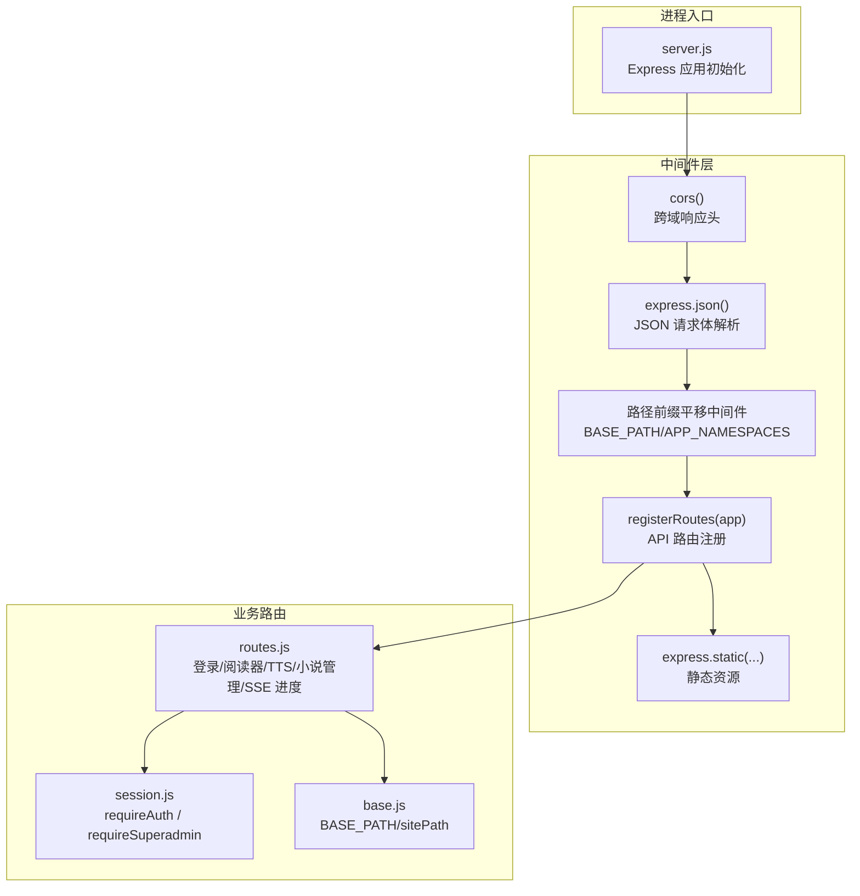
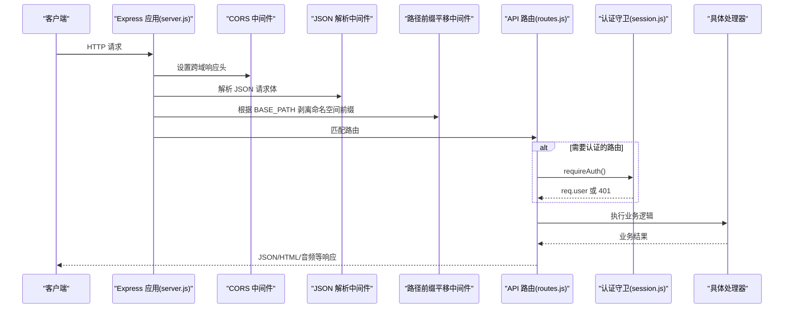
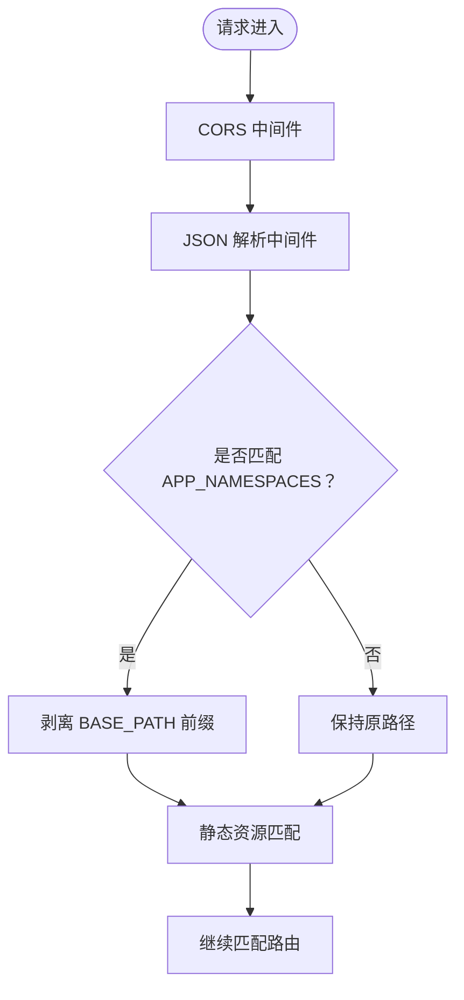
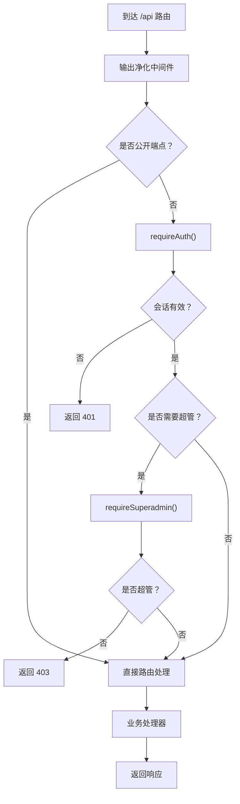
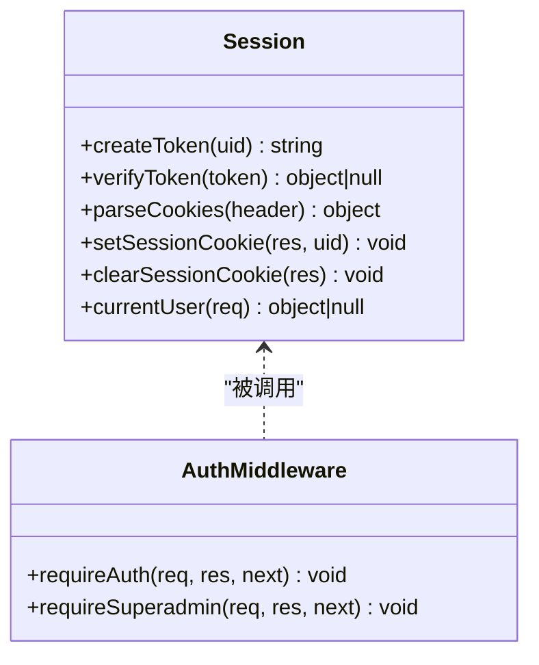
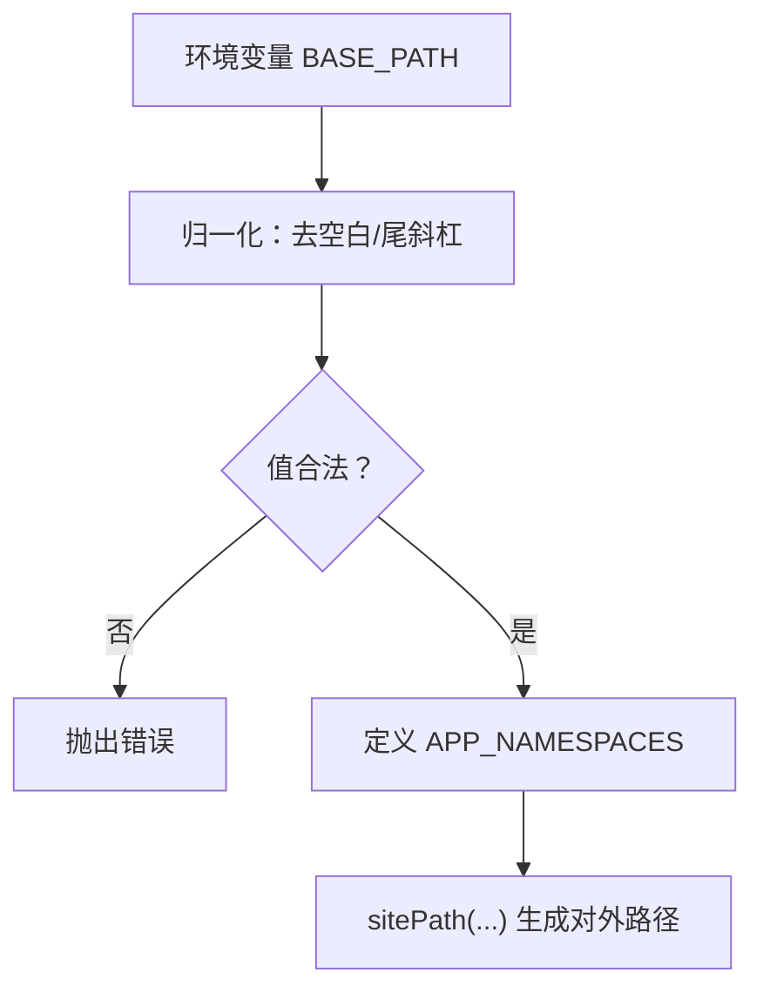
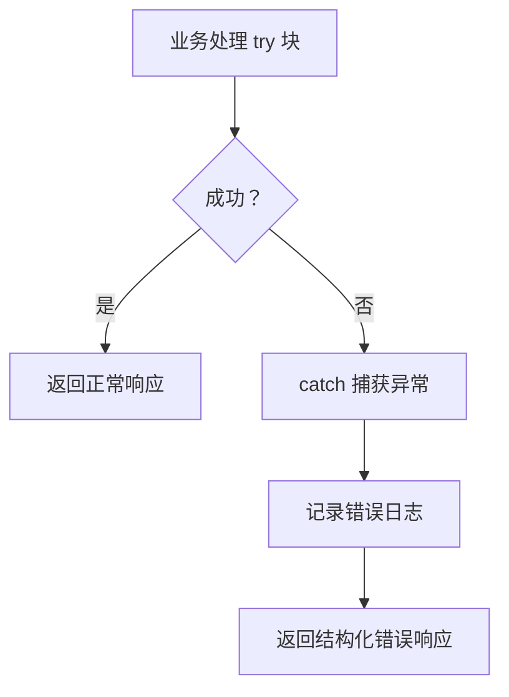
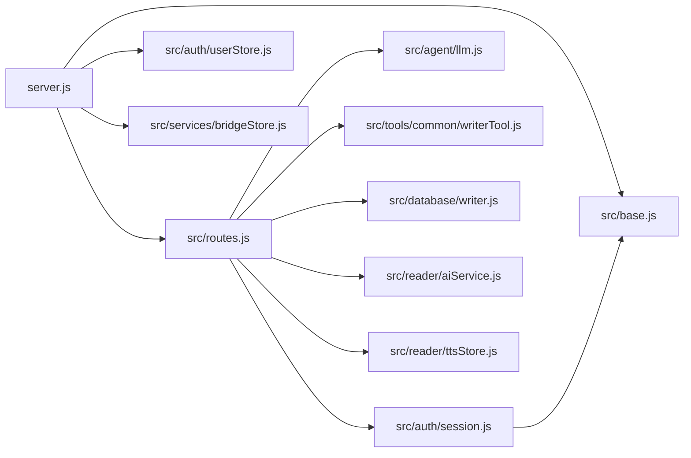

# 中间件系统架构

<cite>
**本文引用的文件**   
- [server.js](file://server.js)
- [src/routes.js](file://src/routes.js)
- [src/auth/session.js](file://src/auth/session.js)
- [src/base.js](file://src/base.js)
</cite>

## 目录
1. [引言](#引言)
2. [项目结构](#项目结构)
3. [核心组件](#核心组件)
4. [架构总览](#架构总览)
5. [详细组件分析](#详细组件分析)
6. [依赖关系分析](#依赖关系分析)
7. [性能与可扩展性](#性能与可扩展性)
8. [故障排查指南](#故障排查指南)
9. [结论](#结论)

## 引言
本文面向 AINovel 的 Express.js 中间件系统，系统性梳理请求从进入服务器到返回响应的完整链路。重点覆盖：
- 全局中间件执行顺序与作用域：CORS、JSON 解析、路径前缀平移、静态资源。
- API 路由层中间件：数据净化、认证守卫、权限守卫、限流、SSE 进度通道等。
- 自定义中间件实现模式：错误处理、认证、日志记录的设计要点。
- 架构图与流程图：帮助读者快速理解“请求如何穿过中间件管道”。

## 项目结构
AINovel 的服务入口位于 `server.js`，API 路由集中在 `src/routes.js`，会话与鉴权逻辑在 `src/auth/session.js`，站点挂载前缀与路径工具在 `src/base.js`。

**图表来源**
- [server.js:9-53](file://server.js#L9-L53)
- [src/routes.js:331-627](file://src/routes.js#L331-L627)
- [src/auth/session.js:93-110](file://src/auth/session.js#L93-L110)
- [src/base.js:17-39](file://src/base.js#L17-L39)

**章节来源**
- [server.js:9-53](file://server.js#L9-L53)
- [src/routes.js:331-627](file://src/routes.js#L331-L627)
- [src/auth/session.js:93-110](file://src/auth/session.js#L93-L110)
- [src/base.js:17-39](file://src/base.js#L17-L39)

## 核心组件
- 全局中间件
  - CORS：允许跨域访问。
  - JSON 解析：将 application/json 请求体解析为对象，限制最大体积。
  - 路径前缀平移：当外部通过 `BASE_PATH`（如 `/novel`）访问时，把受控命名空间的前缀剥离，使内部路由无需感知前缀。
  - 静态资源：对外暴露登录页、TTS 资源、管理后台、已发布书页与公共静态资源。
- API 路由中间件
  - 输出净化：对 `/api` 响应进行敏感信息脱敏。
  - 认证守卫：除公开端点外，要求有效会话。
  - 权限守卫：部分接口需要超级管理员。
  - 限流：按真实客户端 IP 分桶，防止滥用。
  - SSE 进度通道：长任务进度推送。
- 会话与会话 Cookie
  - 零依赖 HMAC-SHA256 签名 Cookie，支持过期校验、禁用用户拦截。
  - 会话 Cookie 作用域限定在 `BASE_PATH`，避免同域多子系统串扰。

**章节来源**
- [server.js:22-53](file://server.js#L22-L53)
- [src/routes.js:331-627](file://src/routes.js#L331-L627)
- [src/auth/session.js:26-90](file://src/auth/session.js#L26-L90)
- [src/base.js:17-39](file://src/base.js#L17-L39)

## 架构总览
下图展示一个典型请求的完整生命周期：从浏览器发起，经过全局中间件，进入 API 路由，再经认证与业务处理，最终返回响应。

**图表来源**
- [server.js:22-36](file://server.js#L22-L36)
- [src/routes.js:331-350](file://src/routes.js#L331-L350)
- [src/auth/session.js:93-102](file://src/auth/session.js#L93-L102)

## 详细组件分析

### 全局中间件链
- CORS
  - 作用：统一开启跨域能力，便于前端在不同域名下调用 API。
  - 位置：Express 应用最外层，确保所有响应都携带跨域头。
- JSON 解析
  - 作用：自动解析 `application/json` 请求体，并限制最大体积，防止超大负载。
  - 注意：若请求不是 JSON，不会触发解析；后续路由需自行校验字段。
- 路径前缀平移
  - 背景：生产环境 nginx 原样转发带前缀的请求，而内部路由以根路径编写。
  - 行为：仅对受控命名空间（如 `/api`、`/login`、`/tts`、`/admin`）剥离 `BASE_PATH`，书页路径不剥离，避免双重 `/novel`。
  - 约束：`BASE_PATH` 只允许空或 `/novel`，否则启动即报错。
- 静态资源
  - 提供登录页、TTS 前端、TTS 音频、管理后台、已发布书页与公共静态资源。
  - TTS 音频使用长期缓存策略，减少重复下载。

**图表来源**
- [server.js:22-53](file://server.js#L22-L53)
- [src/base.js:17-34](file://src/base.js#L17-L34)

**章节来源**
- [server.js:22-53](file://server.js#L22-L53)
- [src/base.js:17-39](file://src/base.js#L17-L39)

### API 路由层中间件
- 输出净化
  - 范围：`/api` 下的 JSON 响应。
  - 目的：过滤可能泄露的内部路径、密钥、服务器信息等敏感字段。
  - 例外：登录、账号、预览、公开书单等端点放行，避免误删必要字段。
- 认证守卫
  - 规则：除 `/api/login`、`/api/logout`、`/api/me` 外，其他 `/api` 路由必须携带有效会话。
  - 机制：解析 Cookie，验证 HMAC 签名与过期时间，加载用户信息并注入 `req.user`。
  - 失败：未登录返回 401。
- 权限守卫
  - 规则：部分接口需要超级管理员角色。
  - 机制：检查 `req.user.role === 'superadmin'`。
  - 失败：无权限返回 403。
- 限流
  - 维度：按真实客户端 IP 分桶，窗口 60 秒。
  - 行为：超出阈值返回 429，并附带 `Retry-After`。
  - 清理：定期清理过期桶，防止内存无限增长。
- SSE 进度通道
  - 用途：长任务进度推送。
  - 设计：先补发缓冲事件，再订阅实时事件；心跳保活；关闭连接后清理定时器与监听器。

**图表来源**
- [src/routes.js:331-350](file://src/routes.js#L331-L350)
- [src/auth/session.js:93-110](file://src/auth/session.js#L93-L110)

**章节来源**
- [src/routes.js:331-627](file://src/routes.js#L331-L627)
- [src/auth/session.js:93-110](file://src/auth/session.js#L93-L110)

### 认证与会话中间件
- Cookie 结构与安全性
  - 结构：HMAC-SHA256 签名的 base64url 载荷，包含用户 ID 与过期时间。
  - 安全：HttpOnly、SameSite=Lax、作用域限定在 `BASE_PATH`。
- 会话校验流程
  - 解析 Cookie → 验签 → 校验过期 → 查找用户 → 检查禁用状态 → 注入 `req.user`。
- 公开与保护端点
  - 公开：`/api/login`、`/api/logout`、`/api/me`。
  - 保护：其余 `/api` 路由默认需要认证。

**图表来源**
- [src/auth/session.js:42-90](file://src/auth/session.js#L42-L90)
- [src/auth/session.js:93-110](file://src/auth/session.js#L93-L110)

**章节来源**
- [src/auth/session.js:26-110](file://src/auth/session.js#L26-L110)

### 路径前缀与站点路径工具
- `BASE_PATH`
  - 唯一权威来源，决定对外 URL 前缀。
  - 启动时校验只允许空或 `/novel`，避免上线后书页 404。
- `APP_NAMESPACES`
  - 定义哪些命名空间会被剥离前缀：`/api`、`/login`、`/tts`、`/tts-audio`、`/admin`。
- `sitePath`
  - 生成带前缀的站点路径，用于 TTS 音频、书页链接等。

**图表来源**
- [src/base.js:17-39](file://src/base.js#L17-L39)

**章节来源**
- [src/base.js:17-39](file://src/base.js#L17-L39)

### 错误处理与日志记录模式
- 错误处理
  - 认证失败：返回 401。
  - 权限不足：返回 403。
  - 限流超限：返回 429，并附带 `Retry-After`。
  - 业务异常：各路由 try/catch 捕获并返回结构化错误。
- 日志记录
  - 关键失败路径打印警告日志，例如 TTS 合成失败、章节定位失败。
  - 建议扩展：在顶层增加统一日志中间件，记录请求方法、路径、耗时、状态码与用户标识。

**图表来源**
- [src/routes.js:359-390](file://src/routes.js#L359-L390)
- [src/routes.js:457-513](file://src/routes.js#L457-L513)

**章节来源**
- [src/routes.js:359-390](file://src/routes.js#L359-L390)
- [src/routes.js:457-513](file://src/routes.js#L457-L513)

## 依赖关系分析
- server.js
  - 依赖 cors、express.json、path、fileURLToPath。
  - 导入 routes、userStore、bridgeStore、base。
- src/routes.js
  - 依赖 fs、crypto、better-sqlite3、WriterTool、llm、bridgeStore、progressHub、registry、auth/session、base、reader/aiService、reader/ttsStore。
- src/auth/session.js
  - 依赖 crypto、fs、path、fileURLToPath、userStore、base。
- src/base.js
  - 纯工具模块，导出 BASE_PATH、APP_NAMESPACES、sitePath。

**图表来源**
- [server.js:9-16](file://server.js#L9-L16)
- [src/routes.js:10-28](file://src/routes.js#L10-L28)
- [src/auth/session.js:6-11](file://src/auth/session.js#L6-L11)
- [src/base.js:17-39](file://src/base.js#L17-L39)

**章节来源**
- [server.js:9-16](file://server.js#L9-L16)
- [src/routes.js:10-28](file://src/routes.js#L10-L28)
- [src/auth/session.js:6-11](file://src/auth/session.js#L6-L11)
- [src/base.js:17-39](file://src/base.js#L17-L39)

## 性能与可扩展性
- 请求体大小限制
  - JSON 解析限制为 20MB，适合大文档上传场景。
- 限流与并发
  - 读者端与 TTS 端分别限流，避免批量请求导致上游服务过载。
  - 长任务互斥锁按书维度串行化，防止并发修改正文与章号。
- 静态资源缓存
  - TTS 音频启用长期缓存，减少带宽与 I/O。
- 可扩展建议
  - 引入统一日志中间件，集中记录请求元数据与耗时。
  - 将限流策略抽象为可配置中间件，支持不同端点的差异化配额。
  - 将输出净化逻辑封装为独立中间件，便于复用与测试。

[本节为通用指导，不涉及具体文件分析]

## 故障排查指南
- 跨域问题
  - 确认 CORS 中间件已启用，且前端请求域名在白名单内。
- 路径前缀问题
  - 若线上部署在非根路径，检查 `BASE_PATH` 是否为空或 `/novel`。
  - 确认 nginx 原样转发前缀，不要剥前缀。
- 认证失败
  - 检查 Cookie 是否存在、是否过期、是否被正确作用域限制。
  - 确认 `SESSION_SECRET` 已配置，避免每次重启失效。
- 限流 429
  - 查看 `Retry-After` 头部，等待指定时间重试。
  - 检查客户端 IP 是否正确识别（直连 vs 反代）。
- TTS 合成失败
  - 关注控制台警告日志中的失败阶段与原因。
  - 校验音色与语速是否在白名单内。

**章节来源**
- [server.js:22-53](file://server.js#L22-L53)
- [src/base.js:17-39](file://src/base.js#L17-L39)
- [src/auth/session.js:26-90](file://src/auth/session.js#L26-L90)
- [src/routes.js:289-306](file://src/routes.js#L289-L306)
- [src/routes.js:457-513](file://src/routes.js#L457-L513)

## 结论
AINovel 的中间件系统以简洁、可控为核心：
- 全局中间件负责跨域、解析与前缀平移，保证内部路由简洁一致。
- API 路由层通过认证、权限、限流与输出净化，构建安全的业务边界。
- 会话与会话 Cookie 零依赖实现，兼顾安全与可移植性。
- 路径前缀工具确保开发态与线上态 URL 一致，降低部署风险。

建议在后续迭代中补充统一日志中间件、可配置限流策略与更完善的错误分类，以提升可观测性与可维护性。