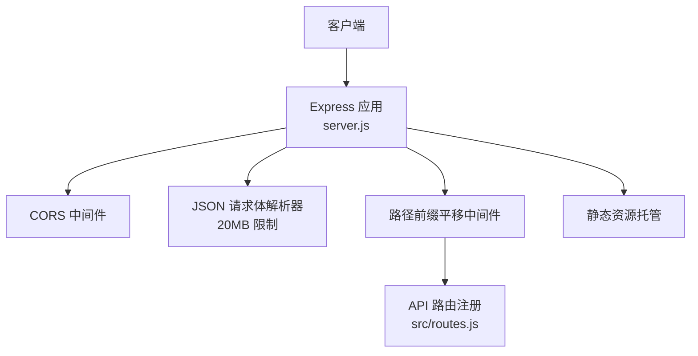
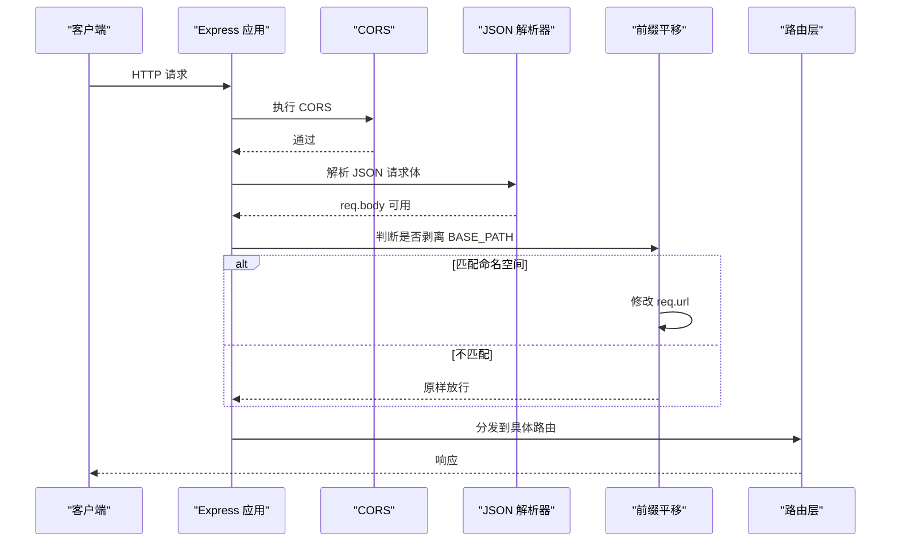
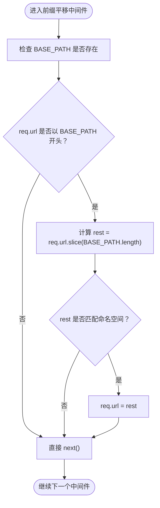
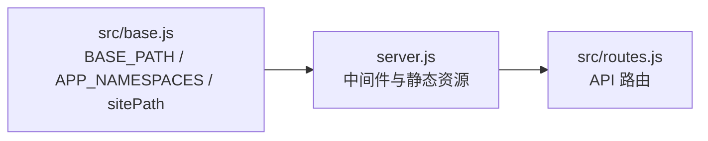

# 核心中间件

<cite>
**本文引用的文件**   
- [server.js](file://server.js)
- [base.js](file://src/base.js)
- [routes.js](file://src/routes.js)
</cite>

## 目录
1. [引言](#引言)
2. [项目结构](#项目结构)
3. [核心组件](#核心组件)
4. [架构总览](#架构总览)
5. [详细组件分析](#详细组件分析)
6. [依赖关系分析](#依赖关系分析)
7. [性能考量](#性能考量)
8. [故障排查指南](#故障排查指南)
9. [结论](#结论)

## 引言
本文聚焦 AINovel 在 Express.js 应用启动时加载的核心中间件，包括：
- CORS 跨域配置
- JSON 请求体解析（20MB 限制）
- 路径前缀平移中间件（将对外 `<BASE>` 前缀剥离为内部根路径）

文档说明每个中间件的配置选项、执行顺序、错误处理策略，并给出配置示例与常见问题解决方案。

## 项目结构
AINovel 的 Web 服务入口位于 `server.js`，其中完成 Express 实例创建、核心中间件注册、路由挂载与静态资源托管；站点挂载前缀与命名空间规则由 `src/base.js` 集中管理；API 路由与业务逻辑集中在 `src/routes.js`。

**图表来源**
- [server.js:18-53](file://server.js#L18-L53)
- [routes.js:331-339](file://src/routes.js#L331-L339)

**章节来源**
- [server.js:1-64](file://server.js#L1-L64)
- [base.js:1-42](file://src/base.js#L1-L42)
- [routes.js:1-30](file://src/routes.js#L1-L30)

## 核心组件
本节梳理启动阶段按顺序注册的三个关键中间件及其职责。

- CORS 跨域中间件
  - 作用：允许浏览器跨域访问 API 与静态资源。
  - 配置：使用默认策略，未显式限制来源、方法或头部。
  - 风险：生产环境建议收紧允许的源、方法与敏感头。

- JSON 请求体解析器
  - 作用：将 `application/json` 请求体解析到 `req.body`。
  - 配置：最大请求体大小 20MB。
  - 行为：超过限制会触发解析错误；未设置 `limit` 时默认较小，易被大正文或批量 TTS 请求打满。

- 路径前缀平移中间件
  - 作用：当外部 URL 以 `BASE_PATH` 开头且匹配受控命名空间时，把前缀从 `req.url` 中剥离，使内部路由无需感知前缀。
  - 命名空间：仅对 `/api`、`/login`、`/tts`、`/tts-audio`、`/admin` 生效。
  - 例外：书页路径（如 `/novel/<uid>/<书名>/...`）不剥离，避免双前缀。

**章节来源**
- [server.js:22-36](file://server.js#L22-L36)
- [base.js:17-34](file://src/base.js#L17-L34)

## 架构总览
下图展示请求进入 Express 后的中间件链顺序与关键分支。

**图表来源**
- [server.js:22-36](file://server.js#L22-L36)
- [routes.js:331-339](file://src/routes.js#L331-L339)

## 详细组件分析

### CORS 跨域中间件
- 配置位置：应用启动时最先注册。
- 行为要点：
  - 允许跨域请求到达后续中间件与路由。
  - 未显式配置白名单，意味着默认较宽松。
- 建议：
  - 生产环境限定 `origin`、`methods`、`allowedHeaders`。
  - 若需要携带 Cookie，需启用凭据模式并配合会话 Cookie 的 SameSite/Path 策略。

**章节来源**
- [server.js:22](file://server.js#L22)

### JSON 请求体解析器（20MB 限制）
- 配置位置：紧随 CORS 之后。
- 行为要点：
  - 自动解析 `application/json` 请求体。
  - 限制最大请求体为 20MB，适合小说正文、批量生成参数等场景。
- 错误处理：
  - 超出限制会返回解析错误；建议在更上层统一捕获并返回友好错误。
- 建议：
  - 针对特定接口可单独调整 `limit`，例如上传类接口提高上限。
  - 结合限流与鉴权，避免恶意大体积请求耗尽内存。

**章节来源**
- [server.js:23](file://server.js#L23)

### 路径前缀平移中间件
- 目标：让内部路由保持“无前缀”写法，同时支持生产环境通过 nginx 原样转发带前缀的请求。
- 关键规则：
  - 读取 `BASE_PATH`（来自环境变量，默认 `/novel`）。
  - 仅当 `req.url` 以 `BASE_PATH` 开头且剩余部分匹配命名空间正则时，才剥离前缀。
  - 命名空间包含：`/api`、`/login`、`/tts`、`/tts-audio`、`/admin`。
  - 书页路径（`/novel/<uid>/<书名>/...`）不剥离，避免产生 `/novel/novel/...` 的双前缀问题。
- 安全校验：
  - `BASE_PATH` 仅允许空串或 `/novel`，否则启动即报错，防止上线后出现静默 404。
- 执行时机：
  - 在路由注册之前执行，确保所有路由都能收到已剥离前缀的 `req.url`。

**图表来源**
- [server.js:30-36](file://server.js#L30-L36)
- [base.js:17-34](file://src/base.js#L17-L34)

**章节来源**
- [server.js:25-36](file://server.js#L25-L36)
- [base.js:17-34](file://src/base.js#L17-L34)

## 依赖关系分析
- `server.js` 依赖 `src/base.js` 提供的 `BASE_PATH` 与 `APP_NAMESPACES`，用于前缀平移决策。
- `server.js` 调用 `registerRoutes(app)` 挂载 API 路由，路由层再依赖 `src/base.js` 中的 `sitePath` 构造对外 URL。
- 中间件顺序严格：CORS → JSON 解析 → 前缀平移 → 路由。

**图表来源**
- [server.js:13-16](file://server.js#L13-L16)
- [base.js:30-41](file://src/base.js#L30-L41)
- [routes.js:26-27](file://src/routes.js#L26-L27)

**章节来源**
- [server.js:13-16](file://server.js#L13-L16)
- [base.js:30-41](file://src/base.js#L30-L41)
- [routes.js:26-27](file://src/routes.js#L26-L27)

## 性能考量
- JSON 解析器 20MB 限制：
  - 优点：避免超大请求体导致内存暴涨。
  - 注意：TTS 批量生成、长文章生成可能接近该阈值，必要时按接口细分限制。
- 前缀平移中间件：
  - 字符串切片与正则匹配开销极低，对性能影响可忽略。
- CORS：
  - 默认宽泛策略在开发期方便，但生产环境应缩小范围以减少无效预检请求。

[本节为通用指导，不直接分析具体代码文件]

## 故障排查指南

- 现象：跨域请求失败
  - 原因：CORS 未放行或浏览器预检失败。
  - 排查：确认请求头与方法是否在 CORS 允许范围内；生产环境建议显式配置 `origin`、`methods`、`allowedHeaders`。
  - 参考：CORS 中间件注册位置。

- 现象：`req.body` 为空或解析报错
  - 原因：请求体非 JSON、Content-Type 不正确，或超过 20MB。
  - 排查：检查 Content-Type 是否为 `application/json`；确认请求体大小；查看解析错误日志。
  - 参考：JSON 解析器配置位置。

- 现象：线上 404，本地正常
  - 原因：nginx 原样转发带前缀的请求，而内部路由未剥离前缀。
  - 排查：确认 `BASE_PATH` 环境变量；检查 `req.url` 是否被正确剥离；确认请求路径是否命中命名空间。
  - 参考：前缀平移中间件与 `BASE_PATH` 校验逻辑。

- 现象：书页整站 404
  - 原因：`BASE_PATH` 不是空串或 `/novel`，导致启动校验失败或路径不一致。
  - 排查：将 `BASE_PATH` 设置为空串或 `/novel`；不要随意改为其他值。
  - 参考：`BASE_PATH` 校验与书页挂载约定。

**章节来源**
- [server.js:22-36](file://server.js#L22-L36)
- [base.js:17-28](file://src/base.js#L17-L28)

## 结论
AINovel 的核心中间件围绕“跨域、请求体解析、路径前缀平移”三大能力构建，既满足开发期的便捷性，也兼顾生产环境的部署约束。建议在生产环境中：
- 收紧 CORS 策略；
- 根据接口类型细化 JSON 解析限制；
- 明确 `BASE_PATH` 与环境变量，避免部署态与开发态差异；
- 在路由层统一处理解析错误与业务异常，提供一致的错误响应。

[本节为总结性内容，不直接分析具体代码文件]