# 自定义中间件

<cite>
**本文引用的文件**   
- [server.js](file://server.js)
- [src/routes.js](file://src/routes.js)
- [src/auth/session.js](file://src/auth/session.js)
- [src/base.js](file://src/base.js)
</cite>

## 目录
1. [引言](#引言)
2. [项目结构](#项目结构)
3. [核心组件](#核心组件)
4. [架构总览](#架构总览)
5. [详细组件分析](#详细组件分析)
6. [依赖关系分析](#依赖关系分析)
7. [性能与可扩展性](#性能与可扩展性)
8. [中间件开发指南](#中间件开发指南)
9. [调试与排错](#调试与排错)
10. [结论](#结论)

## 引言
本文件面向 AINovel 的“自定义中间件系统”，聚焦以下目标：
- 梳理认证、权限验证、日志/净化等中间件的实现模式。
- 说明中间件的注册顺序、执行上下文（req/res）和数据传递方式。
- 给出编写和集成自定义中间件的最佳实践与调试技巧。
- 通过具体代码路径，帮助读者快速定位并扩展中间件能力。

AINovel 基于 Express，采用“全局中间件 + 路由级中间件”的组合方式组织横切逻辑。认证与权限由 `src/auth/session.js` 提供；请求前缀处理、应用命名空间识别由 `src/base.js` 提供；API 路由与业务中间件集中在 `src/routes.js`；服务启动与静态资源挂载在 `server.js`。

## 项目结构
从中间件视角看，关键文件职责如下：
- `server.js`：Express 应用入口，注册全局中间件（CORS、JSON 解析）、前缀平移中间件、静态资源，最后调用 `registerRoutes(app)` 注册 API 路由。
- `src/base.js`：集中管理站点挂载前缀 `BASE_PATH`、应用命名空间匹配正则 `APP_NAMESPACES`，以及对外路径生成函数 `sitePath`。
- `src/auth/session.js`：零依赖会话实现，提供 Cookie 签名、用户解析、认证守卫 `requireAuth`、超管守卫 `requireSuperadmin`。
- `src/routes.js`：API 路由注册中心，包含响应净化中间件、限流中间件、VIP 访问控制、章节路径校验、进度通道、长任务互斥等“类中间件”逻辑。

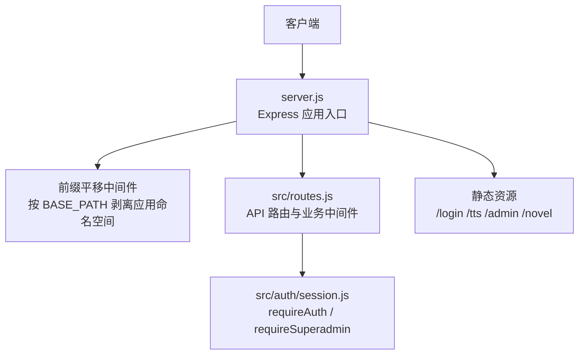

**图表来源**
- [server.js:22-53](file://server.js#L22-L53)
- [src/base.js:17-39](file://src/base.js#L17-L39)
- [src/routes.js:331-560](file://src/routes.js#L331-L560)
- [src/auth/session.js:93-110](file://src/auth/session.js#L93-L110)

**章节来源**
- [server.js:1-64](file://server.js#L1-L64)
- [src/base.js:1-42](file://src/base.js#L1-L42)

## 核心组件
本节聚焦三类“中间件式”能力：认证、权限、日志/净化。

### 认证中间件（requireAuth）
- 功能：对 `/api` 下除 `/login`、`/logout`、`/me` 外的所有请求进行登录态校验。
- 实现要点：
  - 从 Cookie 中解析 `ainovel_session`，使用 HMAC-SHA256 校验签名与过期时间。
  - 根据 uid 查询用户信息，若用户被禁用则视为未登录。
  - 校验通过后把用户对象挂到 `req.user`，供后续路由或中间件消费。
- 注册位置：`src/routes.js` 中在定义完公开接口后，以 `app.use('/api', requireAuth)` 挂载。

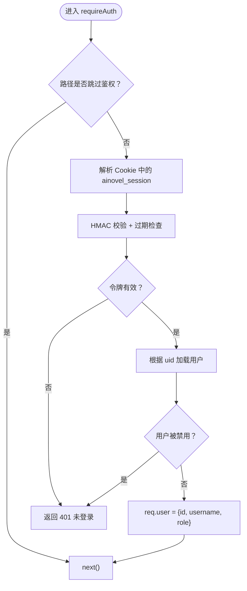

**图表来源**
- [src/auth/session.js:83-102](file://src/auth/session.js#L83-L102)

**章节来源**
- [src/auth/session.js:26-91](file://src/auth/session.js#L26-L91)
- [src/auth/session.js:93-110](file://src/auth/session.js#L93-L110)
- [src/routes.js:341-350](file://src/routes.js#L341-L350)
- [src/routes.js:559-560](file://src/routes.js#L559-L560)

### 权限验证中间件（requireSuperadmin）
- 功能：在已认证基础上，限制仅超级管理员可访问特定端点。
- 实现要点：
  - 依赖 `req.user` 已由 `requireAuth` 填充。
  - 判断 `req.user.role === 'superadmin'`，否则返回 403。
- 典型使用：用户管理、小说库对账等管理接口。

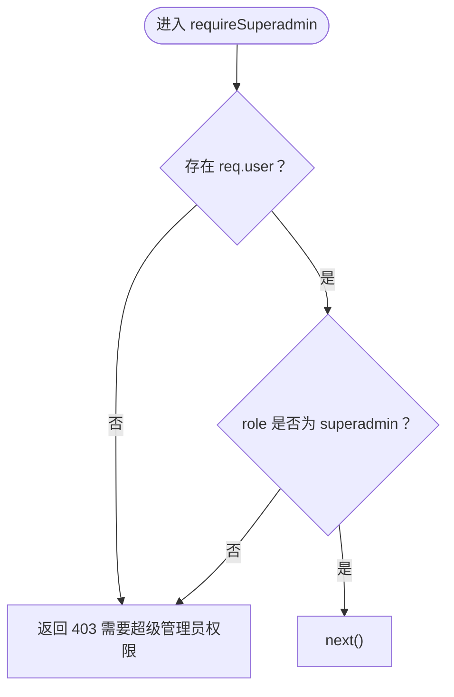

**图表来源**
- [src/auth/session.js:104-110](file://src/auth/session.js#L104-L110)

**章节来源**
- [src/auth/session.js:104-110](file://src/auth/session.js#L104-L110)
- [src/routes.js:678-684](file://src/routes.js#L678-L684)
- [src/routes.js:1251-1261](file://src/routes.js#L1251-L1261)

### 日志与输出净化中间件
- 功能：对 `/api` 响应体进行敏感信息清洗，避免泄露服务器内部路径、密钥、IP、用户名等。
- 实现要点：
  - 在 `res.json` 上包装一层过滤函数，递归清理指定键名与敏感字符串。
  - 对部分公开接口（登录、账号、目录、管理、阅读器、预览）放行，不清洗。
- 本质：一个 Express 中间件，挂载在 `/api` 上，优先于其他路由逻辑。

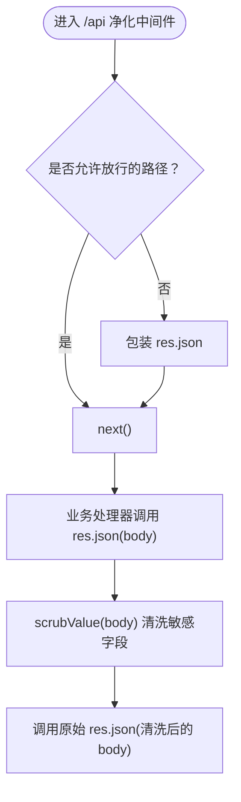

**图表来源**
- [src/routes.js:67-95](file://src/routes.js#L67-L95)
- [src/routes.js:331-339](file://src/routes.js#L331-L339)

**章节来源**
- [src/routes.js:67-95](file://src/routes.js#L67-L95)
- [src/routes.js:331-339](file://src/routes.js#L331-L339)

### 请求前缀与命名空间中间件
- 功能：将外部带 `BASE_PATH` 的请求路径转换为内部根路径，使路由字面量无需重复加前缀。
- 规则：
  - 仅对匹配 `APP_NAMESPACES` 的路径做剥离（如 `/api`、`/login`、`/tts`、`/admin`）。
  - 书页路径 `/novel/<uid>/<书名>/...` 不做剥离，避免双前缀。
- 风险约束：`BASE_PATH` 只能为空或 `/novel`，否则启动即报错。

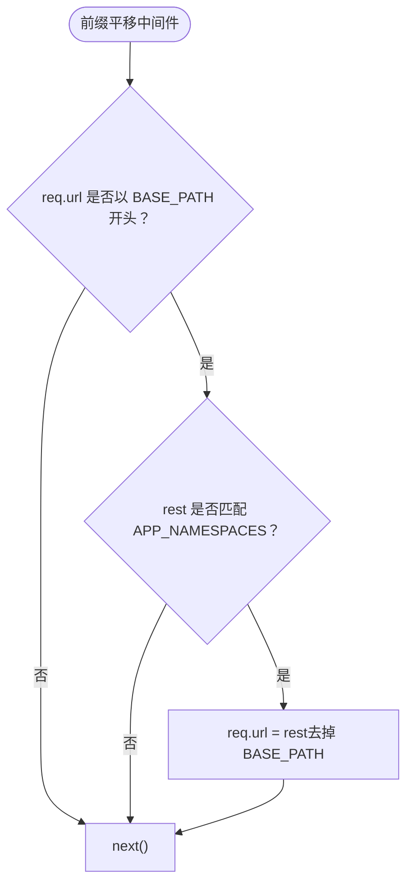

**图表来源**
- [server.js:25-36](file://server.js#L25-L36)
- [src/base.js:17-39](file://src/base.js#L17-L39)

**章节来源**
- [server.js:25-36](file://server.js#L25-L36)
- [src/base.js:17-39](file://src/base.js#L17-L39)

## 架构总览
下图展示一次受保护的 API 请求如何穿过各层中间件，并最终到达业务处理器。

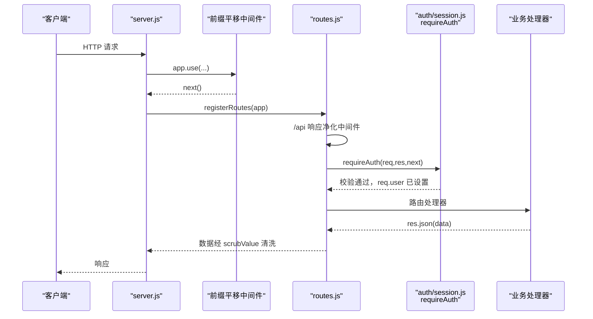

**图表来源**
- [server.js:22-45](file://server.js#L22-L45)
- [src/routes.js:331-339](file://src/routes.js#L331-L339)
- [src/routes.js:559-560](file://src/routes.js#L559-L560)
- [src/auth/session.js:93-102](file://src/auth/session.js#L93-L102)

## 详细组件分析

### 认证与会话机制
- Cookie 名称：`ainovel_session`。
- 令牌结构：`base64url(JSON{uid,exp}) . hex(HMAC(payload, SECRET))`。
- 安全属性：HttpOnly、SameSite=Lax、Path=BASE_PATH、Max-Age=7 天。
- 密钥来源：环境变量 `SESSION_SECRET` 或工程根 `.env` 中的 `SESSION_SECRET`；缺失时生成临时随机密钥并告警。
- 用户解析：`currentUser(req)` 解析 Cookie、校验令牌、查用户、判断禁用状态，返回 `{id, username, role}`。

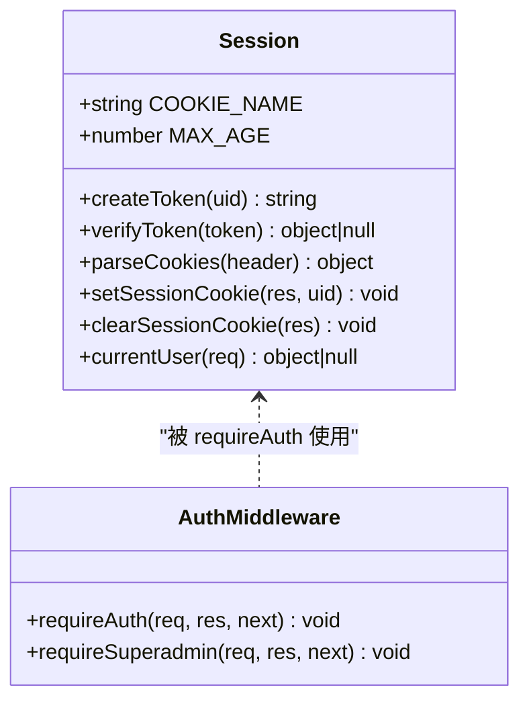

**图表来源**
- [src/auth/session.js:26-91](file://src/auth/session.js#L26-L91)
- [src/auth/session.js:93-110](file://src/auth/session.js#L93-L110)

**章节来源**
- [src/auth/session.js:1-118](file://src/auth/session.js#L1-L118)

### 权限控制与租户隔离
- 角色模型：用户具有 `role`，至少包含普通用户与 `superadmin`。
- 权限策略：
  - 普通用户只能访问自己拥有的小说。
  - 超管可访问全部小说、用户管理与对账接口。
- 小说归属：通过 `resolveNovelForUser(idOrFile, user)` 校验当前用户拥有权，并返回绝对路径用于后续数据库操作。

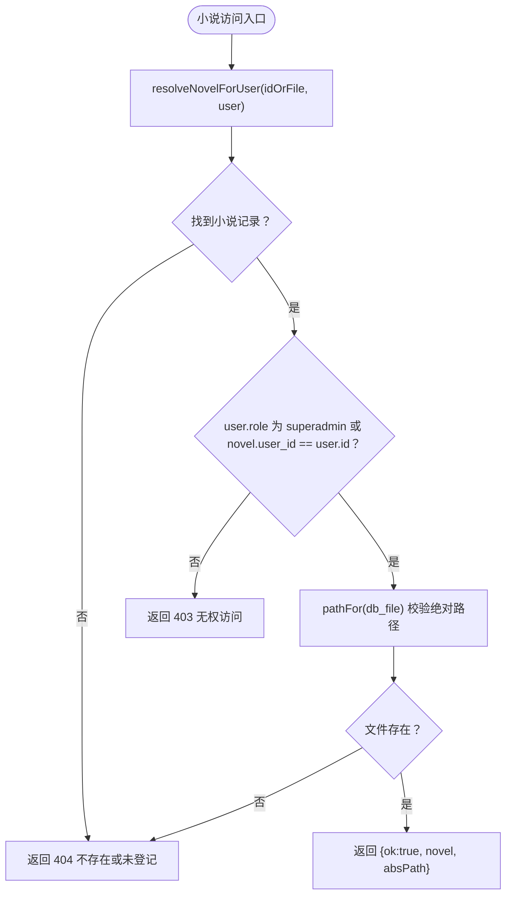

**图表来源**
- [src/routes.js:97-116](file://src/routes.js#L97-L116)

**章节来源**
- [src/routes.js:97-116](file://src/routes.js#L97-L116)

### 限流中间件（rateLimit）
- 目的：防止滥用与突发流量导致上游 LLM/TTS 服务过载。
- 实现：
  - 基于 Map 维护每个真实 IP 的窗口计数 `[count, windowStartMs]`。
  - 超过阈值返回 429，并附带 `Retry-After`。
  - 定期清理过期窗口，防止内存无限增长。
- 使用场景：读者 AI 接口、TTS 接口等。

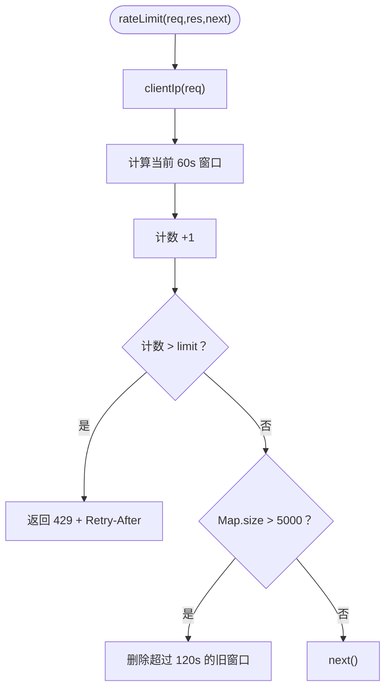

**图表来源**
- [src/routes.js:263-306](file://src/routes.js#L263-L306)

**章节来源**
- [src/routes.js:263-306](file://src/routes.js#L263-L306)

### VIP 访问控制（页面级）
- 背景：VIP 书不再使用共享密码，改为读者账号授权制。
- 判定依据：
  - 读者是否登录。
  - 是否为本书作者或有 VIP 授权。
- 实现：
  - `vipMapForUid(uid)` 构建用户名下 VIP 书的目录映射。
  - 公开书单与书页访问均复用同一判据。
  - 无权时返回专用 HTML 提示页。

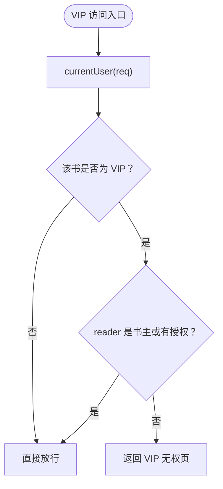

**图表来源**
- [src/routes.js:144-157](file://src/routes.js#L144-L157)
- [src/routes.js:212-238](file://src/routes.js#L212-L238)
- [src/routes.js:519-557](file://src/routes.js#L519-L557)

**章节来源**
- [src/routes.js:144-157](file://src/routes.js#L144-L157)
- [src/routes.js:212-238](file://src/routes.js#L212-L238)
- [src/routes.js:519-557](file://src/routes.js#L519-L557)

### 章节路径解析与防穿越
- 问题：前端传入 URL 中的中文目录是百分号编码，磁盘上是解码后的中文。
- 方案：
  - 先正则匹配章节 URL。
  - 逐段 `decodeURIComponent`，再校验不允许出现分隔符、空字节、`.`、`..`。
  - 拼接后再次校验绝对路径仍位于 `OUT_ROOT` 之下。
- 用途：TTS 句子合成、章节内容读取等。

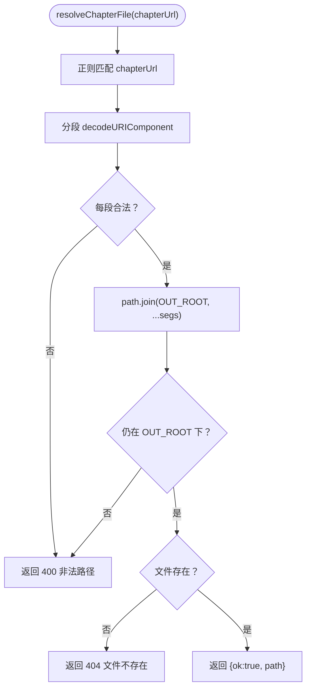

**图表来源**
- [src/routes.js:308-329](file://src/routes.js#L308-L329)

**章节来源**
- [src/routes.js:308-329](file://src/routes.js#L308-L329)

## 依赖关系分析
- `server.js` 依赖 `src/routes.js` 完成 API 注册，依赖 `src/base.js` 获取 `BASE_PATH` 与 `APP_NAMESPACES`。
- `src/routes.js` 依赖 `src/auth/session.js` 提供认证与权限中间件，依赖 `src/base.js` 提供 `sitePath`。
- `src/auth/session.js` 依赖 `src/base.js` 确定 Cookie Path，依赖用户存储模块加载用户信息。

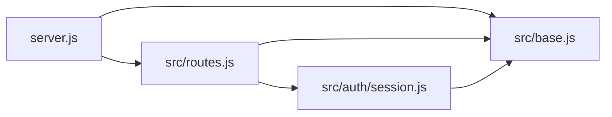

**图表来源**
- [server.js:13-16](file://server.js#L13-L16)
- [src/routes.js:24-27](file://src/routes.js#L24-L27)
- [src/auth/session.js:10-11](file://src/auth/session.js#L10-L11)

**章节来源**
- [server.js:1-64](file://server.js#L1-L64)
- [src/routes.js:1-27](file://src/routes.js#L1-L27)
- [src/auth/session.js:1-12](file://src/auth/session.js#L1-L12)
- [src/base.js:1-42](file://src/base.js#L1-L42)

## 性能与可扩展性
- 中间件顺序很重要：
  - 前缀平移必须早于路由匹配。
  - 响应净化需包裹 `res.json`，且对公开接口放行。
  - 认证中间件应放在受保护路由之前。
- 限流与缓存：
  - 限流使用内存 Map，适合单机部署；多实例需考虑分布式限流。
  - 读者词汇解释等接口有本地缓存，命中即秒回。
- 可扩展点：
  - 新增认证维度（如 IP 白名单、UA 黑名单）可在 `requireAuth` 前追加中间件。
  - 新增审计日志可在 `/api` 净化中间件之后、业务处理器之前插入。
  - 新增权限维度（如按小说 ID 的细粒度权限）可在 `resolveNovelForUser` 附近扩展。

[本节为通用指导，不直接分析具体文件]

## 中间件开发指南

### 设计原则
- 单一职责：每个中间件只做一件事（认证、权限、日志、限流、净化等）。
- 明确上下文：通过 `req` 注入上下文（如 `req.user`），通过 `res` 修改响应。
- 可组合：中间件之间尽量无隐式耦合，顺序清晰。
- 可观测：关键路径打印结构化日志，便于排查。

### 编写步骤
1. 确定中间件职责与触发范围（全局或路由级）。
2. 在 `src/auth/session.js` 或新建文件中实现中间件函数 `(req, res, next) => {}`。
3. 在 `src/routes.js` 中选择合适的挂载点：
   - 全局：`app.use(...)`
   - 路由组：`app.use('/api', mw)`
   - 单路由：`router.get('/xxx', mw, handler)`
4. 如需修改响应体，包装 `res.json` 或 `res.send`。
5. 如需注入上下文，写入 `req.xxx`，并确保下游中间件/处理器能消费。

### 最佳实践
- 认证失败统一返回 401，权限不足统一返回 403。
- 对公开接口（登录、登出、公开目录、阅读器）明确白名单，避免误拦截。
- 对敏感响应体统一清洗，避免泄露内部路径、密钥、IP、用户名等。
- 限流结合真实 IP 解析，避免反向代理导致的限流失效。
- 对破坏性操作（删除整本小说等）要求二次确认参数。

### 调试技巧
- 在中间件入口处打印请求方法、路径、用户信息（脱敏）。
- 对限流、VIP 拒绝、路径解析失败等分支增加警告日志。
- 使用浏览器开发者工具查看 Cookie、请求头、响应体。
- 对 SSE 进度通道，关注连接建立与心跳是否正常。

[本节为通用指导，不直接分析具体文件]

## 调试与排错

### 常见问题
- 登录后仍提示未登录：
  - 检查 Cookie 的 Path 是否与 `BASE_PATH` 一致。
  - 检查 `SESSION_SECRET` 是否稳定，重启后临时密钥会导致旧 Cookie 失效。
- 403 权限不足：
  - 确认 `requireAuth` 已先于 `requireSuperadmin` 执行。
  - 确认 `req.user.role` 是否正确。
- 429 限流：
  - 检查真实 IP 解析逻辑，确认 nginx 反代场景下 `X-Real-IP`、`X-Forwarded-For` 是否可信。
- 章节 404：
  - 检查 `chapterUrl` 是否经过正确解码与路径校验。
- VIP 无法阅读：
  - 确认读者账号是否获得授权，或是否为书主本人。

**章节来源**
- [src/auth/session.js:26-36](file://src/auth/session.js#L26-L36)
- [src/auth/session.js:75-91](file://src/auth/session.js#L75-L91)
- [src/routes.js:263-306](file://src/routes.js#L263-L306)
- [src/routes.js:308-329](file://src/routes.js#L308-L329)
- [src/routes.js:519-557](file://src/routes.js#L519-L557)

## 结论
AINovel 的中间件体系以 Express 原生中间件为核心，围绕认证、权限、日志/净化、限流、路径解析等横切关注点展开。通过清晰的注册顺序与明确的上下文约定（如 `req.user`），实现了高内聚、低耦合的可扩展架构。新增中间件时，建议遵循单一职责、明确上下文、可组合、可观测的原则，并在 `src/routes.js` 中选择合适挂载点，确保与现有认证、净化、限流逻辑协同工作。