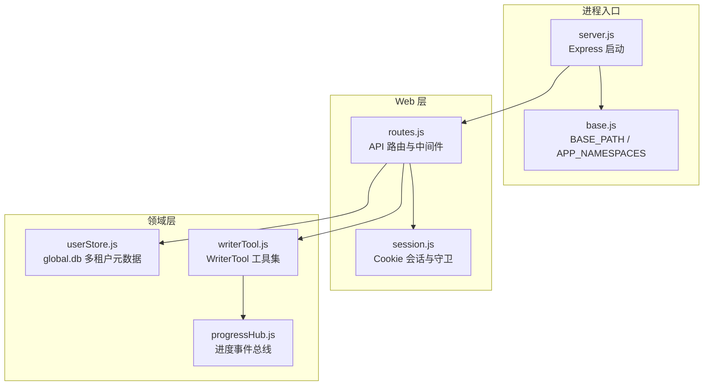
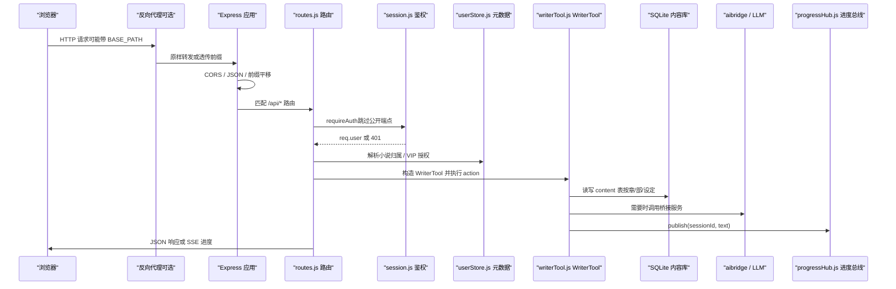
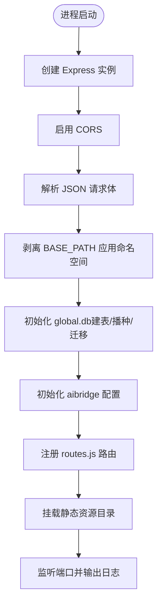
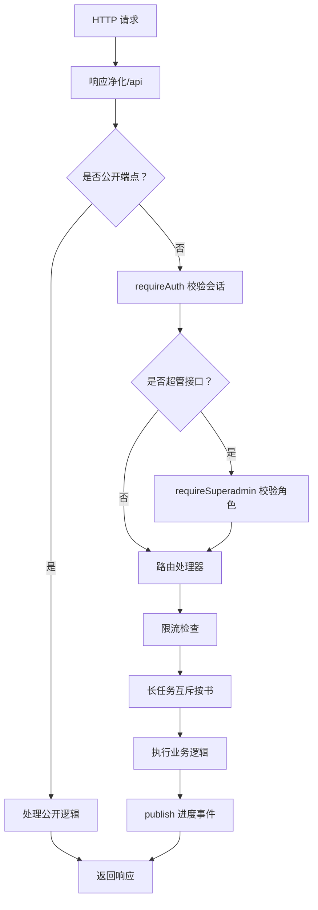
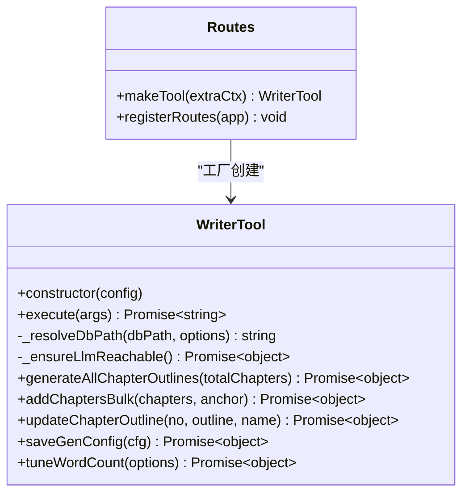
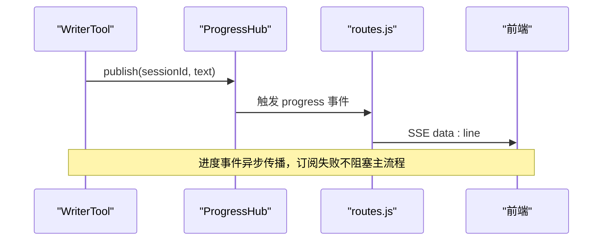
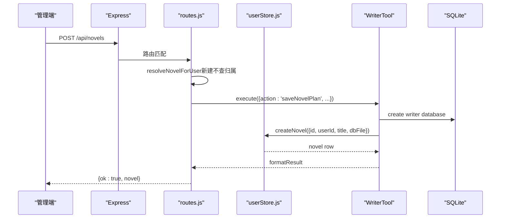
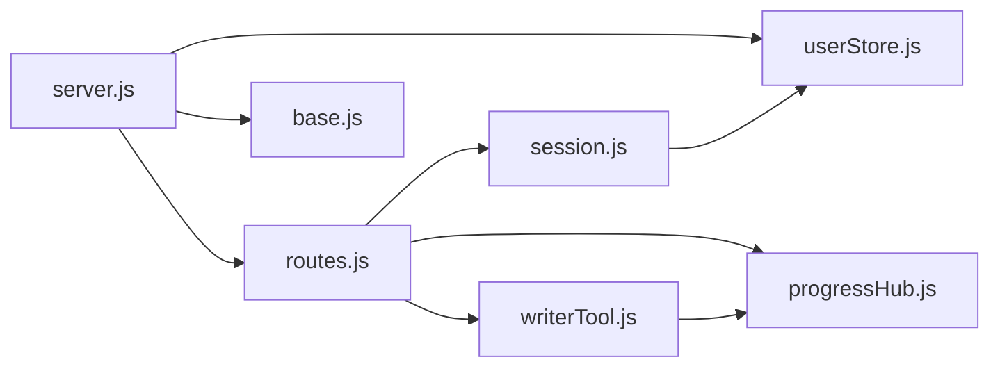

# 后端架构设计

<cite>
**本文引用的文件**   
- [server.js](file://server.js)
- [src/routes.js](file://src/routes.js)
- [src/auth/session.js](file://src/auth/session.js)
- [src/auth/userStore.js](file://src/auth/userStore.js)
- [src/tools/common/writerTool.js](file://src/tools/common/writerTool.js)
- [src/services/progressHub.js](file://src/services/progressHub.js)
- [src/base.js](file://src/base.js)
- [package.json](file://package.json)
- [README.md](file://README.md)
</cite>

## 目录
1. [引言](#引言)
2. [项目结构](#项目结构)
3. [核心组件](#核心组件)
4. [架构总览](#架构总览)
5. [详细组件分析](#详细组件分析)
6. [依赖关系分析](#依赖关系分析)
7. [性能与扩展性](#性能与扩展性)
8. [故障排查指南](#故障排查指南)
9. [结论](#结论)

## 引言
本文件面向 AINovel 后端，系统性说明 Express 应用的启动流程、中间件机制、路由组织、请求处理管道、多租户与权限模型，以及关键设计模式。文档同时给出架构图与时序图，帮助读者从 HTTP 请求一路追踪到数据库操作与 LLM 调用。

## 项目结构
AINovel 后端采用 Node.js + Express 的模块化结构：
- 进程入口负责初始化 Express、CORS、JSON 解析、路径前缀平移、静态资源挂载与端口监听。
- 路由层集中注册 API，承担鉴权、租户隔离、VIP 授权、长任务进度推送等职责。
- 认证与会话模块提供零依赖 Cookie 会话与用户守卫。
- 多租户元数据仓库维护用户、小说登记、VIP 授权与预览生命周期。
- WriterTool 封装章节增删改、大纲生成、字数治理等复杂业务，并通过进度总线对外推送状态。



**图表来源**
- [server.js:9-53](file://server.js#L9-L53)
- [src/base.js:17-41](file://src/base.js#L17-L41)
- [src/routes.js:331-560](file://src/routes.js#L331-L560)
- [src/auth/session.js:93-110](file://src/auth/session.js#L93-L110)
- [src/auth/userStore.js:47-113](file://src/auth/userStore.js#L47-L113)
- [src/tools/common/writerTool.js:76-206](file://src/tools/common/writerTool.js#L76-L206)
- [src/services/progressHub.js:16-58](file://src/services/progressHub.js#L16-L58)

**章节来源**
- [server.js:1-64](file://server.js#L1-L64)
- [src/base.js:1-42](file://src/base.js#L1-L42)
- [package.json:1-29](file://package.json#L1-L29)
- [README.md:1-202](file://README.md#L1-L202)

## 核心组件
- Express 应用与中间件：CORS、JSON 解析、路径前缀平移、静态资源服务。
- 路由注册器：统一挂载 `/api` 接口，内置响应净化、限流、鉴权、VIP 闸门、长任务互斥与 SSE 进度通道。
- 会话与权限：HMAC-SHA256 签名 Cookie，登录态校验、超管守卫。
- 多租户仓库：基于 better-sqlite3 的 global.db，管理用户、小说登记、VIP 授权、预览产物生命周期。
- WriterTool：章节与全书级操作的工厂式入口，封装参数校验、LLM 预检、事务化写入、字数治理与进度推送。
- 进度总线：基于 EventEmitter 的观察者实现，将长任务阶段消息转发给 Web 层 SSE。

**章节来源**
- [server.js:22-53](file://server.js#L22-L53)
- [src/routes.js:331-627](file://src/routes.js#L331-L627)
- [src/auth/session.js:26-110](file://src/auth/session.js#L26-L110)
- [src/auth/userStore.js:47-113](file://src/auth/userStore.js#L47-L113)
- [src/tools/common/writerTool.js:76-206](file://src/tools/common/writerTool.js#L76-L206)
- [src/services/progressHub.js:16-58](file://src/services/progressHub.js#L16-L58)

## 架构总览
下图展示从浏览器发起请求到数据库访问与 LLM 调用的完整链路，包括中间件、鉴权、租户隔离、WriterTool 执行与进度推送。



**图表来源**
- [server.js:22-53](file://server.js#L22-L53)
- [src/routes.js:331-627](file://src/routes.js#L331-L627)
- [src/auth/session.js:93-110](file://src/auth/session.js#L93-L110)
- [src/auth/userStore.js:190-228](file://src/auth/userStore.js#L190-L228)
- [src/tools/common/writerTool.js:217-262](file://src/tools/common/writerTool.js#L217-L262)
- [src/services/progressHub.js:28-54](file://src/services/progressHub.js#L28-L54)

## 详细组件分析

### Express 启动与中间件机制
- 启用 CORS 与 JSON 解析（限制请求体大小）。
- 通过自定义中间件把外部 `BASE_PATH` 下的应用命名空间（`/api|/login|/tts|/admin`）剥离回内部根路径，避免路由字面量重复拼接前缀；书页路径 `/novel/<uid>/<书名>/...` 不参与剥离，防止出现双前缀。
- 启动时初始化全局元数据库（建表、播种、存量迁移），并初始化桥接配置。
- 注册路由后挂载静态资源：登录页、TTS 资源、管理后台、已发布书页与公共静态目录。



**图表来源**
- [server.js:18-55](file://server.js#L18-L55)
- [src/base.js:17-41](file://src/base.js#L17-L41)

**章节来源**
- [server.js:9-55](file://server.js#L9-L55)
- [src/base.js:17-41](file://src/base.js#L17-L41)

### 请求处理管道
- 响应净化：对 `/api` 响应进行敏感字段过滤与绝对路径脱敏，避免泄露服务器信息。
- 公开端点：登录、登出、当前用户、阅读器学习接口、公开书单、TTS 合成等。
- 鉴权守卫：除白名单外所有 `/api` 需有效会话；超管接口额外校验角色。
- 限流：按真实客户端 IP 分桶，支持直连与 nginx 反代场景，返回 429 与 Retry-After。
- 长任务互斥：按小说维度锁住生成类动作，避免并发改写正文与章号。
- SSE 进度：订阅全局进度总线，按 `run:` 前缀会话缓冲补发历史事件，定时清理过期缓冲。



**图表来源**
- [src/routes.js:331-339](file://src/routes.js#L331-L339)
- [src/routes.js:341-350](file://src/routes.js#L341-L350)
- [src/routes.js:559-560](file://src/routes.js#L559-L560)
- [src/routes.js:279-306](file://src/routes.js#L279-L306)
- [src/routes.js:629-637](file://src/routes.js#L629-L637)
- [src/routes.js:573-627](file://src/routes.js#L573-L627)

**章节来源**
- [src/routes.js:331-627](file://src/routes.js#L331-L627)

### 多租户架构与权限控制
- 用户权威：global.db 的 user 表存储用户名、密码哈希、角色与禁用状态。
- 小说归属：novel 表以 user_id 关联 db_file，Web 端列举与鉴权以该表为准，消除路径穿越风险。
- VIP 授权：vip_grant 表记录读者账号对某本书或全站 VIP 的授权，支持到期与撤销；hasVipAccess 为唯一判定口径。
- 会话管理：HMAC-SHA256 签名的 httpOnly Cookie，包含 uid 与过期时间；Path 绑定 BASE_PATH，避免跨子系统串味。
- 权限守卫：requireAuth 校验登录态，requireSuperadmin 校验超管角色；currentUser 返回 id、username、role。

```mermaid
classDiagram
class User {
+string id
+string username
+string pass_hash
+string salt
+string role
+boolean disabled
+number last_login
+number created_at
+number updated_at
}
class Novel {
+string id
+string user_id
+string title
+string db_file
+number chapter_count
+boolean vip
+number created_at
+number updated_at
}
class VipGrant {
+string id
+string user_id
+string novel_id
+string note
+number expires_at
+number revoked_at
+number created_at
+number updated_at
}
class Session {
+string cookieName
+number maxAge
+createToken(uid) string
+verifyToken(token) object
+setSessionCookie(res, uid) void
+clearSessionCookie(res) void
+currentUser(req) object
}
User ||--o{ Novel : owns
User ||--o{ VipGrant : granted_to
Session --> User : "验证会话"
```

**图表来源**
- [src/auth/userStore.js:53-101](file://src/auth/userStore.js#L53-L101)
- [src/auth/session.js:26-91](file://src/auth/session.js#L26-L91)

**章节来源**
- [src/auth/userStore.js:47-113](file://src/auth/userStore.js#L47-L113)
- [src/auth/userStore.js:190-228](file://src/auth/userStore.js#L190-L228)
- [src/auth/userStore.js:235-349](file://src/auth/userStore.js#L235-L349)
- [src/auth/session.js:26-110](file://src/auth/session.js#L26-L110)

### 关键设计模式

#### 工厂模式在 WriterTool 中的应用
- 路由层通过 makeTool 工厂函数创建 WriterTool 实例，注入 workspace、模型参数与上下文。
- WriterTool 作为统一入口，根据 action 分发到不同业务分支，封装参数归一化、LLM 预检、数据库操作与结果格式化。
- 工厂解耦了路由与工具实现，便于扩展新 action 而不改动路由主干。



**图表来源**
- [src/routes.js:55-65](file://src/routes.js#L55-L65)
- [src/tools/common/writerTool.js:76-206](file://src/tools/common/writerTool.js#L76-L206)
- [src/tools/common/writerTool.js:217-262](file://src/tools/common/writerTool.js#L217-L262)

**章节来源**
- [src/routes.js:55-65](file://src/routes.js#L55-L65)
- [src/tools/common/writerTool.js:76-206](file://src/tools/common/writerTool.js#L76-L206)

#### 观察者模式在进度推送中的使用
- progressHub 继承 EventEmitter，提供 publish 与 subscribe。
- WriterTool 在执行长任务时调用 publish，routes.js 订阅并按 sessionId 缓冲与转发至 SSE。
- 观察者模式解耦了“谁产生进度”和“谁消费进度”，订阅方异常被隔离，不影响主执行链路。



**图表来源**
- [src/services/progressHub.js:28-54](file://src/services/progressHub.js#L28-L54)
- [src/routes.js:573-627](file://src/routes.js#L573-L627)

**章节来源**
- [src/services/progressHub.js:16-58](file://src/services/progressHub.js#L16-L58)
- [src/routes.js:573-627](file://src/routes.js#L573-L627)

### 典型请求时序：新建小说


**图表来源**
- [src/routes.js:646-661](file://src/routes.js#L646-L661)
- [src/auth/userStore.js:203-210](file://src/auth/userStore.js#L203-L210)
- [src/tools/common/writerTool.js:327-408](file://src/tools/common/writerTool.js#L327-L408)

**章节来源**
- [src/routes.js:646-661](file://src/routes.js#L646-L661)
- [src/auth/userStore.js:203-210](file://src/auth/userStore.js#L203-L210)
- [src/tools/common/writerTool.js:327-408](file://src/tools/common/writerTool.js#L327-L408)

## 依赖关系分析
- server.js 依赖 express、cors、path、fileURLToPath、routes.js、userStore.js、bridgeStore.js、base.js。
- routes.js 依赖 path、fs、crypto、better-sqlite3、WriterTool、llm、bridgeStore、progressHub、registry、wordTarget、publish、preview、userStore、session、base、reader aiService、ttsStore。
- session.js 依赖 crypto、fs、path、fileURLToPath、userStore、base。
- userStore.js 依赖 fs、path、crypto、fileURLToPath、better-sqlite3。
- writerTool.js 依赖 fs-extra、path、BaseTool、llm、writerDB、better-sqlite3、skillPathResolver、chineseNumber、wordTarget、textDiff、textUtils、checker、progressHub。
- progressHub.js 依赖 events。



**图表来源**
- [server.js:9-16](file://server.js#L9-L16)
- [src/routes.js:10-28](file://src/routes.js#L10-L28)
- [src/auth/session.js:6-11](file://src/auth/session.js#L6-L11)
- [src/auth/userStore.js:12-16](file://src/auth/userStore.js#L12-L16)
- [src/tools/common/writerTool.js:6-18](file://src/tools/common/writerTool.js#L6-L18)
- [src/services/progressHub.js:14](file://src/services/progressHub.js#L14)

**章节来源**
- [server.js:9-16](file://server.js#L9-L16)
- [src/routes.js:10-28](file://src/routes.js#L10-L28)
- [src/auth/session.js:6-11](file://src/auth/session.js#L6-L11)
- [src/auth/userStore.js:12-16](file://src/auth/userStore.js#L12-L16)
- [src/tools/common/writerTool.js:6-18](file://src/tools/common/writerTool.js#L6-L18)
- [src/services/progressHub.js:14](file://src/services/progressHub.js#L14)

## 性能与扩展性
- 中间件开销：CORS 与 JSON 解析为通用开销；路径剥离仅在 BASE_PATH 命中时执行，影响有限。
- 数据库访问：content 表查询尽量只读、按需加载（如 includeContent:false），减少内存占用。
- 限流策略：按真实 IP 分桶，定期清理过期窗口，避免 Map 无限增长。
- 长任务互斥：按小说维度锁，避免并发改写正文与章号；SSE 心跳保活连接。
- 扩展建议：
  - 新增 action 优先在 WriterTool 中实现，并在 routes.js 白名单与菜单清单同步注册。
  - 新增公开端点需在净化白名单与限流策略中显式声明。
  - 新增静态资源挂载应遵循 BASE_PATH 语义，避免破坏书页路径。

[本节为通用指导，不直接分析具体文件]

## 故障排查指南
- 登录失败：检查 SESSION_SECRET 是否设置；未设置会生成临时密钥，重启后会话失效。
- 401 未登录：确认 Cookie 名称、Path 与 BASE_PATH 一致；检查会话是否过期或被禁用。
- 403 无权访问：确认 novel.user_id 与当前用户一致；超管可绕过。
- 429 请求频繁：检查限流桶与真实 IP 提取逻辑；nginx 下需确保 X-Real-IP/X-Forwarded-For 可信。
- 长任务无进度：确认 progressHub 订阅是否建立；检查 sessionId 前缀是否为 run:；查看缓冲 TTL 与最大行数。
- 生成失败：先探 LLM 链路健康；确认 aibridge 可达与 Key 正确；注意超时预算与上游吞吐。

**章节来源**
- [src/auth/session.js:32-36](file://src/auth/session.js#L32-L36)
- [src/auth/session.js:93-110](file://src/auth/session.js#L93-L110)
- [src/routes.js:279-306](file://src/routes.js#L279-L306)
- [src/routes.js:573-627](file://src/routes.js#L573-L627)
- [src/tools/common/writerTool.js:254-262](file://src/tools/common/writerTool.js#L254-L262)

## 结论
AINovel 后端以 Express 为入口，通过清晰的中间件链路与路由组织，实现了多租户隔离、细粒度权限控制与稳定的长任务反馈机制。WriterTool 作为工厂式工具入口，统一封装章节与全书级操作，结合进度总线实现可观测的执行过程。整体架构兼顾安全性、可维护性与可扩展性，适合在本地与线上环境中稳定运行。

[本节为总结性内容，不直接分析具体文件]