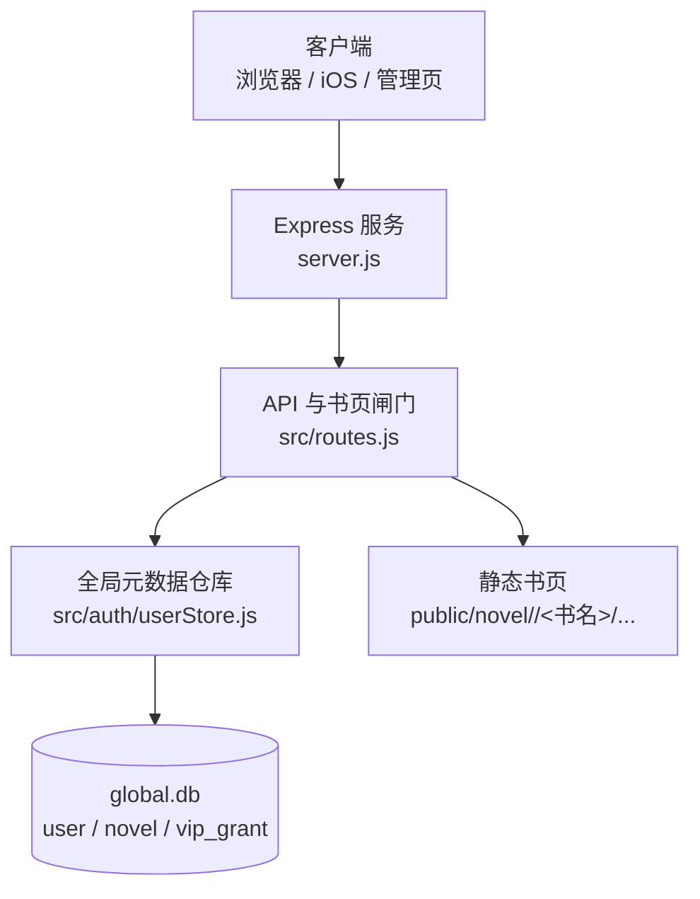
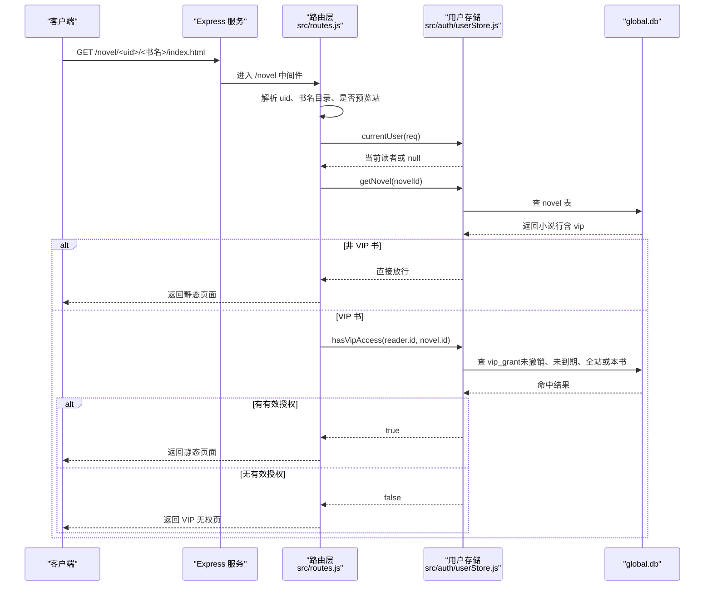
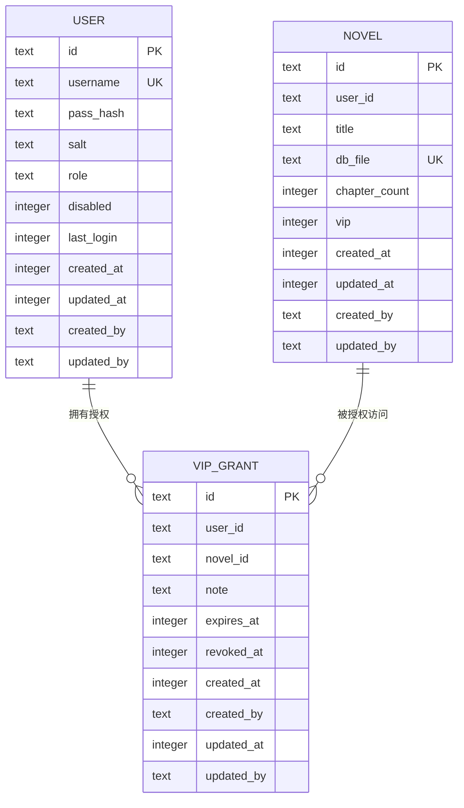
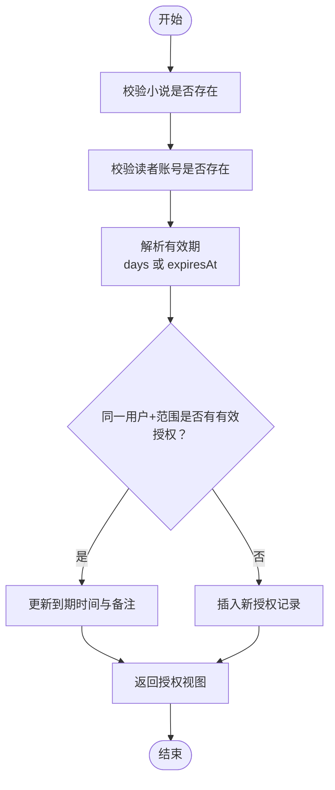
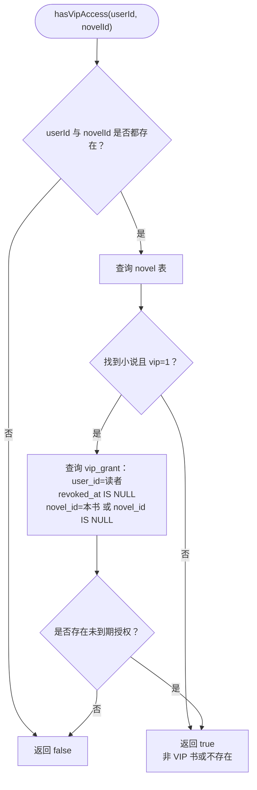
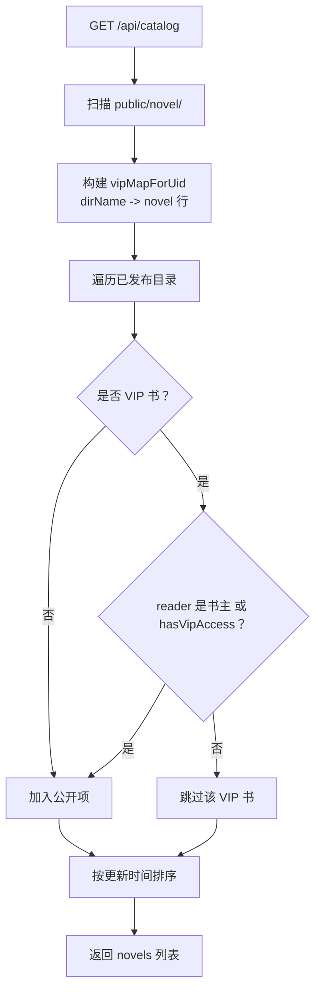
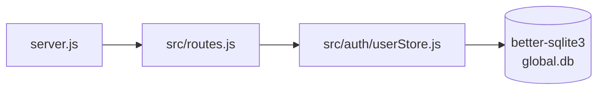

# VIP 访问控制

<cite>
**本文引用的文件**   
- [server.js](file://server.js)
- [src/routes.js](file://src/routes.js)
- [src/auth/userStore.js](file://src/auth/userStore.js)
- [README.md](file://README.md)
</cite>

## 目录
1. [引言](#引言)
2. [项目结构](#项目结构)
3. [核心组件](#核心组件)
4. [架构总览](#架构总览)
5. [详细组件分析](#详细组件分析)
6. [依赖关系分析](#依赖关系分析)
7. [性能与扩展性](#性能与扩展性)
8. [故障排查指南](#故障排查指南)
9. [结论](#结论)
10. [附录：VIP 管理 API 与使用场景](#附录vip-管理-api-与使用场景)

## 引言
本文件面向 AINovel VIP 访问控制系统，目标是把“小说级 VIP 标记 + 读者账号授权 + 全站 VIP 权限”的完整机制讲清楚。重点包括：
- 小说如何被标记为 VIP；
- 读者账号如何通过 vip_grant 表获得单本或全站阅读权；
- hasVipAccess 的判断逻辑、权限继承规则与超管豁免边界；
- 从授权创建到访问控制的端到端工作流；
- 常见管理 API 与典型使用场景。

该机制不再使用共享密码解锁，而是以 global.db 中的用户与会话为基础，对每个书页请求实时校验授权状态，撤销与到期当场生效。

**章节来源**
- [README.md:12-60](file://README.md#L12-L60)

## 项目结构
VIP 相关能力分布在三个关键位置：
- server.js：服务入口、静态资源挂载、前缀处理。
- src/routes.js：API 路由、VIP 闸门（/novel 子树）、公开书单过滤、VIP 属性接口与管理接口。
- src/auth/userStore.js：全局元数据库 global.db 的建表、用户/小说/VIP 授权 CRUD、hasVipAccess 判断。

**图表来源**
- [server.js:38-53](file://server.js#L38-L53)
- [src/routes.js:1035-1094](file://src/routes.js#L1035-L1094)
- [src/auth/userStore.js:47-114](file://src/auth/userStore.js#L47-L114)

**章节来源**
- [server.js:1-64](file://server.js#L1-L64)
- [src/routes.js:1-30](file://src/routes.js#L1-L30)
- [src/auth/userStore.js:1-11](file://src/auth/userStore.js#L1-L11)

## 核心组件
- 小说 VIP 标记：novel.vip 表示该书是否为 VIP 专属内容。
- 读者授权表：vip_grant 记录“哪个用户”可访问“哪本小说”，novel_id 为 NULL 时表示全站 VIP。
- 授权生命周期：支持授予、续期、撤销、恢复，并支持 expires_at 到期控制。
- 访问检查：hasVipAccess 是读者侧唯一口径，结合 novel.vip 决定是否放行。
- 书页闸门：/novel 中间件在静态文件下发前拦截 VIP 书，未授权返回无权页。
- 公开书单过滤：/api/catalog 对未授权读者隐藏 VIP 条目。

**章节来源**
- [src/auth/userStore.js:67-93](file://src/auth/userStore.js#L67-L93)
- [src/auth/userStore.js:235-349](file://src/auth/userStore.js#L235-L349)
- [src/routes.js:144-179](file://src/routes.js#L144-L179)
- [src/routes.js:515-557](file://src/routes.js#L515-L557)
- [src/routes.js:1035-1094](file://src/routes.js#L1035-L1094)

## 架构总览
下图展示一次 VIP 书页访问的关键路径：客户端请求 → Express 路由 → /novel 闸门 → 读取会话用户 → 查询 novel.vip 与 vip_grant → 放行或返回无权页。

**图表来源**
- [src/routes.js:1035-1094](file://src/routes.js#L1035-L1094)
- [src/auth/userStore.js:341-349](file://src/auth/userStore.js#L341-L349)
- [src/auth/userStore.js:197-202](file://src/auth/userStore.js#L197-L202)

## 详细组件分析

### 1. 数据模型与 vip_grant 表设计
global.db 中涉及 VIP 的核心表如下：
- user：账号权威，包含角色、禁用状态等。
- novel：小说登记，包含 user_id、title、db_file、vip 标记。
- vip_grant：读者授权表，字段含义如下：
  - id：授权记录主键。
  - user_id：被授权的读者账号。
  - novel_id：目标小说；NULL 表示全站 VIP。
  - note：备注。
  - expires_at：到期时间戳；NULL 表示长期有效。
  - revoked_at：撤销时间戳；非空表示已撤销（软删除）。
  - created_at / updated_at / created_by / updated_by：审计字段。

索引：
- idx_grant_user：按 user_id 加速读者维度查询。
- idx_grant_novel：按 novel_id 加速小说维度查询。

删除小说时，会级联清理指向该书的 vip_grant 与 preview 登记，避免悬挂引用。

**图表来源**
- [src/auth/userStore.js:53-102](file://src/auth/userStore.js#L53-L102)
- [src/auth/userStore.js:222-228](file://src/auth/userStore.js#L222-L228)

**章节来源**
- [src/auth/userStore.js:47-114](file://src/auth/userStore.js#L47-L114)
- [src/auth/userStore.js:222-228](file://src/auth/userStore.js#L222-L228)

### 2. VIP 授权工作流
VIP 授权由管理员通过控制台调用后端 API 完成，核心流程如下：

关键点：
- grantVip 支持按用户名或 userId 定位读者；novelId 为空即全站 VIP。
- 重复授予不会新增行，而是更新现有有效记录的 expires_at 与 note。
- revokeVipGrant 将 revoked_at 置为非空，历史可审；restoreVipGrant 可恢复。
- resolveGrantExpiry 优先接受 days（从当前时间加天数），其次接受 expiresAt（时间戳或日期串）。

**图表来源**
- [src/auth/userStore.js:285-333](file://src/auth/userStore.js#L285-L333)
- [src/routes.js:190-206](file://src/routes.js#L190-L206)
- [src/routes.js:1276-1294](file://src/routes.js#L1276-L1294)

**章节来源**
- [src/auth/userStore.js:285-333](file://src/auth/userStore.js#L285-L333)
- [src/routes.js:190-206](file://src/routes.js#L190-L206)
- [src/routes.js:1266-1294](file://src/routes.js#L1266-L1294)

### 3. VIP 访问检查流程与权限继承
hasVipAccess 是读者侧访问 VIP 内容的唯一判断口径，其逻辑如下：

权限继承规则：
- 全站 VIP（novel_id 为 NULL）可访问所有 VIP 书。
- 单本 VIP（novel_id 指向具体小说）仅对该书有效。
- 若同时存在全站与单本授权，只要任一未撤销且未到期即可访问。
- 超管在读者侧不享有隐式豁免：必须像普通读者一样具备有效授权；但“书主本人”在书页闸门处有特殊豁免。

超管豁免边界：
- 书页闸门允许“书主本人”直接访问自己的 VIP 书，无需额外授权。
- 其他角色（含超管）一律走 hasVipAccess 名单判定，避免“管理员身份”成为隐形权限。

**图表来源**
- [src/auth/userStore.js:341-349](file://src/auth/userStore.js#L341-L349)
- [src/routes.js:1060-1091](file://src/routes.js#L1060-L1091)

**章节来源**
- [src/auth/userStore.js:341-349](file://src/auth/userStore.js#L341-L349)
- [src/routes.js:1060-1091](file://src/routes.js#L1060-L1091)

### 4. 书页闸门与公开书单过滤
- /novel 中间件：
  - 先识别预览暂存站 token，仅创作者本人或超管可见。
  - 再识别用户站点 UID，若无 VIP 书则直接放行。
  - 对站点首页进行动态过滤：未授权读者看不到 VIP 条目整条链接。
  - 对小说子树（目录页、章节页、目录下任意文件）进行强校验：未授权返回无权页。
- /api/catalog：
  - 公开书单接口对未登录读者只返回非 VIP 书。
  - 登录后，若读者是书主或有 VIP 授权，则显示对应 VIP 书。

**图表来源**
- [src/routes.js:150-157](file://src/routes.js#L150-L157)
- [src/routes.js:515-557](file://src/routes.js#L515-L557)

**章节来源**
- [src/routes.js:150-157](file://src/routes.js#L150-L157)
- [src/routes.js:515-557](file://src/routes.js#L515-L557)
- [src/routes.js:1035-1094](file://src/routes.js#L1035-L1094)

### 5. 旧机制停用与兼容
- 旧的“VIP 密码解锁”已整体停用。
- 保留 /api/reader/vip-unlock 路由，统一返回 410，提示改用账号授权。
- 历史书页上的解锁按钮会收到明确提示，而不是静默 404。

**章节来源**
- [src/routes.js:392-397](file://src/routes.js#L392-L397)
- [README.md:55-60](file://README.md#L55-L60)

## 依赖关系分析
- server.js 负责启动 Express、注册路由、挂载静态资源。
- routes.js 依赖 userStore 提供的用户、小说、VIP 授权能力。
- userStore.js 直接操作 better-sqlite3 的 global.db，封装所有 VIP 相关 SQL。
- 书页访问路径中，routes.js 在 express.static('/novel') 之前拦截，确保权限判断发生在静态文件下发前。

**图表来源**
- [server.js:38-53](file://server.js#L38-L53)
- [src/routes.js:24-26](file://src/routes.js#L24-L26)
- [src/auth/userStore.js:12-16](file://src/auth/userStore.js#L12-L16)

**章节来源**
- [server.js:38-53](file://server.js#L38-L53)
- [src/routes.js:24-26](file://src/routes.js#L24-L26)
- [src/auth/userStore.js:12-16](file://src/auth/userStore.js#L12-L16)

## 性能与扩展性
- hasVipAccess 每次请求都会查询 vip_grant，属于轻量 SQL，适合高频访问。
- 公开书单 /api/catalog 基于磁盘产物扫描，复杂度与已发布站点数量成正比；VIP 过滤在内存中进行。
- 建议：
  - 如果 VIP 授权规模很大，可在 userStore 层增加按 user_id 的缓存，注意撤销与到期变更时的失效策略。
  - 对于高并发站点首页，可考虑对 refreshUserSiteIndex 的结果做短 TTL 缓存，但需保证 VIP 标记变更能刷新。
  - 保持每页请求实时校验，避免缓存导致撤销与到期延迟生效。

[本节为通用指导，不涉及具体代码片段]

## 故障排查指南
常见问题与定位思路：
- 读者登录后仍无法访问 VIP 书：
  - 确认小说已开启 VIP 标记（novel.vip=1）。
  - 确认读者账号存在有效授权（未撤销、未到期）。
  - 确认读者不是“全站 VIP”误配导致范围过大或过小。
- 撤销后仍能访问：
  - 检查是否调用了 revokeVipGrant，且 revoked_at 已设置。
  - 检查浏览器缓存；/novel 闸门会对 VIP 响应设置 no-store。
- 到期后仍可访问：
  - 检查 expires_at 是否早于当前时间。
  - 确认 resolveGrantExpiry 传入的 days 或 expiresAt 是否正确。
- 超管无法访问自己管理的 VIP 书：
  - 超管在读者侧没有隐式豁免，需要给自己授一条全站或单本授权。
  - 只有“书主本人”在书页闸门处有豁免。

**章节来源**
- [src/auth/userStore.js:317-349](file://src/auth/userStore.js#L317-L349)
- [src/routes.js:1060-1091](file://src/routes.js#L1060-L1091)

## 结论
AINovel 的 VIP 访问控制以“小说级标记 + 读者账号授权 + 全站权限”为核心，通过 global.db 的 vip_grant 表实现细粒度、可撤销、可到期的授权管理。hasVipAccess 作为统一判断口径，配合 /novel 书页闸门与 /api/catalog 公开书单过滤，形成从授权创建到访问控制的完整闭环。超管在读者侧不享受隐式豁免，避免“管理员身份”成为安全漏洞；而“书主本人”在书页闸门处获得必要豁免，保障作者正常阅读自己的作品。

[本节为总结性内容，不涉及具体代码片段]

## 附录：VIP 管理 API 与使用场景

### 1. 小说 VIP 属性接口
- GET /api/novels/:id/vip
  - 用途：查看某本小说是否 VIP，以及已授权读者列表。
  - 权限：小说拥有者或超管。
- PUT /api/novels/:id/vip
  - 用途：开启或关闭小说 VIP 标记。
  - 权限：小说拥有者或超管。
- DELETE /api/novels/:id/vip
  - 用途：关闭小说 VIP 标记。
  - 权限：小说拥有者或超管。

**章节来源**
- [src/routes.js:1186-1210](file://src/routes.js#L1186-L1210)

### 2. VIP 读者授权管理接口
- GET /api/admin/vip
  - 用途：获取全部授权、VIP 小说列表、用户列表。
  - 权限：超管。
- POST /api/admin/vip/grant
  - 用途：授予读者 VIP；支持 days 或 expiresAt；novelId 为空即全站 VIP。
  - 权限：超管。
- DELETE /api/admin/vip/:id
  - 用途：撤销授权（软删除）。
  - 权限：超管。
- POST /api/admin/vip/:id/restore
  - 用途：恢复已撤销授权。
  - 权限：超管。

**章节来源**
- [src/routes.js:1266-1294](file://src/routes.js#L1266-L1294)
- [src/auth/userStore.js:285-333](file://src/auth/userStore.js#L285-L333)

### 3. 典型使用场景
- 单本小说 VIP：
  - 步骤：在小说管理页开启“本书为 VIP 专属”，然后在控制台为该读者授予单本 VIP。
  - 效果：该读者可访问该小说；其他读者不可见或无权。
- 全站 VIP：
  - 步骤：在控制台为该读者授予全站 VIP（novelId 为空）。
  - 效果：该读者可访问所有 VIP 小说。
- 限时 VIP：
  - 步骤：授予时传入 days 或 expiresAt。
  - 效果：到期后自动失效，无需人工干预。
- 撤销与恢复：
  - 步骤：撤销后读者立即失去权限；误操作可通过 restore 恢复。
  - 效果：撤销与到期均实时生效。

**章节来源**
- [README.md:55-60](file://README.md#L55-L60)
- [src/routes.js:190-206](file://src/routes.js#L190-L206)
- [src/auth/userStore.js:285-333](file://src/auth/userStore.js#L285-L333)