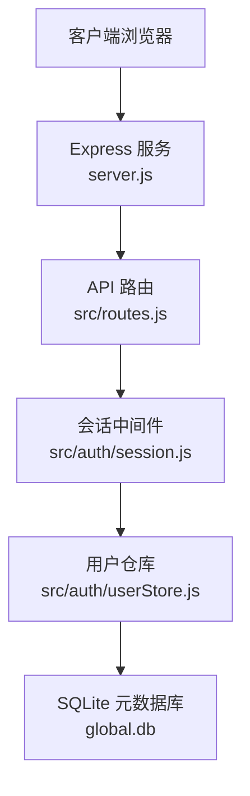
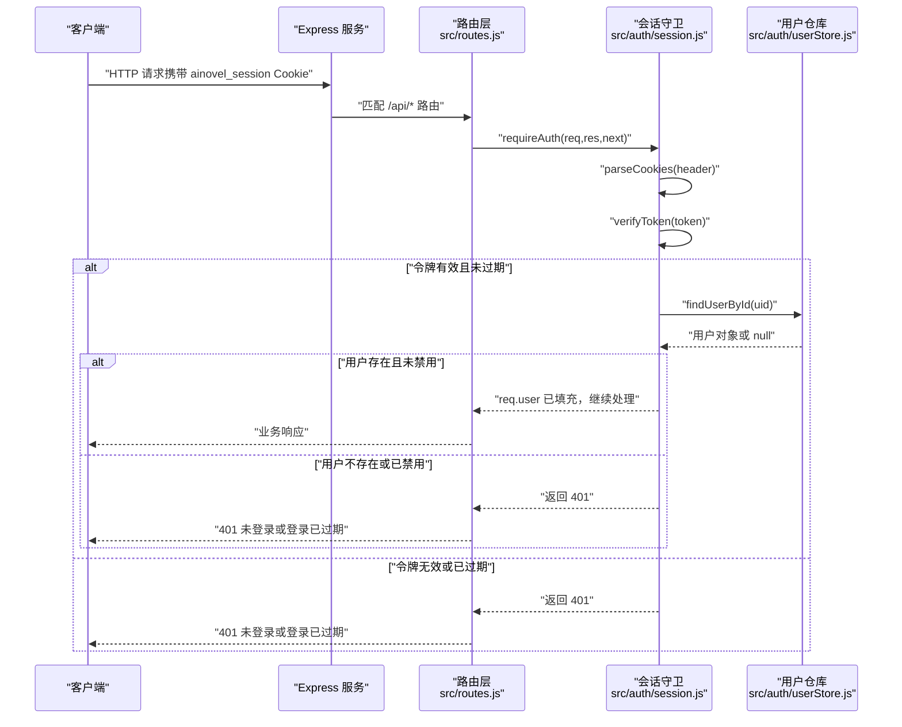
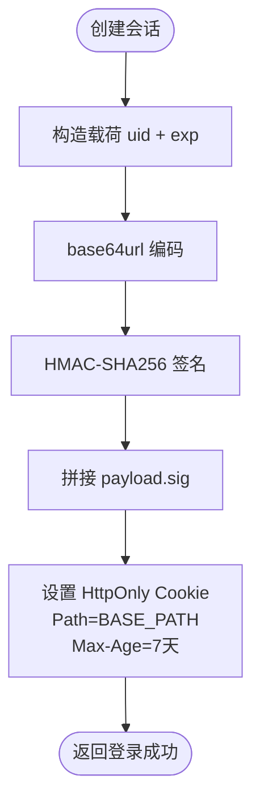
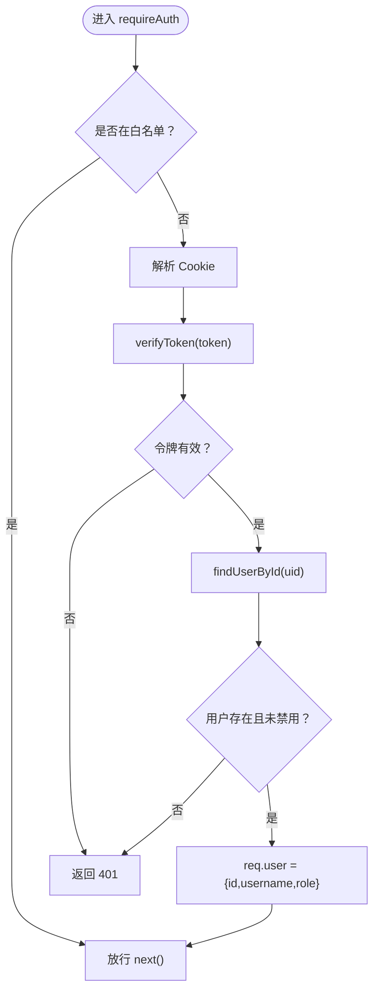
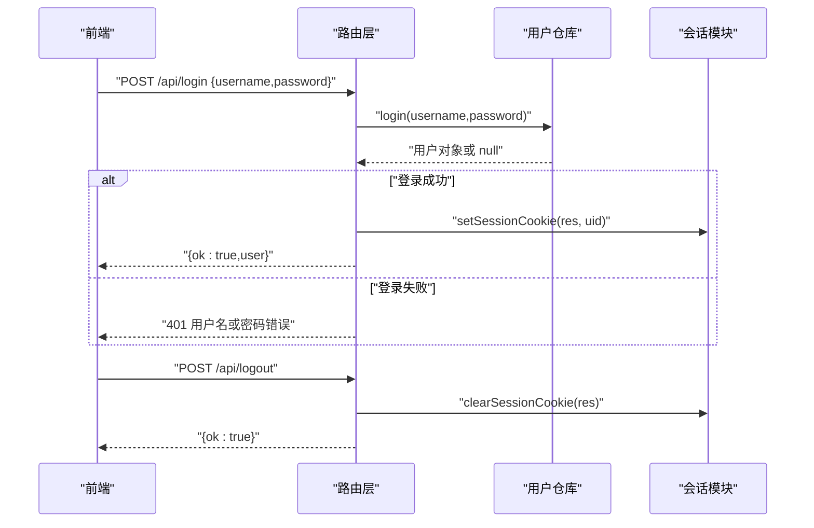
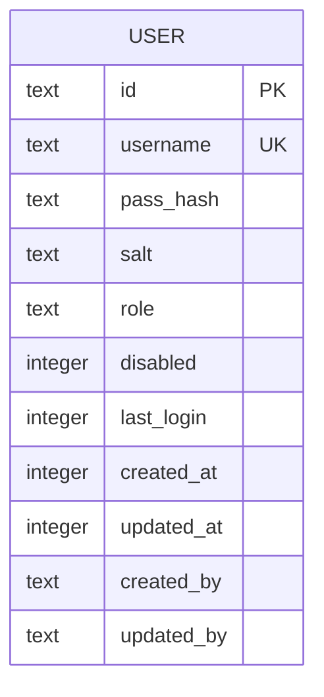
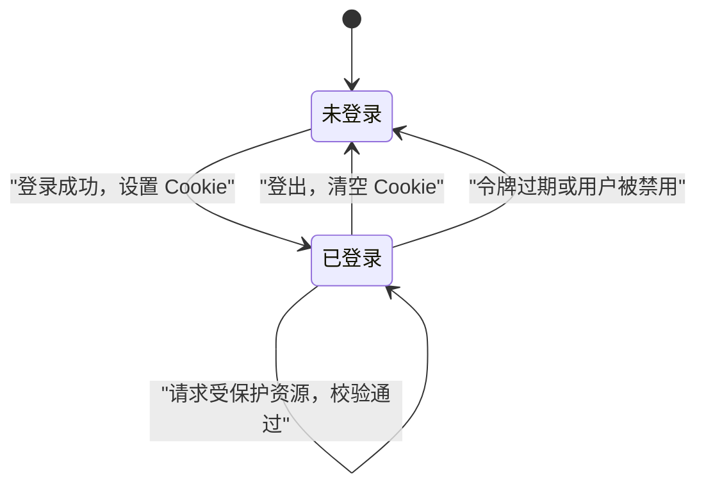
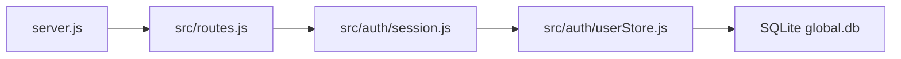

# 会话管理机制

<cite>
**本文引用的文件**   
- [src/auth/session.js](file://src/auth/session.js)
- [src/auth/userStore.js](file://src/auth/userStore.js)
- [server.js](file://server.js)
- [src/routes.js](file://src/routes.js)
</cite>

## 目录
1. [引言](#引言)
2. [项目结构](#项目结构)
3. [核心组件](#核心组件)
4. [架构总览](#架构总览)
5. [详细组件分析](#详细组件分析)
6. [依赖关系分析](#依赖关系分析)
7. [性能与并发特性](#性能与并发特性)
8. [故障排查指南](#故障排查指南)
9. [结论](#结论)

## 引言
本文面向 AINovel 的会话管理子系统，系统性说明其生命周期、存储策略、安全机制与配置项。该实现采用“零依赖”方案：登录态以 httpOnly Cookie 承载 HMAC-SHA256 签名的令牌，服务端不维护进程内会话表；每次请求通过解析 Cookie、校验签名与有效期、再查用户状态完成鉴权。

## 项目结构
与会话相关的代码主要分布在以下位置：
- 会话令牌与中间件：`src/auth/session.js`
- 用户权威数据源（含最后登录时间等）：`src/auth/userStore.js`
- API 路由与登录/登出接口：`src/routes.js`
- 服务启动与全局初始化：`server.js`

**图示来源**
- [server.js:1-64](file://server.js#L1-L64)
- [src/routes.js:331-350](file://src/routes.js#L331-L350)
- [src/auth/session.js:1-118](file://src/auth/session.js#L1-L118)
- [src/auth/userStore.js:47-114](file://src/auth/userStore.js#L47-L114)

**章节来源**
- [server.js:1-64](file://server.js#L1-L64)
- [src/routes.js:331-350](file://src/routes.js#L331-L350)

## 核心组件
- 会话令牌与 Cookie 管理：负责生成、验证、设置和清除会话 Cookie。
- 鉴权中间件：对 `/api` 下除白名单外的所有请求强制校验会话。
- 用户状态查询：从 SQLite 读取用户信息并判断是否禁用。
- 登录/登出接口：创建会话、清除会话、返回当前用户。

关键职责边界：
- 会话本身是无状态的，仅由 Cookie 承载；服务端不保存会话映射表。
- 用户有效性（是否存在、是否禁用）来自 `userStore`。
- 会话过期由令牌内嵌的到期时间控制，无需后台清理任务。

**章节来源**
- [src/auth/session.js:1-118](file://src/auth/session.js#L1-L118)
- [src/routes.js:341-350](file://src/routes.js#L341-L350)

## 架构总览
下图展示一次受保护 API 请求的完整流程，包括会话解析、鉴权与用户状态校验。

**图示来源**
- [src/routes.js:341-350](file://src/routes.js#L341-L350)
- [src/auth/session.js:62-102](file://src/auth/session.js#L62-L102)
- [src/auth/userStore.js:127-132](file://src/auth/userStore.js#L127-L132)

## 详细组件分析

### 会话令牌与 Cookie 管理
- 令牌格式：`base64url(JSON{uid,exp}).hex(HMAC(payload, SECRET))`。
- 密钥来源：优先使用环境变量 `SESSION_SECRET`，若缺失则从工程根 `.env` 中读取；仍缺失时生成随机临时密钥并告警。
- Cookie 属性：`HttpOnly; SameSite=Lax; Path=<BASE_PATH>; Max-Age=7天`。
- 路径隔离：Cookie 的 Path 与站点挂载前缀一致，避免与其他子系统串扰。
- 过期策略：令牌内嵌 `exp`，验证时比较当前时间戳；过期即视为无效。
- 清理策略：登出接口直接清空 Cookie；无后台定时清理任务。

**图示来源**
- [src/auth/session.js:42-45](file://src/auth/session.js#L42-L45)
- [src/auth/session.js:75-81](file://src/auth/session.js#L75-L81)

**章节来源**
- [src/auth/session.js:16-40](file://src/auth/session.js#L16-L40)
- [src/auth/session.js:42-81](file://src/auth/session.js#L42-L81)

### 会话验证与鉴权中间件
- 解析 Cookie：自定义轻量解析器，兼容 URL 编码值。
- 验证令牌：
  - 检查结构、长度与常量时间比较签名。
  - 解码载荷，校验 `uid`、`exp` 与当前时间。
- 用户状态校验：根据 `uid` 查询用户，若不存在或已禁用则拒绝。
- 鉴权守卫：
  - `/api/login`、`/api/logout`、`/api/me` 跳过鉴权。
  - 其他 `/api` 路径必须携带有效会话，否则返回 401。
  - 超级管理员守卫在需更高权限的路由中使用。

**图示来源**
- [src/auth/session.js:62-110](file://src/auth/session.js#L62-L110)

**章节来源**
- [src/auth/session.js:62-110](file://src/auth/session.js#L62-L110)

### 登录与登出接口
- 登录：
  - 调用用户仓库进行口令校验。
  - 成功后设置会话 Cookie，返回用户基本信息。
- 登出：
  - 清空会话 Cookie，返回成功。
- 当前用户：
  - 基于 Cookie 解析当前用户，供前端显示与鉴权兜底。

**图示来源**
- [src/routes.js:341-350](file://src/routes.js#L341-L350)
- [src/auth/session.js:75-81](file://src/auth/session.js#L75-L81)
- [src/auth/userStore.js:181-188](file://src/auth/userStore.js#L181-L188)

**章节来源**
- [src/routes.js:341-350](file://src/routes.js#L341-L350)

### 会话数据结构设计
会话数据以令牌形式存在于客户端 Cookie 中，服务端仅在验证时解析。

- 令牌载荷字段：
  - `uid`：用户 ID，用于定位用户记录。
  - `exp`：过期时间戳（毫秒），用于本地过期判定。
- 服务端关联数据：
  - `user.id`：主键。
  - `user.disabled`：禁用标记，禁用后即使令牌有效也会被拒绝。
  - `user.last_login`：最后登录时间，登录成功时更新。

**图示来源**
- [src/auth/userStore.js:53-66](file://src/auth/userStore.js#L53-L66)

**章节来源**
- [src/auth/userStore.js:53-66](file://src/auth/userStore.js#L53-L66)
- [src/auth/userStore.js:178-188](file://src/auth/userStore.js#L178-L188)

### 会话生命周期管理
- 创建：用户登录成功后，服务端设置会话 Cookie。
- 维护：每次访问受保护资源时，服务端解析并验证会话。
- 过期：令牌内 `exp` 小于当前时间即失效；无需后台清理。
- 清理：登出接口主动清空 Cookie；服务器重启不影响无状态会话。

**图示来源**
- [src/auth/session.js:42-60](file://src/auth/session.js#L42-L60)
- [src/auth/session.js:75-91](file://src/auth/session.js#L75-L91)
- [src/routes.js:341-350](file://src/routes.js#L341-L350)

**章节来源**
- [src/auth/session.js:42-91](file://src/auth/session.js#L42-L91)
- [src/routes.js:341-350](file://src/routes.js#L341-L350)

### 会话存储策略
- 存储位置：客户端 Cookie（httpOnly）。
- 服务端状态：无进程内会话表，无 Redis/数据库会话表。
- 持久化：令牌本身不持久化到服务端；用户状态持久化在 SQLite。
- 扩展性：适合水平扩展，多实例共享同一用户库即可。

**章节来源**
- [src/auth/session.js:1-118](file://src/auth/session.js#L1-L118)
- [src/auth/userStore.js:47-114](file://src/auth/userStore.js#L47-L114)

### 并发访问控制
- 会话解析与验证为纯函数式逻辑，无共享可变状态。
- 用户查询通过 SQLite 单例连接执行，读写串行化由数据库保证。
- 鉴权中间件不引入额外锁或队列，不会成为瓶颈。

**章节来源**
- [src/auth/session.js:62-110](file://src/auth/session.js#L62-L110)
- [src/auth/userStore.js:47-52](file://src/auth/userStore.js#L47-L52)

### 会话安全机制
- 防篡改：HMAC-SHA256 签名，常量时间比较防止时序攻击。
- 防重放：令牌包含短期过期时间，过期即失效。
- 防会话固定：每次登录重新生成令牌，不沿用旧 Cookie。
- 传输安全：Cookie 标记 `HttpOnly`，降低 XSS 窃取风险；`SameSite=Lax` 提供基础 CSRF 防护。
- 路径隔离：Cookie Path 与站点前缀一致，避免跨子系统泄露。
- 用户状态联动：即使用户被禁用，已签发令牌也会在服务端被拒绝。

**章节来源**
- [src/auth/session.js:38-60](file://src/auth/session.js#L38-L60)
- [src/auth/session.js:75-91](file://src/auth/session.js#L75-L91)

### 会话配置选项
- 会话密钥：
  - 环境变量 `SESSION_SECRET`。
  - 若缺失，尝试从工程根 `.env` 读取。
  - 仍缺失则生成随机临时密钥并输出警告。
- 会话超时：
  - `MAX_AGE` 默认 7 天（秒），写入 Cookie `Max-Age`。
- Cookie 路径：
  - `COOKIE_PATH` 取自 `BASE_PATH`，默认 `/`。
- 站点前缀：
  - `BASE_PATH` 决定静态资源与 Cookie 作用域。

建议：
- 生产环境务必设置固定 `SESSION_SECRET`，避免服务重启导致既有会话失效。
- 将 `BASE_PATH` 与实际部署前缀保持一致，确保 Cookie 作用域正确。

**章节来源**
- [src/auth/session.js:16-36](file://src/auth/session.js#L16-L36)
- [src/auth/session.js:26-30](file://src/auth/session.js#L26-L30)
- [server.js:25-36](file://server.js#L25-L36)

### 代码示例与最佳实践
- 登录成功后设置会话：
  - 参考登录路由与会话设置函数的组合用法。
- 受保护接口自动鉴权：
  - 所有 `/api` 路由在注册后统一挂载 `requireAuth`。
- 获取当前用户：
  - 使用 `currentUser(req)` 获取当前登录用户信息。
- 登出：
  - 调用 `clearSessionCookie(res)` 清空会话。

**章节来源**
- [src/routes.js:341-350](file://src/routes.js#L341-L350)
- [src/auth/session.js:75-91](file://src/auth/session.js#L75-L91)

## 依赖关系分析
- `routes.js` 依赖 `session.js` 提供的鉴权中间件与 Cookie 操作。
- `session.js` 依赖 `userStore.js` 的用户查询能力。
- `userStore.js` 依赖 SQLite 数据库（`better-sqlite3`）与文件系统。
- `server.js` 负责应用启动、全局中间件与路由注册。

**图示来源**
- [server.js:13-16](file://server.js#L13-L16)
- [src/routes.js:24-26](file://src/routes.js#L24-L26)
- [src/auth/session.js:10-11](file://src/auth/session.js#L10-L11)
- [src/auth/userStore.js:16-22](file://src/auth/userStore.js#L16-L22)

**章节来源**
- [server.js:13-16](file://server.js#L13-L16)
- [src/routes.js:24-26](file://src/routes.js#L24-L26)
- [src/auth/session.js:10-11](file://src/auth/session.js#L10-L11)
- [src/auth/userStore.js:16-22](file://src/auth/userStore.js#L16-L22)

## 性能与并发特性
- 无状态会话：无需分布式会话同步，扩展成本低。
- 单次请求开销：
  - Cookie 解析与 HMAC 验证为 CPU 密集型但极轻量。
  - 每次鉴权一次 SQLite 用户查询。
- 潜在优化点：
  - 若 QPS 极高，可考虑对热点用户做短时内存缓存（注意一致性）。
  - 合理设置 `BASE_PATH` 与 Cookie Path，减少无效请求。
- 限流与并发：
  - 会话模块本身不限流；读者侧 AI 接口有独立限流逻辑，与会话解耦。

[本节为通用性能讨论，不直接分析具体文件]

## 故障排查指南
- 登录后立即 401：
  - 检查 `SESSION_SECRET` 是否稳定；重启后临时密钥变化会导致旧会话失效。
  - 检查 Cookie Path 是否与站点前缀一致。
- 某用户始终无法登录：
  - 检查用户是否被禁用（`disabled=1`）。
  - 检查口令哈希与盐是否正确。
- 会话不生效：
  - 确认浏览器是否接受 httpOnly Cookie。
  - 确认请求是否携带 `ainovel_session` Cookie。
- 登出后仍可访问：
  - 检查前端是否仍持有旧令牌。
  - 检查后端是否调用了 `clearSessionCookie`。

**章节来源**
- [src/auth/session.js:32-36](file://src/auth/session.js#L32-L36)
- [src/auth/session.js:75-91](file://src/auth/session.js#L75-L91)
- [src/auth/userStore.js:161-188](file://src/auth/userStore.js#L161-L188)

## 结论
AINovel 的会话管理采用轻量的无状态方案：令牌由 httpOnly Cookie 承载，服务端仅做签名与过期校验，并结合用户状态完成鉴权。该设计具备高扩展性、低耦合性与良好的安全性；通过合理的密钥与路径配置，可在多实例与多子系统中稳定运行。对于大规模场景，建议在保持无状态特性的前提下，按需对用户查询与响应净化等环节做进一步优化。