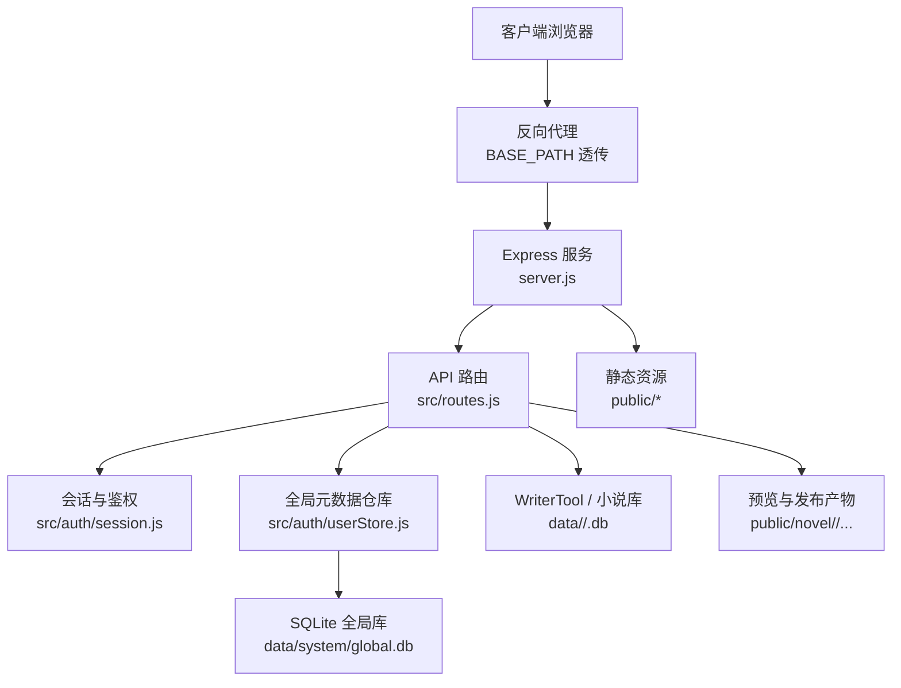
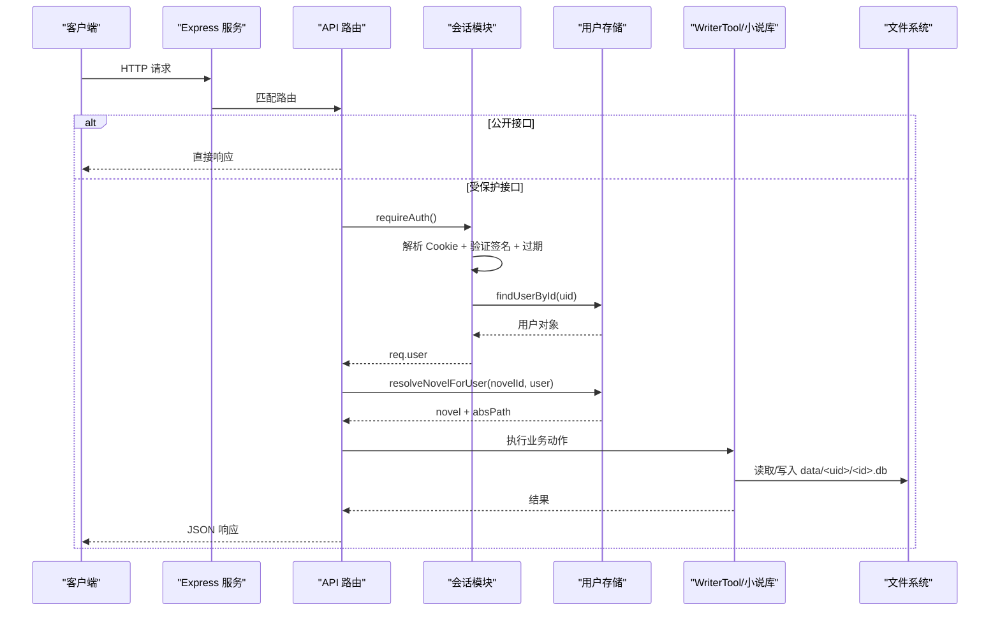
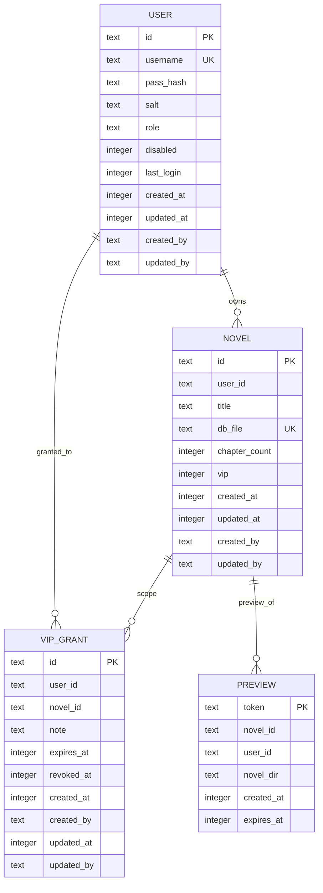
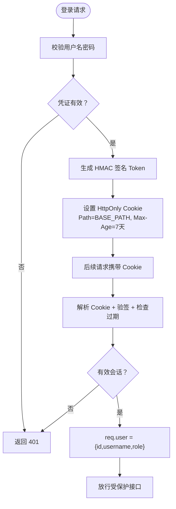
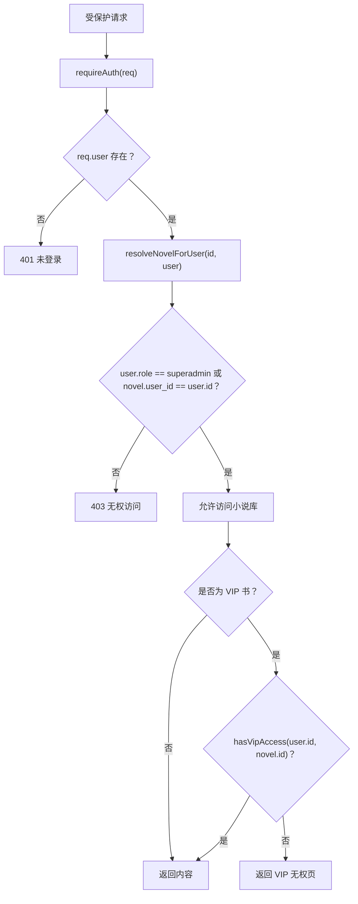
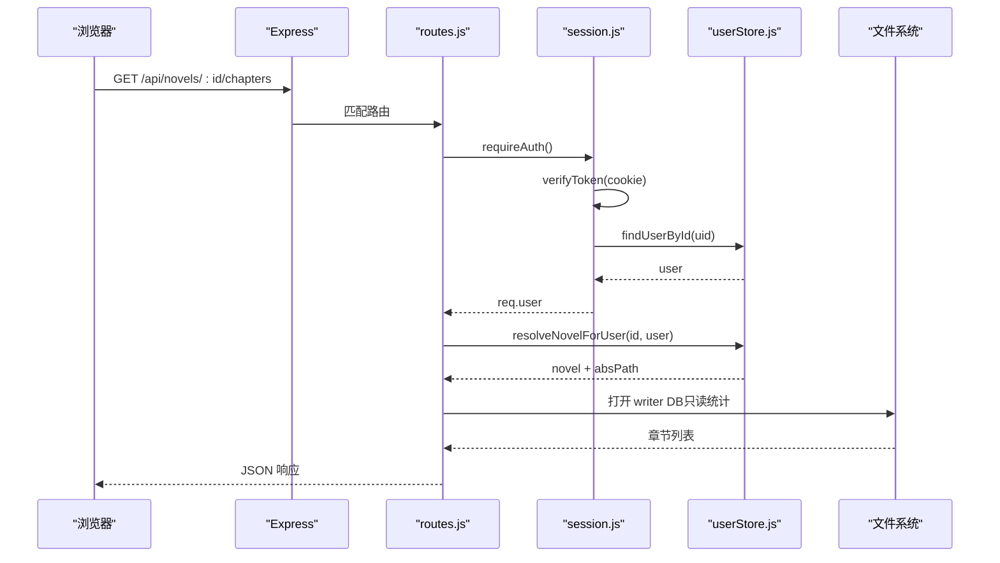
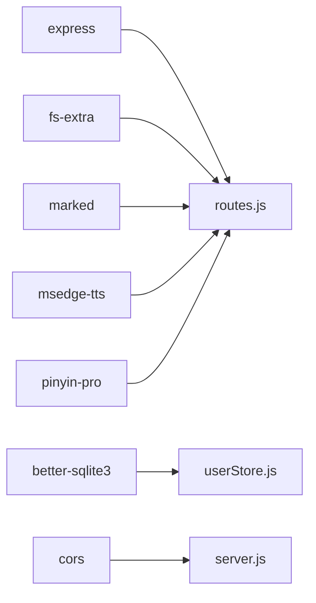

# 多租户架构设计

<cite>
**本文引用的文件**   
- [server.js](file://server.js)
- [src/routes.js](file://src/routes.js)
- [src/auth/session.js](file://src/auth/session.js)
- [src/auth/userStore.js](file://src/auth/userStore.js)
- [src/base.js](file://src/base.js)
- [config/users.json.example](file://config/users.json.example)
- [package.json](file://package.json)
</cite>

## 目录
1. [引言](#引言)
2. [项目结构](#项目结构)
3. [核心组件](#核心组件)
4. [架构总览](#架构总览)
5. [详细组件分析](#详细组件分析)
6. [依赖关系分析](#依赖关系分析)
7. [性能与扩展性](#性能与扩展性)
8. [故障排查指南](#故障排查指南)
9. [结论](#结论)

## 引言
本文件面向 AINovel 的多租户架构，重点说明以下方面：
- 多租户数据隔离的实现原理：用户会话、权限控制、数据访问边界。
- 用户存储策略：SQLite 全局数据库表结构、用户信息持久化、权限级别管理。
- 会话管理机制：登录状态维护、会话过期处理、安全令牌生成。
- 多租户架构图与数据流图：展示用户请求在不同租户间的隔离处理流程。

AINovel 是一个基于 Express 的 Node.js 服务，对外提供登录鉴权、小说创作与管理、阅读站点发布、TTS 朗读、AI 辅助等能力；在多用户模式下，每个用户拥有独立的数据归属（小说库），并通过全局 SQLite 元数据库进行账号、小说登记与 VIP 授权管理。

## 项目结构
从多租户视角，关键代码分布在以下位置：
- 服务入口与前缀处理：`server.js`、`src/base.js`
- API 路由与租户隔离逻辑：`src/routes.js`
- 会话与鉴权中间件：`src/auth/session.js`
- 全局元数据仓库（用户、小说、VIP 授权）：`src/auth/userStore.js`
- 初始种子配置示例：`config/users.json.example`
- 项目依赖与启动脚本：`package.json`

**图表来源**
- [server.js:25-53](file://server.js#L25-L53)
- [src/routes.js:331-339](file://src/routes.js#L331-L339)
- [src/auth/session.js:26-30](file://src/auth/session.js#L26-L30)
- [src/auth/userStore.js:18-23](file://src/auth/userStore.js#L18-L23)

**章节来源**
- [server.js:1-64](file://server.js#L1-L64)
- [src/base.js:1-42](file://src/base.js#L1-L42)
- [package.json:1-29](file://package.json#L1-L29)

## 核心组件
本节聚焦多租户相关的关键模块及其职责：
- 服务入口与前缀平移：负责统一挂载前缀、剥离应用命名空间前缀、初始化全局元数据仓库与桥接服务。
- API 路由层：实现登录、鉴权、租户隔离、VIP 授权、小说 CRUD、发布、预览、TTS、AI 工具执行等。
- 会话模块：零依赖 HMAC-SHA256 Cookie 会话，支持 HttpOnly、SameSite、Path 作用域、过期校验。
- 用户存储模块：封装 better-sqlite3 全局库，提供用户、小说、VIP 授权、预览登记等元数据操作。
- 基础路径模块：集中管理 BASE_PATH、APP_NAMESPACES、sitePath，保证前后端 URL 一致性。

**章节来源**
- [server.js:9-16](file://server.js#L9-L16)
- [src/routes.js:1-29](file://src/routes.js#L1-L29)
- [src/auth/session.js:1-118](file://src/auth/session.js#L1-L118)
- [src/auth/userStore.js:1-11](file://src/auth/userStore.js#L1-L11)
- [src/base.js:1-42](file://src/base.js#L1-L42)

## 架构总览
下图展示多租户请求在服务器中的主要流转路径：客户端通过反向代理进入 Express，路由层根据路径决定是否跳过鉴权；登录后设置会话 Cookie；所有受保护接口均要求有效会话；小说访问通过 `resolveNovelForUser` 做租户归属校验；VIP 内容通过 `hasVipAccess` 判定读者是否被授权；最终由 WriterTool 或静态资源返回结果。

**图表来源**
- [server.js:25-53](file://server.js#L25-L53)
- [src/routes.js:341-350](file://src/routes.js#L341-L350)
- [src/auth/session.js:83-110](file://src/auth/session.js#L83-L110)
- [src/routes.js:97-116](file://src/routes.js#L97-L116)

## 详细组件分析

### 用户存储策略与数据模型
全局元数据仓库使用 SQLite 持久化，核心表包括：
- user：账号权威，包含用户名、密码哈希、salt、角色、禁用标记、最后登录时间、创建/更新时间、创建/更新人。
- novel：小说登记表，user_id -> 小说标题 -> db_file，chapter_count、vip 标记、审计字段。
- vip_grant：VIP 授权表，user_id -> novel_id（NULL 表示全站 VIP）、note、expires_at、revoked_at、审计字段。
- preview：预览登记表，token -> novel_id、user_id、novel_dir、created_at、expires_at。

**图表来源**
- [src/auth/userStore.js:53-101](file://src/auth/userStore.js#L53-L101)

#### 用户信息持久化与权限级别
- 密码采用 scrypt 加随机 salt 后存储，登录时重新计算并 timing-safe 比较。
- 角色分为普通用户与超级管理员；超管可管理用户、VIP 授权、桥接密钥、TTS 清理等。
- 用户禁用不物理删除，而是置 disabled 标志，登录时拒绝。

**章节来源**
- [src/auth/userStore.js:30-45](file://src/auth/userStore.js#L30-L45)
- [src/auth/userStore.js:147-188](file://src/auth/userStore.js#L147-L188)
- [src/auth/userStore.js:483-500](file://src/auth/userStore.js#L483-L500)

#### 小说归属与数据访问边界
- 所有小说以 `global.db.novel.id` 定位，真实文件名仅服务端可见，避免路径穿越。
- `resolveNovelForUser` 将前端传入的 id 或 db_file 映射到内部绝对路径，并校验当前用户拥有权（非超管必须 user_id 匹配）。
- 小说内容库位于 `data/<user_id>/<uuid>.db`，读写一律通过 WriterTool，不在全局库中直接触碰正文。

**章节来源**
- [src/routes.js:97-116](file://src/routes.js#L97-L116)
- [src/auth/userStore.js:190-233](file://src/auth/userStore.js#L190-L233)

#### VIP 授权机制
- 旧共享密码解锁已停用，改为“读者账号授权制”。
- `hasVipAccess` 是 VIP 闸门唯一口径：非 VIP 书恒允许；VIP 书需存在未撤销、未到期且范围命中（全站或本书）的授权。
- 授权支持按用户+小说粒度授予，也支持全站授权（novel_id 为 NULL），并可设置到期时间与备注。

**章节来源**
- [src/routes.js:144-206](file://src/routes.js#L144-L206)
- [src/auth/userStore.js:235-349](file://src/auth/userStore.js#L235-L349)

### 会话管理机制
会话模块实现零依赖的 httpOnly Cookie 会话：
- Token 结构：base64url(JSON{uid, exp}) + "." + hex(HMAC(payload, SECRET))。
- 密钥来源：优先 process.env.SESSION_SECRET，其次 .env 文件，若均未设置则生成临时密钥并警告。
- Cookie 属性：HttpOnly、SameSite=Lax、Path=BASE_PATH（避免跨子系统串味）。
- 过期处理：payload.exp 与当前时间比较，超过即视为无效。
- 登录/登出：登录成功后设置 Cookie；登出清空 Cookie。
- 鉴权中间件：除 `/api/login|logout|me` 外，所有 `/api` 均需有效会话。

**图表来源**
- [src/auth/session.js:16-45](file://src/auth/session.js#L16-L45)
- [src/auth/session.js:75-91](file://src/auth/session.js#L75-L91)
- [src/auth/session.js:93-110](file://src/auth/session.js#L93-L110)

**章节来源**
- [src/auth/session.js:1-118](file://src/auth/session.js#L1-L118)
- [src/routes.js:341-350](file://src/routes.js#L341-L350)

### 多租户数据隔离与权限控制
- 登录态维护：通过 Cookie 中的 uid 反查用户对象，注入 req.user。
- 权限控制：
  - 普通用户只能访问 own novels（user_id 匹配）。
  - 超管可查看所有小说、管理用户、VIP 授权、桥接密钥、TTS 清理等。
  - VIP 内容对读者侧严格依据授权名单，超管也不享有隐形权限。
- 数据访问边界：
  - 全局库只存元数据，正文库通过 WriterTool 访问。
  - 输出净化：API 响应会过滤敏感键与绝对路径，防止泄露服务器信息。

**图表来源**
- [src/routes.js:97-116](file://src/routes.js#L97-L116)
- [src/auth/session.js:93-110](file://src/auth/session.js#L93-L110)
- [src/auth/userStore.js:335-349](file://src/auth/userStore.js#L335-L349)

**章节来源**
- [src/routes.js:331-350](file://src/routes.js#L331-L350)
- [src/routes.js:559-560](file://src/routes.js#L559-L560)
- [src/auth/userStore.js:335-349](file://src/auth/userStore.js#L335-L349)

### 用户请求在不同租户间的隔离处理流程
下图展示一个典型的多租户请求流程：读者或创作者登录后访问某本小说，系统先校验会话，再校验小说归属与 VIP 授权，最后返回对应内容。

**图表来源**
- [src/routes.js:686-708](file://src/routes.js#L686-L708)
- [src/auth/session.js:83-110](file://src/auth/session.js#L83-L110)
- [src/auth/userStore.js:190-233](file://src/auth/userStore.js#L190-L233)

## 依赖关系分析
- Express 作为 Web 框架，承载路由与静态资源。
- better-sqlite3 用于全局元数据持久化。
- cors 启用跨域。
- fs-extra、marked、msedge-tts、pinyin-pro 分别用于文件增强、Markdown 渲染、TTS 合成、拼音处理。
- 会话模块零依赖，仅使用 crypto 与 fs。

**图表来源**
- [package.json:19-27](file://package.json#L19-L27)

**章节来源**
- [package.json:1-29](file://package.json#L1-L29)

## 性能与扩展性
- 会话无外部依赖，Cookie 验签开销低；建议在生产环境固定 SESSION_SECRET 以避免重启失效。
- 全局库为 SQLite，适合中小规模多租户场景；如需更高并发可考虑迁移至 PostgreSQL/MySQL，但需重写 userStore 层。
- 长任务互斥锁按书维度限制并发生成，避免同一本书多次调用 LLM 造成资源竞争。
- 进度通道使用 SSE 缓冲近期事件，避免竞态丢消息；缓冲有 TTL 与行数上限，防止内存无限增长。
- TTS 合成走白名单音色与语速，减少非法参数导致的下游错误。

[本节为通用指导，不直接分析具体文件]

## 故障排查指南
- 登录失败：
  - 检查用户名是否存在、是否被禁用、密码是否正确。
  - 确认 SESSION_SECRET 已配置，否则每次重启会话失效。
- 401 未登录：
  - 检查 Cookie 是否携带 ainovel_session，Path 是否与 BASE_PATH 一致。
  - 检查 Token 是否过期或签名不匹配。
- 403 无权访问：
  - 确认当前用户是否为小说 owner 或 superadmin。
  - VIP 内容需检查 vip_grant 是否有效（未撤销、未到期、范围命中）。
- 404 小说不存在：
  - 检查 global.db.novel 是否登记该小说。
  - 检查 data/<uid>/<id>.db 是否存在。
- 发布与预览问题：
  - 检查 public/novel/<uid>/<书名>/index.html 是否存在。
  - 预览链接需在 24 小时内访问，过期自动清理。

**章节来源**
- [src/auth/session.js:32-36](file://src/auth/session.js#L32-L36)
- [src/auth/session.js:75-91](file://src/auth/session.js#L75-L91)
- [src/routes.js:341-350](file://src/routes.js#L341-L350)
- [src/routes.js:97-116](file://src/routes.js#L97-L116)
- [src/auth/userStore.js:351-378](file://src/auth/userStore.js#L351-L378)

## 结论
AINovel 的多租户架构通过“全局 SQLite 元数据 + 用户目录化小说库”的方式实现了清晰的数据隔离：
- 用户与会话：HMAC-SHA256 Cookie 会话，支持过期与 Path 作用域。
- 权限控制：基于角色的访问控制（RBAC）与基于授权的访问控制（ABAC）结合，VIP 内容严格按授权名单开放。
- 数据边界：全局库只存元数据，正文库通过 WriterTool 访问，避免裸 SQL 操作正文。
- 可扩展性：当前 SQLite 适合中小规模；未来可按需迁移至关系型数据库，同时保持 userStore 抽象不变。

该设计在保证安全性的前提下，兼顾了易用性与可维护性，适合自托管 AI 小说平台的多用户协作与阅读场景。