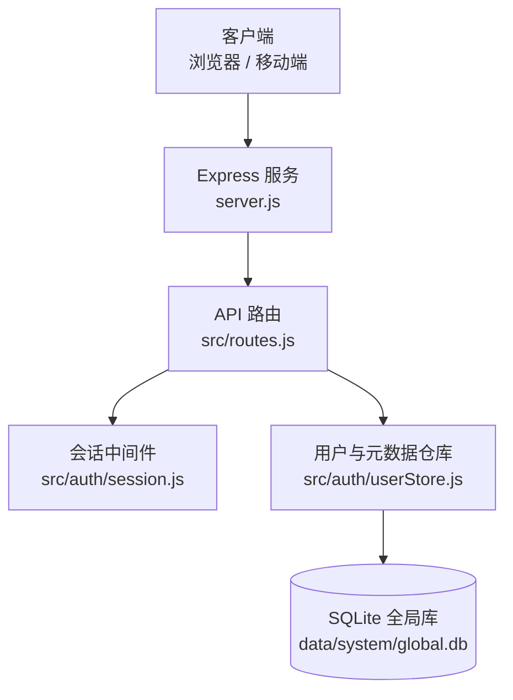
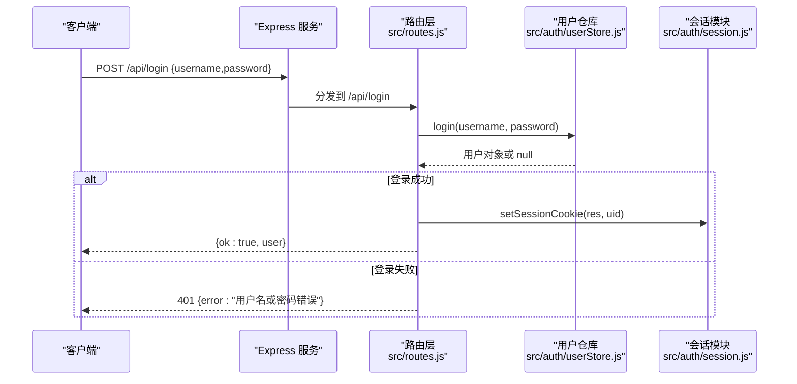
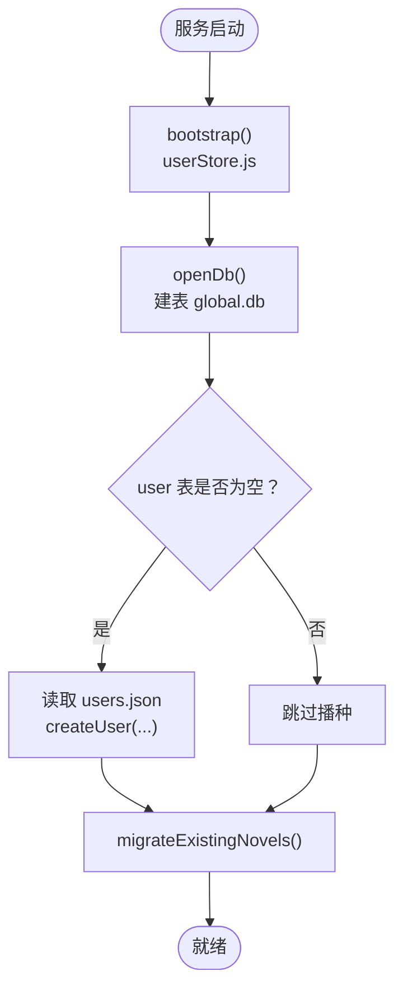
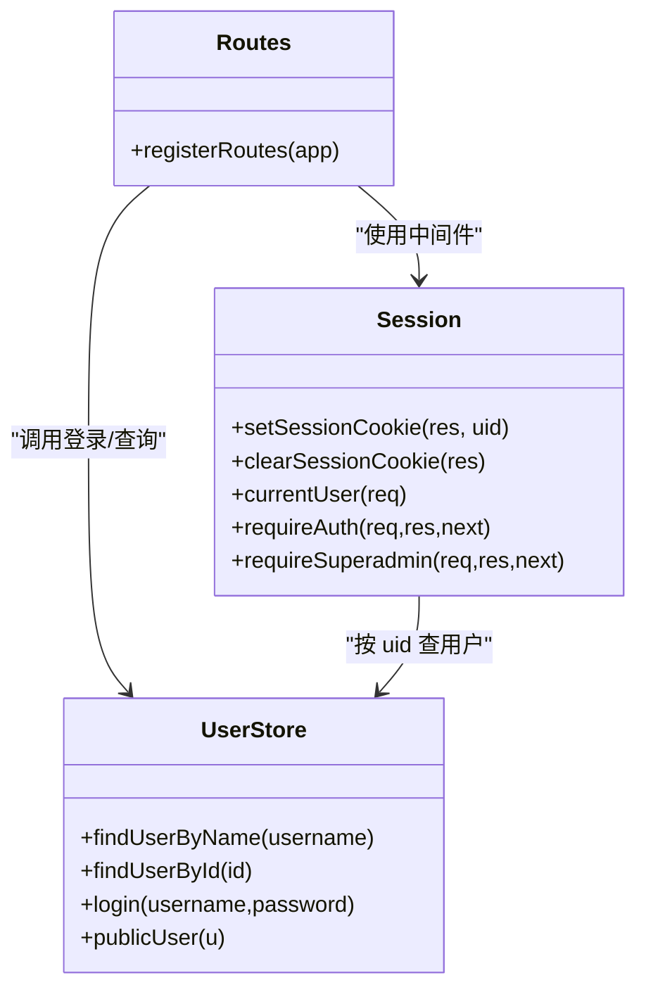
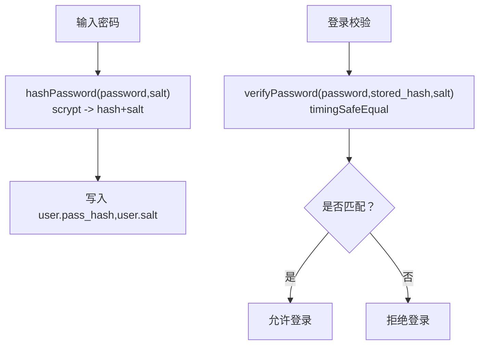
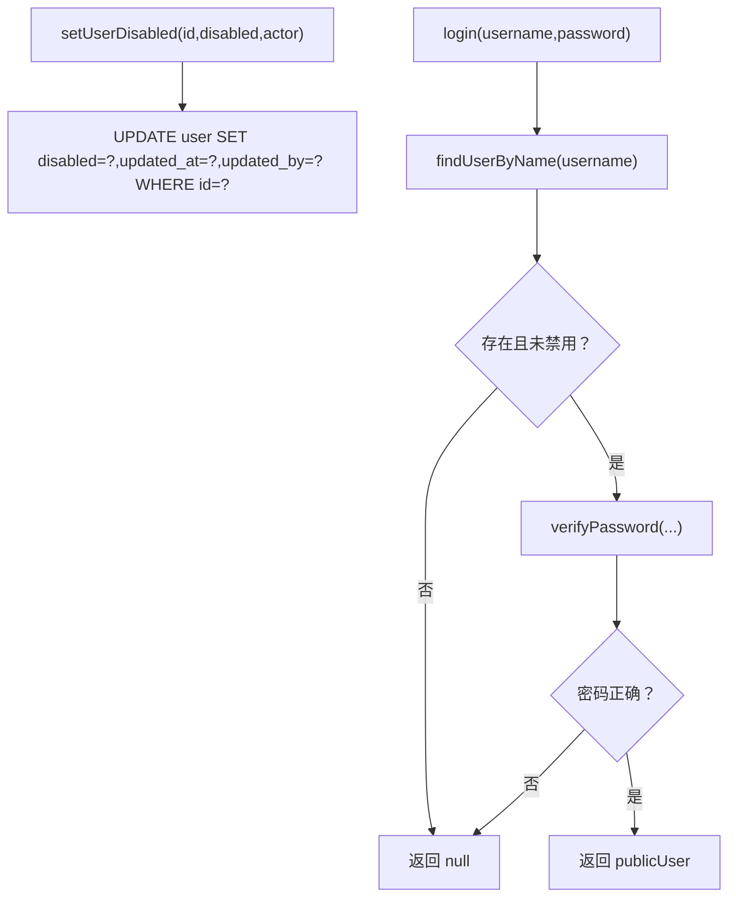
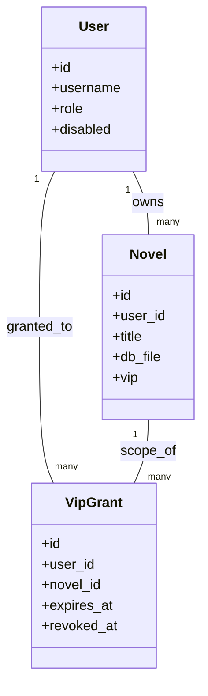
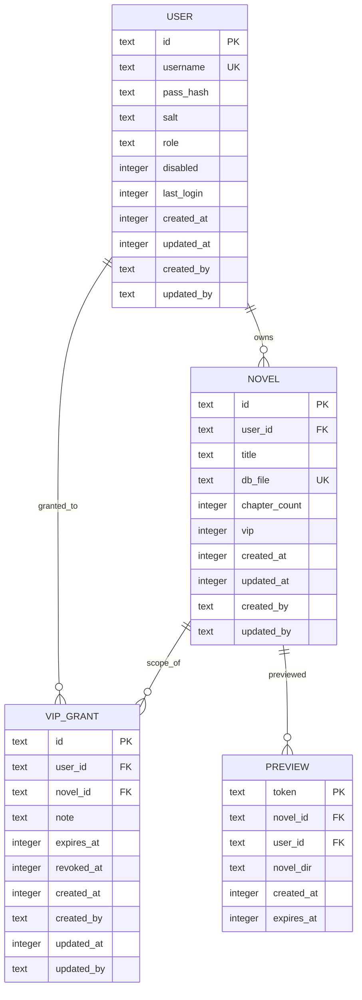
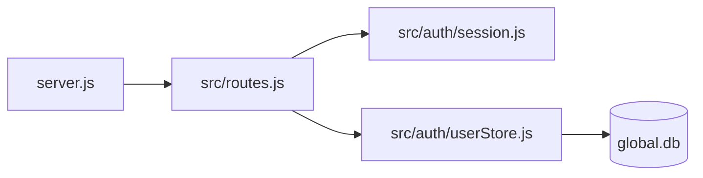

# 用户管理系统

<cite>
**本文引用的文件**   
- [server.js](file://server.js)
- [routes.js](file://src/routes.js)
- [userStore.js](file://src/auth/userStore.js)
- [session.js](file://src/auth/session.js)
- [users.json.example](file://config/users.json.example)
</cite>

## 目录
1. [引言](#引言)
2. [项目结构](#项目结构)
3. [核心组件](#核心组件)
4. [架构总览](#架构总览)
5. [详细组件分析](#详细组件分析)
6. [依赖关系分析](#依赖关系分析)
7. [性能与安全性考量](#性能与安全性考量)
8. [故障排查指南](#故障排查指南)
9. [结论](#结论)
10. [附录：API 参考与错误处理](#附录api-参考与错误处理)

## 引言
本文件面向 AINovel 的用户管理系统，聚焦多用户场景下的账户生命周期、鉴权与会话、密码安全机制、角色权限边界、数据模型设计以及最佳实践。系统以 Express 为入口，通过路由层进行鉴权与租户隔离，用户元数据与小说归属统一保存在 SQLite 全局数据库（global.db）中；会话采用零依赖的 HMAC-SHA256 签名 Cookie，口令使用 Node 内置 scrypt 加随机 salt 存储。

## 项目结构
用户管理相关代码主要分布在以下位置：
- 服务入口与静态资源挂载：server.js
- API 路由与鉴权中间件：src/routes.js
- 用户/小说/VIP 授权等元数据仓库：src/auth/userStore.js
- 会话 Cookie 签发与校验：src/auth/session.js
- 初始种子账号示例：config/users.json.example

**图表来源**
- [server.js:1-64](file://server.js#L1-L64)
- [routes.js:331-560](file://src/routes.js#L331-L560)
- [session.js:1-118](file://src/auth/session.js#L1-L118)
- [userStore.js:47-114](file://src/auth/userStore.js#L47-L114)

**章节来源**
- [server.js:1-64](file://server.js#L1-L64)

## 核心组件
- 用户注册与初始化：系统启动时从 config/users.json 播种用户，若 user 表为空则创建默认超管与普通用户。
- 登录验证：POST /api/login 调用 store.login，成功后设置会话 Cookie。
- 会话管理：HMAC-SHA256 签名的 httpOnly Cookie，包含用户 ID 与过期时间，路径限定在站点前缀下。
- 密码安全：scrypt 哈希 + 每用户随机 salt，比较使用恒定时间比较函数。
- 用户状态：disabled 字段控制启用/禁用，禁用后无法登录。
- 角色权限：user 与 superadmin 两种角色，部分接口需 requireSuperadmin。
- VIP 授权：读者账号授权制，支持全站或单书授权，带到期与撤销。

**章节来源**
- [userStore.js:30-45](file://src/auth/userStore.js#L30-L45)
- [userStore.js:147-187](file://src/auth/userStore.js#L147-L187)
- [session.js:26-90](file://src/auth/session.js#L26-L90)
- [routes.js:341-350](file://src/routes.js#L341-L350)

## 架构总览
下图展示一次典型登录流程：客户端提交用户名与密码，服务端校验并签发会话 Cookie，后续请求携带 Cookie 经 requireAuth 中间件解析当前用户。

**图表来源**
- [routes.js:341-350](file://src/routes.js#L341-L350)
- [userStore.js:181-187](file://src/auth/userStore.js#L181-L187)
- [session.js:75-90](file://src/auth/session.js#L75-L90)

## 详细组件分析

### 用户注册与初始化
- 启动引导：server.js 调用 bootstrap() 完成建库、建表、播种与存量迁移。
- 种子文件：config/users.json.example 提供初始账号示例，实际部署应替换为强口令。
- 幂等性：bootstrap 会检测 user 表是否为空，避免重复播种。

**图表来源**
- [server.js:38-45](file://server.js#L38-L45)
- [userStore.js:380-422](file://src/auth/userStore.js#L380-L422)
- [userStore.js:442-481](file://src/auth/userStore.js#L442-L481)

**章节来源**
- [server.js:38-45](file://server.js#L38-L45)
- [userStore.js:380-422](file://src/auth/userStore.js#L380-L422)
- [users.json.example:1-4](file://config/users.json.example#L1-L4)

### 登录验证与会话
- 登录接口：POST /api/login 返回用户信息并设置 Cookie。
- 会话 Cookie：ainovel_session，HttpOnly、SameSite=Lax，Path=BASE_PATH，Max-Age=7 天。
- 会话校验：requireAuth 中间件对除 /login、/logout、/me 外的所有 /api 请求进行鉴权。
- 登出：POST /api/logout 清除 Cookie。

**图表来源**
- [session.js:75-110](file://src/auth/session.js#L75-L110)
- [userStore.js:127-187](file://src/auth/userStore.js#L127-L187)
- [routes.js:341-350](file://src/routes.js#L341-L350)

**章节来源**
- [routes.js:341-350](file://src/routes.js#L341-L350)
- [session.js:26-110](file://src/auth/session.js#L26-L110)

### 密码安全机制（scrypt + 随机 salt）
- 哈希算法：Node crypto.scryptSync，参数包括明文密码、salt、输出长度。
- Salt 生成：每个用户独立随机 16 字节 hex salt。
- 比较方式：Buffer 对比 + timingSafeEqual，防止时序攻击。
- 重置密码：超级管理员可重置用户密码，重新生成 salt 与哈希。

**图表来源**
- [userStore.js:30-45](file://src/auth/userStore.js#L30-L45)
- [userStore.js:168-177](file://src/auth/userStore.js#L168-L177)

**章节来源**
- [userStore.js:30-45](file://src/auth/userStore.js#L30-L45)
- [userStore.js:168-177](file://src/auth/userStore.js#L168-L177)

### 用户状态管理（启用/禁用）
- disabled 字段：0 表示启用，非 0 表示禁用。
- 登录拦截：login 方法在命中用户后立即检查 disabled，禁用则返回 null。
- 状态更新：setUserDisabled 更新 disabled 与审计字段 updated_at/updated_by。

**图表来源**
- [userStore.js:161-167](file://src/auth/userStore.js#L161-L167)
- [userStore.js:181-187](file://src/auth/userStore.js#L181-L187)

**章节来源**
- [userStore.js:161-167](file://src/auth/userStore.js#L161-L167)
- [userStore.js:181-187](file://src/auth/userStore.js#L181-L187)

### 角色权限体系
- 角色定义：
  - user：普通用户，仅能访问自己拥有的小说。
  - superadmin：超级管理员，可查看所有小说、执行敏感操作（如 reconcile）。
- 权限边界：
  - 小说访问：resolveNovelForUser 在非 superadmin 时要求 novel.user_id === user.id。
  - 管理接口：requireSuperadmin 强制角色为 superadmin。
- VIP 授权：
  - hasVipAccess 判定读者是否有权阅读某本 VIP 书，基于 vip_grant 表。

**图表来源**
- [userStore.js:53-93](file://src/auth/userStore.js#L53-L93)
- [routes.js:102-116](file://src/routes.js#L102-L116)
- [routes.js:678-684](file://src/routes.js#L678-L684)

**章节来源**
- [routes.js:102-116](file://src/routes.js#L102-L116)
- [routes.js:678-684](file://src/routes.js#L678-L684)
- [userStore.js:341-349](file://src/auth/userStore.js#L341-L349)

### 用户数据模型设计
全局数据库 global.db 的核心表如下：
- user：账号权威，包含 pass_hash、salt、role、disabled、last_login、created_at、updated_at、created_by、updated_by。
- novel：小说归属映射，user_id -> title -> db_file，含 chapter_count、vip、审计字段。
- vip_grant：VIP 授权记录，user_id -> novel_id（NULL 表示全站），带 expires_at、revoked_at、审计字段。
- preview：预览站登记，token -> novel_id/user_id/novel_dir，带 created_at/expires_at。

索引策略：
- idx_novel_user：novel(user_id)，加速按用户列举小说。
- idx_grant_user：vip_grant(user_id)，加速按用户查询授权。
- idx_grant_novel：vip_grant(novel_id)，加速按小说查询授权。

**图表来源**
- [userStore.js:53-101](file://src/auth/userStore.js#L53-L101)

**章节来源**
- [userStore.js:53-101](file://src/auth/userStore.js#L53-L101)

## 依赖关系分析
- server.js 负责 Express 应用初始化、静态资源挂载、调用 bootstrap() 与 registerRoutes()。
- routes.js 引入 session 与 userStore，实现鉴权、租户隔离、VIP 闸门、限流等。
- userStore.js 封装 SQLite 全局库读写，暴露用户、小说、VIP 授权、预览等能力。
- session.js 提供 Cookie 签发、解析、校验与中间件。

**图表来源**
- [server.js:13-16](file://server.js#L13-L16)
- [routes.js:24-26](file://src/routes.js#L24-L26)
- [userStore.js:47-114](file://src/auth/userStore.js#L47-L114)

**章节来源**
- [server.js:13-16](file://server.js#L13-L16)
- [routes.js:24-26](file://src/routes.js#L24-L26)

## 性能与安全性考量
- 会话安全：
  - Cookie HttpOnly、SameSite=Lax，降低 XSS 与 CSRF 风险。
  - SESSION_SECRET 缺失时生成临时密钥，建议在生产环境配置固定值。
- 口令安全：
  - scrypt 计算开销较高，适合本地比对；注意批量导入时避免同步阻塞。
  - 每用户随机 salt，避免彩虹表攻击。
- 限流保护：
  - 读者侧 AI/TTS 接口使用定窗限流，防滥用与资源耗尽。
- 路径安全：
  - 小说与章节路径均做白名单与穿越防护，避免任意文件读取。
- 输出脱敏：
  - 对外 JSON 响应过滤敏感键与绝对路径，减少信息泄露。

[本节为通用指导，不直接分析具体文件]

## 故障排查指南
- 登录失败：
  - 检查用户名是否存在、是否被禁用、密码是否正确。
  - 查看日志中是否有“用户名或密码错误”。
- 会话失效：
  - 确认 SESSION_SECRET 已配置且稳定。
  - 检查 Cookie Path 是否与 BASE_PATH 一致。
- VIP 无法访问：
  - 核对 vip_grant 是否有效（未撤销、未过期）、范围是否命中。
  - 确认书籍是否标记为 VIP。
- 删除小说失败：
  - 二次确认 confirm 必须为 “OK”。
  - 检查文件是否存在、权限是否足够。

**章节来源**
- [routes.js:341-350](file://src/routes.js#L341-L350)
- [routes.js:663-676](file://src/routes.js#L663-L676)
- [userStore.js:341-349](file://src/auth/userStore.js#L341-L349)

## 结论
AINovel 的用户管理系统以简洁可靠的架构实现了多用户鉴权、会话管理、密码安全与角色权限控制。通过全局 SQLite 库集中管理用户与小说归属，结合会话中间件与路由守卫，形成清晰的职责边界。建议在生产环境中强化口令强度、完善审计日志、优化批量导入流程，并持续监控限流与资源占用。

[本节为总结性内容，不直接分析具体文件]

## 附录：API 参考与错误处理

### 认证与会话
- POST /api/login
  - 请求体：{ username, password }
  - 成功：200 { ok: true, user }
  - 失败：401 { error: "用户名或密码错误" }
- POST /api/logout
  - 成功：200 { ok: true }
- GET /api/me
  - 成功：200 { ok: true, user }

**章节来源**
- [routes.js:341-350](file://src/routes.js#L341-L350)

### 用户管理（需登录）
- 创建用户（通常由控制台或后台任务调用）
  - 调用 store.createUser({ username, password, role, actor })
  - 失败：抛出错误（如用户名已存在、密码过短）
- 禁用/启用用户
  - 调用 store.setUserDisabled(id, disabled, actor)
  - 失败：用户不存在
- 重置用户密码
  - 调用 store.setUserPassword(id, password, actor)
  - 失败：用户不存在、密码过短

**章节来源**
- [userStore.js:147-177](file://src/auth/userStore.js#L147-L177)

### 小说与归属（需登录）
- GET /api/novels
  - 普通用户：列出本人小说
  - 超管：可传 all=1 列出全部
- POST /api/novels
  - 创建新小说，分配 id 与 db_file，登记归属
- DELETE /api/novels/:id
  - 需二次确认 confirm="OK"
  - 删除登记行与磁盘文件

**章节来源**
- [routes.js:639-676](file://src/routes.js#L639-L676)

### VIP 授权（需登录，部分需超管）
- 授予 VIP：store.grantVip({ username|userId, novelId|null, expiresAt, note, actor })
- 撤销授权：store.revokeVipGrant(id, actor)
- 恢复授权：store.restoreVipGrant(id, actor)
- 查询授权：store.listVipGrants({ userId, novelId, includeRevoked })
- 访问判定：store.hasVipAccess(userId, novelId)

**章节来源**
- [userStore.js:285-349](file://src/auth/userStore.js#L285-L349)

### 常见错误码与处理
- 400：参数缺失或格式错误（例如缺少 chapterUrl、文本过长、confirm 不正确）
- 401：未登录或会话过期
- 403：无权限（非所属者访问小说、非超管访问管理接口）
- 404：资源不存在（小说未登记、章节文件缺失）
- 429：请求过于频繁（限流触发）
- 500：服务器内部错误（数据库或工具调用异常）
- 502/503：上游服务不可用或合成失败（TTS/图像代理）

**章节来源**
- [routes.js:457-513](file://src/routes.js#L457-L513)
- [routes.js:663-676](file://src/routes.js#L663-L676)
- [routes.js:289-306](file://src/routes.js#L289-L306)