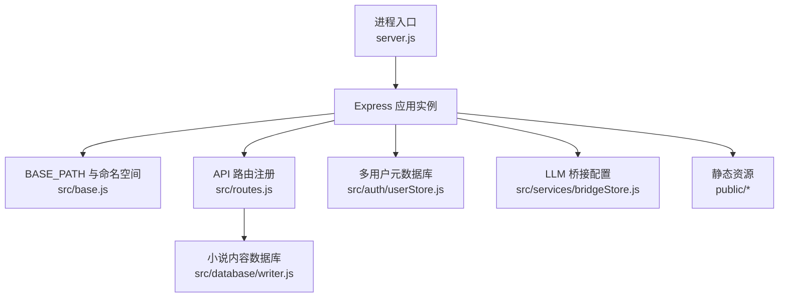
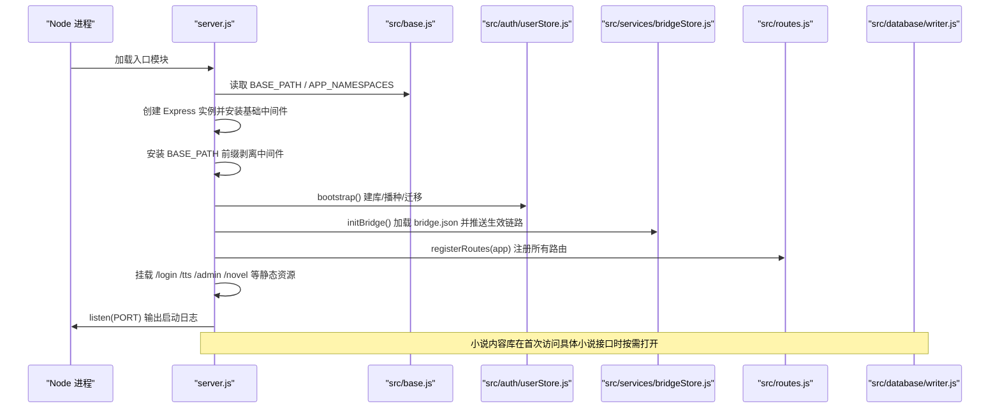
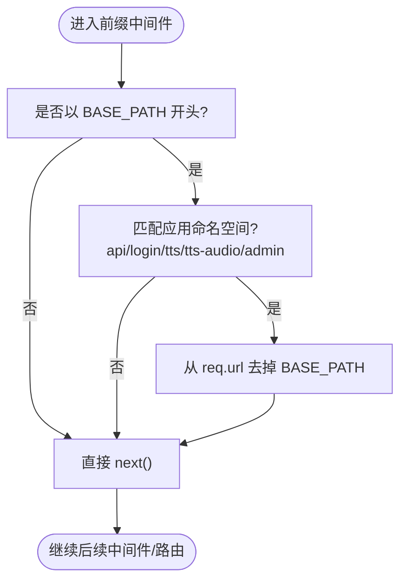
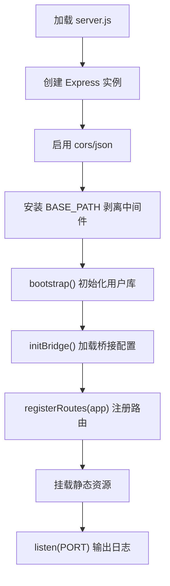
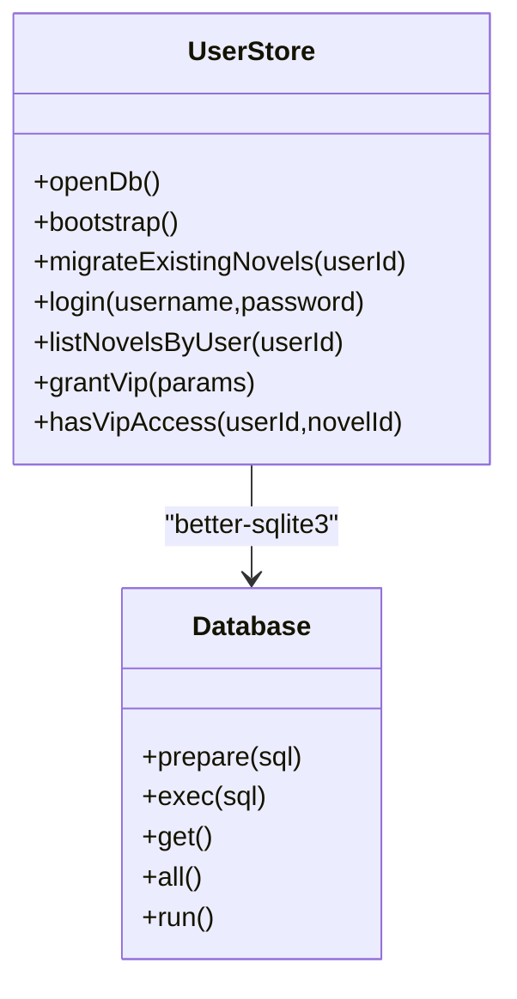
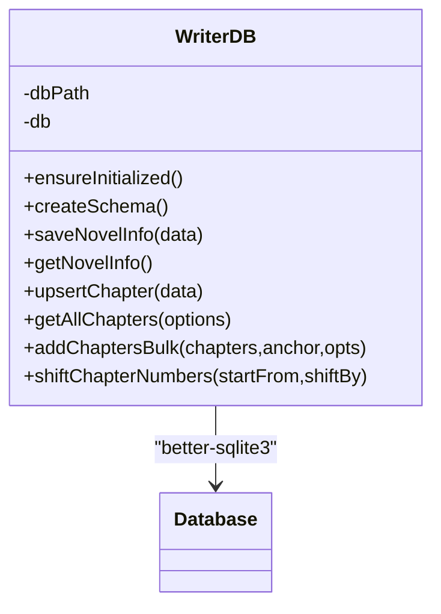
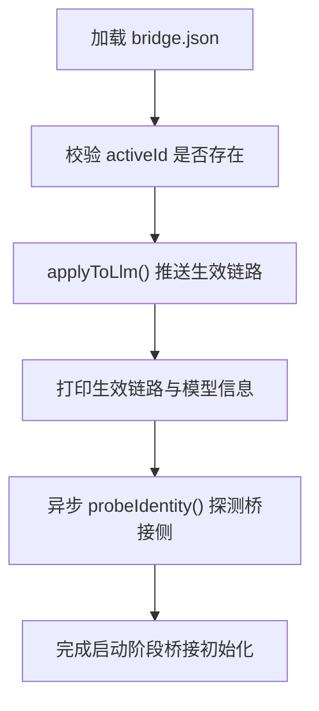
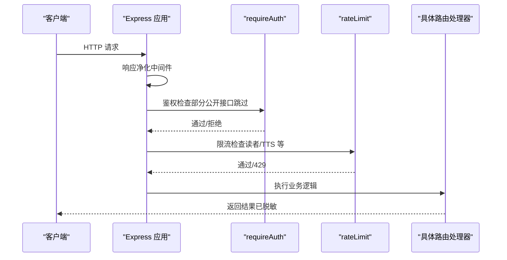
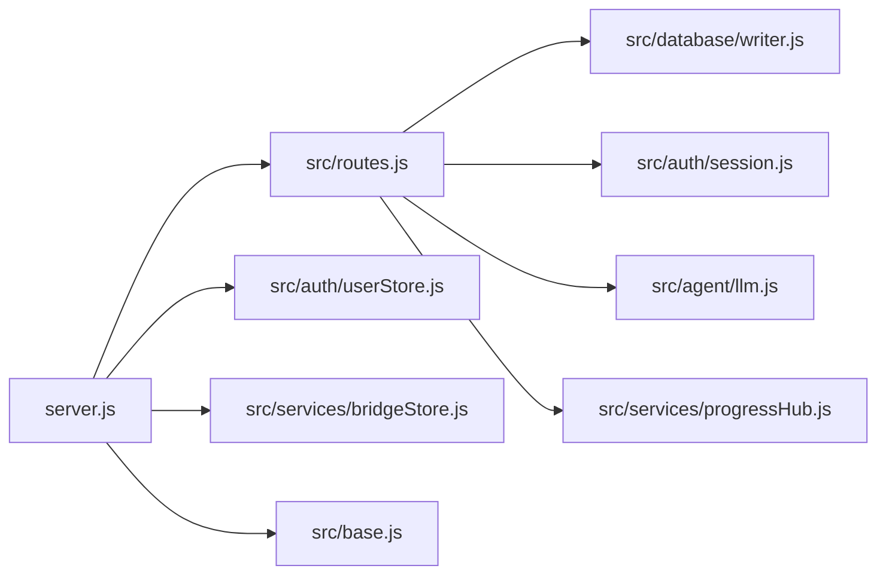

# 应用生命周期管理

<cite>
**本文引用的文件**   
- [server.js](file://server.js)
- [src/base.js](file://src/base.js)
- [src/routes.js](file://src/routes.js)
- [src/auth/userStore.js](file://src/auth/userStore.js)
- [src/database/writer.js](file://src/database/writer.js)
- [src/services/bridgeStore.js](file://src/services/bridgeStore.js)
- [config/writer.json](file://config/writer.json)
</cite>

## 目录
1. [引言](#引言)
2. [项目结构](#项目结构)
3. [核心组件](#核心组件)
4. [架构总览](#架构总览)
5. [详细组件分析](#详细组件分析)
6. [依赖关系分析](#依赖关系分析)
7. [性能与启动特性](#性能与启动特性)
8. [故障排查指南](#故障排查指南)
9. [结论](#结论)

## 引言
本文面向 AINovel 应用的运行期生命周期，聚焦 Express.js 服务从进程启动到“可接收请求”的完整过程。文档重点覆盖：
- 模块加载顺序与初始化阶段
- 环境变量与 BASE_PATH 前缀机制
- 数据库连接建立（多用户元数据库与小说内容库）
- 静态资源挂载与 URL 路径重写
- 配置系统（writer.json 的作用边界）
- 启动时序图与配置流程图

## 项目结构
AINovel 后端采用 Node.js + Express 的单进程服务形态，关键入口位于 `server.js`；路由、鉴权、租户隔离、LLM 桥接等能力分布在 `src` 下多个模块中；静态资源集中在 `public`，运行时数据落在 `data`。

**图表来源**
- [server.js:9-53](file://server.js#L9-L53)
- [src/base.js:17-39](file://src/base.js#L17-L39)
- [src/routes.js:331-339](file://src/routes.js#L331-L339)
- [src/auth/userStore.js:47-113](file://src/auth/userStore.js#L47-L113)
- [src/services/bridgeStore.js:85-99](file://src/services/bridgeStore.js#L85-L99)
- [src/database/writer.js:16-50](file://src/database/writer.js#L16-L50)

**章节来源**
- [server.js:1-64](file://server.js#L1-L64)

## 核心组件
- 应用入口与中间件装配：负责创建 Express 实例、启用 CORS/JSON、安装 BASE_PATH 前缀剥离中间件、初始化用户库与桥接、注册路由、挂载静态资源并监听端口。
- BASE_PATH 前缀机制：集中定义站点挂载前缀与需要带前缀的应用命名空间，提供对外路径拼接工具。
- 多用户元数据库：维护 user/novel/vip_grant/preview 表，提供登录、账号、小说归属、VIP 授权、预览站生命周期管理。
- 小说内容数据库：按小说维度维护 content/parts/chapter_revision 等表，提供章节增删改查、批量插入、编号重排等能力。
- LLM 桥接配置：持久化 aibridge API Key 清单与当前生效项，支持地址覆盖与模型探测，并在启动时把生效链路推给 LLM 层。
- 路由层：统一处理鉴权、限流、租户隔离、公开书单、TTS、阅读器 AI、长任务进度 SSE、小说 CRUD 与发布相关接口。

**章节来源**
- [server.js:9-63](file://server.js#L9-L63)
- [src/base.js:17-41](file://src/base.js#L17-L41)
- [src/auth/userStore.js:47-113](file://src/auth/userStore.js#L47-L113)
- [src/database/writer.js:16-137](file://src/database/writer.js#L16-L137)
- [src/services/bridgeStore.js:85-99](file://src/services/bridgeStore.js#L85-L99)
- [src/routes.js:331-339](file://src/routes.js#L331-L339)

## 架构总览
下图展示从进程启动到服务就绪的关键阶段，以及各模块之间的调用关系。

**图表来源**
- [server.js:18-63](file://server.js#L18-L63)
- [src/base.js:17-39](file://src/base.js#L17-L39)
- [src/auth/userStore.js:386-422](file://src/auth/userStore.js#L386-L422)
- [src/services/bridgeStore.js:85-99](file://src/services/bridgeStore.js#L85-L99)
- [src/routes.js:331-339](file://src/routes.js#L331-L339)
- [src/database/writer.js:25-50](file://src/database/writer.js#L25-L50)

## 详细组件分析

### BASE_PATH 前缀机制与 URL 路径重写
- 权威来源：`BASE_PATH` 由环境变量 `BASE_PATH` 归一化而来，默认 `/novel`，去除空白和尾部斜杠；空串表示挂在根路径。
- 安全校验：当非空且不为 `/novel` 时直接抛错，因为书页内部挂载点固定为 `/novel`，而生产 nginx 原样透传前缀，二者必须一致。
- 命名空间白名单：仅对 `api/login/tts/tts-audio/admin` 这些应用命名空间做前缀剥离，其他路径（如书页 `<BASE>/<uid>/<书名>/...`）保持原样，避免双前缀。
- 中间件实现：在 Express 最上层拦截请求，若 `req.url` 以 `BASE_PATH` 开头且命中命名空间正则，则把前缀从 `req.url` 中切掉，后续路由无需感知前缀。
- 对外路径生成：通过 `sitePath(...)` 将 `BASE_PATH` 与相对段拼接，用于 TTS 音频 URL、登录跳转、公开书单链接等。

**图表来源**
- [server.js:25-36](file://server.js#L25-L36)
- [src/base.js:17-39](file://src/base.js#L17-L39)

**章节来源**
- [src/base.js:17-41](file://src/base.js#L17-L41)
- [server.js:25-36](file://server.js#L25-L36)

### 应用启动流程与时序
启动阶段按以下顺序执行：
1. 导入依赖并计算 `__dirname`。
2. 创建 Express 实例，设置端口（优先 `process.env.PORT`）。
3. 启用 CORS 与 JSON 解析（限制请求体大小）。
4. 安装 BASE_PATH 前缀剥离中间件。
5. 调用 `bootstrap()` 初始化多用户元数据库（建表、播种、存量迁移）。
6. 调用 `initBridge()` 加载桥接配置并把生效链路推给 LLM 层。
7. 调用 `registerRoutes(app)` 注册全部 API 路由。
8. 挂载静态资源目录（登录页、TTS、管理页、已发布书页、公共静态）。
9. 监听端口并打印启动信息（包括 BASE_PATH、登录入口、管理页面、阅读入口、账号与 LLM 链路）。

**图表来源**
- [server.js:18-63](file://server.js#L18-L63)

**章节来源**
- [server.js:18-63](file://server.js#L18-L63)

### 多用户元数据库初始化（userStore）
- 职责：维护全局用户、小说登记、VIP 授权与预览站登记；不直接读写小说正文。
- 初始化：`openDb()` 确保 `data/system/global.db` 存在并按需建表；包含 user/novel/vip_grant/preview 等表及索引。
- 幂等性：建表使用 `CREATE TABLE IF NOT EXISTS`，列缺失时自动迁移（例如新增 vip 列）。
- 播种：首次无用户时从 `config/users.json` 读取种子账号并哈希入库。
- 存量迁移：扫描 `data/` 下的小说 `.db`，将其移动到 `data/<user_id>/` 并登记到首个超管名下。
- 返回信息：`bootstrap()` 返回超管 ID、播种数量与迁移数量，供启动日志显示。

**图表来源**
- [src/auth/userStore.js:47-113](file://src/auth/userStore.js#L47-L113)
- [src/auth/userStore.js:386-422](file://src/auth/userStore.js#L386-L422)
- [src/auth/userStore.js:446-481](file://src/auth/userStore.js#L446-L481)

**章节来源**
- [src/auth/userStore.js:47-113](file://src/auth/userStore.js#L47-L113)
- [src/auth/userStore.js:386-422](file://src/auth/userStore.js#L386-L422)
- [src/auth/userStore.js:446-481](file://src/auth/userStore.js#L446-L481)

### 小说内容数据库（WriterDB）
- 职责：按小说维度存储章节、大纲、部结构、修订快照与生成设定。
- 懒初始化：`ensureInitialized()` 在首次使用时创建连接、建表并打印日志。
- 表结构演进：通过 `PRAGMA table_info` 检测缺失列后动态迁移，保证旧库可用。
- 常用操作：保存/获取小说概要、增删改章节、批量加章、区间查询、编号平移、统计字数等。
- 事务与一致性：大量写操作使用 `db.transaction`，保证批量操作的原子性与数据一致性。

**图表来源**
- [src/database/writer.js:16-50](file://src/database/writer.js#L16-L50)
- [src/database/writer.js:55-137](file://src/database/writer.js#L55-L137)
- [src/database/writer.js:645-724](file://src/database/writer.js#L645-L724)

**章节来源**
- [src/database/writer.js:16-137](file://src/database/writer.js#L16-L137)
- [src/database/writer.js:645-724](file://src/database/writer.js#L645-L724)

### LLM 桥接配置（bridgeStore）
- 目的：让正文生成的上游模型与密钥可在控制台切换，重启后仍生效。
- 存储位置：`data/system/bridge.json`，权限 0600，明文密钥不落盘给其它用户。
- 启动行为：`initBridge()` 加载配置、打印生效链路与上游模型信息，并异步探测桥接侧身份。
- 对外脱敏：列表接口只返回 key 前缀，不暴露明文。
- 生效机制：`applyToLlm()` 把当前生效项的 url 与 apiKey 推给 LLM 层，未选生效项时回落到环境变量。

**图表来源**
- [src/services/bridgeStore.js:31-54](file://src/services/bridgeStore.js#L31-L54)
- [src/services/bridgeStore.js:85-99](file://src/services/bridgeStore.js#L85-L99)

**章节来源**
- [src/services/bridgeStore.js:31-54](file://src/services/bridgeStore.js#L31-L54)
- [src/services/bridgeStore.js:85-99](file://src/services/bridgeStore.js#L85-L99)

### 路由层与鉴权/限流
- 响应净化：对 `/api` 响应进行敏感字段清洗，防止泄露服务器路径、密钥等。
- 公开接口：登录、登出、当前用户、读者 AI、公开书单等允许匿名或特定场景访问。
- 鉴权中间件：除少数公开端点外，其余 `/api` 均要求有效会话。
- 限流：基于真实客户端 IP 的定窗限流，区分读者接口与 TTS 接口的不同阈值。
- 长任务进度：通过 SSE 推送进度，附带缓冲补发与心跳保活。
- 小说业务：列举、新建、删除、章节列表、单章正文、部结构、设置读写、发布等。

**图表来源**
- [src/routes.js:67-95](file://src/routes.js#L67-L95)
- [src/routes.js:270-306](file://src/routes.js#L270-L306)
- [src/routes.js:331-339](file://src/routes.js#L331-L339)
- [src/routes.js:341-350](file://src/routes.js#L341-L350)
- [src/routes.js:559-560](file://src/routes.js#L559-L560)

**章节来源**
- [src/routes.js:67-95](file://src/routes.js#L67-L95)
- [src/routes.js:270-306](file://src/routes.js#L270-L306)
- [src/routes.js:331-339](file://src/routes.js#L331-L339)
- [src/routes.js:341-350](file://src/routes.js#L341-L350)
- [src/routes.js:559-560](file://src/routes.js#L559-L560)

### 配置系统：writer.json
- 文件位置：`config/writer.json`。
- 当前结构：包含 `config.publish.autoPublish` 开关，默认关闭。
- 作用范围：该文件属于 writer 工具的配置范畴；当前代码中并未在启动阶段显式读取该文件，因此它更多作为 writer 工具的约定配置，而非 Express 启动必需配置。
- 建议：如需在启动阶段影响行为，应在 `server.js` 或对应模块中增加读取与校验逻辑，并纳入环境变量或集中配置中心。

**章节来源**
- [config/writer.json:1-8](file://config/writer.json#L1-L8)

## 依赖关系分析
- 入口依赖：`server.js` 依赖 `express`、`cors`、`path`、`url`，并导入路由注册、用户库引导、桥接初始化与 BASE_PATH。
- 路由依赖：`src/routes.js` 依赖文件系统、SQLite、WriterTool、LLM、进度通道、鉴权、BASE_PATH 与 sitePath。
- 数据库依赖：`src/auth/userStore.js` 与 `src/database/writer.js` 都依赖 `better-sqlite3`，分别管理全局元数据与每本小说的内容库。
- 桥接依赖：`src/services/bridgeStore.js` 依赖 LLM 层的桥接配置与探测接口，并将生效项写入本地文件。

**图表来源**
- [server.js:9-16](file://server.js#L9-L16)
- [src/routes.js:10-28](file://src/routes.js#L10-L28)
- [src/auth/userStore.js:12-16](file://src/auth/userStore.js#L12-L16)
- [src/database/writer.js:6-11](file://src/database/writer.js#L6-L11)
- [src/services/bridgeStore.js:15-19](file://src/services/bridgeStore.js#L15-L19)

**章节来源**
- [server.js:9-16](file://server.js#L9-L16)
- [src/routes.js:10-28](file://src/routes.js#L10-L28)
- [src/auth/userStore.js:12-16](file://src/auth/userStore.js#L12-L16)
- [src/database/writer.js:6-11](file://src/database/writer.js#L6-L11)
- [src/services/bridgeStore.js:15-19](file://src/services/bridgeStore.js#L15-L19)

## 性能与启动特性
- 启动阶段：
  - 用户库建表与播种为同步操作，但通常很快；存量迁移会扫描 `data/` 并可能移动文件，数据量大时会影响启动时间。
  - 桥接探测为异步，不阻塞服务启动。
  - 小说内容库按需懒初始化，避免启动时打开所有小说库。
- 请求阶段：
  - 限流保护读者与 TTS 接口，防止突发流量压垮上游模型。
  - 长任务进度通过 SSE 推送，服务端缓冲近期事件以减少丢消息。
  - 静态资源通过 Express 静态中间件提供，TTS 音频目录设置缓存头以提升重复播放性能。

[本节为通用性能讨论，不直接分析具体文件]

## 故障排查指南
- BASE_PATH 配置错误：
  - 现象：启动时报错提示 BASE_PATH 只能为空或 `/novel`。
  - 原因：nginx 原样透传前缀，而书页内部挂载点固定为 `/novel`，不一致会导致书页 404。
  - 处理：将 `BASE_PATH` 设置为空串或 `/novel`。
- 桥接链路异常：
  - 现象：启动日志显示桥接侧探测失败或无可用 Key。
  - 原因：`bridge.json` 损坏、activeId 指向已删除条目、或上游不可达。
  - 处理：检查 `data/system/bridge.json`，重新选择生效 Key 或回落到环境变量。
- 用户库播种失败：
  - 现象：无管理员账号或小说未登记。
  - 原因：`config/users.json` 格式错误或缺少必要字段。
  - 处理：修正种子文件格式，确保包含 username/password，必要时指定 role。
- 小说内容库初始化失败：
  - 现象：访问小说接口报数据库相关错误。
  - 原因：小说库文件损坏或缺失。
  - 处理：确认 `data/<user_id>/<id>.db` 存在且可读，必要时重建或恢复备份。

**章节来源**
- [src/base.js:23-28](file://src/base.js#L23-L28)
- [src/services/bridgeStore.js:31-54](file://src/services/bridgeStore.js#L31-L54)
- [src/auth/userStore.js:386-422](file://src/auth/userStore.js#L386-L422)
- [src/database/writer.js:25-50](file://src/database/writer.js#L25-L50)

## 结论
AINovel 的生命周期围绕 Express 入口展开：先加载 BASE_PATH 与命名空间，再初始化多用户元数据库与 LLM 桥接，随后注册路由并挂载静态资源。BASE_PATH 机制通过中间件实现 URL 重写与命名空间隔离，使开发态与线上态 URL 保持一致。数据库连接采用“全局元数据库启动时建立、小说内容库按需懒初始化”的策略，兼顾启动速度与扩展性。配置系统目前以 writer.json 作为 writer 工具的配置约定，尚未在启动阶段被显式消费；如需增强，应将其纳入集中配置与环境变量体系。