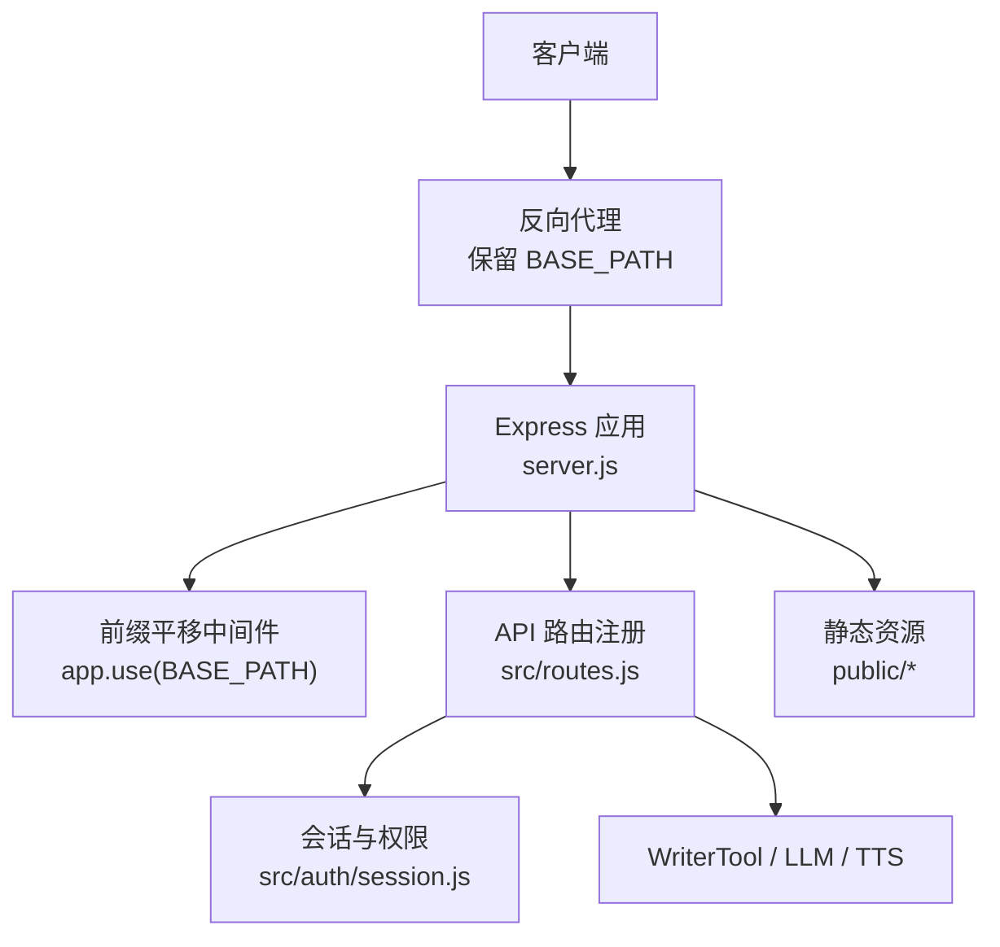
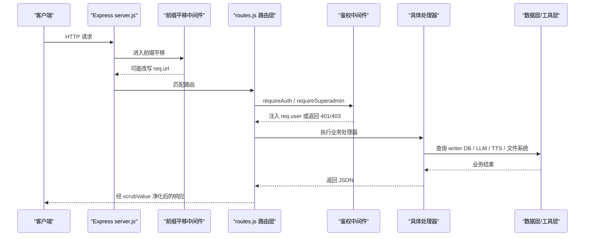
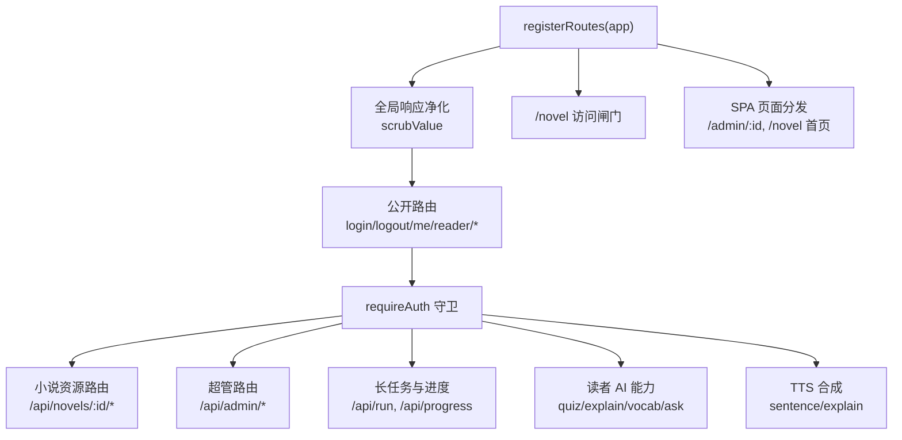
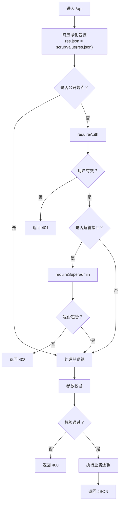
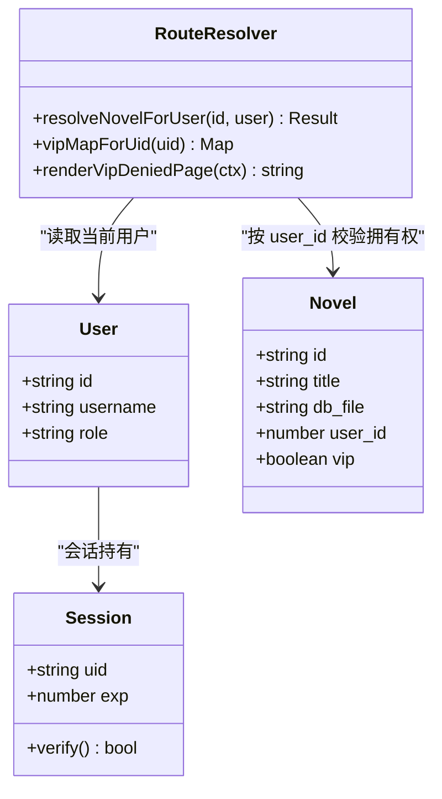
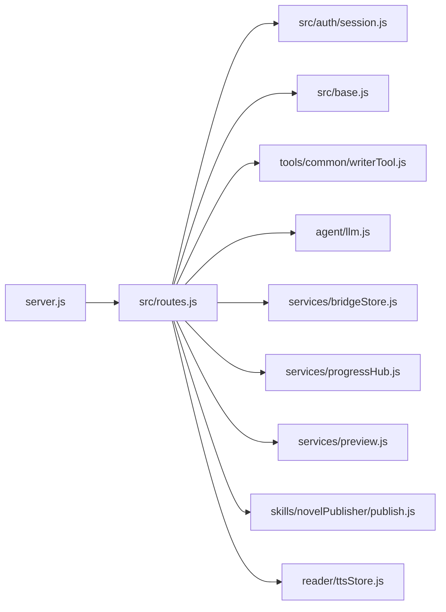

# 路由系统设计

<cite>
**本文引用的文件**   
- [server.js](file://server.js)
- [routes.js](file://src/routes.js)
- [session.js](file://src/auth/session.js)
- [base.js](file://src/base.js)
</cite>

## 目录
1. [引言](#引言)
2. [项目结构与入口](#项目结构与入口)
3. [核心设计原则](#核心设计原则)
4. [架构总览](#架构总览)
5. [模块化路由注册与组织方式](#模块化路由注册与组织方式)
6. [RESTful API 设计与 URL 命名规范](#restful-api-设计与-url-命名规范)
7. [请求处理流程与统一处理机制](#请求处理流程与统一处理机制)
8. [多租户与数据隔离机制](#多租户与数据隔离机制)
9. [关键路由分类与职责](#关键路由分类与职责)
10. [依赖关系分析](#依赖关系分析)
11. [性能与稳定性特征](#性能与稳定性特征)
12. [故障排查指南](#故障排查指南)
13. [结论](#结论)

## 引言
本文件面向 AINovel 的 Express.js 路由系统，目标是帮助开发者快速理解：
- 路由如何按模块组织、如何挂载前缀；
- RESTful API 的设计原则与 URL 命名约定；
- 参数校验、鉴权、限流、响应净化等统一处理方式；
- 多租户小说归属、VIP 授权、预览站与公开书单的隔离策略；
- 从 HTTP 请求到控制器/工具方法调用的完整映射。

## 项目结构与入口
服务入口位于 `server.js`，负责：
- 创建 Express 应用；
- 启用 CORS 与 JSON 解析；
- 根据 `BASE_PATH` 做“对外前缀 → 内部路径”的平移；
- 初始化用户数据库与桥接配置；
- 调用 `registerRoutes(app)` 注册全部 API 路由；
- 挂载静态资源（登录页、管理页、TTS、书页）。

**图表来源**
- [server.js:9-53](file://server.js#L9-L53)
- [base.js:17-39](file://src/base.js#L17-L39)

**章节来源**
- [server.js:1-64](file://server.js#L1-L64)
- [base.js:1-42](file://src/base.js#L1-L42)

## 核心设计原则
1. **前缀透明**  
   生产环境由 nginx 原样转发 `/novel` 前缀，进程内通过中间件把受控命名空间（`api/login/tts/admin`）剥回根级，避免每个路由重复拼接前缀。

2. **统一鉴权边界**  
   `/api/login|logout|me` 公开；其余 `/api` 必须携带有效会话。超管接口额外使用 `requireSuperadmin`。

3. **租户即用户**  
   所有小说操作以 `global.db` 中的 `user_id -> novel.id -> db_file` 为权威来源，URL 只传不透明的 `novel.id`，真实文件名仅服务端可见。

4. **输出净化**  
   除登录、账号、公开书单、预览等明确白名单外，所有 `/api` 响应都会递归清洗敏感字段和绝对路径。

5. **可观测长任务**  
   生成类 action 支持 SSE 进度通道，并带按书互斥锁，防止并发生成压垮上游模型。

**章节来源**
- [server.js:25-45](file://server.js#L25-L45)
- [routes.js:67-95](file://src/routes.js#L67-L95)
- [routes.js:331-350](file://src/routes.js#L331-L350)
- [routes.js:559-560](file://src/routes.js#L559-L560)

## 架构总览
下图展示一次典型受保护 API 请求的处理链路：

**图表来源**
- [server.js:25-45](file://server.js#L25-L45)
- [routes.js:331-350](file://src/routes.js#L331-L350)
- [routes.js:559-560](file://src/routes.js#L559-L560)
- [session.js:83-110](file://src/auth/session.js#L83-L110)

## 模块化路由注册与组织方式
### 注册入口
`registerRoutes(app)` 是路由唯一注册点，集中定义：
- 全局响应净化；
- 公开认证端点；
- 读者 AI/TTS 公共能力；
- 已登录小说管理 API；
- 书页访问闸门；
- 管理后台与 VIP 授权管理；
- AI 意图解析与工具执行。

### 组织模式
- **按领域分组**：认证、阅读器、小说元数据、章节、设置、发布、预览、VIP、管理、桥接、TTS 审计。
- **按权限分层**：先注册公开路由，再挂载 `requireAuth`，最后对超管接口加 `requireSuperadmin`。
- **按资源建模**：小说用 `/api/novels/:id` 作为资源中心，子资源如章节、设置、发布、预览、VIP 均挂在其下。

**图表来源**
- [routes.js:331-350](file://src/routes.js#L331-L350)
- [routes.js:559-560](file://src/routes.js#L559-L560)
- [routes.js:1035-1107](file://src/routes.js#L1035-L1107)

**章节来源**
- [routes.js:331-350](file://src/routes.js#L331-L350)
- [routes.js:559-560](file://src/routes.js#L559-L560)
- [routes.js:1035-1107](file://src/routes.js#L1035-L1107)

## RESTful API 设计与 URL 命名规范
### 命名规范
- **资源名词复数化**：`/api/novels`。
- **子资源嵌套**：`/api/novels/:id/chapters`、`/api/novels/:id/settings`、`/api/novels/:id/publish`。
- **动作动词优先状态变更**：POST/PUT/DELETE 用于写操作；GET 用于读。
- **幂等性区分**：删除整本小说、删除章节、禁用用户等破坏性操作要求显式确认。
- **公开与私有分离**：`/api/catalog` 公开；其余 `/api` 默认需登录。

### 典型资源映射
| 资源 | GET | POST | PUT | DELETE |
|---|---|---|---|---|
| 小说列表 | `/api/novels` | 新建小说 | — | — |
| 单本小说 | `/api/novels/:id/chapters` | — | — | `/api/novels/:id` |
| 章节 | `/api/novels/:id/chapter/:no` | — | 更新大纲 | `/api/novels/:id/chapter/:no` |
| 设置 | `/api/novels/:id/settings` | — | 更新设置 | — |
| 发布 | — | `/api/novels/:id/publish` | — | — |
| 预览 | — | `/api/novels/:id/preview` | — | `/api/novels/:id/preview/:token` |
| VIP | `/api/novels/:id/vip` | — | `/api/novels/:id/vip` | `/api/novels/:id/vip` |

**章节来源**
- [routes.js:639-684](file://src/routes.js#L639-L684)
- [routes.js:686-725](file://src/routes.js#L686-L725)
- [routes.js:747-823](file://src/routes.js#L747-L823)
- [routes.js:825-912](file://src/routes.js#L825-L912)
- [routes.js:991-1033](file://src/routes.js#L991-L1033)
- [routes.js:1186-1210](file://src/routes.js#L1186-L1210)

## 请求处理流程与统一处理机制
### 统一鉴权
- 公开端点：`/api/login`、`/api/logout`、`/api/me`。
- 其他 `/api` 必须通过 `requireAuth`，失败返回 401。
- 超管接口额外通过 `requireSuperadmin`，失败返回 403。

### 统一参数校验
- 必填字段缺失返回 400。
- 类型错误（如章节号非整数）返回 400。
- 破坏性操作需要 `confirm:"OK"`。
- 非法 URL 片段、越界路径直接拒绝。

### 统一响应格式化
- 所有 `/api` 响应经过 `scrubValue`，剔除绝对路径、密钥、服务器信息等。
- 成功响应通常包含 `ok`、`success`、`error` 等稳定字段。
- 错误响应统一使用 `{ error }` 结构，便于前端提示。

### 统一限流
- 读者 AI 与 TTS 使用独立速率限制器，按真实 IP 分桶。
- 超限返回 429，并附带 `Retry-After`。

**图表来源**
- [routes.js:331-350](file://src/routes.js#L331-L350)
- [routes.js:352-390](file://src/routes.js#L352-L390)
- [routes.js:559-560](file://src/routes.js#L559-L560)
- [session.js:83-110](file://src/auth/session.js#L83-L110)

**章节来源**
- [routes.js:331-350](file://src/routes.js#L331-L350)
- [routes.js:352-390](file://src/routes.js#L352-L390)
- [routes.js:559-560](file://src/routes.js#L559-L560)
- [session.js:83-110](file://src/auth/session.js#L83-L110)

## 多租户与数据隔离机制
### 租户身份来源
- 用户身份来自会话 cookie，由 `currentUser(req)` 解析。
- 会话 token 使用 HMAC-SHA256 签名，含用户 ID 与过期时间。
- 被禁用的用户会被拒绝登录态。

### 小说归属隔离
- 所有小说操作通过 `resolveNovelForUser(idOrFile, user)` 解析。
- 超管可访问全部小说；普通用户只能访问 `user_id === req.user.id` 的小说。
- 真实 `.db` 文件名在服务端构造，URL 只暴露不透明 `novel.id`。

### VIP 授权隔离
- VIP 小说在站点首页和子树中按授权名单过滤。
- 未授权读者看到专用无权页；匿名读者跳转到登录页。
- 书主本人不受自己设定的 VIP 限制。
- 授权可设置天数或到期时间，撤销后即时生效。

**图表来源**
- [routes.js:97-116](file://src/routes.js#L97-L116)
- [routes.js:148-179](file://src/routes.js#L148-L179)
- [routes.js:1035-1094](file://src/routes.js#L1035-L1094)
- [session.js:42-91](file://src/auth/session.js#L42-L91)

**章节来源**
- [routes.js:97-116](file://src/routes.js#L97-L116)
- [routes.js:148-179](file://src/routes.js#L148-L179)
- [routes.js:1035-1094](file://src/routes.js#L1035-L1094)
- [session.js:42-91](file://src/auth/session.js#L42-L91)

## 关键路由分类与职责
### 认证与会话
- `POST /api/login`：登录并设置会话 cookie。
- `POST /api/logout`：清除会话。
- `GET /api/me`：返回当前用户信息。

**章节来源**
- [routes.js:341-350](file://src/routes.js#L341-L350)
- [session.js:75-91](file://src/auth/session.js#L75-L91)

### 读者 AI 与 TTS
- `POST /api/reader/quiz`：生成阅读理解题。
- `POST /api/reader/explain`：句子讲解。
- `POST /api/reader/vocab`：生词标注。
- `POST /api/reader/explain-word`：单词讲解。
- `POST /api/reader/word-status`：词汇解释状态。
- `POST /api/reader/ask`：问答。
- `POST /api/reader/feedback`：反馈。
- `POST /api/reader/image`：文生图代理。
- `POST /api/tts/sentence`：章节句子 TTS。
- `POST /api/tts/explain`：讲解文本 TTS。

**章节来源**
- [routes.js:352-390](file://src/routes.js#L352-L390)
- [routes.js:412-428](file://src/routes.js#L412-L428)
- [routes.js:456-513](file://src/routes.js#L456-L513)

### 小说资源
- `GET /api/novels`：列出当前用户小说。
- `POST /api/novels`：新建小说。
- `DELETE /api/novels/:id`：删除小说。
- `GET /api/novels/:id/chapters`：章节列表。
- `GET /api/novels/:id/chapter/:no`：单章正文。
- `GET /api/novels/:id/parts`：部结构。
- `GET /api/novels/:id/settings`：获取设置。
- `PUT /api/novels/:id/settings`：更新设置。
- `PUT /api/novels/:id/chapter/:no/outline`：更新章节大纲。
- `POST /api/novels/:id/chapter/:no/outline-draft`：生成大纲草稿。
- `DELETE /api/novels/:id/chapter/:no`：删除章节。
- `POST /api/novels/:id/renumber`：重排章节号。

**章节来源**
- [routes.js:639-684](file://src/routes.js#L639-L684)
- [routes.js:686-725](file://src/routes.js#L686-L725)
- [routes.js:727-775](file://src/routes.js#L727-L775)
- [routes.js:777-823](file://src/routes.js#L777-L823)
- [routes.js:825-912](file://src/routes.js#L825-L912)

### 长任务与进度
- `POST /api/run`：通用 WriterTool action 执行。
- `GET /api/progress`：SSE 进度流。

**章节来源**
- [routes.js:573-627](file://src/routes.js#L573-L627)
- [routes.js:914-973](file://src/routes.js#L914-L973)

### 发布与预览
- `POST /api/novels/:id/publish`：本地发布。
- `GET /api/novels/:id/share`：分享链接。
- `POST /api/novels/:id/preview`：生成预览站。
- `GET /api/novels/:id/preview/report`：修改报告。
- `GET /api/novels/:id/preview/:token/diff`：单页 diff。
- `DELETE /api/novels/:id/preview/:token`：作废预览。

**章节来源**
- [routes.js:991-1033](file://src/routes.js#L991-L1033)
- [routes.js:1109-1184](file://src/routes.js#L1109-L1184)

### VIP 与管理
- `GET /api/novels/:id/vip`：查看 VIP 状态与授权名单。
- `PUT /api/novels/:id/vip`：开启/关闭 VIP。
- `DELETE /api/novels/:id/vip`：关闭 VIP。
- `/api/admin/*`：用户管理、VIP 授权、桥接配置、TTS 审计。

**章节来源**
- [routes.js:1186-1210](file://src/routes.js#L1186-L1210)
- [routes.js:1250-1360](file://src/routes.js#L1250-L1360)

### AI 意图与工具执行
- `POST /api/ai/plan`：将自然语言转为工具调用。
- `POST /api/ai/execute`：执行工具。

**章节来源**
- [routes.js:1212-1248](file://src/routes.js#L1212-L1248)
- [routes.js:1371-1432](file://src/routes.js#L1371-L1432)

## 依赖关系分析

**图表来源**
- [server.js:13-16](file://server.js#L13-L16)
- [routes.js:10-28](file://src/routes.js#L10-L28)

**章节来源**
- [server.js:13-16](file://server.js#L13-L16)
- [routes.js:10-28](file://src/routes.js#L10-L28)

## 性能与稳定性特征
- **JSON 体大小限制**：`express.json({ limit: '20mb' })`，适配大文档与批量生成。
- **IP 限流**：读者 AI 与 TTS 分别限速，避免批量请求导致整体拥塞。
- **长任务互斥**：同一本书同时只允许一个生成任务，返回 409 提示已有任务。
- **SSE 进度缓冲**：按 `progressId` 缓存近期事件，解决发起任务与建立 SSE 的竞态。
- **只读统计优化**：章节列表与设置接口尽量使用 `contentLength` 而非加载全文。
- **静态资源缓存**：TTS 音频目录设置 `immutable` 与长期缓存。

**章节来源**
- [server.js:22-23](file://server.js#L22-L23)
- [routes.js:289-306](file://src/routes.js#L289-L306)
- [routes.js:573-627](file://src/routes.js#L573-L627)
- [routes.js:639-708](file://src/routes.js#L639-L708)
- [server.js:48-53](file://server.js#L48-L53)

## 故障排查指南
### 常见错误码
| 状态码 | 含义 | 常见原因 |
|---|---|---|
| 400 | 请求参数错误或校验失败 | 缺少字段、非法章节号、非法 URL、未二次确认 |
| 401 | 未登录或会话失效 | 未携带 cookie、cookie 过期、用户被禁用 |
| 403 | 无权限 | 访问他人小说、非超管访问管理接口 |
| 404 | 资源不存在 | 小说未登记、章节不存在、预览已过期 |
| 409 | 长任务冲突 | 同一本书已有生成任务 |
| 429 | 请求过于频繁 | 读者 AI 或 TTS 触发限流 |
| 500 | 服务端异常 | 数据库、LLM、TTS 或文件系统错误 |
| 502 | 上游模型不可达 | LLM 或 aibridge 连接失败 |
| 503 | TTS 合成失败 | 外部语音服务异常或音频文件问题 |

### 排查建议
1. **先看是否登录**：检查 `ainovel_session` cookie 是否存在且未过期。
2. **再看是否属于当前用户**：确认 `novel.id` 对应的 `user_id` 与当前用户一致。
3. **检查二次确认**：删除类接口必须带 `confirm:"OK"`。
4. **查看限流**：429 时关注 `Retry-After`，不要立即重试。
5. **核对 LLM/TTS 链路**：502/503 时检查桥接地址、密钥与上游服务健康。
6. **核对路径安全**：中文书名目录在 URL 中编码，服务端会解码并做穿越防护。

**章节来源**
- [routes.js:45-53](file://src/routes.js#L45-L53)
- [routes.js:313-329](file://src/routes.js#L313-L329)
- [routes.js:914-973](file://src/routes.js#L914-L973)
- [routes.js:1186-1210](file://src/routes.js#L1186-L1210)

## 结论
AINovel 的路由系统以 `registerRoutes` 为单一注册点，围绕“认证 → 鉴权 → 参数校验 → 业务处理 → 响应净化”的统一流水线构建。它通过：
- 前缀平移适配 nginx 部署；
- 会话 cookie 实现零依赖鉴权；
- `resolveNovelForUser` 实现强租户隔离；
- 限流、互斥锁与 SSE 保障长任务稳定性；
- 公开书单、VIP 授权与预览站提供灵活的内容分发。

这种设计既保证了多用户场景下的数据安全，又为后续扩展新资源与新工具提供了清晰、一致的接入点。