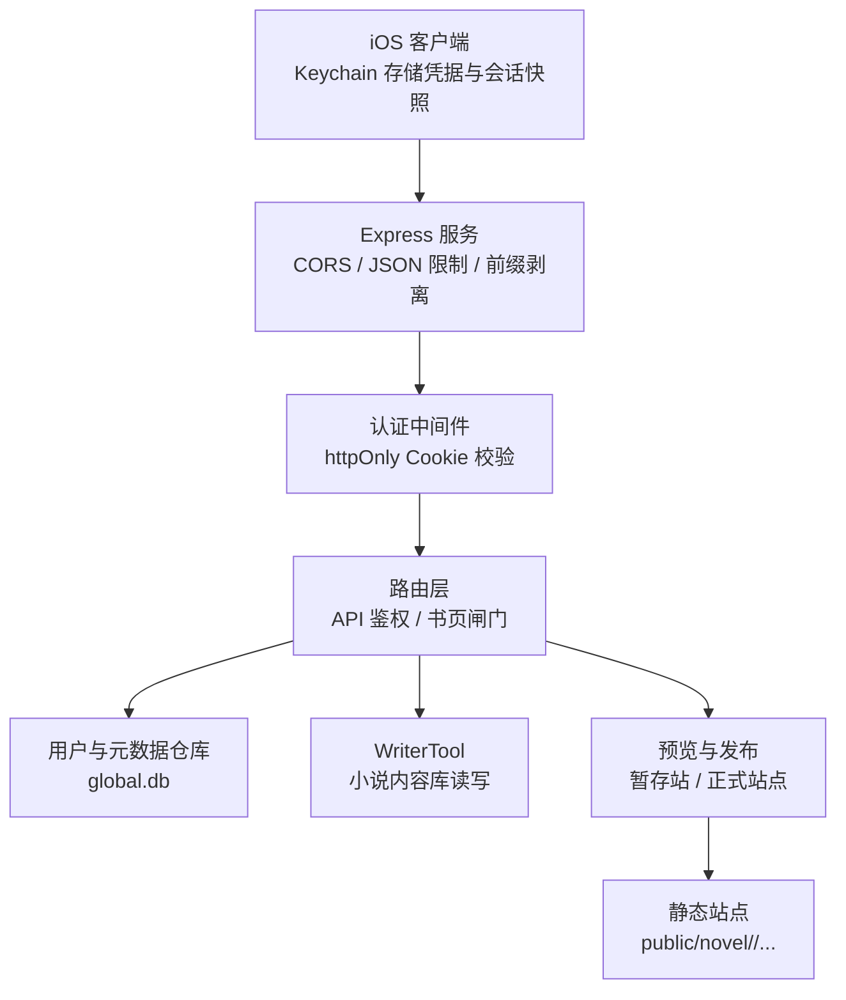
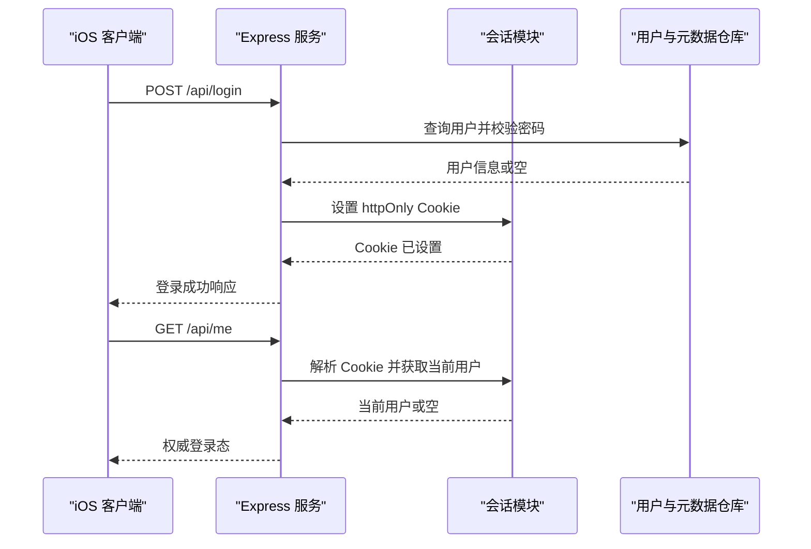
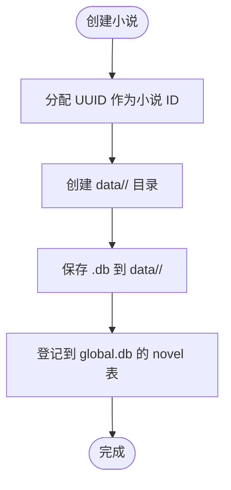
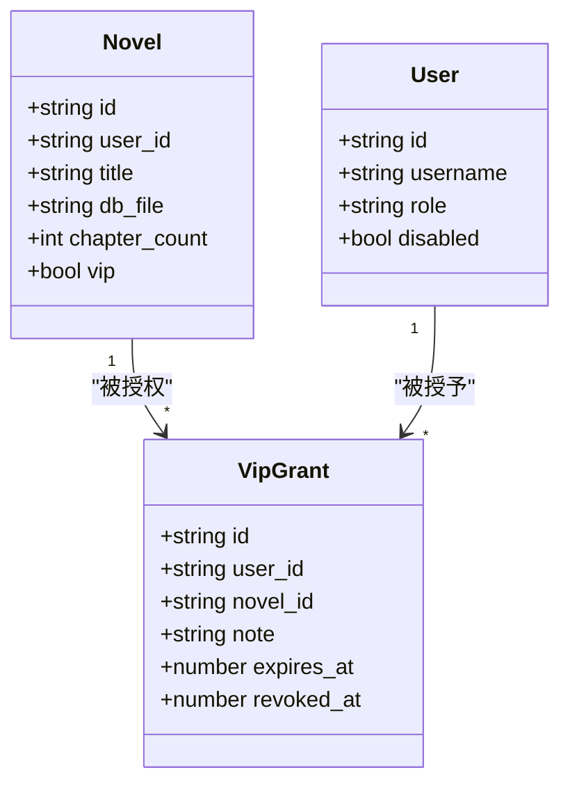
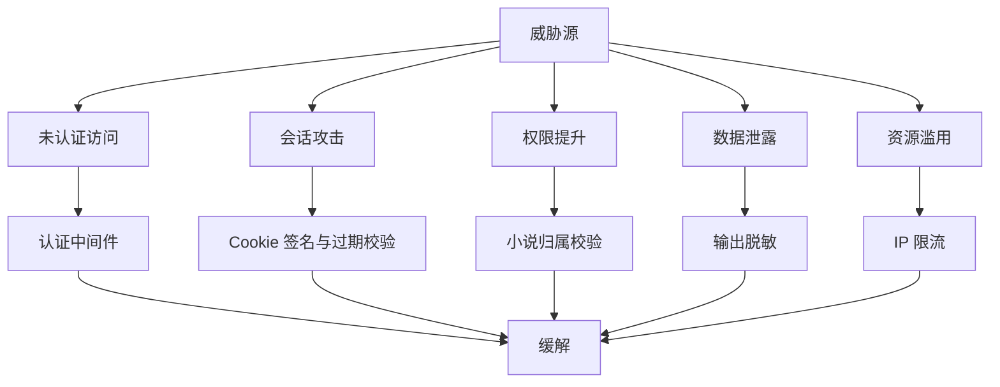

# 安全架构设计

<cite>
**本文引用的文件**   
- [server.js](file://server.js)
- [routes.js](file://src/routes.js)
- [session.js](file://src/auth/session.js)
- [userStore.js](file://src/auth/userStore.js)
- [users.json.example](file://config/users.json.example)
- [writer.json](file://config/writer.json)
- [KeychainStore.swift](file://ios/AINovel/Security/KeychainStore.swift)
- [AuthViewModel.swift](file://ios/AINovel/Auth/AuthViewModel.swift)
- [LoginView.swift](file://ios/AINovel/Auth/LoginView.swift)
- [Endpoints.swift](file://ios/AINovel/Networking/Endpoints.swift)
- [README.md](file://README.md)
</cite>

## 目录
1. [引言](#引言)
2. [项目结构与安全边界总览](#项目结构与安全边界总览)
3. [核心安全组件](#核心安全组件)
4. [认证与授权机制](#认证与授权机制)
5. [多租户数据隔离与 VIP 保护](#多租户数据隔离与-vip-保护)
6. [密钥管理与敏感信息保护](#密钥管理与敏感信息保护)
7. [安全防护措施](#安全防护措施)
8. [威胁模型分析](#威胁模型分析)
9. [性能与可用性对安全的影响](#性能与可用性对安全的影响)
10. [故障排查指南](#故障排查指南)
11. [结论](#结论)

## 引言
本文件面向 AINovel 的安全架构，聚焦以下目标：
- 描述用户登录验证、会话管理、权限控制策略。
- 说明多租户安全隔离：用户数据隔离、API 访问控制、VIP 内容保护。
- 文档化密钥管理机制：环境变量、本地安全存储、敏感信息脱敏。
- 总结 XSS、CSRF、SQL 注入等防护措施。
- 给出安全架构图与威胁模型，帮助读者理解安全边界和防护有效性。

## 项目结构与安全边界总览
AINovel 采用“服务端 Express + SQLite + 静态站点”的架构，iOS 客户端通过 HTTP 调用 API，并通过系统 Keychain 保存凭据与会话快照。安全边界主要分布在：
- 网络入口：Express 服务、CORS、请求体大小限制、路径前缀剥离。
- 认证层：基于 httpOnly Cookie 的零依赖会话令牌。
- 授权层：按用户角色（普通用户 / 超级管理员）与小说归属进行资源访问控制。
- 数据层：`global.db` 管理账号、小说登记、VIP 授权；每本小说的内容库位于 `data/<uid>/<uuid>.db`。
- 前端侧：iOS 使用 Keychain 存储凭据与会话快照，但权威登录态以 `/api/me` 为准。

**图示来源**
- [server.js:9-53](file://server.js#L9-L53)
- [routes.js:331-560](file://src/routes.js#L331-L560)
- [userStore.js:47-114](file://src/auth/userStore.js#L47-L114)

**章节来源**
- [server.js:1-64](file://server.js#L1-L64)
- [routes.js:1-35](file://src/routes.js#L1-L35)
- [README.md:166-202](file://README.md#L166-L202)

## 核心安全组件
- 会话模块：实现 HMAC-SHA256 签名的 httpOnly Cookie，包含用户 ID 与过期时间，支持超时校验与定时比较签名。
- 用户与元数据仓库：维护用户表、小说登记表、VIP 授权表、预览登记表，提供密码哈希、登录校验、VIP 授权查询。
- 路由层：统一注册 API，区分公开接口、需登录接口、超管接口，并实现 VIP 书页闸门与预览站访问控制。
- iOS 客户端安全：Keychain 封装用于保存用户名/密码与最近一次会话快照，配合服务端 Cookie 维持登录态。

**章节来源**
- [session.js:1-118](file://src/auth/session.js#L1-L118)
- [userStore.js:1-114](file://src/auth/userStore.js#L1-L114)
- [routes.js:331-560](file://src/routes.js#L331-L560)
- [KeychainStore.swift:1-83](file://ios/AINovel/Security/KeychainStore.swift#L1-L83)
- [AuthViewModel.swift:1-107](file://ios/AINovel/Auth/AuthViewModel.swift#L1-L107)

## 认证与授权机制
### 用户登录验证
- 客户端调用 `/api/login`，携带用户名与密码。
- 服务端从 `global.db` 中查找用户，校验禁用状态与密码哈希。
- 成功后设置 httpOnly Cookie，返回用户基本信息。
- 客户端在冷启动时先回填 Keychain 中的会话快照，再调用 `/api/me` 确认权威登录态。

**图示来源**
- [routes.js:341-350](file://src/routes.js#L341-L350)
- [session.js:75-91](file://src/auth/session.js#L75-L91)
- [userStore.js:181-188](file://src/auth/userStore.js#L181-L188)
- [AuthViewModel.swift:37-54](file://ios/AINovel/Auth/AuthViewModel.swift#L37-L54)

### 会话管理
- 会话令牌由 base64url 编码的用户 ID 与过期时间组成，附带 HMAC-SHA256 签名。
- Cookie 配置为 HttpOnly、SameSite=Lax，Path 绑定到应用前缀，避免跨子系统串味。
- 会话有效期默认 7 天，过期后自动失效。
- 登出时清除 Cookie，客户端同步清理 Keychain 中的会话快照。

**章节来源**
- [session.js:26-81](file://src/auth/session.js#L26-L81)
- [routes.js:349-350](file://src/routes.js#L349-L350)
- [AuthViewModel.swift:82-96](file://ios/AINovel/Auth/AuthViewModel.swift#L82-L96)

### 权限控制策略
- 所有 `/api` 路由默认需要有效会话，仅 `/api/login`、`/api/logout`、`/api/me` 公开。
- 超管接口额外要求 `role === 'superadmin'`。
- 小说操作通过 `resolveNovelForUser` 校验当前用户是否拥有该小说。
- VIP 内容通过书页闸门与授权名单双重控制。

**章节来源**
- [routes.js:559-560](file://src/routes.js#L559-L560)
- [session.js:93-110](file://src/auth/session.js#L93-L110)
- [routes.js:103-116](file://src/routes.js#L103-L116)

## 多租户数据隔离与 VIP 保护
### 用户数据隔离
- 每本小说的内容库文件路径形如 `data/<uid>/<uuid>.db`，UID 来自用户 ID。
- 创建小说时分配不透明文件名 `<uuid>.db`，真实路径仅服务端可见。
- 列举小说时按登录用户过滤，超管可查看所有。

**图示来源**
- [routes.js:646-661](file://src/routes.js#L646-L661)
- [userStore.js:203-211](file://src/auth/userStore.js#L203-L211)

**章节来源**
- [routes.js:646-661](file://src/routes.js#L646-L661)
- [userStore.js:203-211](file://src/auth/userStore.js#L203-L211)

### API 访问控制
- 非 VIP 小说：登录后即可按归属访问。
- VIP 小说：需满足以下条件之一：
  - 书主本人。
  - 已被授予 VIP 授权且未撤销、未到期。
- 公开书单 `/api/catalog` 对 VIP 书隐藏整条记录，而非显示锁标。

**章节来源**
- [routes.js:515-557](file://src/routes.js#L515-L557)
- [userStore.js:341-349](file://src/auth/userStore.js#L341-L349)

### VIP 内容保护
- VIP 开关位于 `novel.vip` 字段。
- VIP 授权存储在 `vip_grant` 表，支持全站范围或单本书范围，带到期时间与撤销标记。
- 书页访问时实时校验授权，撤销与到期立即生效。

**图示来源**
- [userStore.js:67-93](file://src/auth/userStore.js#L67-L93)
- [userStore.js:235-349](file://src/auth/userStore.js#L235-L349)

**章节来源**
- [userStore.js:235-349](file://src/auth/userStore.js#L235-L349)
- [routes.js:144-238](file://src/routes.js#L144-L238)

## 密钥管理与敏感信息保护
### 环境变量管理
- 会话密钥 `SESSION_SECRET` 从环境变量或 `.env` 读取，未设置时生成临时随机值。
- LLM 桥接密钥通过控制台动态切换，优先级：控制台启用项 > 环境变量 > `.env`。
- 桥接密钥明文保存在 `data/system/bridge.json`，权限设为 `0600`。

**章节来源**
- [session.js:32-36](file://src/auth/session.js#L32-L36)
- [README.md:71-80](file://README.md#L71-L80)

### 本地安全存储
- iOS 端使用 Keychain 存储用户名/密码与会话快照，服务名为 `com.ainovel.app`。
- 服务器端 `global.db` 存储用户密码哈希与盐值，不存储明文密码。
- 配置文件示例 `users.json.example` 提供初始超管账号模板。

**章节来源**
- [KeychainStore.swift:1-83](file://ios/AINovel/Security/KeychainStore.swift#L1-L83)
- [userStore.js:30-45](file://src/auth/userStore.js#L30-L45)
- [users.json.example:1-4](file://config/users.json.example#L1-L4)

### 敏感信息加密
- 密码使用 scrypt 哈希 + 随机 salt，比较时使用恒定时间比较函数。
- 会话令牌使用 HMAC-SHA256 签名，防止篡改。
- 对外响应经过脱敏处理，移除路径、密钥、端口等敏感字段。

**章节来源**
- [userStore.js:30-45](file://src/auth/userStore.js#L30-L45)
- [session.js:42-60](file://src/auth/session.js#L42-L60)
- [routes.js:67-95](file://src/routes.js#L67-L95)

## 安全防护措施
### XSS 防护
- 输出净化：对所有 JSON 响应递归清洗，移除敏感键名与绝对路径。
- HTML 渲染中使用轻量转义函数，避免直接拼接用户输入。
- VIP 无权页与预览无权页使用内联模板，但不对用户输入做动态拼接。

**章节来源**
- [routes.js:67-95](file://src/routes.js#L67-L95)
- [routes.js:239-241](file://src/routes.js#L239-L241)

### CSRF 防护
- 会话 Cookie 设置 SameSite=Lax，降低跨站请求风险。
- 删除类操作要求二次确认（手输 `OK`），并在三个入口统一校验。
- 建议生产环境结合后端 Token 校验进一步增强 CSRF 防护。

**章节来源**
- [session.js:75-81](file://src/auth/session.js#L75-L81)
- [routes.js:45-53](file://src/routes.js#L45-L53)
- [routes.js:663-676](file://src/routes.js#L663-L676)

### SQL 注入防护
- 所有数据库查询使用参数化语句，避免字符串拼接。
- 用户输入经严格类型转换与白名单校验。
- VIP 授权查询使用 JOIN 与条件过滤，无动态 SQL 拼接。

**章节来源**
- [userStore.js:127-188](file://src/auth/userStore.js#L127-L188)
- [userStore.js:270-349](file://src/auth/userStore.js#L270-L349)

### 其他安全措施
- 限流：对读者 AI 接口与 TTS 接口实施 IP 级限流，防止滥用。
- 路径穿越防护：章节 URL 解码后校验路径段，确保不越界。
- 外部服务代理：文生图请求转发至 aibridge，密钥留在服务端。

**章节来源**
- [routes.js:263-306](file://src/routes.js#L263-L306)
- [routes.js:308-329](file://src/routes.js#L308-L329)
- [routes.js:399-428](file://src/routes.js#L399-L428)

## 威胁模型分析
### 攻击面
- 未认证访问：尝试绕过登录访问受保护 API 或 VIP 内容。
- 会话劫持：窃取或篡改 httpOnly Cookie。
- 权限提升：普通用户尝试访问他人小说或执行超管操作。
- 数据泄露：通过日志、响应体或文件路径暴露敏感信息。
- 资源滥用：批量请求触发 LLM 或 TTS 导致服务过载。

### 防护措施有效性
- 会话令牌签名与过期校验可有效防止篡改与长期持有。
- 小说归属校验与 VIP 授权检查可阻止横向越权。
- 输出脱敏可降低敏感信息泄露风险。
- 限流与路径校验可缓解部分滥用与路径攻击。

**图示来源**
- [routes.js:331-560](file://src/routes.js#L331-L560)
- [session.js:42-60](file://src/auth/session.js#L42-L60)
- [routes.js:67-95](file://src/routes.js#L67-L95)
- [routes.js:263-306](file://src/routes.js#L263-L306)

## 性能与可用性对安全的影响
- 长任务互斥：同一本书的生成任务串行执行，避免并发竞争导致数据损坏。
- SSE 进度缓冲：解决进度事件丢失问题，同时设置 TTL 防止内存无限增长。
- 预览站生命周期：默认保留 24 小时，仅创作者本人可访问，减少未授权暴露风险。
- 限流窗口清理：定期清理过期 IP 桶，防止 Map 无限增长。

**章节来源**
- [routes.js:573-627](file://src/routes.js#L573-L627)
- [routes.js:629-673](file://src/routes.js#L629-L673)
- [userStore.js:351-378](file://src/auth/userStore.js#L351-L378)
- [routes.js:291-306](file://src/routes.js#L291-L306)

## 故障排查指南
### 常见问题
- 登录失败：检查用户名、密码、用户是否被禁用。
- VIP 无法访问：确认用户是否被授予有效授权且未撤销、未到期。
- 会话过期：检查 `SESSION_SECRET` 是否稳定，浏览器是否清除了 Cookie。
- 输出敏感信息：检查响应体是否被脱敏，避免回显密钥或路径。
- 限流触发：检查请求频率是否超过阈值，调整限流策略或优化客户端重试逻辑。

**章节来源**
- [userStore.js:181-188](file://src/auth/userStore.js#L181-L188)
- [userStore.js:341-349](file://src/auth/userStore.js#L341-L349)
- [session.js:32-36](file://src/auth/session.js#L32-L36)
- [routes.js:67-95](file://src/routes.js#L67-L95)
- [routes.js:291-306](file://src/routes.js#L291-L306)

## 结论
AINovel 的安全体系围绕“认证、授权、数据隔离、密钥管理、输出防护”展开，通过 httpOnly Cookie、HMAC 签名、scrypt 哈希、参数化查询、路径校验、限流与脱敏等手段构建多层防御。VIP 授权机制将内容保护从共享密码升级为细粒度账号授权，提升安全性与可审计性。建议在后续迭代中补充 CSRF Token、速率限制持久化、密钥轮换与审计日志，以进一步提升整体安全水位。