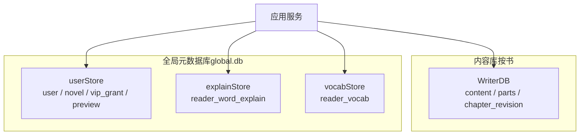
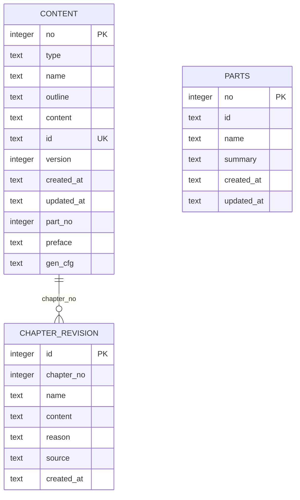
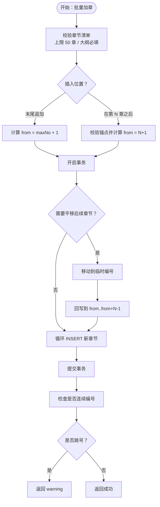
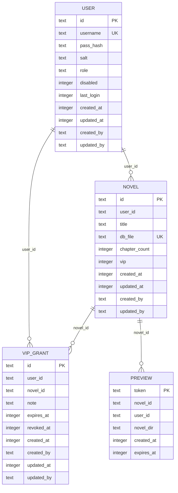
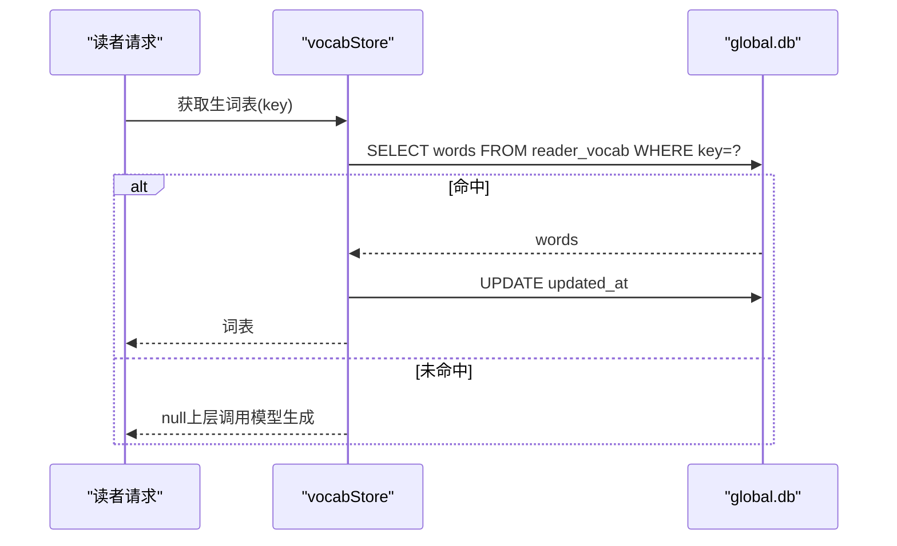
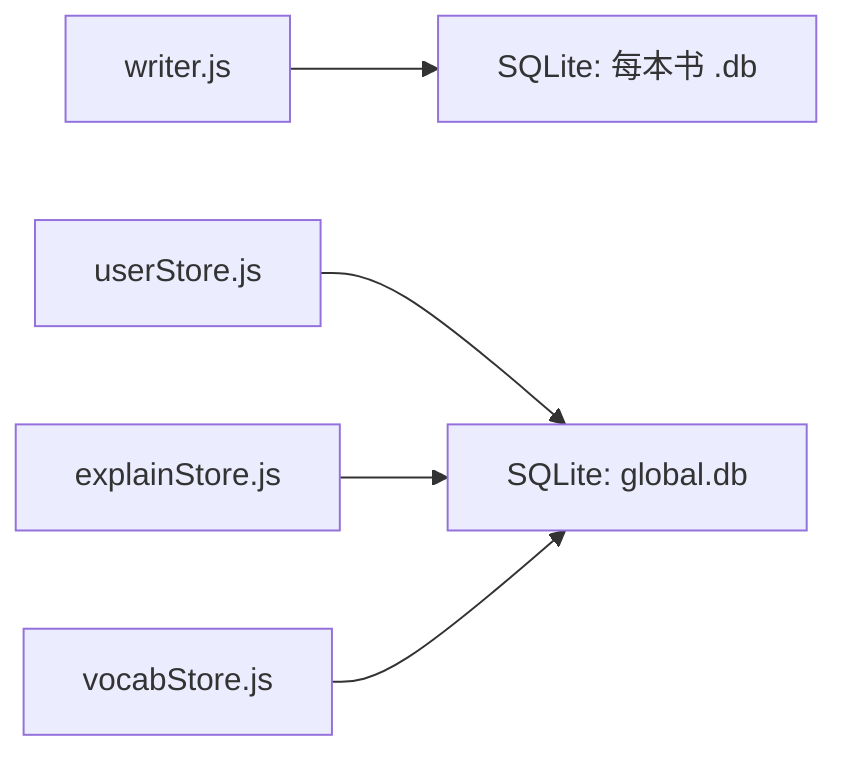

# 数据架构设计

<cite>
**本文引用的文件**   
- [src/database/writer.js](file://src/database/writer.js)
- [src/auth/userStore.js](file://src/auth/userStore.js)
- [src/reader/explainStore.js](file://src/reader/explainStore.js)
- [src/reader/vocabStore.js](file://src/reader/vocabStore.js)
- [README.md](file://README.md)
</cite>

## 目录
1. [引言](#引言)
2. [项目结构](#项目结构)
3. [核心组件](#核心组件)
4. [架构总览](#架构总览)
5. [详细组件分析](#详细组件分析)
6. [依赖关系分析](#依赖关系分析)
7. [性能与一致性](#性能与一致性)
8. [故障排查指南](#故障排查指南)
9. [结论](#结论)

## 引言
本文面向 AINovel 的数据层，聚焦 SQLite 数据库的设计模式、表结构与索引、事务管理、多租户隔离、权限控制、数据迁移策略以及持久化方案。文档同时给出 ER 图与关键数据处理流程图，帮助读者从“用户信息 → 小说内容 → 阅读缓存”的完整生命周期理解系统如何组织与管理数据。

## 项目结构
AINovel 的数据层由多个职责清晰的模块组成：
- 内容库：按每本小说一个 SQLite 文件，集中存储小说概要、章节大纲与正文、分部归属、生成配置等。
- 全局元数据库：集中存储用户、小说登记、VIP 授权、预览链接等跨书元数据。
- 阅读缓存：在同一个全局库中为“生词表、单词讲解、测试题、TTS 音频”提供有界持久缓存。



**图表来源**
- [src/database/writer.js:16-137](file://src/database/writer.js#L16-L137)
- [src/auth/userStore.js:47-114](file://src/auth/userStore.js#L47-L114)
- [src/reader/explainStore.js:24-47](file://src/reader/explainStore.js#L24-L47)
- [src/reader/vocabStore.js:23-46](file://src/reader/vocabStore.js#L23-L46)

**章节来源**
- [README.md:166-193](file://README.md#L166-L193)

## 核心组件
- WriterDB：封装单本小说的内容库，负责 schema 初始化、章节增删改查、批量加章、重排编号、分部划分、修订快照、生成配置等。
- userStore：封装 global.db，负责用户认证、小说登记、VIP 授权、预览登记、存量迁移与超管播种。
- explainStore：以 (word, age, lang) 为主键，持久化单词讲解结果，支持 LRU 式淘汰。
- vocabStore：以 sha1('vocab|年龄|正文') 为键，持久化章节生词表，避免重复调用模型。

**章节来源**
- [src/database/writer.js:16-137](file://src/database/writer.js#L16-L137)
- [src/auth/userStore.js:1-11](file://src/auth/userStore.js#L1-L11)
- [src/reader/explainStore.js:1-15](file://src/reader/explainStore.js#L1-L15)
- [src/reader/vocabStore.js:1-14](file://src/reader/vocabStore.js#L1-L14)

## 架构总览
数据层采用“按书分库 + 全局元库 + 共享缓存表”的组合：
- 每本小说拥有独立 SQLite 文件，通过 content/parts/chapter_revision 三张表承载内容与结构变更。
- 全局库 global.db 承担身份、授权、预览等跨书元数据；阅读缓存也复用该库，但使用独立表并做容量限制。
- 所有写操作尽量走 better-sqlite3 的事务 API，保证批量插入、重排编号、分部覆盖等复杂流程的原子性。

```mermaid
classDiagram
class WriterDB {
+ensureInitialized()
+createSchema()
+saveNovelInfo(data)
+getNovelInfo()
+upsertChapter(data)
+getAllChapters(options)
+addChaptersBulk(chapters, anchor, opts)
+shiftChapterNumbers(startFrom, shiftBy)
+reNumberAllChapters()
+saveParts(parts)
+saveGenConfig(cfg)
+saveChapterRevision(no, snapshot)
+restoreChapterRevision(revisionId)
}
class UserStore {
+bootstrap()
+login(username, password)
+createUser(params)
+listNovelsByUser(userId)
+grantVip(params)
+hasVipAccess(userId, novelId)
+registerPreview(token, novelId, userId, ttl)
}
class ExplainStore {
+getExplanation(word, age, lang)
+putExplanation(word, age, lang, text)
+wordsWithExplanation(words, age, lang)
}
class VocabStore {
+getCachedWords(key)
+putCachedWords(key, words, charCount)
}
WriterDB --> "SQLite : content / parts / chapter_revision" : "按书库"
UserStore --> "SQLite : global.db" : "用户/小说/VIP/预览"
ExplainStore --> "SQLite : global.db" : "reader_word_explain"
VocabStore --> "SQLite : global.db" : "reader_vocab"
```

**图表来源**
- [src/database/writer.js:16-137](file://src/database/writer.js#L16-L137)
- [src/auth/userStore.js:47-114](file://src/auth/userStore.js#L47-L114)
- [src/reader/explainStore.js:24-47](file://src/reader/explainStore.js#L24-L47)
- [src/reader/vocabStore.js:23-46](file://src/reader/vocabStore.js#L23-L46)

## 详细组件分析

### 内容库（WriterDB）
WriterDB 是小说内容的权威落库点，核心职责包括：
- Schema 初始化：创建 content、parts、chapter_revision 三张表，并通过 PRAGMA table_info 检测旧列，增量补齐 id、part_no、preface、gen_cfg 等字段。
- 章节建模：no=0 表示小说概要，no≥1 表示章节；type 区分 'novel' 与 'chapter'；id 为稳定章节 ID，用于发布文件名，不随重排变化。
- 分部建模：parts 表只存部序号、稳定部 id、部名与导言正文；起止章与章节数由 content.part_no 聚合派生，避免区间副本不一致。
- 修订快照：chapter_revision 记录改写前的 name/content/reason/source，支持恢复。



**图表来源**
- [src/database/writer.js:55-137](file://src/database/writer.js#L55-L137)
- [src/database/writer.js:110-137](file://src/database/writer.js#L110-L137)

#### 表结构与索引
- content：主键 no；唯一索引 idx_content_id；普通索引 idx_content_no/type/name/part_no。
- parts：主键 no。
- chapter_revision：自增 id 主键。

这些索引支撑了按 no 查询、按 type 过滤、按 name 搜索、按 part_no 聚合等常见路径。

**章节来源**
- [src/database/writer.js:123-130](file://src/database/writer.js#L123-L130)

#### 事务与一致性
- 删除章节后对后续章节统一 -1 重排，包裹在事务内。
- 批量加章使用“临时偏移 + 回写”的两步平移，确保一次事务内完成平移与连续 INSERT，不会留下半插状态。
- 重排编号、分部覆盖 saveParts 均使用事务，失败则整体回滚。



**图表来源**
- [src/database/writer.js:645-724](file://src/database/writer.js#L645-L724)

**章节来源**
- [src/database/writer.js:408-438](file://src/database/writer.js#L408-L438)
- [src/database/writer.js:478-528](file://src/database/writer.js#L478-L528)
- [src/database/writer.js:581-626](file://src/database/writer.js#L581-L626)
- [src/database/writer.js:645-724](file://src/database/writer.js#L645-L724)
- [src/database/writer.js:812-851](file://src/database/writer.js#L812-L851)
- [src/database/writer.js:1039-1098](file://src/database/writer.js#L1039-L1098)

#### 分部与归属
- parts 表仅保存“部元数据”，起止范围由 content.part_no 聚合得出。
- _resolvePartNo 根据当前已存在的部区间推断新章节归属：无部→0；落在区间→对应部；尾部追加→最后一部；首部异常→0 提示重新划分。
- saveParts 会先清空 parts 表、解除所有章节归属，再写入新区间并批量更新 content.part_no。

**章节来源**
- [src/database/writer.js:853-902](file://src/database/writer.js#L853-L902)
- [src/database/writer.js:1001-1098](file://src/database/writer.js#L1001-L1098)

#### 生成配置与设定说明
- no=0 行额外携带 preface（本书设定说明）与 gen_cfg（全书生成配置）。
- saveGenConfig 是唯一校验入口，支持清除、越界报错、JSON 解析失败降级为未设置。
- getNovelInfo 在读取时把 gen_cfg 字符串解析为对象，统一消费口径。

**章节来源**
- [src/database/writer.js:904-999](file://src/database/writer.js#L904-L999)

#### 修订快照与回滚
- saveChapterRevision 记录改写前快照。
- restoreChapterRevision 恢复前先把当前内容再存一份，实现双向备份；随后按 chapter_no 和 type='chapter' 恢复 name/content。

**章节来源**
- [src/database/writer.js:1186-1259](file://src/database/writer.js#L1186-L1259)

### 全局元数据库（userStore）
userStore 维护 global.db，承担多租户与权限的核心职责：
- user：账号权威，密码 scrypt 哈希 + salt，disabled 软禁用。
- novel：user_id → 小说 → db_file 映射，标记 vip 专属。
- vip_grant：读者账号到某本书或全站的授权，支持到期、撤销、恢复。
- preview：暂存预览站 token 与过期时间。



**图表来源**
- [src/auth/userStore.js:54-102](file://src/auth/userStore.js#L54-L102)

#### 多租户与权限
- 多租户：每本小说 db_file 属于某个 user_id；Web 端列举与鉴权以 novel.user_id 为准。
- 权限：hasVipAccess 是读者侧 VIP 闸门唯一口径——非 VIP 书恒可访问；VIP 书要求存在未撤销、未到期且命中范围（全站或本书）的授权。
- 超管豁免不在这里处理，而是由路由中间件叠加。

**章节来源**
- [src/auth/userStore.js:1-11](file://src/auth/userStore.js#L1-L11)
- [src/auth/userStore.js:335-349](file://src/auth/userStore.js#L335-L349)

#### 数据迁移与播种
- bootstrap：首次启动若 user 表为空，从 config/users.json 播种；并找出 superadminId。
- migrateExistingNovels：幂等地把 data/ 根下的 .db 文件归入 data/<user_id>/ 并在 novel 表登记；历史扁平 db_file 也会物理搬迁并更新路径。
- 兼容迁移：为 novel.vip 列补默认值，并把旧 vip_hash 转为 vip 标记。

**章节来源**
- [src/auth/userStore.js:380-481](file://src/auth/userStore.js#L380-L481)
- [src/auth/userStore.js:103-113](file://src/auth/userStore.js#L103-L113)

### 阅读缓存（explainStore / vocabStore）
两者都复用 global.db，但各自建表，并以“有界淘汰”防止匿名接口刷库导致无限增长：
- reader_word_explain：主键 (word, age, lang)，按 updated_at 淘汰最冷数据。
- reader_vocab：主键 key=sha1('vocab|年龄|正文')，同样按 updated_at 淘汰。



**图表来源**
- [src/reader/vocabStore.js:53-68](file://src/reader/vocabStore.js#L53-L68)

**章节来源**
- [src/reader/explainStore.js:24-113](file://src/reader/explainStore.js#L24-L113)
- [src/reader/vocabStore.js:23-101](file://src/reader/vocabStore.js#L23-L101)

## 依赖关系分析
- writer.js 依赖 better-sqlite3 与 fs-extra/path/os/crypto，直接操作每本小说的 SQLite 文件。
- userStore.js 依赖 better-sqlite3、fs、path、crypto，维护 global.db 并暴露 bootstrap/migrate 等生命周期方法。
- explainStore.js 与 vocabStore.js 依赖 better-sqlite3 与 userStore 提供的 GLOBAL_DB，惰性打开连接，失败时降级为进程内缓存。
- 发布逻辑（publish.js）会读取 content 表并可能执行 ALTER TABLE 兼容迁移，但内容写盘主要依赖渲染与文件系统。



**图表来源**
- [src/database/writer.js:6-11](file://src/database/writer.js#L6-L11)
- [src/auth/userStore.js:12-23](file://src/auth/userStore.js#L12-L23)
- [src/reader/explainStore.js:16-17](file://src/reader/explainStore.js#L16-L17)
- [src/reader/vocabStore.js:15-16](file://src/reader/vocabStore.js#L15-L16)

**章节来源**
- [src/database/writer.js:6-11](file://src/database/writer.js#L6-L11)
- [src/auth/userStore.js:12-23](file://src/auth/userStore.js#L12-L23)
- [src/reader/explainStore.js:16-17](file://src/reader/explainStore.js#L16-L17)
- [src/reader/vocabStore.js:15-16](file://src/reader/vocabStore.js#L15-L16)

## 性能与一致性
- 日志模式：WriterDB 与 userStore 显式设置 journal_mode=DELETE，避免 WAL 带来的额外文件与同进程多连接场景下的收益有限问题。
- 索引优化：content 表针对 no/type/name/id/part_no 建立索引，满足列表、搜索、稳定 ID 访问与分部聚合。
- 批量写入：addChaptersBulk 用单次事务完成平移与连续 INSERT，避免逐条 upsert 导致的 O(N×M) 与半插风险。
- 内存保护：getAllChapters 支持 includeContent=false，仅返回 LENGTH(content) 作为 contentLength，避免整本正文搬进内存。
- 缓存淘汰：explainStore 与 vocabStore 在写入后触发 evict，按 updated_at 保留最近 MAX_ROWS 行，防止匿名接口无限增长。

**章节来源**
- [src/database/writer.js:38-41](file://src/database/writer.js#L38-L41)
- [src/database/writer.js:123-130](file://src/database/writer.js#L123-L130)
- [src/database/writer.js:355-377](file://src/database/writer.js#L355-L377)
- [src/database/writer.js:645-724](file://src/database/writer.js#L645-L724)
- [src/reader/explainStore.js:104-113](file://src/reader/explainStore.js#L104-L113)
- [src/reader/vocabStore.js:92-101](file://src/reader/vocabStore.js#L92-L101)

## 故障排查指南
- 无法打开 WriterDB：检查 ensureInitialized 是否抛出错误，确认数据库目录存在且路径正确。
- 章节编号异常：优先运行 reNumberAllChapters 或 shiftChapterNumbers；注意 addChaptersBulk 会返回“章号不连续”的 warning。
- 分部归属错乱：检查 parts 表与 content.part_no 的一致性；可用 getAllParts 与 getPartRanges 对比。
- VIP 不可读：确认 hasVipAccess 判定条件——novel.vip 是否为 1，是否存在未撤销、未过期的 vip_grant 记录。
- 预览链接失效：检查 preview 表中的 expires_at 是否已过期；清理前先 listPreviewsByNovel 找到目录名。
- 阅读缓存未命中：确认 key 口径一致（vocabStore 使用 sha1('vocab|年龄|正文')），避免改用章节号或文件名。

**章节来源**
- [src/database/writer.js:25-50](file://src/database/writer.js#L25-L50)
- [src/database/writer.js:812-851](file://src/database/writer.js#L812-L851)
- [src/database/writer.js:1001-1098](file://src/database/writer.js#L1001-L1098)
- [src/auth/userStore.js:335-349](file://src/auth/userStore.js#L335-L349)
- [src/auth/userStore.js:351-378](file://src/auth/userStore.js#L351-L378)
- [src/reader/vocabStore.js:8-14](file://src/reader/vocabStore.js#L8-L14)

## 结论
AINovel 的数据层通过“按书分库 + 全局元库 + 共享缓存表”实现了清晰的分层与职责分离：WriterDB 专注小说内容与结构变更，userStore 专注多租户与权限，explainStore/vocabStore 专注阅读体验缓存。配合良好的索引、事务与迁移策略，系统在可读性、可扩展性与一致性之间取得平衡。对于未来扩展，建议继续遵循现有约定：新增字段优先通过 ALTER TABLE 增量补齐，新增表保持幂等建表，对外接口统一经过 userStore 与 WriterDB 的抽象层，避免裸 SQL 绕过约束。