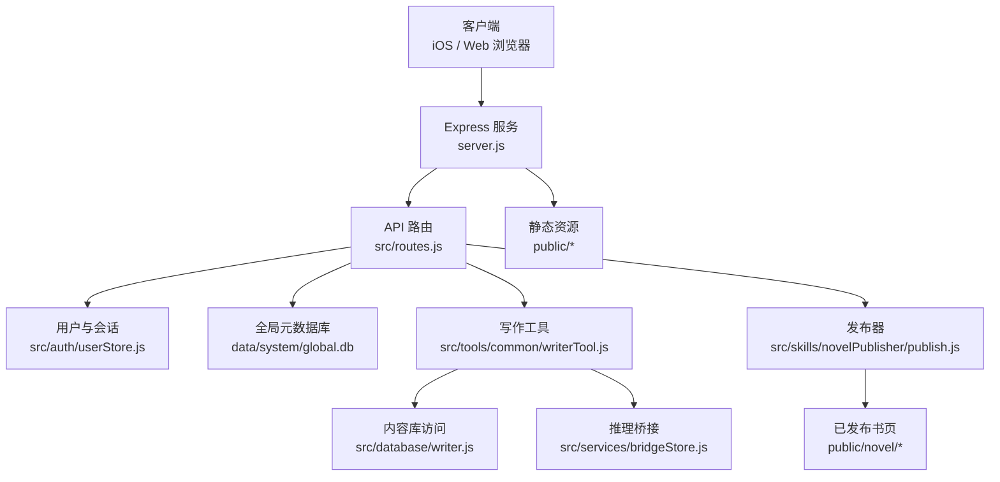
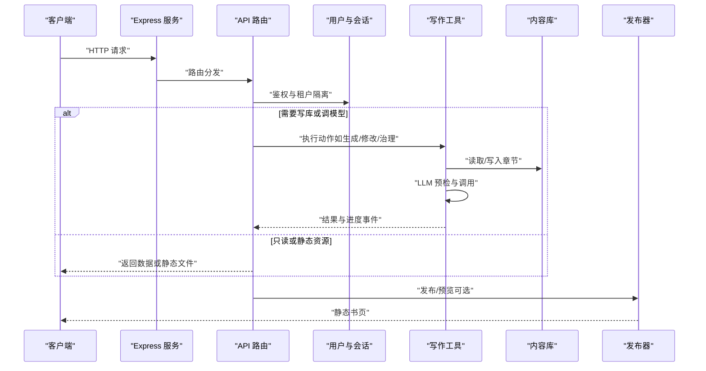
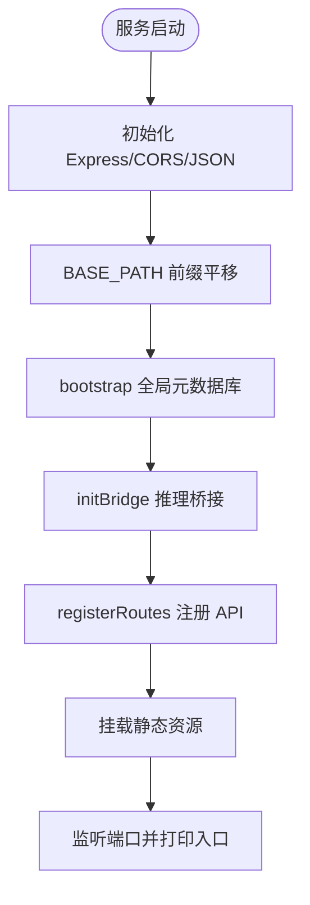
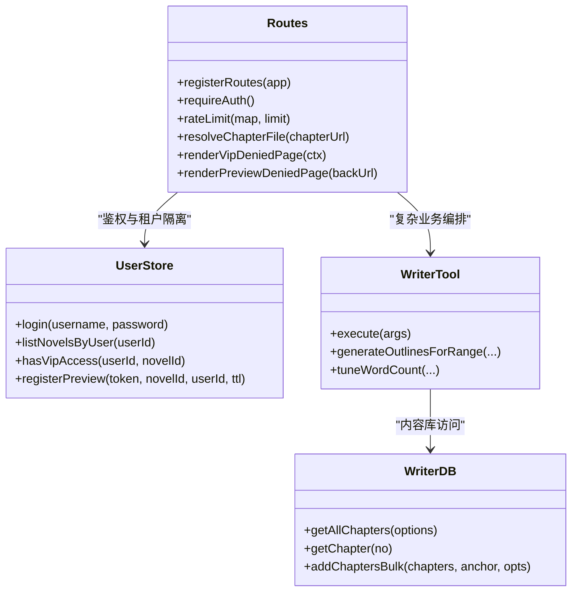
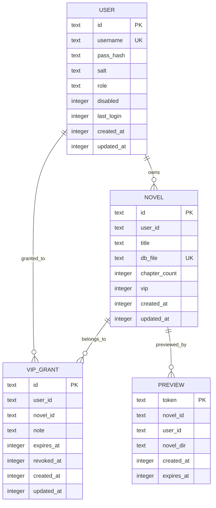
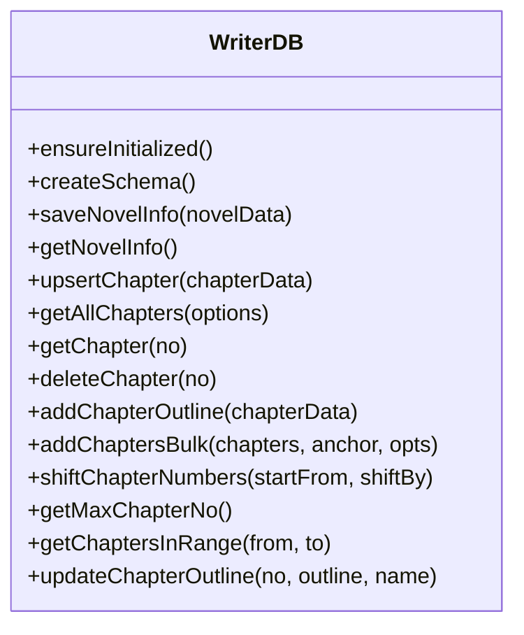
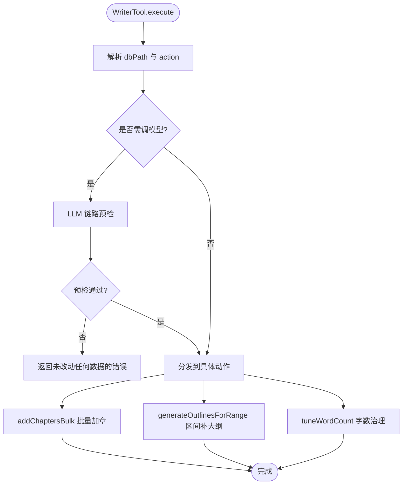
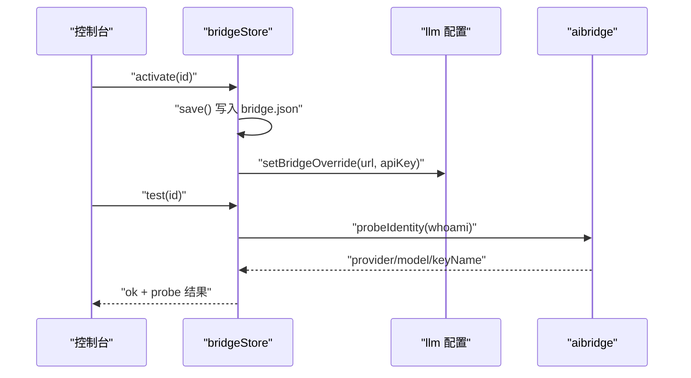
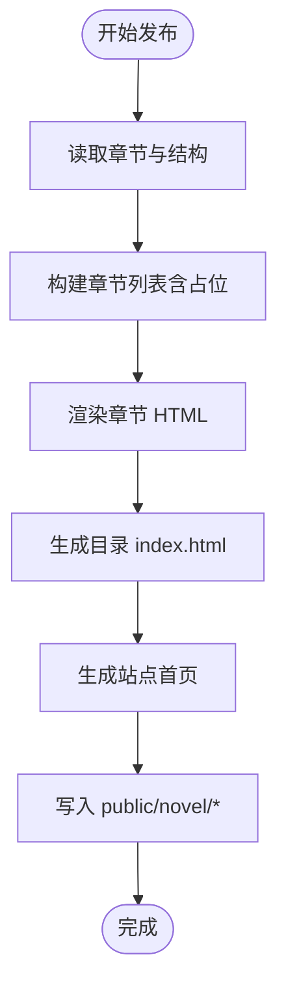
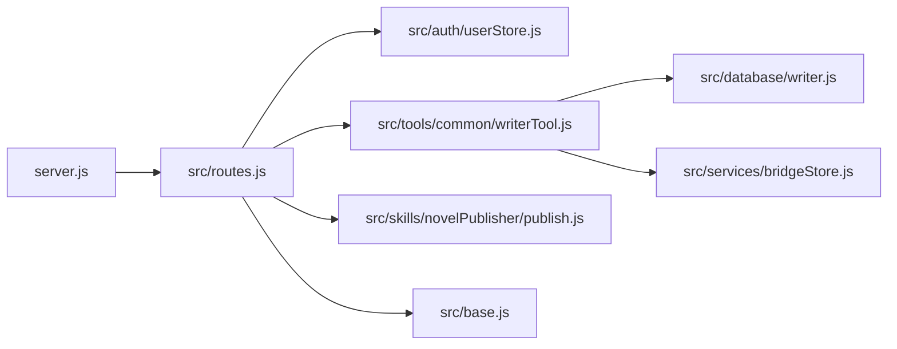

# 整体架构概览

<cite>
**本文引用的文件**   
- [README.md](file://README.md)
- [server.js](file://server.js)
- [package.json](file://package.json)
- [src/base.js](file://src/base.js)
- [src/routes.js](file://src/routes.js)
- [src/auth/userStore.js](file://src/auth/userStore.js)
- [src/database/writer.js](file://src/database/writer.js)
- [src/tools/common/writerTool.js](file://src/tools/common/writerTool.js)
- [src/services/bridgeStore.js](file://src/services/bridgeStore.js)
- [src/skills/novelPublisher/publish.js](file://src/skills/novelPublisher/publish.js)
</cite>

## 目录
1. [引言](#引言)
2. [项目结构](#项目结构)
3. [核心组件](#核心组件)
4. [架构总览](#架构总览)
5. [详细组件分析](#详细组件分析)
6. [依赖关系分析](#依赖关系分析)
7. [性能与扩展性](#性能与扩展性)
8. [故障排查指南](#故障排查指南)
9. [结论](#结论)

## 引言
AINovel 是一个“阅读 + 管理 + 学习”一体化的 AI 小说平台。系统采用前后端分离的分层架构：
- 表现层：iOS 应用与 Web 前端（登录页、管理后台、阅读器静态资源）。
- 业务逻辑层：基于 Express.js 的 Node.js 服务，提供 RESTful API、会话鉴权、多租户隔离、长任务进度推送、TTS 合成、AI 问答与图片生成代理等能力。
- 数据访问层：SQLite（better-sqlite3），分为全局元数据库 global.db 与每本小说的内容库 writer.db；发布产物以静态 HTML 文件形式托管在 public/novel 下。

本架构强调：
- 明确职责边界：路由层负责鉴权、租户隔离与参数校验；WriterTool 封装章节增删改与 LLM 调用；WriterDB 专注 SQLite 操作；publish 模块负责渲染与发布。
- 安全与可观测：统一输出净化、VIP 授权实时校验、删除二次确认、按书互斥的长任务锁、SSE 进度通道。
- 部署友好：支持 BASE_PATH 前缀挂载、静态资源 ETag 缓存、TTS 音频长期缓存、浏览器侧 reader.core.js 时间戳刷新。

**章节来源**
- [README.md:1-202](file://README.md#L1-L202)

## 项目结构
系统由以下关键目录与文件组成：
- server.js：Express 服务入口，负责 CORS、JSON 解析、BASE_PATH 前缀平移、全局初始化、API 注册与静态资源挂载。
- src/base.js：站点挂载前缀与路径工具，保证开发态与线上 nginx 原样转发行为一致。
- src/routes.js：API 路由与中间件，包含登录、读者公开接口、VIP 闸门、限流、长任务 SSE、小说 CRUD、章节查询、设置读写、发布与预览等。
- src/auth/userStore.js：global.db 多用户元数据仓库，负责用户、小说登记、VIP 授权、预览暂存站生命周期。
- src/database/writer.js：WriterDB，封装 content/parts/chapter_revision 表结构与章节增删改查、批量加章、分部归属、字数治理相关查询。
- src/tools/common/writerTool.js：WriterTool，聚合 WriterDB 与 LLM 调用，实现大纲/正文生成、区间补大纲、全书设定、字数治理等复杂流程。
- src/services/bridgeStore.js：aibridge Key 管理与启用切换，运行时生效并探测上游模型身份。
- src/skills/novelPublisher/publish.js：渲染章节 HTML、生成目录与站点首页、处理占位章与分部导言、本地发布。

**图表来源**
- [server.js:1-64](file://server.js#L1-L64)
- [src/base.js:1-42](file://src/base.js#L1-L42)
- [src/routes.js:1-800](file://src/routes.js#L1-L800)
- [src/auth/userStore.js:1-501](file://src/auth/userStore.js#L1-L501)
- [src/database/writer.js:1-800](file://src/database/writer.js#L1-L800)
- [src/tools/common/writerTool.js:1-800](file://src/tools/common/writerTool.js#L1-L800)
- [src/services/bridgeStore.js:1-221](file://src/services/bridgeStore.js#L1-L221)
- [src/skills/novelPublisher/publish.js:1-800](file://src/skills/novelPublisher/publish.js#L1-L800)

**章节来源**
- [server.js:1-64](file://server.js#L1-L64)
- [src/base.js:1-42](file://src/base.js#L1-L42)
- [src/routes.js:1-800](file://src/routes.js#L1-L800)
- [src/auth/userStore.js:1-501](file://src/auth/userStore.js#L1-L501)
- [src/database/writer.js:1-800](file://src/database/writer.js#L1-L800)
- [src/tools/common/writerTool.js:1-800](file://src/tools/common/writerTool.js#L1-L800)
- [src/services/bridgeStore.js:1-221](file://src/services/bridgeStore.js#L1-L221)
- [src/skills/novelPublisher/publish.js:1-800](file://src/skills/novelPublisher/publish.js#L1-L800)

## 核心组件
- 服务入口与静态托管：server.js 启动 Express，注册 CORS、JSON 解析、BASE_PATH 前缀平移、全局初始化、API 路由与静态资源挂载（login/tts/admin/novel/public）。
- 前缀与路径：src/base.js 定义 BASE_PATH 与 sitePath，确保对外 URL 与内部挂载点一致，避免双前缀问题。
- API 路由与鉴权：src/routes.js 提供登录、读者公开接口、VIP 闸门、限流、长任务 SSE、小说与章节 CRUD、设置读写、发布与预览。
- 多租户与 VIP：src/auth/userStore.js 维护 user/novel/vip_grant/preview 表，实现账号权威、小说归属映射、读者授权与预览生命周期。
- 内容库访问：src/database/writer.js 提供 WriterDB，封装 content/parts/chapter_revision 表结构与章节增删改查、批量加章、分部归属、字数治理相关查询。
- 写作工具与 LLM：src/tools/common/writerTool.js 聚合 WriterDB 与 LLM 调用，实现大纲/正文生成、区间补大纲、全书设定、字数治理等复杂流程，并在动笔前进行链路预检。
- 推理桥接配置：src/services/bridgeStore.js 管理 aibridge Key 清单与当前生效项，支持运行时切换、地址覆盖与 whoami 探测。
- 发布与预览：src/skills/novelPublisher/publish.js 渲染章节 HTML、生成目录与站点首页、处理占位章与分部导言、本地发布到 public/novel。

**章节来源**
- [server.js:1-64](file://server.js#L1-L64)
- [src/base.js:1-42](file://src/base.js#L1-L42)
- [src/routes.js:1-800](file://src/routes.js#L1-L800)
- [src/auth/userStore.js:1-501](file://src/auth/userStore.js#L1-L501)
- [src/database/writer.js:1-800](file://src/database/writer.js#L1-L800)
- [src/tools/common/writerTool.js:1-800](file://src/tools/common/writerTool.js#L1-L800)
- [src/services/bridgeStore.js:1-221](file://src/services/bridgeStore.js#L1-L221)
- [src/skills/novelPublisher/publish.js:1-800](file://src/skills/novelPublisher/publish.js#L1-L800)

## 架构总览
系统分层如下：
- 表现层：iOS 应用与 Web 前端通过 RESTful API 与服务交互；静态页面与阅读器资源由 Express 直接托管。
- 业务逻辑层：routes.js 作为统一入口，负责鉴权、租户隔离、参数校验、限流、长任务调度；WriterTool 封装复杂业务流程；bridgeStore 管理推理服务连接。
- 数据访问层：userStore.js 操作 global.db（用户、小说登记、VIP 授权、预览）；writer.js 操作每本小说的 writer.db（content/parts/chapter_revision）；publish.js 将内容渲染为静态 HTML 并发布到 public/novel。

**图表来源**
- [server.js:1-64](file://server.js#L1-L64)
- [src/routes.js:1-800](file://src/routes.js#L1-L800)
- [src/auth/userStore.js:1-501](file://src/auth/userStore.js#L1-L501)
- [src/tools/common/writerTool.js:1-800](file://src/tools/common/writerTool.js#L1-L800)
- [src/database/writer.js:1-800](file://src/database/writer.js#L1-L800)
- [src/skills/novelPublisher/publish.js:1-800](file://src/skills/novelPublisher/publish.js#L1-L800)

## 详细组件分析

### 服务入口与静态资源托管（server.js）
- 功能要点：
  - 初始化 Express、CORS、JSON 解析。
  - BASE_PATH 前缀平移：对外 <BASE>/(api|login|tts|admin)/* → 内部 /*，书页路径保持原样。
  - 全局初始化：bootstrap 多用户元数据库、initBridge 推理桥接。
  - 静态资源：/login、/tts、/tts-audio、/admin、/novel、根级 public。
- 设计考量：
  - 与 nginx 原样转发保持一致，避免开发态与线上行为不一致。
  - 启动日志输出 BASE_PATH、登录与管理入口、LLM 链路来源。

**图表来源**
- [server.js:1-64](file://server.js#L1-L64)
- [src/base.js:1-42](file://src/base.js#L1-L42)

**章节来源**
- [server.js:1-64](file://server.js#L1-L64)
- [src/base.js:1-42](file://src/base.js#L1-L42)

### API 路由与鉴权（src/routes.js）
- 功能要点：
  - 登录/登出/当前用户：/api/login、/api/logout、/api/me。
  - 读者公开接口：/api/reader/*（问答、讲解、生词、TTS、图片代理），带独立限流。
  - VIP 闸门：对 /novel 下的书页与公开书单进行实时授权校验。
  - 长任务：/api/run 与 /api/progress（SSE），按书互斥锁。
  - 小说与章节：/api/novels、/api/novels/:id/chapters、/api/novels/:id/chapter/:no。
  - 设置与发布：/api/novels/:id/settings、/api/novels/:id/publish、预览与报告。
- 安全与健壮性：
  - 输出净化：过滤敏感字段与绝对路径。
  - 删除二次确认：三个入口统一 requireOkConfirm。
  - 限流：按真实 IP（考虑回环与反向代理头）定窗限流。

**图表来源**
- [src/routes.js:1-800](file://src/routes.js#L1-L800)
- [src/auth/userStore.js:1-501](file://src/auth/userStore.js#L1-L501)
- [src/tools/common/writerTool.js:1-800](file://src/tools/common/writerTool.js#L1-L800)
- [src/database/writer.js:1-800](file://src/database/writer.js#L1-L800)

**章节来源**
- [src/routes.js:1-800](file://src/routes.js#L1-L800)

### 多租户与 VIP 授权（src/auth/userStore.js）
- 功能要点：
  - 用户表：scrypt 哈希 + salt，禁用软删除，最后登录时间。
  - 小说表：user_id -> title -> db_file，web 列举与鉴权唯一口径。
  - VIP 授权表：user_id -> novel_id（NULL=全站），到期与撤销软删除。
  - 预览登记：token -> novel_id/user_id，24 小时 TTL。
  - 初始化与播种：首次从 config/users.json 播种超管，存量小说迁移。
- 设计考量：
  - 权限最小化：对外不暴露凭据列。
  - 幂等与可审计：授权撤销留痕，预览过期可回收。

**图表来源**
- [src/auth/userStore.js:1-501](file://src/auth/userStore.js#L1-L501)

**章节来源**
- [src/auth/userStore.js:1-501](file://src/auth/userStore.js#L1-L501)

### 内容库与章节管理（src/database/writer.js）
- 功能要点：
  - content 表：no=0 为小说概要，no≥1 为章节；支持 name/outline/content/id/version/preface/gen_cfg/part_no。
  - parts 表：部序号、稳定 id、部名、导言摘要。
  - chapter_revision 表：改写前快照，支持回滚。
  - 方法：saveNovelInfo/getNovelInfo/upsertChapter/getAllChapters/getChapter/deleteChapter/addChapterOutline/addChaptersBulk/shiftChapterNumbers/getMaxChapterNo/getChaptersInRange/updateChapterOutline 等。
- 设计考量：
  - 批量加章单事务一次平移，避免半插状态。
  - includeContent=false 时仅返回 LENGTH(content)，避免列表接口拉整本书正文。
  - 分部归属由 part_no 聚合派生，避免区间副本漂移。

**图表来源**
- [src/database/writer.js:1-800](file://src/database/writer.js#L1-L800)

**章节来源**
- [src/database/writer.js:1-800](file://src/database/writer.js#L1-L800)

### 写作工具与 LLM 集成（src/tools/common/writerTool.js）
- 功能要点：
  - 动作枚举：generate/add/modify/delete/saveNovelPlan/generateChapterOutlines/addChapterOutline/addChaptersBulk/generateOutlinesForRange/updateChapterOutline/reNumberChapters/updateNovelPlan/generatePreface/savePreface/setParts/generatePartIntros/listParts/setGenConfig/tuneWordCount。
  - LLM 预检：动笔前先探桥接服务可达性与密钥，失败则不写库。
  - 区间补大纲：逐章串行，连续失败熔断，自由扩展落库降序插入。
  - 字数治理：默认 dry-run，降序处理，拆章后校正引用。
- 设计考量：
  - 防误操作：占位文本守卫、主角具名守卫、书名防分裂。
  - 可观测：progressHub 推送逐章进度，错误分类与断言。

**图表来源**
- [src/tools/common/writerTool.js:1-800](file://src/tools/common/writerTool.js#L1-L800)

**章节来源**
- [src/tools/common/writerTool.js:1-800](file://src/tools/common/writerTool.js#L1-L800)

### 推理桥接配置（src/services/bridgeStore.js）
- 功能要点：
  - 存储 data/system/bridge.json（0600），明文密钥进程内流转，对外仅 keyPrefix。
  - 启动 initBridge：加载生效项、打印链路来源、异步探测 whoami。
  - 管理 Key：add/rename/remove/activate/setUrl/test。
- 设计考量：
  - 运行时切换：activeId 变化立即 applyToLlm，无需重启。
  - 安全：对外不返回明文，/api/admin 前缀不过 scrub 但靠自觉不泄露。

**图表来源**
- [src/services/bridgeStore.js:1-221](file://src/services/bridgeStore.js#L1-L221)

**章节来源**
- [src/services/bridgeStore.js:1-221](file://src/services/bridgeStore.js#L1-L221)

### 发布与预览（src/skills/novelPublisher/publish.js）
- 功能要点：
  - 渲染章节 HTML：stripLeadingHeading、buildChapterNav、markdownToHtml。
  - 目录与站点首页：generateIndex、generateSiteIndex，支持 VIP 徽章与分部区块。
  - 占位章：isPlaceholder 标记未完成章节，保持序列连续。
  - 分部导言：parts 表读取，introUrl/brief 展示。
  - 本地发布：publishNovelLocal 写入 public/novel/<uid>/<书名>/index.html 与 chapter_*.html。
- 设计考量：
  - TTS 外链：reader.js 带时间戳加载 reader.core.js，避免重新发布。
  - 目录安全：sanitizeDirName 防止穿越与非法字符。

**图表来源**
- [src/skills/novelPublisher/publish.js:1-800](file://src/skills/novelPublisher/publish.js#L1-L800)

**章节来源**
- [src/skills/novelPublisher/publish.js:1-800](file://src/skills/novelPublisher/publish.js#L1-L800)

## 依赖关系分析
- 外部依赖：
  - express：HTTP 服务与路由。
  - better-sqlite3：SQLite 同步访问。
  - cors：跨域支持。
  - marked：Markdown 转 HTML。
  - msedge-tts：TTS 合成。
  - pinyin-pro：拼音处理。
- 内部依赖：
  - server.js → routes.js → userStore.js / writerTool.js / publish.js。
  - writerTool.js → writer.js + llm.js + progressHub。
  - routes.js → base.js（sitePath/BASE_PATH）。

**图表来源**
- [server.js:1-64](file://server.js#L1-L64)
- [src/routes.js:1-800](file://src/routes.js#L1-L800)
- [src/auth/userStore.js:1-501](file://src/auth/userStore.js#L1-L501)
- [src/tools/common/writerTool.js:1-800](file://src/tools/common/writerTool.js#L1-L800)
- [src/database/writer.js:1-800](file://src/database/writer.js#L1-L800)
- [src/services/bridgeStore.js:1-221](file://src/services/bridgeStore.js#L1-L221)
- [src/skills/novelPublisher/publish.js:1-800](file://src/skills/novelPublisher/publish.js#L1-L800)
- [src/base.js:1-42](file://src/base.js#L1-L42)

**章节来源**
- [package.json:1-29](file://package.json#L1-L29)
- [server.js:1-64](file://server.js#L1-L64)
- [src/routes.js:1-800](file://src/routes.js#L1-L800)

## 性能与扩展性
- 数据库：
  - global.db 与 writer.db 均为 SQLite，适合中小规模内容库；WriterDB 使用 DELETE journal_mode，简化小数据量场景。
  - getAllChapters 支持 includeContent=false，避免列表接口拉整本书正文。
- 网络与缓存：
  - 静态资源 ETag 与 max-age 控制：/tts-audio 长期缓存，/tts/reader.js 带时间戳避免缓存。
  - 限流：读者接口与 TTS 接口分别限流，按真实 IP 分桶，避免反代导致的全站限流。
- 长任务：
  - 按书互斥锁，避免并发生成互相踩正文与章号。
  - SSE 进度通道，缓冲近期事件，避免先订阅后发布的竞态丢消息。
- 扩展建议：
  - 若内容库增长显著，可考虑 WAL 模式与索引优化。
  - 发布产物可引入 CDN 与增量更新策略。
  - LLM 调用可引入重试与退避策略，结合 bridgeStore 的多 Key 切换。

[本节为通用指导，不直接分析具体文件]

## 故障排查指南
- 登录与鉴权：
  - 检查 /api/login 返回与 Cookie 设置；确认 BASE_PATH 与 nginx 转发一致。
- VIP 访问：
  - 确认 vip_grant 是否有效（未撤销、未到期）；书页请求实时校验。
- 长任务失败：
  - 查看 /api/llm-status 与 bridgeStore 的 whoami 探测；确认 aibridge 可达与 Key 正确。
  - 关注按书互斥锁与连续失败熔断提示。
- 发布异常：
  - 检查 public/novel 目录权限与 ETag；确认 sanitizeDirName 与章节 ID 稳定性。
- 输出净化：
  - 确认 /api 响应不包含敏感字段；/api/admin 前缀不过 scrub，需自觉不泄露明文。

**章节来源**
- [src/routes.js:1-800](file://src/routes.js#L1-L800)
- [src/services/bridgeStore.js:1-221](file://src/services/bridgeStore.js#L1-L221)
- [src/skills/novelPublisher/publish.js:1-800](file://src/skills/novelPublisher/publish.js#L1-L800)

## 结论
AINovel 采用清晰的分层架构：Express 服务作为业务中枢，routes.js 统一鉴权与编排，writerTool.js 封装复杂写作流程，writer.js 专注内容库访问，publish.js 负责静态发布。技术选型上，Express + SQLite 组合简洁高效，适合中小型内容库与快速迭代；多租户与 VIP 授权机制保障数据安全与访问控制；bridgeStore 支持运行时切换推理服务，提升可观测性与灵活性。部署层面，BASE_PATH 前缀与静态资源缓存策略使开发与线上行为一致，便于运维与扩展。

[本节为总结，不直接分析具体文件]