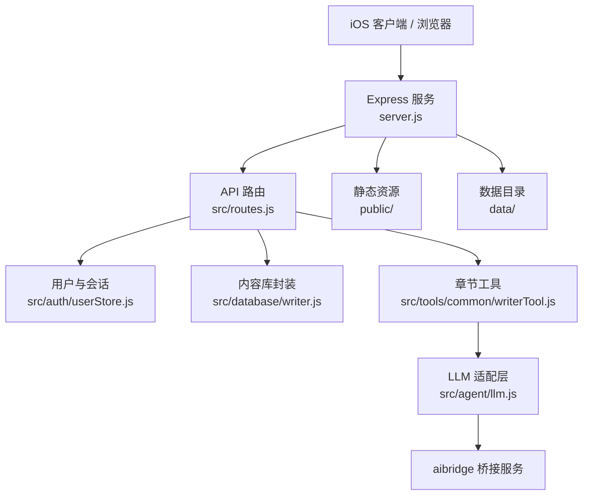
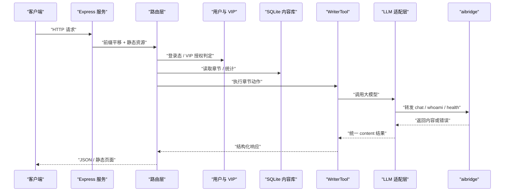
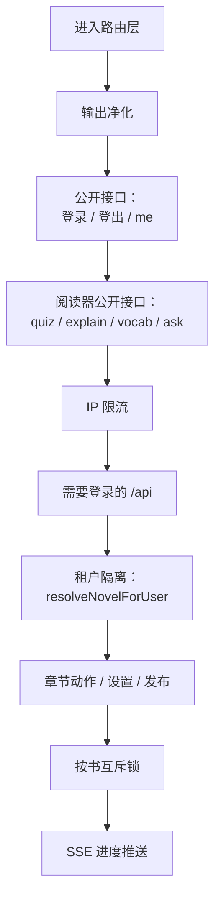
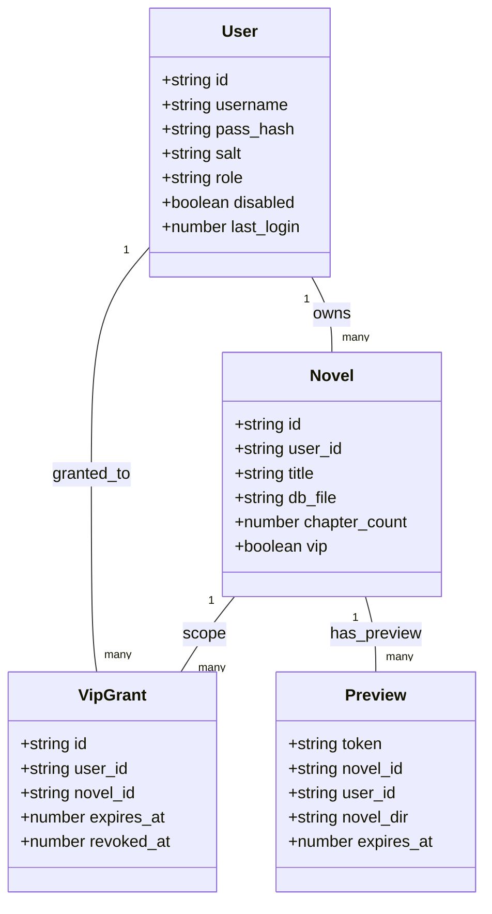
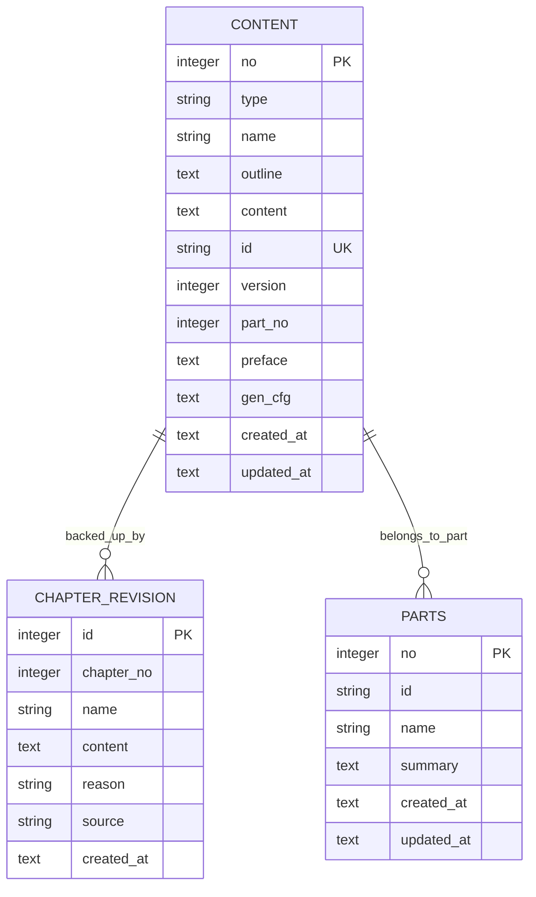
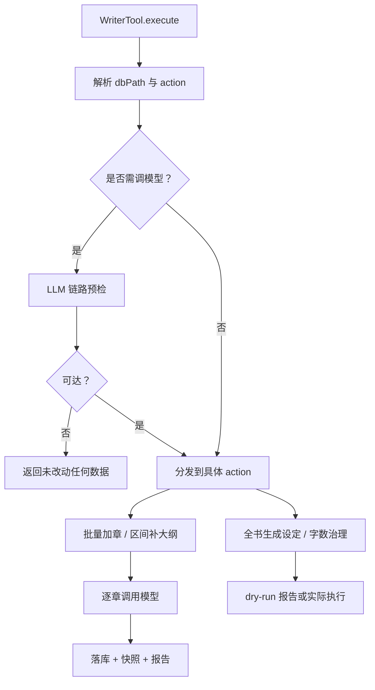
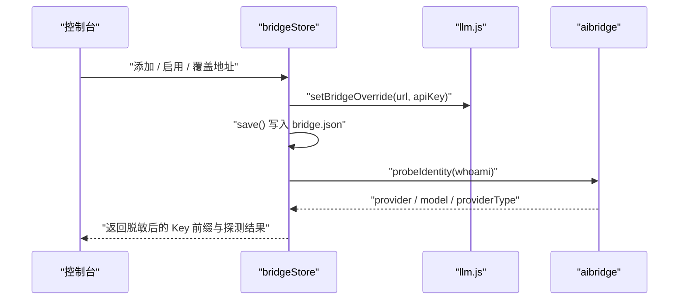
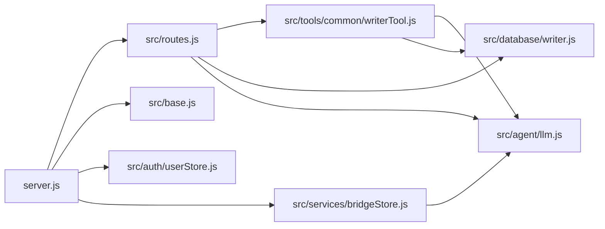

# 系统架构设计

<cite>
**本文引用的文件**   
- [server.js](file://server.js)
- [src/base.js](file://src/base.js)
- [src/routes.js](file://src/routes.js)
- [src/auth/userStore.js](file://src/auth/userStore.js)
- [src/database/writer.js](file://src/database/writer.js)
- [src/tools/common/writerTool.js](file://src/tools/common/writerTool.js)
- [src/services/bridgeStore.js](file://src/services/bridgeStore.js)
- [src/agent/llm.js](file://src/agent/llm.js)
- [package.json](file://package.json)
- [README.md](file://README.md)
</cite>

## 目录
1. [引言](#引言)
2. [项目结构](#项目结构)
3. [核心组件](#核心组件)
4. [架构总览](#架构总览)
5. [详细组件分析](#详细组件分析)
6. [依赖关系分析](#依赖关系分析)
7. [性能与可靠性](#性能与可靠性)
8. [故障排查指南](#故障排查指南)
9. [结论](#结论)

## 引言
AINovel 是一个“阅读 + 管理 + 学习”一体化的 AI 小说平台。后端基于 Node.js 与 Express，使用 SQLite 存储用户元数据与每本小说的内容库；前端包含 iOS 客户端、浏览器管理控制台与读者站；AI 能力通过 aibridge 桥接服务接入外部大模型。系统强调多租户隔离、VIP 授权、长任务进度反馈、发布前预览与内容级一致性校验。

本架构文档面向技术读者与非技术读者，既给出高层上下文图，也深入到路由、数据库、工具层与 LLM 适配层的实现细节，并解释关键技术决策：为什么选择 SQLite、Express 中间件如何组织鉴权与限流、多租户与 VIP 授权如何工作、以及请求到生成再到发布的完整数据流。

## 项目结构
仓库采用前后端分离的组织方式：
- 后端入口 `server.js` 启动 Express 应用，挂载静态资源、注册 API 路由，并在启动时初始化全局数据库与推理链路配置。
- 业务路由集中在 `src/routes.js`，负责登录鉴权、租户隔离、VIP 闸门、阅读器公开接口、小说 CRUD、章节操作、发布与预览等。
- 多用户元数据与 VIP 授权由 `src/auth/userStore.js` 管理，统一读写 `data/system/global.db`。
- 每本小说的内容库由 `src/database/writer.js` 封装，按书维护 `content`、`parts`、`chapter_revision` 等表。
- 章节增删改、批量加章、区间补大纲、字数治理等复杂逻辑集中在 `src/tools/common/writerTool.js`。
- LLM 调用通过 `src/agent/llm.js` 适配 aibridge，密钥与地址切换由 `src/services/bridgeStore.js` 管理。
- iOS 客户端位于 `ios/`，浏览器管理页与阅读器静态资源位于 `public/`。

**图表来源**
- [server.js:1-64](file://server.js#L1-L64)
- [src/routes.js:1-80](file://src/routes.js#L1-L80)
- [src/auth/userStore.js:1-114](file://src/auth/userStore.js#L1-L114)
- [src/database/writer.js:1-137](file://src/database/writer.js#L1-L137)
- [src/tools/common/writerTool.js:1-20](file://src/tools/common/writerTool.js#L1-L20)
- [src/agent/llm.js:1-65](file://src/agent/llm.js#L1-L65)

**章节来源**
- [server.js:1-64](file://server.js#L1-L64)
- [src/base.js:1-42](file://src/base.js#L1-L42)
- [package.json:1-29](file://package.json#L1-L29)
- [README.md:166-202](file://README.md#L166-L202)

## 核心组件
- **Express 服务层**：负责跨域、JSON 解析、BASE_PATH 前缀平移、静态资源挂载、全局初始化与端口监听。
- **路由与中间件层**：集中处理登录、会话、VIP 授权、限流、净化输出、长任务 SSE 进度、小说与章节 REST 接口。
- **多租户与认证层**：以 `global.db` 为权威，维护用户、小说登记、VIP 授权与预览登记。
- **内容数据库层**：按书维护 SQLite 文件，提供章节增删改、批量加章、分部划分、修订快照等能力。
- **章节工具层**：封装 WriterTool，统一调度数据库、LLM、进度推送、字数治理与发布相关动作。
- **LLM 适配层**：将内部消息格式转为 aibridge 请求，支持健康检查、whoami 探测、超时控制与密钥覆盖。
- **桥接密钥存储层**：持久化 aibridge Key 清单、当前生效项与地址覆盖，启动时主动注入 LLM 配置。

**章节来源**
- [server.js:1-64](file://server.js#L1-L64)
- [src/routes.js:1-80](file://src/routes.js#L1-L80)
- [src/auth/userStore.js:1-114](file://src/auth/userStore.js#L1-L114)
- [src/database/writer.js:1-137](file://src/database/writer.js#L1-L137)
- [src/tools/common/writerTool.js:1-206](file://src/tools/common/writerTool.js#L1-L206)
- [src/agent/llm.js:1-65](file://src/agent/llm.js#L1-L65)
- [src/services/bridgeStore.js:1-99](file://src/services/bridgeStore.js#L1-L99)

## 架构总览
系统采用前后端分离的多租户架构：
- 客户端（iOS App 与浏览器）通过 HTTP 访问 Express 服务。
- Express 根据 BASE_PATH 做前缀平移，把 `/novel` 下的应用命名空间映射到内部根路径。
- 所有 `/api` 请求在登录后受 `requireAuth` 保护；部分公开接口如阅读器学习模式走独立限流。
- 小说数据按用户隔离：`global.db` 记录 `user_id -> novel.id -> db_file`，Web 端只暴露不透明 ID，真实文件名仅服务端可见。
- 内容库是 per-novel 的 SQLite 文件，所有正文修改必须经 WriterTool，避免裸 SQL 直接写正文。
- AI 生成通过 LLM 适配层转发到 aibridge，密钥与地址可运行时切换，启动日志明确显示当前链路。

**图表来源**
- [server.js:25-53](file://server.js#L25-L53)
- [src/routes.js:331-350](file://src/routes.js#L331-L350)
- [src/auth/userStore.js:181-188](file://src/auth/userStore.js#L181-L188)
- [src/database/writer.js:355-377](file://src/database/writer.js#L355-L377)
- [src/tools/common/writerTool.js:217-262](file://src/tools/common/writerTool.js#L217-L262)
- [src/agent/llm.js:102-171](file://src/agent/llm.js#L102-L171)

## 详细组件分析

### Express 服务层与 BASE_PATH 前缀策略
Express 服务层承担以下职责：
- 启用 CORS 与 JSON 解析。
- 根据 `BASE_PATH` 对 `/api`、`/login`、`/tts`、`/admin` 等命名空间做前缀剥离，使内部路由无需重复拼接前缀。
- 书页路径 `<BASE>/<uid>/<书名>/...` 不走前缀剥离，避免 `/novel/novel/...` 双前缀问题。
- 启动时调用 `bootstrap()` 初始化 `global.db`，调用 `initBridge()` 把控制台选择的桥接连接推给 LLM。
- 挂载静态资源：登录页、TTS 资源、管理页、已发布书页与通用静态文件。

关键设计点：
- `BASE_PATH` 只能为空或 `/novel`，否则启动时报错，防止线上代理行为与本地不一致。
- 启动日志会打印挂载前缀、登录入口、管理页面、阅读入口、账号播种数量与当前 LLM 链路来源。

**章节来源**
- [server.js:1-64](file://server.js#L1-L64)
- [src/base.js:1-42](file://src/base.js#L1-L42)

### 路由层：鉴权、限流、租户隔离与公开接口
路由层是系统的中枢：
- 对所有 `/api` 响应进行脱敏，过滤绝对路径、敏感字段、内网 IP 与公网 URL。
- 公开登录接口 `/api/login`、`/api/logout`、`/api/me` 不受会话保护。
- 阅读器学习模式接口 `/api/reader/*` 对未登录读者开放，但走独立限流器。
- 其他 `/api` 路由需有效会话，并通过 `resolveNovelForUser` 做租户隔离。
- 长任务通过 SSE `/api/progress` 推送进度，按 `run:` 前缀缓冲近期事件，避免先订阅后发布的竞态丢消息。
- 按书互斥锁阻止同一本书并发生成任务，避免正文与章号互相踩踏。

**图表来源**
- [src/routes.js:67-95](file://src/routes.js#L67-L95)
- [src/routes.js:341-350](file://src/routes.js#L341-L350)
- [src/routes.js:359-397](file://src/routes.js#L359-L397)
- [src/routes.js:559-637](file://src/routes.js#L559-L637)

**章节来源**
- [src/routes.js:1-800](file://src/routes.js#L1-L800)

### 多租户与 VIP 授权机制
多租户的核心是 `global.db`：
- `user` 表保存用户名、密码哈希、角色、禁用状态与登录时间。
- `novel` 表记录 `user_id -> id -> title -> db_file`，作为 Web 端列举与鉴权的权威来源。
- `vip_grant` 表实现读者账号授权制：可按单本书或全站范围授予有效期，支持撤销与恢复。
- `preview` 表登记暂存预览站的生命周期，默认保留 24 小时。

VIP 授权流程：
- 超管在控制台标记某书为 VIP，并为读者账号授予访问权限。
- 读者访问 VIP 书页时，服务端实时检查 `hasVipAccess`，撤销与到期立即生效。
- 旧版共享密码解锁整体停用，历史书页返回 410 提示改用账号授权。

**图表来源**
- [src/auth/userStore.js:47-114](file://src/auth/userStore.js#L47-L114)
- [src/auth/userStore.js:235-349](file://src/auth/userStore.js#L235-L349)

**章节来源**
- [src/auth/userStore.js:1-501](file://src/auth/userStore.js#L1-L501)

### 内容数据库层：SQLite 设计与 WriterDB
内容数据库层按书维护 SQLite 文件，主要表包括：
- `content`：统一存储小说概要（no=0）与章节（no≥1），含标题、大纲、正文、稳定章节 ID、分部归属、版本与时间戳。
- `parts`：存储部名、稳定部 ID 与导言摘要；起止章与章节数由 `content.part_no` 聚合派生。
- `chapter_revision`：章节改写前的快照，用于回滚与一致性体检。

WriterDB 的关键特性：
- 懒初始化数据库连接，确保目录存在并创建 schema。
- 列表查询支持 `includeContent=false`，只返回 `LENGTH(content)` 作为 `contentLength`，避免整本正文搬入内存。
- 批量加章使用单事务一次平移，绝不触碰已有章节正文。
- 区间补大纲只处理空大纲章节，连续失败自动熔断。
- 分部划分要求从第 1 章起连续覆盖到末章，不允许缺口或重叠。

**图表来源**
- [src/database/writer.js:55-137](file://src/database/writer.js#L55-L137)

**章节来源**
- [src/database/writer.js:1-800](file://src/database/writer.js#L1-L800)

### 章节工具层：WriterTool 与长任务编排
WriterTool 是章节操作的统一入口，封装了参数校验、数据库路径解析、LLM 预检、章节 CRUD、批量加章、区间补大纲、设定说明、分部导言、全书生成设定与字数治理。

关键流程：
- 动笔前先对需要调模型的 action 做链路预检，不通则直接返回“本次未改动任何数据”。
- 批量加章限制单次最多 50 章，且必须带大纲；无大纲的章节不会被批量生成正文。
- 区间补大纲逐章串行，连续 3 章失败自动停止，剩余章节标记为“未尝试”。
- 字数治理默认 dry-run，只有显式确认后才实际扩写、压缩或拆章；拆章后统一校正首行章号与正文/大纲中的互相引用。

**图表来源**
- [src/tools/common/writerTool.js:217-262](file://src/tools/common/writerTool.js#L217-L262)
- [src/tools/common/writerTool.js:444-672](file://src/tools/common/writerTool.js#L444-L672)
- [src/tools/common/writerTool.js:721-800](file://src/tools/common/writerTool.js#L721-L800)

**章节来源**
- [src/tools/common/writerTool.js:1-800](file://src/tools/common/writerTool.js#L1-L800)

### LLM 适配层与桥接密钥管理
LLM 适配层负责：
- 将内部 messages 拆平为 system 与 prompt，适配 aibridge 的请求体。
- 支持健康检查 `/api/health`、whoami 探测 `/api/bridge/whoami`。
- 透传调用方 timeout，并与桥接侧默认超时对齐，避免 502 与客户端超时不一致。
- 密钥优先级：控制台运行时覆盖 > 环境变量 > `.env` > 内置默认。

桥接密钥管理负责：
- 将明文 Key 保存在 `data/system/bridge.json`，文件权限设为 0600。
- 对外只返回 keyPrefix，不暴露明文。
- 启动时必须调用 `initBridge()`，否则控制台切换重启后是哑的。
- 支持新增、重命名、删除 Key，启用某条 Key，覆盖桥接地址，并用 Key 自身探测身份。

**图表来源**
- [src/agent/llm.js:37-56](file://src/agent/llm.js#L37-L56)
- [src/agent/llm.js:179-201](file://src/agent/llm.js#L179-L201)
- [src/services/bridgeStore.js:56-99](file://src/services/bridgeStore.js#L56-L99)
- [src/services/bridgeStore.js:126-221](file://src/services/bridgeStore.js#L126-L221)

**章节来源**
- [src/agent/llm.js:1-205](file://src/agent/llm.js#L1-L205)
- [src/services/bridgeStore.js:1-221](file://src/services/bridgeStore.js#L1-L221)

### iOS 客户端与浏览器前端
iOS 客户端位于 `ios/`，包含：
- 应用入口与主 Tab 视图。
- 认证模块：登录、服务器设置、Keychain 存储。
- 管理模块：小说管理、章节列表、ViewModel。
- 阅读器模块：章节列表、学习面板、语音播放、站点 WebView。
- 网络模块：API 错误定义与端点。

浏览器前端位于 `public/`，包含：
- 首页、登录页、管理页、控制台、预览页。
- TTS 阅读器资源：加载器、核心逻辑与样式。

iOS 客户端与服务端通信主要通过 REST API，管理端与读者端通过浏览器访问静态页面与 API。

**章节来源**
- [README.md:166-202](file://README.md#L166-L202)

## 依赖关系分析
系统依赖关系如下：
- `server.js` 依赖 `src/routes.js`、`src/auth/userStore.js`、`src/services/bridgeStore.js`、`src/base.js`。
- `src/routes.js` 依赖认证、数据库、工具层、LLM、预览、发布、阅读器 AI 与 TTS。
- `src/tools/common/writerTool.js` 依赖数据库、LLM、进度推送、文本工具与字数目标计算。
- `src/database/writer.js` 依赖 better-sqlite3 与文件系统。
- `src/agent/llm.js` 依赖文件系统读取 `.env`，并发起 HTTP 请求到 aibridge。
- `src/services/bridgeStore.js` 依赖 `llm.js` 的覆盖与探测接口。

**图表来源**
- [server.js:9-16](file://server.js#L9-L16)
- [src/routes.js:10-28](file://src/routes.js#L10-L28)
- [src/tools/common/writerTool.js:6-18](file://src/tools/common/writerTool.js#L6-L18)
- [src/database/writer.js:6-11](file://src/database/writer.js#L6-L11)
- [src/agent/llm.js:12-18](file://src/agent/llm.js#L12-L18)
- [src/services/bridgeStore.js:15-19](file://src/services/bridgeStore.js#L15-L19)

**章节来源**
- [server.js:1-64](file://server.js#L1-L64)
- [src/routes.js:1-80](file://src/routes.js#L1-L80)
- [src/tools/common/writerTool.js:1-20](file://src/tools/common/writerTool.js#L1-L20)
- [src/database/writer.js:1-11](file://src/database/writer.js#L1-L11)
- [src/agent/llm.js:1-18](file://src/agent/llm.js#L1-L18)
- [src/services/bridgeStore.js:1-19](file://src/services/bridgeStore.js#L1-L19)

## 性能与可靠性
- **数据库选型**：使用 better-sqlite3，适合单机、中小规模内容库；每本书一个 SQLite 文件，便于隔离与迁移。
- **内存优化**：章节列表查询关闭正文加载，只返回 `contentLength`，避免整本正文搬入内存。
- **限流与并发**：阅读器接口与 TTS 接口分别限流；长任务按书互斥，避免并发生成破坏正文与章号。
- **超时控制**：LLM 调用透传 timeout，桥接侧默认 120s，客户端信号再宽 15s，避免 502 与客户端超时不一致。
- **进度反馈**：SSE 进度通道缓冲近期事件，连上时先补发再转实流，避免先发布后订阅丢消息。
- **内容安全**：输出净化过滤绝对路径、敏感字段、内网 IP 与公网 URL；VIP 授权实时校验，撤销与到期即时生效。

[本节为通用性能讨论，不直接分析具体文件]

## 故障排查指南
常见问题与定位建议：
- **LLM 不可用**：查看控制台“推理服务连接”，确认 Key 与地址；启动日志会打印 `[bridge] 正文生成链路`、`[bridge] 上游模型`、`[bridge] 桥接侧确认`。
- **生成很慢**：先看桥接侧探测结果的吞吐与 providerType；公网 Ollama 与本地 Qwen 差异明显。
- **章节 404**：检查 `chapterUrl` 解码与路径穿越防护；中文书名目录在 URL 中是百分号编码，磁盘上是解码后的中文。
- **VIP 无法访问**：确认读者账号是否被授权、是否过期或被撤销；VIP 旧密码解锁已停用。
- **批量加章失败**：检查大纲是否为空、锚点章是否存在、是否超过 50 章上限；事务失败会整体回滚。
- **区间补大纲连续失败**：连续 3 章失败会自动停止，剩余章节标记为“未尝试”；先修复链路再重跑。
- **字数治理误写**：dry-run 省略或认不准一律停在预览；确认执行需显式传 false 并二次确认。

**章节来源**
- [src/agent/llm.js:63-99](file://src/agent/llm.js#L63-L99)
- [src/services/bridgeStore.js:74-99](file://src/services/bridgeStore.js#L74-L99)
- [src/routes.js:308-329](file://src/routes.js#L308-L329)
- [src/routes.js:392-397](file://src/routes.js#L392-L397)
- [src/tools/common/writerTool.js:444-672](file://src/tools/common/writerTool.js#L444-L672)
- [src/tools/common/writerTool.js:760-800](file://src/tools/common/writerTool.js#L760-L800)

## 结论
AINovel 的系统架构以 Express 服务层为入口，结合 SQLite 内容库与 LLM 桥接服务，实现了多租户隔离、VIP 授权、长任务进度反馈与发布前预览。关键技术决策包括：
- 选择 SQLite 作为内容库存储，简化单机部署与按书隔离。
- 使用 Express 中间件组织鉴权、限流与输出净化，保证安全与可观测性。
- 通过 `global.db` 与 per-novel SQLite 文件实现多租户与数据隔离。
- 通过 bridgeStore 与 llm.js 实现运行时密钥与地址切换，提升生成链路的可观测性与可控性。

未来可扩展方向包括：
- 引入更完善的缓存层，减少重复 LLM 调用。
- 扩展发布渠道，支持远程 SSH 发布与增量同步。
- 增强 iOS 客户端离线能力与本地缓存策略。
- 完善监控与告警，覆盖 LLM 超时、桥接服务健康与数据库异常。

[本节为总结性内容，不直接分析具体文件]