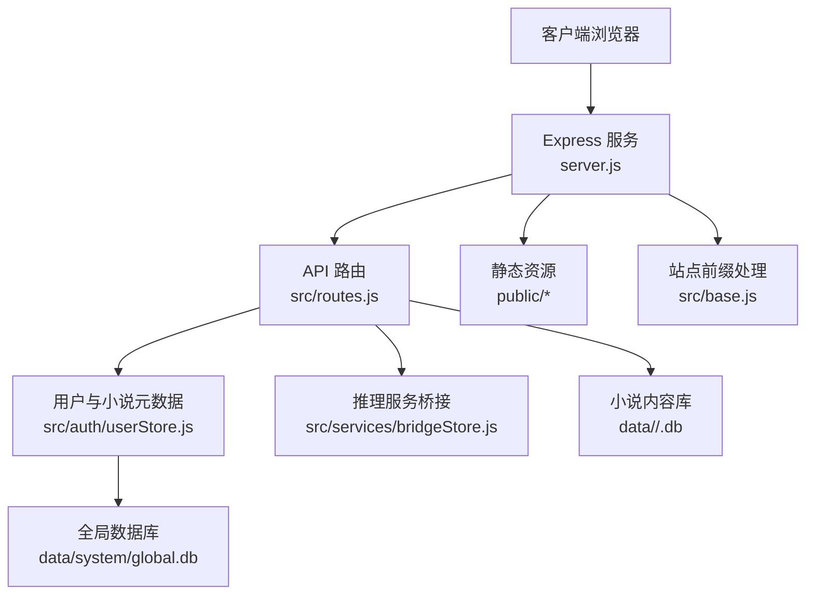
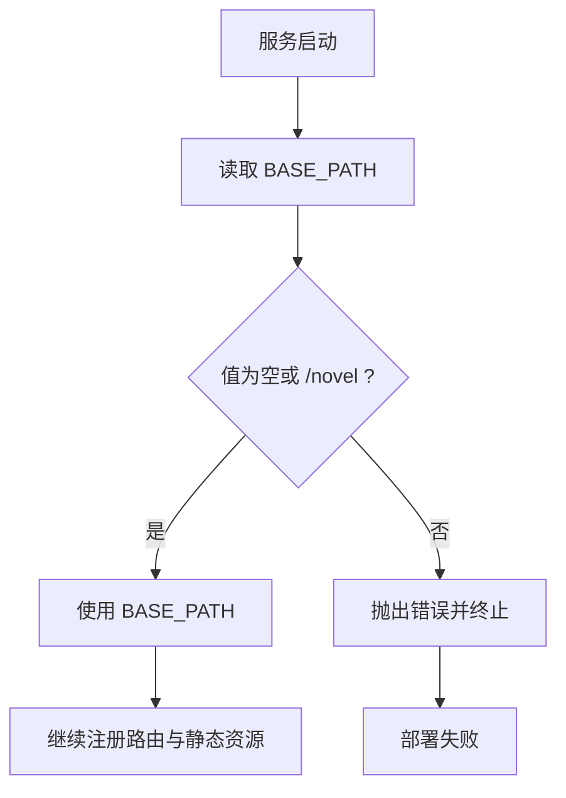

# 部署与运维

<cite>
**本文引用的文件**   
- [README.md](file://README.md)
- [package.json](file://package.json)
- [server.js](file://server.js)
- [src/base.js](file://src/base.js)
- [src/routes.js](file://src/routes.js)
- [src/auth/userStore.js](file://src/auth/userStore.js)
- [src/services/bridgeStore.js](file://src/services/bridgeStore.js)
- [config/writer.json](file://config/writer.json)
- [config/users.json.example](file://config/users.json.example)
- [kill-port.sh](file://kill-port.sh)
</cite>

## 目录
1. [简介](#简介)
2. [项目结构与运行入口](#项目结构与运行入口)
3. [环境配置](#环境配置)
4. [部署流程](#部署流程)
5. [多环境与配置文件管理](#多环境与配置文件管理)
6. [服务启动与端口管理](#服务启动与端口管理)
7. [数据库初始化与数据维护](#数据库初始化与数据维护)
8. [推理服务连接与密钥管理](#推理服务连接与密钥管理)
9. [监控与日志](#监控与日志)
10. [故障排除](#故障排除)
11. [运维脚本与最佳实践](#运维脚本与最佳实践)
12. [结论](#结论)

## 简介
本指南面向生产与测试环境的部署、配置、启动、数据维护、监控与排障。内容基于仓库中的服务端入口、路由、用户与元数据仓库、桥接密钥存储、站点前缀处理、示例种子账号以及端口清理脚本整理而成，重点覆盖：
- 环境变量与配置文件的作用范围
- 首次部署、依赖安装、数据库初始化与服务启动
- 多环境下的挂载前缀、端口、推理服务地址切换
- 日常运维：端口释放、TTS 音频、预览产物、VIP 授权、发布产物
- 常见问题定位思路与可执行命令参考

## 项目结构与运行入口
本项目是 Node.js + Express 服务，默认监听本地端口并对外提供登录页、管理后台、阅读站与 API。核心运行路径如下：
- 进程入口：`server.js`
- 路由与业务接口：`src/routes.js`
- 站点挂载前缀与路径工具：`src/base.js`
- 多用户元数据与 VIP 授权：`src/auth/userStore.js`
- 推理服务桥接密钥与连接状态：`src/services/bridgeStore.js`
- 示例种子账号模板：`config/users.json.example`
- 写作器相关配置示例：`config/writer.json`



**图表来源**
- [server.js:1-64](file://server.js#L1-L64)
- [src/routes.js:1-800](file://src/routes.js#L1-L800)
- [src/base.js:1-42](file://src/base.js#L1-L42)
- [src/auth/userStore.js:1-501](file://src/auth/userStore.js#L1-L501)
- [src/services/bridgeStore.js:1-221](file://src/services/bridgeStore.js#L1-L221)

**章节来源**
- [README.md:166-202](file://README.md#L166-L202)
- [server.js:1-64](file://server.js#L1-L64)

## 环境配置
### 关键环境变量
| 变量 | 作用 | 默认值或行为 | 说明 |
| --- | --- | --- | --- |
| `PORT` | 服务监听端口 | `3400` | 通过 `process.env.PORT || 3400` 生效 |
| `BASE_PATH` | 站点挂载前缀 | `/novel` | 仅允许空串或 `/novel`；空串表示挂在根路径 |
| `NOVEL_LLM_MODEL` | 模型名称 | 未设置时由桥接链路决定 | 用于工具上下文中的模型标识 |
| `NOVEL_LLM_TEMPERATURE` | 生成温度 | `0.7` | 数值类型 |
| `NOVEL_LLM_MAX_TOKENS` | 最大 token | `16384` | 数值类型 |
| `AIBRIDGE_URL` | 推理服务地址 | 由桥接配置或控制台启用项决定 | 实际生效优先级见“推理服务连接与密钥管理” |

**章节来源**
- [server.js:20-20](file://server.js#L20-L20)
- [src/base.js:17-28](file://src/base.js#L17-L28)
- [src/routes.js:55-65](file://src/routes.js#L55-L65)
- [src/services/bridgeStore.js:185-199](file://src/services/bridgeStore.js#L185-L199)

### 依赖与环境要求
- Node.js 运行时（项目使用 ES Module）
- npm 包管理器
- SQLite 支持（better-sqlite3）
- TTS 能力依赖微软边缘语音接口（msedge-tts）
- 可选：aibridge 推理服务（OpenAI 兼容接口）

**章节来源**
- [package.json:1-29](file://package.json#L1-L29)
- [README.md:195-202](file://README.md#L195-L202)

## 部署流程
### 服务器准备
1. 准备一台可访问公网或内网推理服务的机器。
2. 安装 Node.js 与 npm。
3. 创建项目目录并拉取代码。
4. 确保 `data/` 目录可写，用于存放全局数据库、小说内容库、TTS 音频与桥接密钥。

### 依赖安装
在项目根目录执行：
```bash
npm install
```

**章节来源**
- [README.md:155-164](file://README.md#L155-L164)
- [package.json:7-10](file://package.json#L7-L10)

### 数据库初始化
首次启动会自动完成以下操作：
- 创建 `data/system/global.db`
- 建表：用户、小说登记、VIP 授权、预览登记等
- 若用户表为空，从 `config/users.json` 播种超管账号
- 迁移 `data/` 下已有小说 `.db` 到按用户分目录结构

注意：
- 种子账号来自 `config/users.json`，不是 `users.json.example`。
- 首次启动后密码以数据库为准，修改密码走控制台重置。

**章节来源**
- [src/auth/userStore.js:47-114](file://src/auth/userStore.js#L47-L114)
- [src/auth/userStore.js:380-422](file://src/auth/userStore.js#L380-L422)
- [src/auth/userStore.js:442-481](file://src/auth/userStore.js#L442-L481)
- [README.md:29-31](file://README.md#L29-L31)

### 服务启动
开发或生产均可通过 npm 脚本启动：
```bash
npm start
```
该命令等价于：
```bash
node server.js
```

启动后会输出：
- 监听端口
- 挂载前缀
- 登录入口
- 管理页面
- 阅读入口
- 已播种账号数与存量小说迁移数
- 当前推理服务链路与上游模型信息

**章节来源**
- [package.json:7-10](file://package.json#L7-L10)
- [server.js:55-63](file://server.js#L55-L63)

## 多环境与配置文件管理
### 站点挂载前缀
- 默认挂载前缀为 `/novel`，本地与线上 URL 一致，避免代理后才暴露的问题。
- 可通过 `BASE_PATH` 设置为空串表示挂在根路径。
- 非空且不为 `/novel` 的值会在启动时报错，防止上线后书页 404。



**图表来源**
- [src/base.js:17-28](file://src/base.js#L17-L28)

**章节来源**
- [src/base.js:1-42](file://src/base.js#L1-L42)

### 示例配置文件
- `config/users.json.example`：示例种子账号模板，包含用户名、密码、角色。
- `config/writer.json`：写作器相关配置示例，例如是否自动发布。

部署时需将示例文件复制为真实配置文件并按需修改：
```bash
cp config/users.json.example config/users.json
```

**章节来源**
- [config/users.json.example:1-4](file://config/users.json.example#L1-L4)
- [config/writer.json:1-8](file://config/writer.json#L1-L8)
- [src/auth/userStore.js:23-23](file://src/auth/userStore.js#L23-L23)

## 服务启动与端口管理
### 默认端口
服务默认监听 `3400`，可通过 `PORT` 环境变量覆盖。

### 端口冲突处理
仓库提供端口清理脚本 `kill-port.sh`，用法：
```bash
./kill-port.sh <端口号> [端口号2 ...]
```
该脚本会查找占用端口的进程并强制结束，适合本地调试或重启服务前清理残留进程。

**章节来源**
- [server.js:20-20](file://server.js#L20-L20)
- [kill-port.sh:1-24](file://kill-port.sh#L1-L24)

## 数据库初始化与数据维护
### 全局数据库
- 路径：`data/system/global.db`
- 用途：用户、小说登记、VIP 授权、预览登记等元数据
- 特点：首次启动幂等建表；用户表为空时从种子文件播种；支持存量小说迁移

### 小说内容库
- 路径：`data/<userId>/<uuid>.db`
- 用途：每本小说的章节、大纲、正文、分部等
- 访问方式：统一通过 WriterTool，不直接裸改 SQL

### 数据维护建议
- 定期备份 `data/system/global.db` 与 `data/` 下所有 `.db` 文件。
- 删除整本小说前，先确认暂存预览目录已被清理。
- 若发现小说文件存在但管理页看不到，可使用对账接口恢复登记。

**章节来源**
- [src/auth/userStore.js:18-23](file://src/auth/userStore.js#L18-L23)
- [src/auth/userStore.js:47-114](file://src/auth/userStore.js#L47-L114)
- [src/auth/userStore.js:380-422](file://src/auth/userStore.js#L380-L422)
- [src/auth/userStore.js:442-481](file://src/auth/userStore.js#L442-L481)
- [src/routes.js:678-684](file://src/routes.js#L678-L684)

## 推理服务连接与密钥管理
### 生效优先级
推理服务连接的生效优先级为：
1. 控制台启用项
2. 环境变量
3. `.env`

若停用控制台启用项或删除正在生效的条目，会自动回落到环境变量或 `.env`，不会出现“切没了就没密钥”的状态。

### 密钥存储
- 明文密钥保存在 `data/system/bridge.json`
- 写入权限设为 `0600`
- 对外接口只返回密钥前缀，不回显明文

### 启动探测
服务启动时会打印三条桥接日志：
- 正文生成链路来源
- 上游模型缓存信息
- 桥接侧 whoami 探测结果

**章节来源**
- [README.md:71-81](file://README.md#L71-L81)
- [src/services/bridgeStore.js:1-13](file://src/services/bridgeStore.js#L1-L13)
- [src/services/bridgeStore.js:85-99](file://src/services/bridgeStore.js#L85-L99)
- [src/services/bridgeStore.js:185-199](file://src/services/bridgeStore.js#L185-L199)

## 监控与日志
### 启动日志
启动日志包含：
- 服务地址
- 挂载前缀
- 登录与管理入口
- 已播种账号与迁移小说数量
- 推理服务链路与上游模型

### 长任务进度
- 长任务通过 SSE 推送进度
- 进度通道按会话 ID 缓冲近期事件，避免订阅晚于发布的丢消息
- 心跳间隔用于检测连接存活

### 限流与防护
- 阅读器公开接口有独立限流
- TTS 合成接口有更高额度限制
- 删除类操作需要二次确认
- API 响应会脱敏敏感字段

**章节来源**
- [server.js:55-63](file://server.js#L55-L63)
- [src/routes.js:573-627](file://src/routes.js#L573-L627)
- [src/routes.js:289-306](file://src/routes.js#L289-L306)
- [src/routes.js:45-53](file://src/routes.js#L45-L53)
- [src/routes.js:67-95](file://src/routes.js#L67-L95)

## 故障排除
### 无法登录
- 检查 `config/users.json` 是否存在且格式正确
- 检查 `data/system/global.db` 是否已创建
- 确认首个超管账号是否成功播种

**章节来源**
- [src/auth/userStore.js:380-422](file://src/auth/userStore.js#L380-L422)

### 页面 404 或路径异常
- 检查 `BASE_PATH` 是否为空或 `/novel`
- 检查 nginx 是否原样转发前缀
- 检查书页内部挂载点是否与外部前缀一致

**章节来源**
- [src/base.js:17-28](file://src/base.js#L17-L28)
- [server.js:25-36](file://server.js#L25-L36)

### 推理服务不可用
- 检查桥接地址是否合法
- 检查 API Key 是否已启用
- 查看启动日志中的桥接探测结果
- 使用控制台“测活”功能验证可达性

**章节来源**
- [src/services/bridgeStore.js:185-199](file://src/services/bridgeStore.js#L185-L199)
- [src/services/bridgeStore.js:202-211](file://src/services/bridgeStore.js#L202-L211)
- [README.md:71-81](file://README.md#L71-L81)

### TTS 合成失败
- 检查音色是否在白名单
- 检查语速是否在允许范围
- 检查章节正文是否存在
- 查看合成失败的具体原因

**章节来源**
- [src/routes.js:430-513](file://src/routes.js#L430-L513)

### 端口被占用
- 使用 `kill-port.sh` 清理占用进程
- 确认是否有旧进程未退出
- 更换 `PORT` 环境变量

**章节来源**
- [kill-port.sh:1-24](file://kill-port.sh#L1-L24)
- [server.js:20-20](file://server.js#L20-L20)

## 运维脚本与最佳实践
### 端口管理
- 使用 `kill-port.sh` 清理指定端口
- 建议在重启服务前先执行
- 生产环境建议使用进程管理器（如 systemd、pm2）管理生命周期

### 数据维护
- 定期备份 `data/system/global.db` 与 `data/` 下所有 `.db` 文件
- 清理过期预览产物：系统默认保留 24 小时
- 清理 TTS 音频：根据磁盘空间与访问频率制定淘汰策略

### 发布与预览
- 发布前使用预览功能检查修改报告
- 发布后核对磁盘上的书页文件
- 同一账号下书名重复会导致发布跳过清理，需先改名

### 安全与权限
- 不要将 `data/system/bridge.json` 提交到版本库
- 不要将 `config/users.json` 中的明文密码泄露
- 生产环境关闭直连端口，仅开放反向代理端口

**章节来源**
- [src/auth/userStore.js:351-378](file://src/auth/userStore.js#L351-L378)
- [README.md:33-41](file://README.md#L33-L41)
- [src/services/bridgeStore.js:1-13](file://src/services/bridgeStore.js#L1-L13)

## 结论
本指南覆盖了 AI 小说平台的部署与运维关键点：
- 明确环境变量与配置文件职责
- 给出从零开始的部署步骤
- 解释多环境挂载前缀与推理服务切换
- 提供数据库初始化、数据维护与日志监控思路
- 列出常见故障与排查命令

实际生产部署时，请结合反向代理、进程管理、备份策略与安全加固方案，形成完整的上线与运维流程。