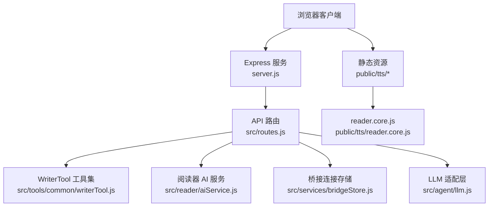
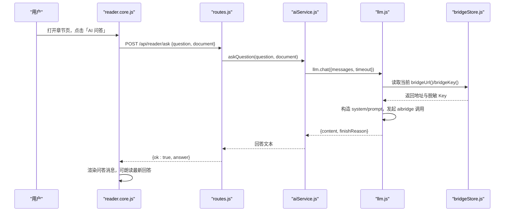
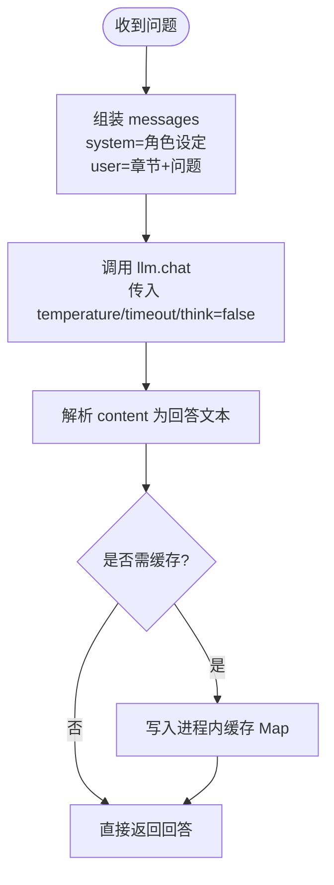
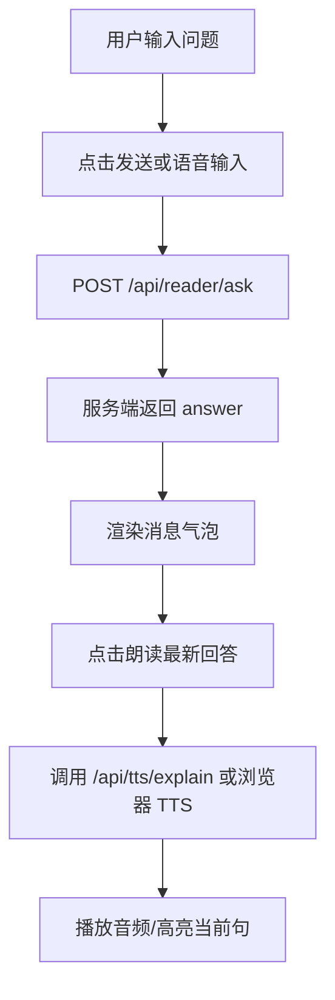
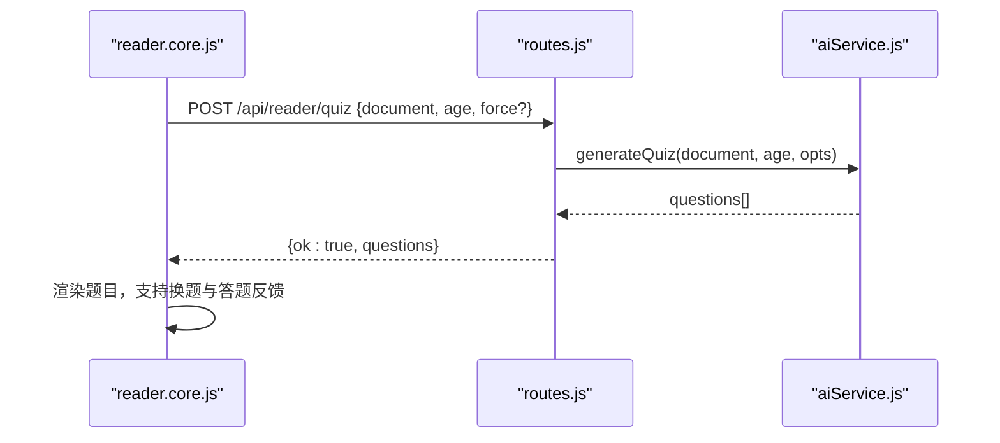
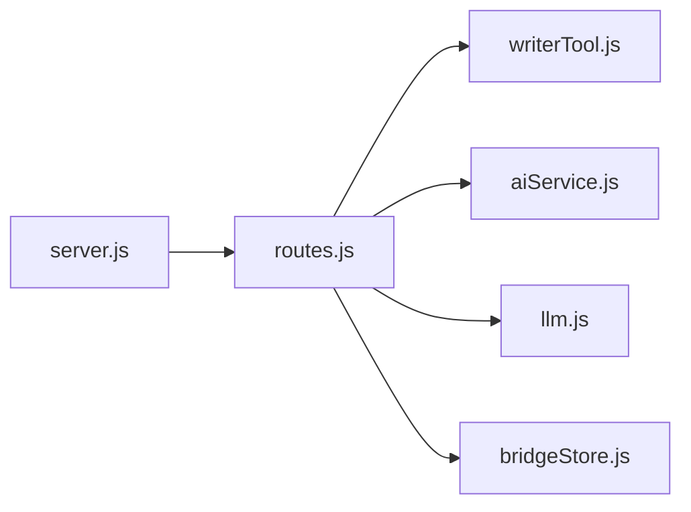

# AI 交互问答系统

<cite>
**本文引用的文件**   
- [README.md](file://README.md)
- [server.js](file://server.js)
- [src/routes.js](file://src/routes.js)
- [src/agent/llm.js](file://src/agent/llm.js)
- [src/services/bridgeStore.js](file://src/services/bridgeStore.js)
- [src/tools/common/writerTool.js](file://src/tools/common/writerTool.js)
- [src/reader/aiService.js](file://src/reader/aiService.js)
- [public/tts/reader.core.js](file://public/tts/reader.core.js)
- [package.json](file://package.json)
</cite>

## 目录
1. [引言](#引言)
2. [项目结构](#项目结构)
3. [核心组件](#核心组件)
4. [架构总览](#架构总览)
5. [详细组件分析](#详细组件分析)
6. [依赖关系分析](#依赖关系分析)
7. [性能与扩展性](#性能与扩展性)
8. [故障排查指南](#故障排查指南)
9. [结论](#结论)
10. [附录：API 接口规范与配置](#附录api-接口规范与配置)

## 引言
本技术文档面向“AI 交互问答系统”，围绕以下目标展开：
- 问题理解与回答机制：自然语言处理、上下文保持、对话状态管理。
- AI 模型集成：LLM 调用、提示词工程、响应流式处理（含进度通道）。
- 问答界面设计：消息展示、语音朗读、输入方式（文本/语音）。
- 章节内容关联问答、阅读理解测试、知识巩固等学习功能。
- 错误处理、性能优化与安全考虑。
- API 接口规范、配置参数与扩展开发指南。

该系统以 Node.js + Express 为后端，SQLite 作为内容库，Web Speech API 提供 TTS 能力，并通过 aibridge 桥接服务接入上游 LLM；前端阅读页内置悬浮工具栏，支持朗读、章节导航、AI 问答、词汇讲解与章节测试。

**章节来源**
- [README.md:1-202](file://README.md#L1-L202)

## 项目结构
系统由服务端入口、路由与业务模块、LLM 适配层、阅读器前端资源组成：
- 服务端入口负责静态资源挂载、前缀平移、鉴权与会话初始化。
- 路由层暴露 REST 接口，承载登录、小说管理、发布、预览、TTS、读者 AI 能力、长任务进度 SSE 等。
- LLM 适配层封装 aibridge 调用、健康探测、密钥与地址切换。
- 阅读器前端在已发布书页中加载 reader.core.js，实现朗读、问答面板、学习模式与测试。



**图表来源**
- [server.js:1-64](file://server.js#L1-L64)
- [src/routes.js:1-800](file://src/routes.js#L1-L800)
- [src/agent/llm.js:1-205](file://src/agent/llm.js#L1-L205)
- [src/services/bridgeStore.js:1-221](file://src/services/bridgeStore.js#L1-L221)
- [public/tts/reader.core.js:1-800](file://public/tts/reader.core.js#L1-L800)

**章节来源**
- [server.js:1-64](file://server.js#L1-L64)
- [README.md:166-202](file://README.md#L166-L202)

## 核心组件
- LLM 适配层：统一封装 aibridge 的 chat、health、whoami 探测，支持运行时密钥与地址覆盖。
- 桥接连接存储：持久化多条 aibridge Key，支持启用/停用、地址覆盖、探测结果缓存。
- WriterTool：章节增删改、批量加章、区间补大纲、字数治理、设定说明生成等复杂工作流。
- 阅读器 AI 服务：章节测试、句子讲解、生词挑选、自由问答，带并发队列、去重与缓存。
- 阅读器前端：朗读引擎（浏览器 TTS / 服务端 mp3）、AI 问答面板、学习设置、章节导航。

**章节来源**
- [src/agent/llm.js:1-205](file://src/agent/llm.js#L1-L205)
- [src/services/bridgeStore.js:1-221](file://src/services/bridgeStore.js#L1-L221)
- [src/tools/common/writerTool.js:1-800](file://src/tools/common/writerTool.js#L1-L800)
- [src/reader/aiService.js:1-253](file://src/reader/aiService.js#L1-L253)
- [public/tts/reader.core.js:1-800](file://public/tts/reader.core.js#L1-L800)

## 架构总览
系统采用“前端阅读页 + 服务端 API + LLM 桥接”的分层架构：
- 前端通过 reader.core.js 构建朗读与问答 UI，并调用服务端 /api/reader/* 与 /api/tts/*。
- 服务端 routes.js 统一鉴权、限流、租户隔离与数据校验，将请求分发到 WriterTool、ReaderAI 或 LLM 适配层。
- LLM 适配层通过 bridgeStore 动态选择当前生效的 aibridge 地址与 Key，完成实际推理调用。



**图表来源**
- [public/tts/reader.core.js:114-128](file://public/tts/reader.core.js#L114-L128)
- [src/routes.js:352-390](file://src/routes.js#L352-L390)
- [src/reader/aiService.js:225-236](file://src/reader/aiService.js#L225-L236)
- [src/agent/llm.js:102-171](file://src/agent/llm.js#L102-L171)
- [src/services/bridgeStore.js:37-66](file://src/services/bridgeStore.js#L37-L66)

## 详细组件分析

### 问题理解与回答机制
- 自然语言处理：
  - 章节测试：按章节正文与年龄档生成选择题，使用固定提示词模板，输出 JSON 数组，容错解析。
  - 句子讲解与单词讲解：根据目标语言与年龄档生成解释，关闭思考链以提升吞吐。
  - 生词挑选：从课文挑出值得积累的词，过滤非原文词，按长度降序避免重叠标注。
  - 自由问答：基于章节内容的开放式问答，不缓存但受并发保护。
- 上下文保持：
  - 章节测试与生词挑选以“章节正文 + 年龄”为键，保证内容与受众一致。
  - 单词讲解以“词 + 年龄 + 语言”为键，原句仅首次生成时作为语境，不进缓存键，实现跨章节复用。
- 对话状态管理：
  - 阅读器前端维护问答面板消息列表、最近一次回答用于朗读。
  - 服务端对自由问答不做会话记忆，每次独立请求；如需多轮，可在前端维护上下文并拼接至 user 消息。



**图表来源**
- [src/reader/aiService.js:225-236](file://src/reader/aiService.js#L225-L236)
- [src/reader/aiService.js:62-77](file://src/reader/aiService.js#L62-L77)
- [src/agent/llm.js:102-171](file://src/agent/llm.js#L102-L171)

**章节来源**
- [src/reader/aiService.js:1-253](file://src/reader/aiService.js#L1-L253)
- [public/tts/reader.core.js:114-128](file://public/tts/reader.core.js#L114-L128)

### AI 模型集成（LLM 调用、提示词工程、响应流式处理）
- LLM 调用：
  - 将 messages 拆分为 system 与 prompt，映射到 aibridge 请求体。
  - 支持 temperature、maxTokens、model、think（关闭思考链）、timeout（透传给桥接服务）。
  - 失败时区分超时、网络错误、HTTP 状态码，抛出结构化错误。
- 提示词工程：
  - 章节测试、句子讲解、单词讲解、生词挑选均有明确提示词模板，强调输出格式（JSON 数组/对象），并针对少儿读者调整语气与难度。
- 响应流式处理：
  - 当前 LLM 适配层默认 stream:false，返回完整 content。
  - 长任务进度通过 SSE 通道 /api/progress 推送逐章日志，前端订阅后显示遮罩与计时。

```mermaid
classDiagram
class LLM {
+checkReachable(timeoutMs)
+chat({messages,model,temperature,maxTokens,timeout,think})
}
class BridgeStore {
+initBridge()
+listPublic()
+activate(id)
+setUrl(url)
+test(id)
}
LLM --> BridgeStore : "读取 bridgeUrl()/bridgeKey()"
```

**图表来源**
- [src/agent/llm.js:67-171](file://src/agent/llm.js#L67-L171)
- [src/services/bridgeStore.js:85-99](file://src/services/bridgeStore.js#L85-L99)

**章节来源**
- [src/agent/llm.js:1-205](file://src/agent/llm.js#L1-L205)
- [src/services/bridgeStore.js:1-221](file://src/services/bridgeStore.js#L1-L221)
- [src/routes.js:573-627](file://src/routes.js#L573-L627)

### 问答界面设计（消息展示、语音朗读、输入方式）
- 消息展示：
  - 问答面板包含标题、消息区、输入框、发送按钮与麦克风按钮。
  - 支持朗读最新回答，便于听读结合。
- 语音朗读：
  - 双引擎：浏览器 Web Speech API 与服务端 mp3 合成。
  - 句间停顿可调，自动滚动跟随，支持连续朗读下一章、定时关闭、息屏省电与屏幕常亮。
- 输入方式：
  - 文本输入为主，麦克风按钮触发语音识别（依赖浏览器能力）。
  - 若服务端合成失败，自动回落到浏览器 TTS，并提示原因。



**图表来源**
- [public/tts/reader.core.js:114-128](file://public/tts/reader.core.js#L114-L128)
- [src/routes.js:456-513](file://src/routes.js#L456-L513)

**章节来源**
- [public/tts/reader.core.js:1-800](file://public/tts/reader.core.js#L1-L800)
- [src/routes.js:456-513](file://src/routes.js#L456-L513)

### 章节内容关联问答、阅读理解测试、知识巩固
- 章节内容关联问答：
  - 自由问答接口接受 question 与 document（章节正文），系统依据章节内容作答。
- 阅读理解测试：
  - 章节测试接口按正文与年龄档生成选择题，支持“换一组新题”强制刷新缓存。
- 知识巩固：
  - 生词挑选与单词讲解提供词汇层面的巩固；讲解文本可朗读，增强多模态学习体验。



**图表来源**
- [src/routes.js:359-367](file://src/routes.js#L359-L367)
- [src/reader/aiService.js:126-152](file://src/reader/aiService.js#L126-L152)

**章节来源**
- [src/reader/aiService.js:1-253](file://src/reader/aiService.js#L1-L253)
- [src/routes.js:352-390](file://src/routes.js#L352-L390)

### 错误处理、性能优化与安全考虑
- 错误处理：
  - LLM 调用失败区分超时、网络错误、HTTP 状态码，抛出 connectionError 标记供上层熔断。
  - TTS 合成失败返回具体阶段与原因，前端自动回退到浏览器 TTS。
  - 删除类操作要求 confirm:"OK"，防止误删。
- 性能优化：
  - 阅读器 AI 服务有全局并发上限、队列上限、在途请求去重与进程内缓存。
  - 长任务按书互斥，避免并发压垮推理服务。
  - 进度通道 SSE 缓冲近期事件，避免首包丢失。
- 安全考虑：
  - API 响应净化，屏蔽路径、IP、密钥等敏感信息。
  - VIP 授权实时校验，未授权返回无权页。
  - 桥接 Key 明文只存本地文件（权限 0600），对外仅返回前缀。

**章节来源**
- [src/agent/llm.js:143-171](file://src/agent/llm.js#L143-L171)
- [src/routes.js:67-95](file://src/routes.js#L67-L95)
- [src/routes.js:456-513](file://src/routes.js#L456-L513)
- [src/routes.js:629-637](file://src/routes.js#L629-L637)
- [src/routes.js:1035-1094](file://src/routes.js#L1035-L1094)
- [src/services/bridgeStore.js:1-221](file://src/services/bridgeStore.js#L1-L221)

## 依赖关系分析
- server.js 启动 Express，注册路由，挂载静态资源，初始化用户存储与桥接连接。
- routes.js 集中定义所有 API，依赖 WriterTool、ReaderAI、LLM、BridgeStore。
- writerTool.js 依赖数据库访问、文本工具、字数策略、进度中心。
- aiService.js 依赖 LLM 适配层与持久缓存（词汇、讲解、测试）。
- bridgeStore.js 依赖 LLM 适配层的探测与覆盖能力。



**图表来源**
- [server.js:1-64](file://server.js#L1-L64)
- [src/routes.js:1-800](file://src/routes.js#L1-L800)
- [src/tools/common/writerTool.js:1-800](file://src/tools/common/writerTool.js#L1-L800)
- [src/reader/aiService.js:1-253](file://src/reader/aiService.js#L1-L253)
- [src/agent/llm.js:1-205](file://src/agent/llm.js#L1-L205)
- [src/services/bridgeStore.js:1-221](file://src/services/bridgeStore.js#L1-L221)

**章节来源**
- [server.js:1-64](file://server.js#L1-L64)
- [src/routes.js:1-800](file://src/routes.js#L1-L800)

## 性能与扩展性
- 并发与队列：
  - 阅读器 AI 服务限制最大并发与队列长度，超出即快速失败，避免堆积。
  - 在途请求去重，相同 key 的请求共享一次计算结果。
- 缓存策略：
  - 进程内 Map 缓存不可变结果，按容量淘汰。
  - 持久缓存（词汇、讲解、测试）落库，重启后可复用。
- 长任务与进度：
  - 长任务按书互斥，SSE 进度通道缓冲近期事件，避免丢包。
- 可扩展点：
  - 新增 AI 能力可在 aiService.js 增加函数并在 routes.js 注册端点。
  - 新增 LLM 能力可通过 llm.js 扩展 chat 参数与解析逻辑。
  - 新增 TTS 音色需在 routes.js 白名单中添加。

**章节来源**
- [src/reader/aiService.js:27-77](file://src/reader/aiService.js#L27-L77)
- [src/routes.js:573-627](file://src/routes.js#L573-L627)
- [src/agent/llm.js:102-171](file://src/agent/llm.js#L102-L171)

## 故障排查指南
- LLM 链路不通：
  - 检查桥接服务可达性与 Key 配置，使用 /api/llm-status 或控制台“测活”。
  - 确认 bridgeStore 已 initBridge，启动日志会打印当前链路来源与上游模型。
- TTS 合成失败：
  - 检查音色与语速是否在白名单，章节是否存在正文内容。
  - 查看返回 error 详情，前端会自动回退到浏览器 TTS。
- 删除操作被拒：
  - 确保请求体携带 confirm:"OK"，与管理页输入框口径一致。
- 长任务卡住：
  - 检查按书互斥锁，确认同一本书无并发生成任务。
  - 观察 SSE 进度通道是否有逐章日志。

**章节来源**
- [src/agent/llm.js:67-100](file://src/agent/llm.js#L67-L100)
- [src/services/bridgeStore.js:85-99](file://src/services/bridgeStore.js#L85-L99)
- [src/routes.js:456-513](file://src/routes.js#L456-L513)
- [src/routes.js:629-637](file://src/routes.js#L629-L637)

## 结论
本系统通过清晰的职责分层与严格的错误处理，实现了稳定的 AI 交互问答能力。前端朗读与问答面板提升用户体验，后端通过并发控制、缓存与进度通道保障性能与可观测性。LLM 适配层与桥接连接存储使模型切换与地址覆盖灵活可控。整体架构易于扩展，适合在小说阅读与学习场景中持续演进。

## 附录：API 接口规范与配置

### 阅读器 AI 接口
- POST /api/reader/quiz
  - 请求体：{document, age, force?}
  - 响应：{ok:true, questions[]}
- POST /api/reader/explain
  - 请求体：{sentence, age, lang}
  - 响应：{ok:true, explanation}
- POST /api/reader/vocab
  - 请求体：{document, age}
  - 响应：{ok:true, words[]}
- POST /api/reader/explain-word
  - 请求体：{word, age, lang, context?}
  - 响应：{ok:true, explanation}
- POST /api/reader/word-status
  - 请求体：{words[], age, lang}
  - 响应：{ok:true, have[]}
- POST /api/reader/ask
  - 请求体：{question, document?}
  - 响应：{ok:true, answer}
- POST /api/reader/feedback
  - 请求体：{text}
  - 响应：{ok:true, feedback}

**章节来源**
- [src/routes.js:352-390](file://src/routes.js#L352-L390)
- [src/reader/aiService.js:126-253](file://src/reader/aiService.js#L126-L253)

### TTS 接口
- POST /api/tts/sentence
  - 请求体：{chapterUrl, text, voice, rate}
  - 响应：{ok:true, hash, audioPath, bytes, tailPadMs?}
- POST /api/tts/explain
  - 请求体：{text, voice, rate}
  - 响应：{ok:true, hash, audioPath, bytes, tailPadMs?}

**章节来源**
- [src/routes.js:456-513](file://src/routes.js#L456-L513)

### 长任务进度通道
- GET /api/progress?id=run:<id>
  - 响应：SSE 事件，包含逐章日志与时间戳。

**章节来源**
- [src/routes.js:573-627](file://src/routes.js#L573-L627)

### 配置参数与环境变量
- NOVEL_LLM_MODEL：指定 LLM 模型名。
- NOVEL_LLM_TEMPERATURE：温度参数。
- NOVEL_LLM_MAX_TOKENS：最大 token 数。
- AIBRIDGE_URL：桥接服务地址。
- AIBRIDGE_API_KEY：桥接服务密钥。
- READER_LLM_CONC：阅读器 AI 并发上限。
- READER_LLM_QUEUE：阅读器 AI 队列上限。
- READER_LLM_CACHE：阅读器 AI 进程内缓存上限。
- READER_LLM_TIMEOUT：阅读器 AI 超时（毫秒）。
- READER_VOCAB_TIMEOUT：生词挑选超时（毫秒）。

**章节来源**
- [src/routes.js:55-65](file://src/routes.js#L55-L65)
- [src/agent/llm.js:30-42](file://src/agent/llm.js#L30-L42)
- [src/reader/aiService.js:27-34](file://src/reader/aiService.js#L27-L34)

### 扩展开发指南
- 新增 AI 能力：
  - 在 aiService.js 实现函数，并在 routes.js 注册端点。
  - 在前端 reader.core.js 添加调用与 UI 交互。
- 新增 LLM 能力：
  - 在 llm.js 扩展 chat 参数与解析逻辑，保持与 aibridge 协议一致。
- 新增 TTS 音色：
  - 在 routes.js 白名单中添加音色 ID，确保为微软边缘接口真实存在的音色。

**章节来源**
- [src/reader/aiService.js:1-253](file://src/reader/aiService.js#L1-L253)
- [src/agent/llm.js:102-171](file://src/agent/llm.js#L102-L171)
- [src/routes.js:430-443](file://src/routes.js#L430-L443)