# TTS 文本转语音系统

<cite>
**本文引用的文件**   
- [public/tts/reader.js](file://public/tts/reader.js)
- [public/tts/reader.core.js](file://public/tts/reader.core.js)
- [src/routes.js](file://src/routes.js)
</cite>

## 目录
1. [简介](#简介)
2. [项目结构](#项目结构)
3. [核心组件](#核心组件)
4. [架构总览](#架构总览)
5. [详细组件分析](#详细组件分析)
6. [依赖关系分析](#依赖关系分析)
7. [性能与缓存策略](#性能与缓存策略)
8. [故障排查指南](#故障排查指南)
9. [结论](#结论)

## 简介
本技术文档面向 TTS 文本转语音系统，重点解释双引擎架构：浏览器 Web Speech API 与服务端 mp3 合成。文档覆盖音频文件管理、缓存与预加载机制、句子切分算法、多语言支持、音色选择、语速控制、屏幕唤醒锁、静音保活、定时关闭、Media Session 集成、错误处理与性能优化，并给出实际使用场景与代码路径定位。

## 项目结构
TTS 功能由前端资源与后端路由共同实现：
- 前端入口 reader.js：稳定加载器，带时间戳动态引入 reader.core.js 与样式，避免历史章节页缓存问题。
- 前端核心 reader.core.js：实现正文切句、双引擎朗读、UI 面板、交互手势、学习模式、AI 问答、Media Session、唤醒锁、静音保活、定时关闭等。
- 服务端 routes.js：提供 /api/tts/sentence 与 /api/tts/explain 两个 TTS 接口，负责参数校验、白名单校验、章节存在性校验、调用 ttsSynthesize、落盘与返回音频 URL。

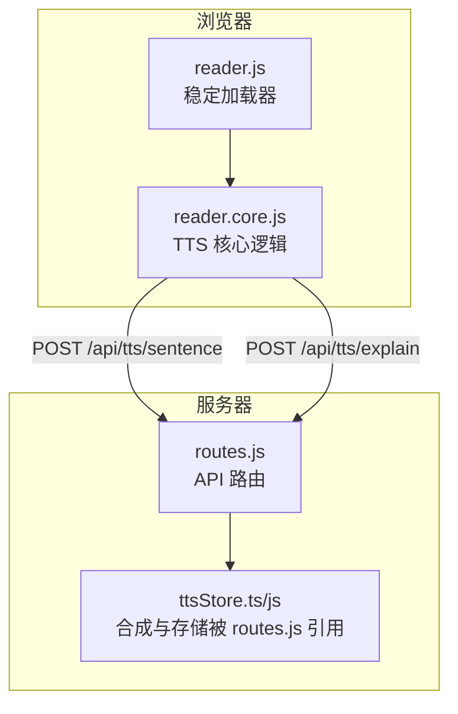

**图表来源**
- [public/tts/reader.js:11-46](file://public/tts/reader.js#L11-L46)
- [public/tts/reader.core.js:18-31](file://public/tts/reader.core.js#L18-L31)
- [src/routes.js:457-513](file://src/routes.js#L457-L513)

**章节来源**
- [public/tts/reader.js:11-46](file://public/tts/reader.js#L11-L46)
- [public/tts/reader.core.js:18-31](file://public/tts/reader.core.js#L18-L31)
- [src/routes.js:457-513](file://src/routes.js#L457-L513)

## 核心组件
- 稳定加载器 reader.js：通过自身脚本 URL 推导站点前缀，注入 CSS 与带时间戳的 reader.core.js；在 core 未就绪时临时隐藏原始章节导航，防止闪烁。
- 阅读核心 reader.core.js：
  - 环境检测与 UI 构建：工具栏、朗读面板、章节面板、设置面板、AI 面板、学习面板。
  - 正文切句：按中文标点切分，跳过 pre/code 与 .tts-skip 元素。
  - 双引擎调度：browser（Web Speech API）与 audio（服务端 mp3）。
  - 播放控制：播放/暂停/从头、进度条跳转、双击或长按触发当前句。
  - 高级特性：屏幕唤醒锁、静音保活、定时关闭、连读下一章、滑动/方向键翻页、Media Session。
  - 学习与 AI：生词标注、词汇讲解、章节测试、AI 问答、拼音模式。
- 服务端路由 routes.js：
  - 限流：基于 IP 的固定窗口限流，TTS 接口更高配额。
  - 白名单：ALLOWED_VOICES 与 ALLOWED_RATES。
  - 章节校验：解析 chapterUrl，解码并防穿越，确认章节 HTML 存在 content 区域。
  - 合成与返回：调用 ttsSynthesize，返回 { ok, hash, audioPath, bytes, tailPadMs }。

**章节来源**
- [public/tts/reader.js:11-46](file://public/tts/reader.js#L11-L46)
- [public/tts/reader.core.js:33-109](file://public/tts/reader.core.js#L33-L109)
- [public/tts/reader.core.js:272-325](file://public/tts/reader.core.js#L272-L325)
- [public/tts/reader.core.js:327-383](file://public/tts/reader.core.js#L327-L383)
- [public/tts/reader.core.js:574-611](file://public/tts/reader.core.js#L574-L611)
- [public/tts/reader.core.js:613-797](file://public/tts/reader.core.js#L613-L797)
- [public/tts/reader.core.js:798-829](file://public/tts/reader.core.js#L798-L829)
- [public/tts/reader.core.js:831-855](file://public/tts/reader.core.js#L831-L855)
- [public/tts/reader.core.js:1089-1127](file://public/tts/reader.core.js#L1089-L1127)
- [public/tts/reader.core.js:1131-1179](file://public/tts/reader.core.js#L1131-L1179)
- [public/tts/reader.core.js:1182-1217](file://public/tts/reader.core.js#L1182-L1217)
- [public/tts/reader.core.js:1219-1299](file://public/tts/reader.core.js#L1219-L1299)
- [public/tts/reader.core.js:1301-1324](file://public/tts/reader.core.js#L1301-L1324)
- [public/tts/reader.core.js:1678-1754](file://public/tts/reader.core.js#L1678-L1754)
- [src/routes.js:289-306](file://src/routes.js#L289-L306)
- [src/routes.js:308-329](file://src/routes.js#L308-L329)
- [src/routes.js:430-454](file://src/routes.js#L430-L454)
- [src/routes.js:457-513](file://src/routes.js#L457-L513)

## 架构总览
TTS 采用“前端双引擎 + 服务端合成”的分层设计：
- 浏览器端优先使用 Web Speech API，零网络延迟、无需额外服务；但在移动端息屏后可能被系统挂起。
- 服务端端点提供高质量 Edge Neural 音色 mp3，适合离线有声、跨设备一致体验；需要网络且受限流保护。
- 前端自动降级：当服务端合成失败时回落到浏览器 TTS，保证可用性。

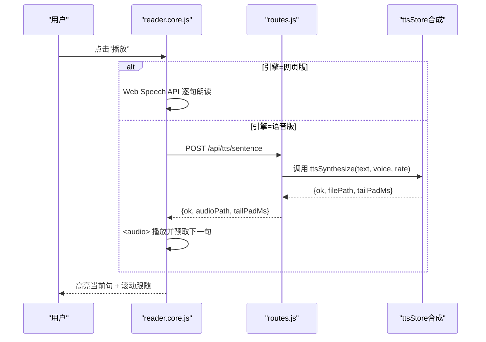

**图表来源**
- [public/tts/reader.core.js:574-611](file://public/tts/reader.core.js#L574-L611)
- [public/tts/reader.core.js:613-797](file://public/tts/reader.core.js#L613-L797)
- [src/routes.js:457-513](file://src/routes.js#L457-L513)

## 详细组件分析

### 双引擎调度与切换
- 引擎状态：ttsEngine ∈ {'browser', 'audio'}，持久化到 localStorage。
- 切换逻辑：switchEngine 会停止当前播放、释放唤醒锁、更新 UI 提示，并保存偏好。
- 默认行为：首次进入根据本地偏好恢复；若为 audio，按钮文案与提示文案同步更新。

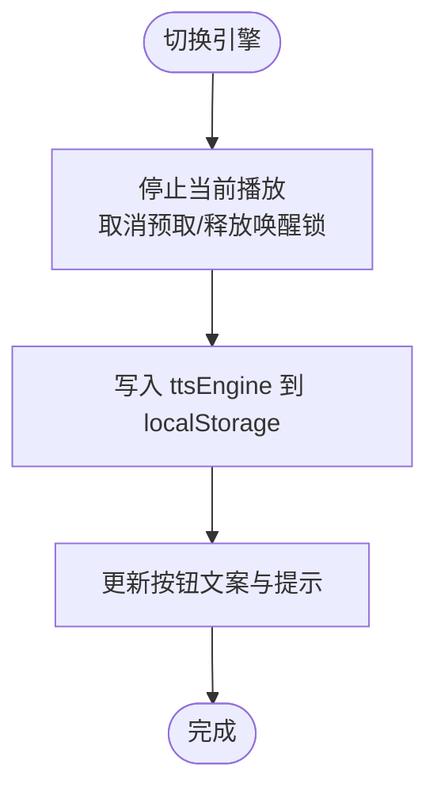

**图表来源**
- [public/tts/reader.core.js:831-855](file://public/tts/reader.core.js#L831-L855)

**章节来源**
- [public/tts/reader.core.js:831-855](file://public/tts/reader.core.js#L831-L855)

### 句子切分与高亮
- 切分规则：以中文句号、感叹号、省略号、分号等为断点，合并尾部标点；跳过 pre/code 与 .tts-skip 节点。
- DOM 改造：将每个句子包裹为 .tts-sentence span，便于高亮与滚动定位。
- 高亮与滚动：playing 时标记 reading，已读完标记 read；滚动到当前句 center。

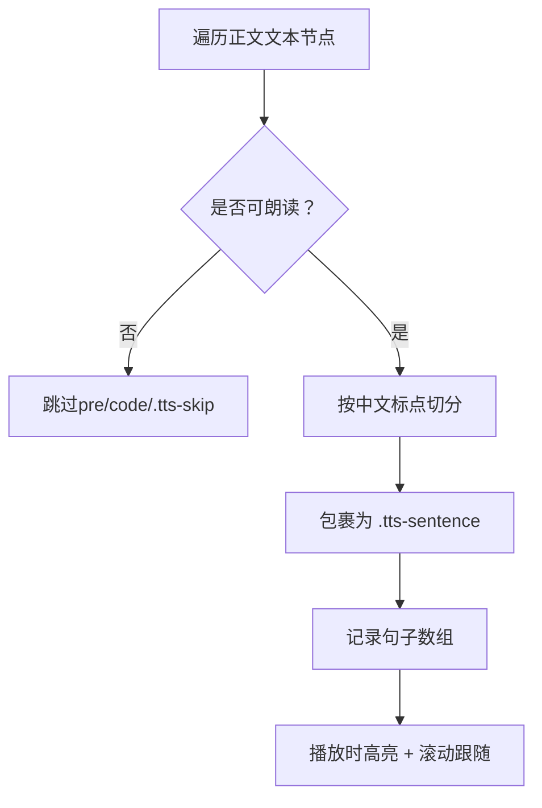

**图表来源**
- [public/tts/reader.core.js:272-325](file://public/tts/reader.core.js#L272-L325)
- [public/tts/reader.core.js:502-511](file://public/tts/reader.core.js#L502-L511)

**章节来源**
- [public/tts/reader.core.js:272-325](file://public/tts/reader.core.js#L272-L325)
- [public/tts/reader.core.js:502-511](file://public/tts/reader.core.js#L502-L511)

### 浏览器引擎（Web Speech API）
- 能力检测：不支持时显示提示并退出。
- 语音准备：ensureVoicesReady 触发 voiceschanged，必要时用空 utterance 强制加载。
- 播放流程：创建 SpeechSynthesisUtterance，设置 voice/lang/rate，onend 自动下一句；onerror 中断并提示。
- 唤醒锁与保活：请求 wakeLock（可选），否则保持静音循环保活。

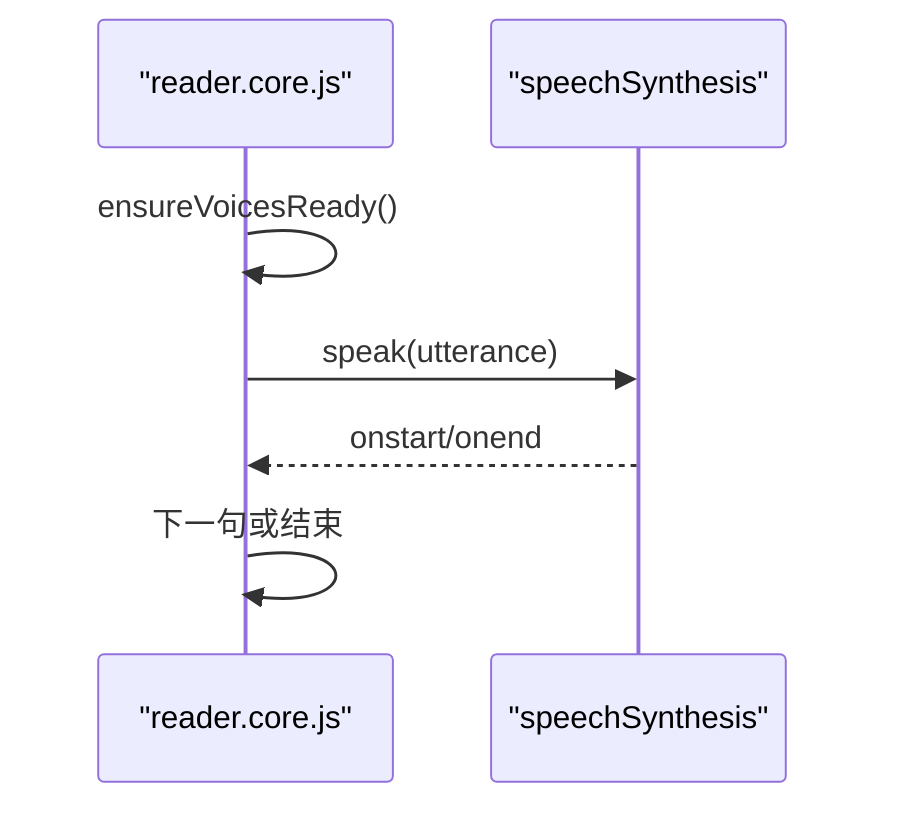

**图表来源**
- [public/tts/reader.core.js:477-492](file://public/tts/reader.core.js#L477-L492)
- [public/tts/reader.core.js:574-611](file://public/tts/reader.core.js#L574-L611)

**章节来源**
- [public/tts/reader.core.js:477-492](file://public/tts/reader.core.js#L477-L492)
- [public/tts/reader.core.js:574-611](file://public/tts/reader.core.js#L574-L611)

### 服务端引擎（mp3 合成与播放）
- 接口：POST /api/tts/sentence，参数 { chapterUrl, text, voice, rate }。
- 服务端校验：必填字段、ALLOWED_VOICES、ALLOWED_RATES、chapterUrl 解析与存在性校验、content 区域存在。
- 合成结果：返回 { ok, hash, audioPath, bytes, tailPadMs }；失败返回 503 并附带 error/fallback。
- 前端播放：
  - 预取下一句：prefetchNext 并发拉取下一句 mp3 并转为 blob，换源时仅切换本地地址，降低卡顿。
  - 句间停顿：timeupdate 判断 curTailPad + sentenceGapMs，避免吃字；ended 兜底补差。
  - 错误降级：合成失败或请求异常时自动切换到 browser 引擎。

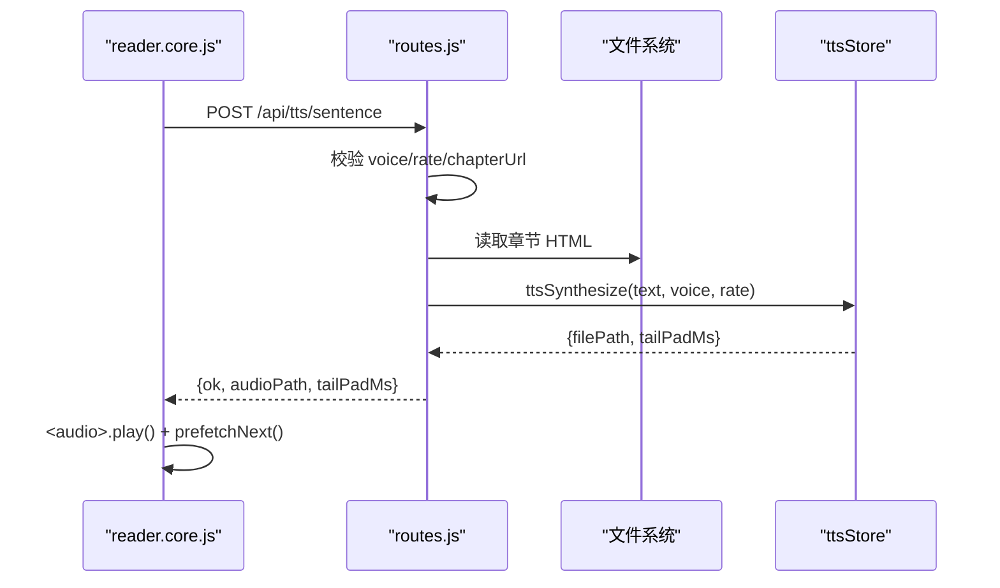

**图表来源**
- [src/routes.js:457-513](file://src/routes.js#L457-L513)
- [public/tts/reader.core.js:704-797](file://public/tts/reader.core.js#L704-L797)

**章节来源**
- [src/routes.js:457-513](file://src/routes.js#L457-L513)
- [public/tts/reader.core.js:704-797](file://public/tts/reader.core.js#L704-L797)

### 音频文件管理与缓存
- 服务端存储：data/tts 目录，对外通过 sitePath('tts-audio', ...) 暴露相对路径，避免被其他路由拦截。
- 前端缓存：
  - 预取命中：prefetchNext 将下一句 mp3 转为 blob URL，减少换源等待。
  - 全章生成：并发 3 路，间隔 200ms，支持 Retry-After 退避重试，失败统计并提示原因。
- 尾静音对齐：tailPadMs 随音频一起缓存，确保跨句时机准确。

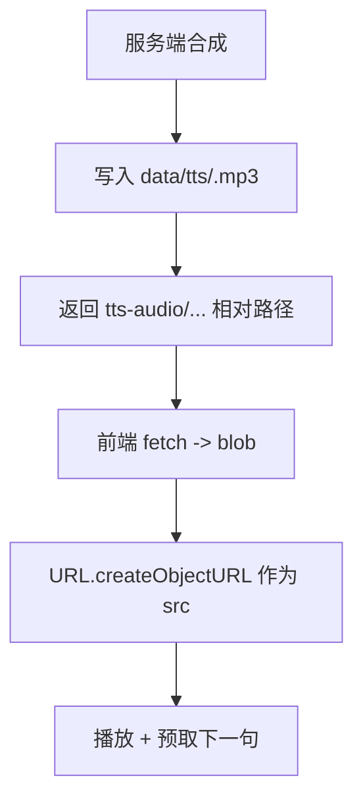

**图表来源**
- [src/routes.js:445-454](file://src/routes.js#L445-L454)
- [public/tts/reader.core.js:719-752](file://public/tts/reader.core.js#L719-L752)
- [public/tts/reader.core.js:1219-1299](file://public/tts/reader.core.js#L1219-L1299)

**章节来源**
- [src/routes.js:445-454](file://src/routes.js#L445-L454)
- [public/tts/reader.core.js:719-752](file://public/tts/reader.core.js#L719-L752)
- [public/tts/reader.core.js:1219-1299](file://public/tts/reader.core.js#L1219-L1299)

### 多语言支持与音色选择
- 浏览器侧：loadVoices 过滤出 MeiJia/TingTing/Google 普通话/台湾等常用音色；edgeVoice 映射到 Edge Neural ID（如 zh-CN-XiaoxiaoNeural、zh-TW-HsiaoChenNeural）。
- 服务端白名单：ALLOWED_VOICES 限定可用音色集合，含简中、繁中、英文、日文。
- 讲解音频：langToVoice 根据学习语言选择对应 Edge Neural 音色与 BCP-47 标签。

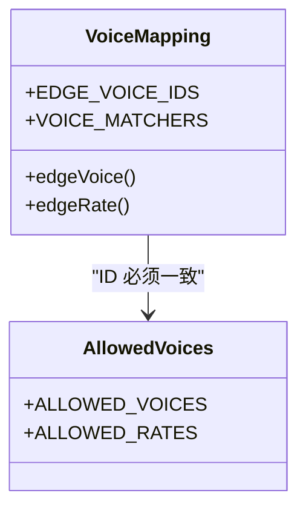

**图表来源**
- [public/tts/reader.core.js:1089-1127](file://public/tts/reader.core.js#L1089-L1127)
- [public/tts/reader.core.js:1131-1179](file://public/tts/reader.core.js#L1131-L1179)
- [public/tts/reader.core.js:1678-1691](file://public/tts/reader.core.js#L1678-L1691)
- [src/routes.js:430-443](file://src/routes.js#L430-L443)

**章节来源**
- [public/tts/reader.core.js:1089-1127](file://public/tts/reader.core.js#L1089-L1127)
- [public/tts/reader.core.js:1131-1179](file://public/tts/reader.core.js#L1131-L1179)
- [public/tts/reader.core.js:1678-1691](file://public/tts/reader.core.js#L1678-L1691)
- [src/routes.js:430-443](file://src/routes.js#L430-L443)

### 语速控制
- 浏览器引擎：rateEl.value 直接映射到 SpeechSynthesisUtterance.rate。
- 服务端引擎：edgeRate 将下拉值映射为百分比字符串（-20% / +0% / +30% / +50%），服务端 ALLOWED_RATES 校验。

**章节来源**
- [public/tts/reader.core.js:591-595](file://public/tts/reader.core.js#L591-L595)
- [public/tts/reader.core.js:1124-1127](file://public/tts/reader.core.js#L1124-L1127)
- [src/routes.js:443-443](file://src/routes.js#L443-L443)

### 屏幕唤醒锁与静音保活
- 唤醒锁：requestWakeLock/releaseWakeLock 仅在 keepScreenOn 开启时生效；iOS Safari 不支持则静默忽略。
- 静音保活：SILENT_WAV 数据 URI 循环播放，volume=0，用于维持音频会话，防止息屏无声。
- 联动：visibilitychange 回前台时重新校准倒计时与唤醒锁；keepScreenOn 变化时即时放锁或加锁。

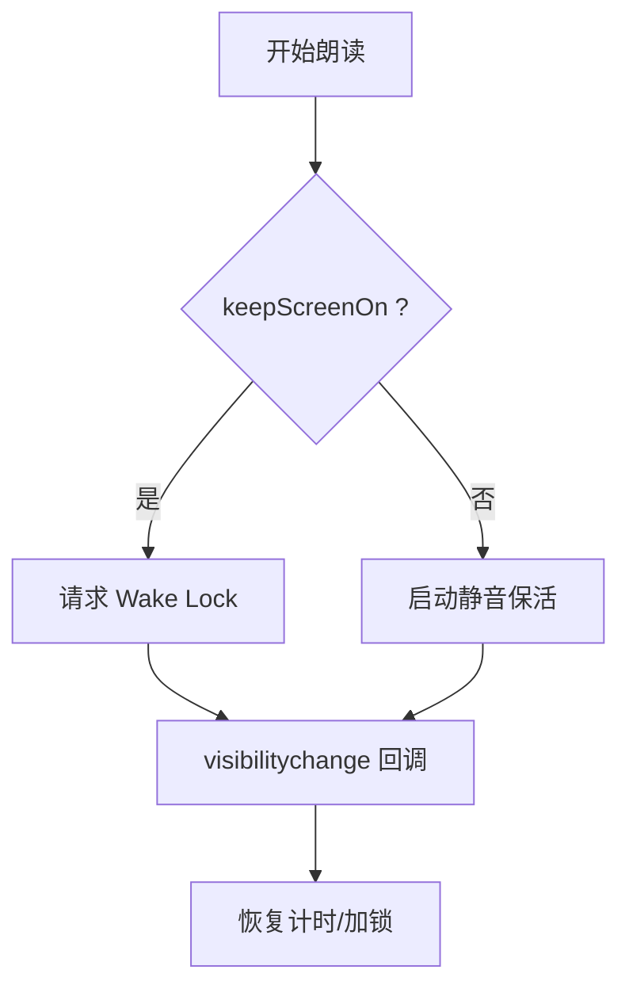

**图表来源**
- [public/tts/reader.core.js:351-383](file://public/tts/reader.core.js#L351-L383)
- [public/tts/reader.core.js:471-475](file://public/tts/reader.core.js#L471-L475)

**章节来源**
- [public/tts/reader.core.js:351-383](file://public/tts/reader.core.js#L351-L383)
- [public/tts/reader.core.js:471-475](file://public/tts/reader.core.js#L471-L475)

### 定时关闭
- 分钟档：armSleep 计算绝对截止时间戳，存入 sessionStorage，每秒刷新剩余时间；到期 fireSleep 停止朗读并清理。
- 本章结束档：armChapterEndSleep 设置标志位，onChapterEnd 消费并停止。
- 跨章续期：goChapter 前清理“本章结束”档；分钟档跨章继续由 sessionStorage 接上。

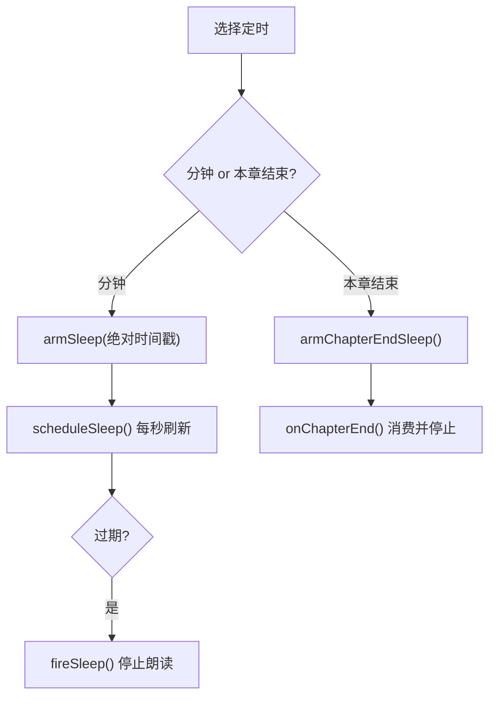

**图表来源**
- [public/tts/reader.core.js:385-468](file://public/tts/reader.core.js#L385-L468)
- [public/tts/reader.core.js:1301-1324](file://public/tts/reader.core.js#L1301-L1324)

**章节来源**
- [public/tts/reader.core.js:385-468](file://public/tts/reader.core.js#L385-L468)
- [public/tts/reader.core.js:1301-1324](file://public/tts/reader.core.js#L1301-L1324)

### Media Session 集成
- 元数据：title/artist/album 设置。
- 动作：play/pause/previoustrack/nexttrack/seekto 映射到当前引擎（audio 或 synth）。
- 兼容性：不支持 mediaSession 时静默忽略。

**章节来源**
- [public/tts/reader.core.js:798-829](file://public/tts/reader.core.js#L798-L829)

### 错误处理与降级
- 浏览器引擎：onerror 中断并提示“语音服务不可用”，建议切换音色。
- 服务端引擎：合成失败或请求异常时 showHint 并 switchEngine('browser')，同时 speakSentence(idx) 重试当前句。
- 全章生成：区分 429/503/网络错误，按 Retry-After 退避重试，失败累计并报告首个错误原因。

**章节来源**
- [public/tts/reader.core.js:601-611](file://public/tts/reader.core.js#L601-L611)
- [public/tts/reader.core.js:777-797](file://public/tts/reader.core.js#L777-L797)
- [public/tts/reader.core.js:1245-1299](file://public/tts/reader.core.js#L1245-L1299)
- [src/routes.js:450-454](file://src/routes.js#L450-L454)

### 使用场景与示例
- 章节朗读：打开页面，点击“朗读”，选择引擎与音色，调节语速与句间停顿，启用“连续朗读下一章”。
- 离线播放：切换到“语音版”，点击“生成全章”，等待服务端合成 mp3，之后可在无网络环境下播放。
- 学习模式：开启学习模式，自动标注生词；点击词语查看讲解；可自动生成缺失词义。
- 定时关闭：选择 15/30/60 分钟或“本章结束”，到点自动停止朗读。
- 媒体控件：锁屏界面或蓝牙耳机控件中播放/暂停/上一首/下一首。

[本节为使用指导，不直接分析具体文件]

## 依赖关系分析
- 前端依赖：
  - reader.js 依赖 reader.core.js 与 reader.css。
  - reader.core.js 依赖浏览器 API：speechSynthesis、navigator.wakeLock、mediaSession、SpeechRecognition（可选）。
  - reader.core.js 依赖服务端接口：/api/tts/sentence、/api/tts/explain。
- 后端依赖：
  - routes.js 依赖 ttsStore（synthesize/computeHash/auditAudio/pruneAudio）、fs、path、crypto。
  - routes.js 定义 ALLOWED_VOICES/ALLOWED_RATES，并对 chapterUrl 做安全解析。

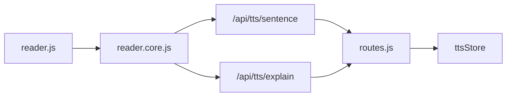

**图表来源**
- [public/tts/reader.js:11-46](file://public/tts/reader.js#L11-L46)
- [public/tts/reader.core.js:704-797](file://public/tts/reader.core.js#L704-L797)
- [src/routes.js:457-513](file://src/routes.js#L457-L513)

**章节来源**
- [public/tts/reader.js:11-46](file://public/tts/reader.js#L11-L46)
- [public/tts/reader.core.js:704-797](file://public/tts/reader.core.js#L704-L797)
- [src/routes.js:457-513](file://src/routes.js#L457-L513)

## 性能与缓存策略
- 预取与 Blob：prefetchNext 提前拉取下一句 mp3 并转为 blob，换源时几乎无等待；只保留一格预取，内存占用可控。
- 句间停顿优化：timeupdate 判定 curTailPad + sentenceGapMs，避免 ended 事件迟到导致吃字；ended 兜底补差。
- 全章生成并发控制：并发 3，间隔 200ms，Retry-After 退避，失败计数与首个错误原因上报。
- 限流保护：TTS 接口 600/min，Reader AI 接口 60/min，按 IP 分桶，超限时返回 Retry-After。
- 资源加载优化：reader.js 长期稳定、reader.core.js 带时间戳，避免历史章节页缓存旧版本。

**章节来源**
- [public/tts/reader.core.js:613-797](file://public/tts/reader.core.js#L613-L797)
- [public/tts/reader.core.js:1219-1299](file://public/tts/reader.core.js#L1219-L1299)
- [src/routes.js:289-306](file://src/routes.js#L289-L306)
- [public/tts/reader.js:11-46](file://public/tts/reader.js#L11-L46)

## 故障排查指南
- 浏览器不支持语音合成：检查浏览器类型（Chrome/Edge/Safari），或切换到“语音版”。
- 息屏无声：开启“屏幕常亮”或保持“静音保活”；iOS Safari 不支持 wakeLock，需保活。
- 服务端合成失败：查看提示中的 error 信息；检查 ALLOWED_VOICES/ALLOWED_RATES 是否匹配；确认章节 URL 正确。
- 全章生成卡住：检查网络与限流（429/503），关注 Retry-After；确认服务端 tts-audio 路径未被反向代理拦截。
- 进度不同步：拖动进度条会暂停朗读并重置高亮；重新播放从目标句开始。

**章节来源**
- [public/tts/reader.core.js:43-54](file://public/tts/reader.core.js#L43-L54)
- [public/tts/reader.core.js:601-611](file://public/tts/reader.core.js#L601-L611)
- [public/tts/reader.core.js:777-797](file://public/tts/reader.core.js#L777-L797)
- [public/tts/reader.core.js:1245-1299](file://public/tts/reader.core.js#L1245-L1299)
- [src/routes.js:450-454](file://src/routes.js#L450-L454)

## 结论
本 TTS 系统通过双引擎架构兼顾了易用性与稳定性：浏览器引擎零依赖、低延迟；服务端引擎音质稳定、可离线播放。配合预取、Blob、尾静音对齐、限流与错误降级，系统在复杂网络与移动设备上仍能提供流畅的朗读体验。结合唤醒锁、静音保活、定时关闭与 Media Session，进一步提升了用户体验与可维护性。