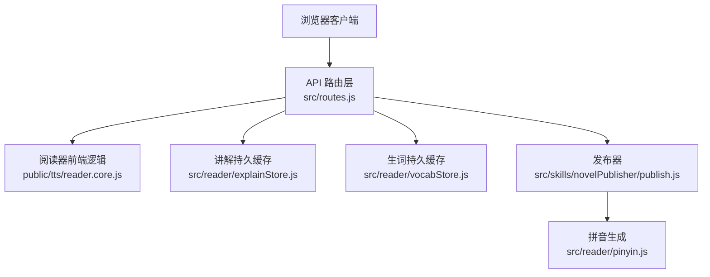
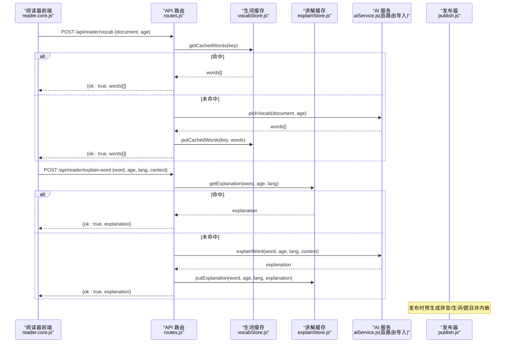
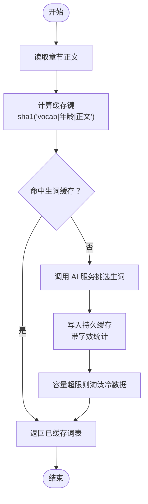
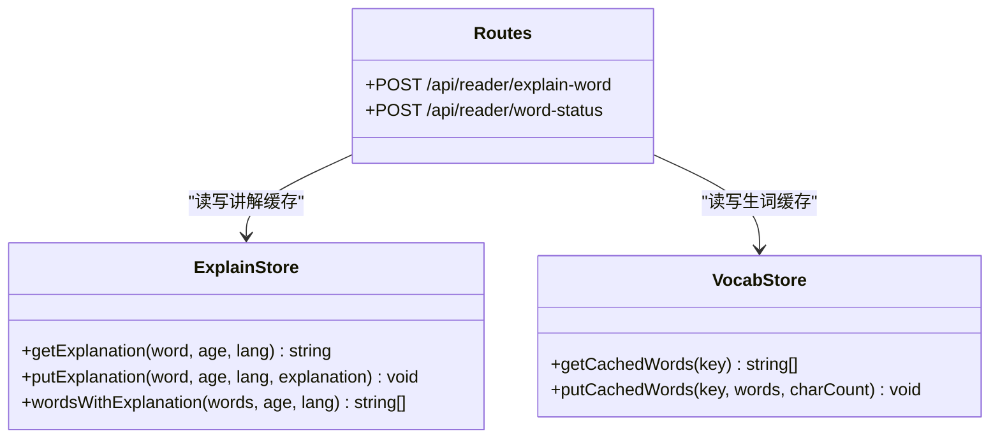
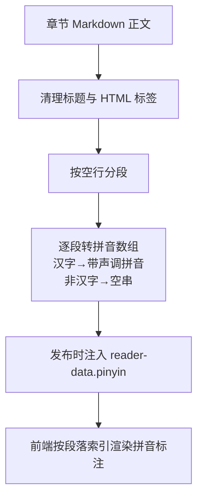
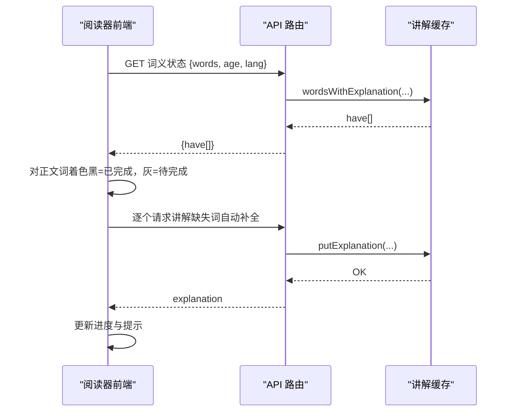
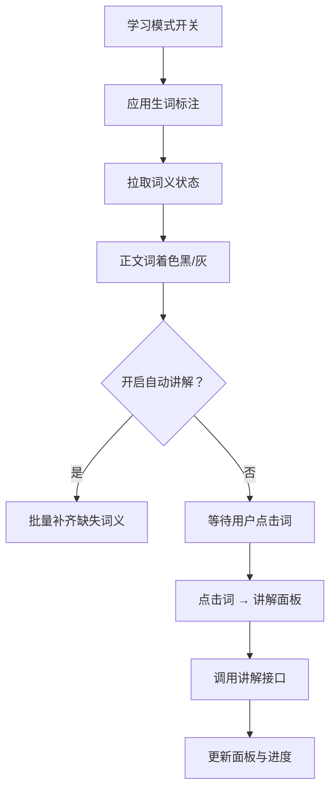
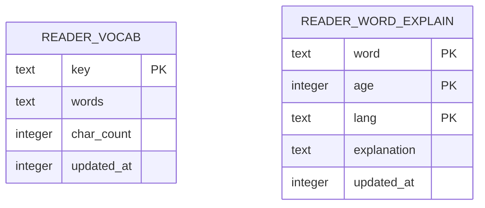
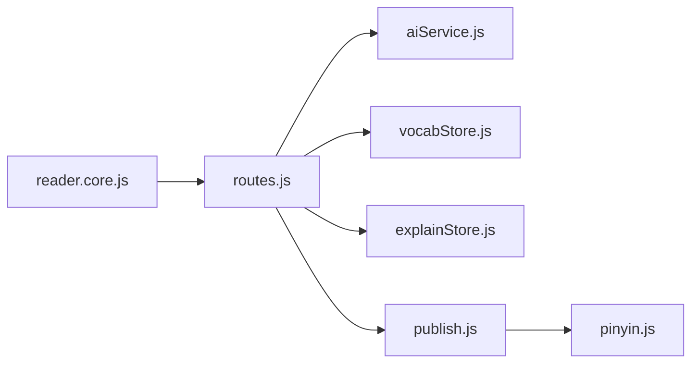

# 词汇学习系统

<cite>
**本文引用的文件**   
- [README.md](file://README.md)
- [package.json](file://package.json)
- [server.js](file://server.js)
- [src/routes.js](file://src/routes.js)
- [src/reader/explainStore.js](file://src/reader/explainStore.js)
- [src/reader/vocabStore.js](file://src/reader/vocabStore.js)
- [src/reader/pinyin.js](file://src/reader/pinyin.js)
- [public/tts/reader.core.js](file://public/tts/reader.core.js)
- [src/skills/novelPublisher/publish.js](file://src/skills/novelPublisher/publish.js)
</cite>

## 目录
1. [引言](#引言)
2. [项目结构](#项目结构)
3. [核心组件](#核心组件)
4. [架构总览](#架构总览)
5. [详细组件分析](#详细组件分析)
6. [依赖关系分析](#依赖关系分析)
7. [性能与可扩展性](#性能与可扩展性)
8. [故障排查指南](#故障排查指南)
9. [结论](#结论)
10. [附录：API 与配置参考](#附录api-与配置参考)

## 引言
本技术文档聚焦“词汇学习系统”，覆盖以下关键能力：
- 生词识别算法：基于年龄分级的词汇筛选、中文文本复杂度评估（通过年龄分级与上下文理解体现）。
- 词汇解释服务：AI 驱动的词汇释义生成、多语言支持、上下文理解。
- 拼音处理：拼音标注、声调处理、段落级数据嵌入。
- 学习辅助：学习进度追踪、词汇记忆曲线（持久缓存 + 状态着色）、复习提醒（自动生成与提示）。
- 前端界面与用户体验：阅读模式、悬浮工具栏、章节测试、TTS 朗读。
- 数据持久化：全局数据库中的生词表与讲解缓存、有界淘汰策略。
- 配置选项、API 接口与扩展点：发布时预生成、可插拔的 LLM 钩子。

## 项目结构
本项目为“AI 小说平台”的阅读与学习子系统，核心代码分布在服务端路由、阅读器前端、持久化存储与发布流程中：
- 服务端入口与路由：负责鉴权、限流、学习者公开 API、TTS 合成、发布集成。
- 阅读器前端：实现学习模式开关、生词标注、点击讲解、自动补全、章节测试、TTS 播放。
- 持久化存储：全局 SQLite 表用于生词表与讲解缓存，带容量上限与冷热淘汰。
- 发布流程：在静态页面渲染阶段预生成拼音、生词、题目并内嵌到 HTML。

**图示来源**
- [src/routes.js:352-390](file://src/routes.js#L352-L390)
- [public/tts/reader.core.js:1600-1885](file://public/tts/reader.core.js#L1600-L1885)
- [src/reader/explainStore.js:1-113](file://src/reader/explainStore.js#L1-L113)
- [src/reader/vocabStore.js:1-101](file://src/reader/vocabStore.js#L1-L101)
- [src/skills/novelPublisher/publish.js:2119-2269](file://src/skills/novelPublisher/publish.js#L2119-L2269)
- [src/reader/pinyin.js:1-57](file://src/reader/pinyin.js#L1-L57)

**章节来源**
- [README.md:137-143](file://README.md#L137-L143)
- [server.js:1-64](file://server.js#L1-L64)

## 核心组件
- 学习者公开 API：提供章节测试、句子讲解、生词标注、单词讲解、词义状态查询等端点，面向未登录读者，具备独立限流。
- 持久化缓存：
  - 生词表：按 (章节正文哈希 + 年龄) 键落库，避免重复调用 LLM。
  - 讲解缓存：按 (词 + 年龄 + 语言) 主键落库，全站复用。
- 拼音处理：将章节 Markdown 正文转为段落级拼音数组，发布时注入 reader-data。
- 阅读器前端：学习模式 UI、生词标注、点击讲解、自动补全、章节测试、TTS 播放。
- 发布器：在渲染章节页时预生成拼音、生词、题目并内嵌，使读者端零延迟体验。

**章节来源**
- [src/routes.js:352-390](file://src/routes.js#L352-L390)
- [src/reader/vocabStore.js:1-101](file://src/reader/vocabStore.js#L1-L101)
- [src/reader/explainStore.js:1-113](file://src/reader/explainStore.js#L1-L113)
- [src/reader/pinyin.js:1-57](file://src/reader/pinyin.js#L1-L57)
- [public/tts/reader.core.js:1600-1885](file://public/tts/reader.core.js#L1600-L1885)
- [src/skills/novelPublisher/publish.js:2119-2269](file://src/skills/novelPublisher/publish.js#L2119-L2269)

## 架构总览
学习者工作流从前端触发，经公开 API 到达后端服务，命中持久化缓存或调用 AI 服务，最终返回结果给前端展示；发布阶段则批量预生成资源并内嵌到静态页面。

**图示来源**
- [src/routes.js:352-390](file://src/routes.js#L352-L390)
- [src/reader/vocabStore.js:48-89](file://src/reader/vocabStore.js#L48-L89)
- [src/reader/explainStore.js:49-82](file://src/reader/explainStore.js#L49-L82)
- [src/skills/novelPublisher/publish.js:2197-2226](file://src/skills/novelPublisher/publish.js#L2197-L2226)

## 详细组件分析

### 生词识别算法（年龄分级与复杂度评估）
- 年龄分级：所有学习者相关接口均接收 `age` 参数，默认值为 9。该值参与缓存键计算，确保不同年龄段得到不同的生词集与题目难度。
- 复杂度评估：通过 AI 服务根据章节正文与年龄选择“值得积累”的词汇，并在前端以粗体标注；同时结合上下文理解提升准确性。
- 缓存键设计：
  - 生词表键：`sha1('vocab|年龄|正文')`，正文变化即失效，避免旧词表污染新内容。
  - 讲解缓存键：`(词, 年龄, 语言)`，原句仅作为首次生成的语境，不进键，保证跨句复用。
- 有界淘汰：两张表均设置最大行数，超出后按 `updated_at` 淘汰冷数据，防止匿名接口滥用导致无限增长。

**图示来源**
- [src/reader/vocabStore.js:1-101](file://src/reader/vocabStore.js#L1-L101)
- [src/routes.js:368-372](file://src/routes.js#L368-L372)

**章节来源**
- [src/reader/vocabStore.js:1-101](file://src/reader/vocabStore.js#L1-L101)
- [src/routes.js:368-372](file://src/routes.js#L368-L372)

### 词汇解释服务（AI 驱动、多语言、上下文理解）
- 多语言支持：讲解语言默认为中文，可通过前端设置切换英语、日语、韩语等；服务端 TTS 音色与 BCP-47 标签随语言映射。
- 上下文理解：首次讲解时传入原句上下文，帮助模型给出更贴切的释义；后续请求无需上下文即可命中缓存。
- 持久化与状态：
  - 讲解缓存表主键 `(word, age, lang)`，更新最近访问时间，便于冷热淘汰。
  - 前端通过 `/api/reader/word-status` 批量查询哪些词已有讲解，从而对正文中的词进行黑/灰着色。
- 自动生成：开启“自动讲解”后，前端会依次补齐缺失词义，边生成边转黑，失败不阻断整批。

**图示来源**
- [src/reader/explainStore.js:1-113](file://src/reader/explainStore.js#L1-L113)
- [src/reader/vocabStore.js:1-101](file://src/reader/vocabStore.js#L1-L101)
- [src/routes.js:373-382](file://src/routes.js#L373-L382)

**章节来源**
- [src/reader/explainStore.js:1-113](file://src/reader/explainStore.js#L1-L113)
- [public/tts/reader.core.js:1650-1788](file://public/tts/reader.core.js#L1650-L1788)
- [src/routes.js:373-382](file://src/routes.js#L373-L382)

### 拼音处理（标注、声调、多音字）
- 拼音生成：使用第三方库将汉字转换为带声调符号的拼音字符串；非汉字位置为空串。
- 段落划分：按空行分段，去除标题行与 HTML 标签，输出段落级拼音数组，供前端按 `
` 索引对应。
- 发布内嵌：发布时在章节页注入 reader-data，包含 pinyin 字段，前端打开即具备拼音标注能力。

**图示来源**
- [src/reader/pinyin.js:1-57](file://src/reader/pinyin.js#L1-L57)
- [src/skills/novelPublisher/publish.js:2197-2206](file://src/skills/novelPublisher/publish.js#L2197-L2206)

**章节来源**
- [src/reader/pinyin.js:1-57](file://src/reader/pinyin.js#L1-L57)
- [src/skills/novelPublisher/publish.js:2197-2206](file://src/skills/novelPublisher/publish.js#L2197-L2206)

### 学习进度追踪与复习提醒
- 进度追踪：
  - 词义状态：前端维护 `explainDone` 字典，记录当前年龄与语言下已生成的词；正文中的词根据是否命中缓存显示黑/灰。
  - 生词标注：学习模式下，正文中标注的词会被包裹为特殊元素，便于点击讲解与状态着色。
- 复习提醒：
  - 自动生成：开启“自动讲解”后，前端会依次发起讲解请求补齐缺失词义，并通过提示条反馈进度。
  - 章节测试：内置选择题测试，支持换题（强制刷新缓存），测试题与生词可在发布时预生成并内嵌。

**图示来源**
- [public/tts/reader.core.js:1756-1788](file://public/tts/reader.core.js#L1756-L1788)
- [src/reader/explainStore.js:84-102](file://src/reader/explainStore.js#L84-L102)
- [src/routes.js:378-382](file://src/routes.js#L378-L382)

**章节来源**
- [public/tts/reader.core.js:1756-1788](file://public/tts/reader.core.js#L1756-L1788)
- [src/reader/explainStore.js:84-102](file://src/reader/explainStore.js#L84-L102)
- [src/routes.js:378-382](file://src/routes.js#L378-L382)

### 前端界面组件与用户体验
- 学习模式开关：控制是否启用生词标注与讲解面板；切换时即时应用或清除标注。
- 讲解面板：句子讲解与单词讲解共用同一面板，支持 TTS 朗读（优先服务端 Edge TTS，失败回落浏览器 SpeechSynthesis）。
- 生词标注：长词优先占位，避免重叠；点击词进入讲解流程，成功后标记为已完成。
- 章节测试：弹出式测试面板，支持换题与本地缓存；发布时预生成题目并内嵌，读者端零 LLM 即时呈现。

**图示来源**
- [public/tts/reader.core.js:1600-1885](file://public/tts/reader.core.js#L1600-L1885)

**章节来源**
- [public/tts/reader.core.js:1600-1885](file://public/tts/reader.core.js#L1600-L1885)

### 数据持久化与有界淘汰
- 生词表：表名 `reader_vocab`，主键 `key`，字段包括 `words`、`char_count`、`updated_at`；写入时 JSON 序列化词表，并记录正文长度以便核对。
- 讲解缓存：表名 `reader_word_explain`，主键 `(word, age, lang)`，字段包括 `explanation`、`updated_at`；写入时采用 upsert 语义。
- 淘汰策略：两张表均在写入后检查行数，超过阈值则删除最旧的行，保证匿名接口不会撑爆数据库。

**图示来源**
- [src/reader/vocabStore.js:24-46](file://src/reader/vocabStore.js#L24-L46)
- [src/reader/explainStore.js:24-47](file://src/reader/explainStore.js#L24-L47)

**章节来源**
- [src/reader/vocabStore.js:24-46](file://src/reader/vocabStore.js#L24-L46)
- [src/reader/explainStore.js:24-47](file://src/reader/explainStore.js#L24-L47)

## 依赖关系分析
- 路由层依赖：
  - AI 服务：`aiService.js`（由路由导入），提供 `generateQuiz`、`pickVocab`、`explainSentence`、`explainWord` 等能力。
  - 持久化存储：`vocabStore.js`、`explainStore.js`，分别管理生词与讲解缓存。
  - 发布器：`publish.js`，在渲染章节页时预生成拼音、生词、题目。
- 前端依赖：
  - 阅读器核心逻辑：`reader.core.js`，实现学习模式 UI、标注、讲解、测试、TTS。
  - 静态资源：TTS 音频由服务端合成并托管于 `/tts-audio`。

**图示来源**
- [src/routes.js:17-28](file://src/routes.js#L17-L28)
- [src/skills/novelPublisher/publish.js:2119-2269](file://src/skills/novelPublisher/publish.js#L2119-L2269)
- [public/tts/reader.core.js:1600-1885](file://public/tts/reader.core.js#L1600-L1885)

**章节来源**
- [src/routes.js:17-28](file://src/routes.js#L17-L28)
- [src/skills/novelPublisher/publish.js:2119-2269](file://src/skills/novelPublisher/publish.js#L2119-L2269)
- [public/tts/reader.core.js:1600-1885](file://public/tts/reader.core.js#L1600-L1885)

## 性能与可扩展性
- 缓存命中率：
  - 生词表与讲解缓存均采用持久化存储，重启不丢失，显著降低 LLM 调用次数。
  - 发布时预生成拼音、生词、题目，读者端零延迟体验。
- 限流与并发：
  - 学习者公开 API 与 TTS 各自独立限流桶，避免单用户刷爆服务。
  - 讲解自动生成在前端串行执行，避免与服务端并发上限冲突。
- 可扩展点：
  - 发布器接受 `generateQuiz`、`pickVocab` 钩子，便于替换 AI 服务或调整年龄参数。
  - 讲解与生词缓存表结构稳定，可按需扩展字段（如难度等级、掌握度）。

[本节为通用指导，不涉及具体文件分析]

## 故障排查指南
- 讲解缓存不可用：
  - 现象：控制台打印降级日志，功能不受影响但重启后需重算。
  - 排查：检查全局数据库连接与权限，确认建表语句执行成功。
- 生词缓存键不一致：
  - 现象：正文修改后仍命中旧词表。
  - 排查：确认缓存键口径为 `sha1('vocab|年龄|正文')`，而非章节号或文件名。
- TTS 合成失败：
  - 现象：返回 503 并附带错误详情。
  - 排查：检查音色白名单、语速白名单、章节正文是否存在，以及上游 TTS 服务可用性。
- 发布预生成失败：
  - 现象：章节页缺少内嵌 quiz/vocab。
  - 排查：查看发布日志，确认钩子函数是否传入、AI 服务是否可用；失败不会阻断发布。

**章节来源**
- [src/reader/explainStore.js:42-46](file://src/reader/explainStore.js#L42-L46)
- [src/reader/vocabStore.js:41-45](file://src/reader/vocabStore.js#L41-L45)
- [src/routes.js:456-513](file://src/routes.js#L456-L513)
- [src/skills/novelPublisher/publish.js:2208-2226](file://src/skills/novelPublisher/publish.js#L2208-L2226)

## 结论
词汇学习系统通过年龄分级、AI 驱动的解释与生词挑选、持久化缓存与发布预生成，实现了高效、低延迟的学习体验。前端交互流畅，后端限流与容错完善，整体架构清晰、可扩展性强。建议在生产环境中关注缓存命中率、LLM 调用成本与 TTS 服务质量，并根据业务需求扩展讲解维度与学习指标。

[本节为总结性内容，不涉及具体文件分析]

## 附录：API 与配置参考

### 学习者公开 API
- POST `/api/reader/quiz`
  - 作用：生成章节测试题
  - 参数：`document`（正文）、`age`（年龄）、`force`（强制换题）
  - 响应：`{ ok: true, questions: [...] }`
- POST `/api/reader/explain`
  - 作用：句子讲解
  - 参数：`sentence`、`age`、`lang`
  - 响应：`{ ok: true, explanation: string }`
- POST `/api/reader/vocab`
  - 作用：生词标注
  - 参数：`document`、`age`
  - 响应：`{ ok: true, words: string[] }`
- POST `/api/reader/explain-word`
  - 作用：单词讲解
  - 参数：`word`、`age`、`lang`、`context`
  - 响应：`{ ok: true, explanation: string }`
- POST `/api/reader/word-status`
  - 作用：批量查询词义状态
  - 参数：`words`、`age`、`lang`
  - 响应：`{ ok: true, have: string[] }`

**章节来源**
- [src/routes.js:352-390](file://src/routes.js#L352-L390)

### 配置与环境变量
- 讲解缓存行数上限：`READER_EXPLAIN_DB_ROWS`（默认 5000）
- 生词缓存行数上限：`READER_VOCAB_DB_ROWS`（默认 3000）
- 端口：`PORT`（默认 3400）
- 前缀：`BASE_PATH`（默认 `/novel`）

**章节来源**
- [src/reader/explainStore.js:19](file://src/reader/explainStore.js#L19)
- [src/reader/vocabStore.js:18](file://src/reader/vocabStore.js#L18)
- [server.js:18-23](file://server.js#L18-L23)