# 阅读器用户界面

<cite>
**本文引用的文件**   
- [reader.js](file://public/tts/reader.js)
- [reader.core.js](file://public/tts/reader.core.js)
- [reader.css](file://public/tts/reader.css)
</cite>

## 目录
1. [简介](#简介)
2. [项目结构](#项目结构)
3. [核心组件](#核心组件)
4. [架构总览](#架构总览)
5. [详细组件分析](#详细组件分析)
6. [依赖关系分析](#依赖关系分析)
7. [性能与体验优化](#性能与体验优化)
8. [故障排查指南](#故障排查指南)
9. [扩展与集成指南](#扩展与集成指南)
10. [结论](#结论)

## 简介
本文件面向“阅读器用户界面”的技术文档，聚焦以下目标：
- 悬浮工具栏设计：按钮布局、展开收起交互、无障碍属性。
- 控制面板实现：播放控制、设置面板、章节导航、学习模式切换、章节测试。
- 界面组件结构：HTML 模板注入、CSS 样式体系、JavaScript 行为绑定。
- 用户交互流程：手势滑动、键盘快捷键、双击/长按朗读、屏幕常亮与息屏省电。
- 技术细节：主题定制、国际化支持、性能优化、错误处理。
- 扩展方法：自定义样式、第三方集成、服务端接口约定。

该阅读器以“稳定入口 + 带时间戳的核心资源”为发布策略：读者打开任意小说章节页时，先加载稳定的 `reader.js`，再由它动态拉取带版本戳的 `reader.core.js` 与 `reader.css`，从而让历史章节无需重新发布即可立即获得最新界面与逻辑。

**章节来源**
- [reader.js:1-47](file://public/tts/reader.js#L1-L47)
- [reader.core.js:1-14](file://public/tts/reader.core.js#L1-L14)

## 项目结构
阅读器的用户界面由三个前端文件组成：

| 文件 | 职责 | 关键特性 |
|---|---|---|
| `public/tts/reader.js` | 页面加载器与资源注入器 | 推导站点前缀、延迟隐藏原始章节导航、动态注入 CSS 与核心 JS |
| `public/tts/reader.core.js` | 阅读器核心逻辑 | 构建 UI、切句朗读、双引擎、手势、学习模式、AI 问答、章节测试 |
| `public/tts/reader.css` | 阅读器样式 | 悬浮工具栏、底部控制面板、章节/AI/设置/讲解/测试面板、拼音标注、翻页箭头 |

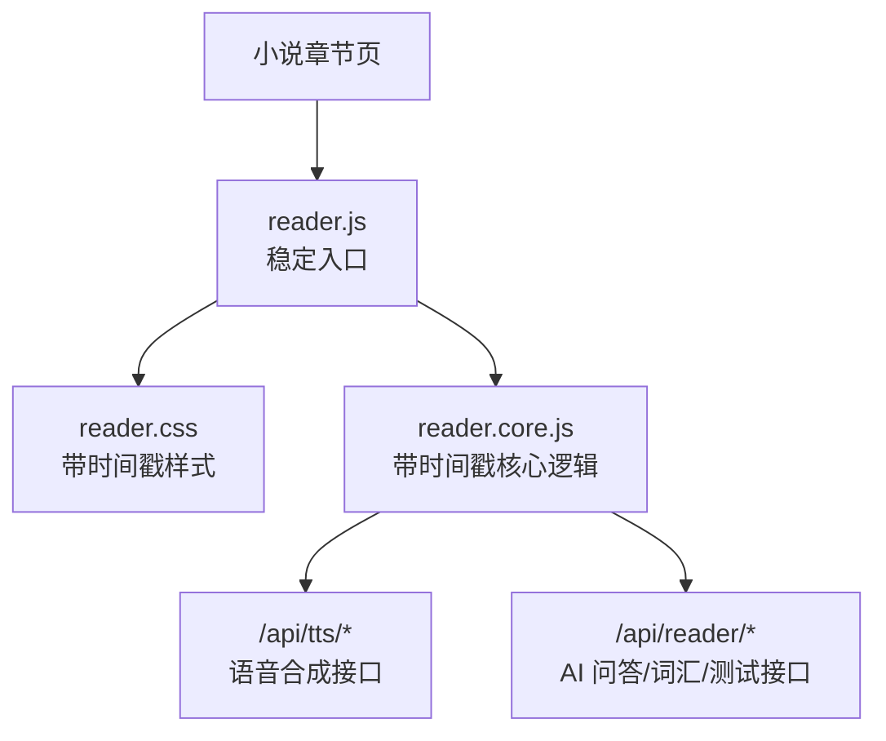

**图表来源**
- [reader.js:11-45](file://public/tts/reader.js#L11-L45)
- [reader.core.js:18-31](file://public/tts/reader.core.js#L18-L31)
- [reader.core.js:1128-1129](file://public/tts/reader.core.js#L1128-L1129)

**章节来源**
- [reader.js:1-47](file://public/tts/reader.js#L1-L47)
- [reader.core.js:1-14](file://public/tts/reader.core.js#L1-L14)
- [reader.css:1-3](file://public/tts/reader.css#L1-L3)

## 核心组件
阅读器的 UI 由“悬浮工具栏 + 多个浮动面板 + 正文增强层”构成：

| 组件 | 说明 | 主要状态 |
|---|---|---|
| 悬浮工具栏 | 右下角固定入口，点击展开动作项 | 收起 / 展开 |
| 朗读控制面板 | 播放、暂停、从头、进度条、音色、语速、连读、引擎、定时关闭 | 打开 / 关闭 |
| 章节目录面板 | 把页面内联章节导航迁移到悬浮面板 | 打开 / 关闭 |
| AI 问答面板 | 输入问题、语音输入、朗读回答 | 打开 / 关闭 |
| 学习设置面板 | 学习模式开关、自动生成词义、学习语言、年龄 | 打开 / 关闭 |
| 词汇讲解面板 | 显示句子或词语讲解，可朗读讲解内容 | 打开 / 关闭 |
| 章节测试面板 | 选择题答题、反馈、结果、换题 | 打开 / 关闭 |
| 正文增强层 | 按句切分、高亮当前句、生词加粗、拼音 ruby 标注 | 普通 / 朗读中 / 学习模式 / 拼音模式 |

这些组件全部由 `reader.core.js` 在运行时通过 HTML 模板字符串注入，并由 `reader.css` 提供统一视觉风格。

**章节来源**
- [reader.core.js:56-185](file://public/tts/reader.core.js#L56-L185)
- [reader.css:4-118](file://public/tts/reader.css#L4-L118)
- [reader.css:161-298](file://public/tts/reader.css#L161-L298)

## 架构总览
从用户视角看，阅读器的运行流程如下：

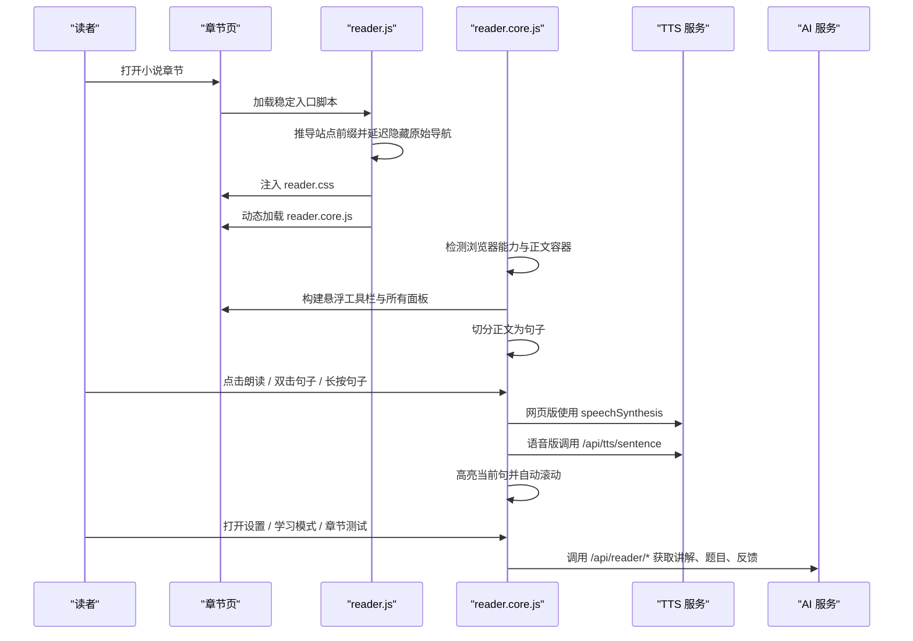

**图表来源**
- [reader.js:14-45](file://public/tts/reader.js#L14-L45)
- [reader.core.js:33-54](file://public/tts/reader.core.js#L33-L54)
- [reader.core.js:272-325](file://public/tts/reader.core.js#L272-L325)
- [reader.core.js:574-611](file://public/tts/reader.core.js#L574-L611)
- [reader.core.js:754-797](file://public/tts/reader.core.js#L754-L797)
- [reader.core.js:1399-1425](file://public/tts/reader.core.js#L1399-L1425)

## 详细组件分析

### 悬浮工具栏
悬浮工具栏位于页面右下角，采用“单入口 + 展开动作项”的设计：
- 默认只展示一个菜单入口按钮。
- 点击入口后向上弹出设置、测试、拼音、问答、目录、朗读等动作按钮。
- 再次点击入口收起；点击工具栏外部区域也收起。
- 展开态会更新 `aria-expanded`，便于辅助技术识别。

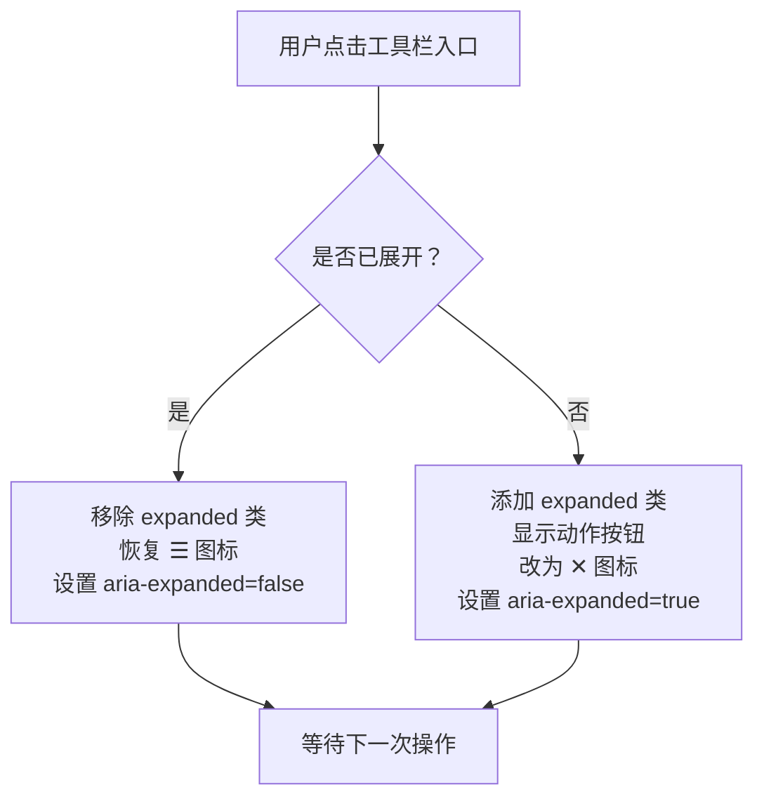

**图表来源**
- [reader.core.js:242-270](file://public/tts/reader.core.js#L242-L270)

#### 按钮布局与语义
工具栏包含以下按钮：
- 设置：打开学习设置面板。
- 本章测试：打开章节测试面板。
- 拼音：切换拼音标注模式。
- 问答：打开 AI 问答面板。
- 目录：打开章节目录悬浮面板。
- 朗读：打开朗读控制面板。

这些按钮由模板字符串生成，并通过 ID 绑定事件。

**章节来源**
- [reader.core.js:56-69](file://public/tts/reader.core.js#L56-L69)
- [reader.core.js:242-270](file://public/tts/reader.core.js#L242-L270)
- [reader.css:4-39](file://public/tts/reader.css#L4-L39)

### 朗读控制面板
朗读控制面板是阅读器的核心交互区，负责：
- 播放 / 暂停 / 继续。
- 从头开始。
- 拖动进度条跳转到指定句子。
- 选择音色与语速。
- 开启连续朗读下一章。
- 切换网页版 TTS 与服务端语音版。
- 设置屏幕常亮或息屏省电。
- 设置定时关闭朗读。
- 设置句间停顿（语音版）。

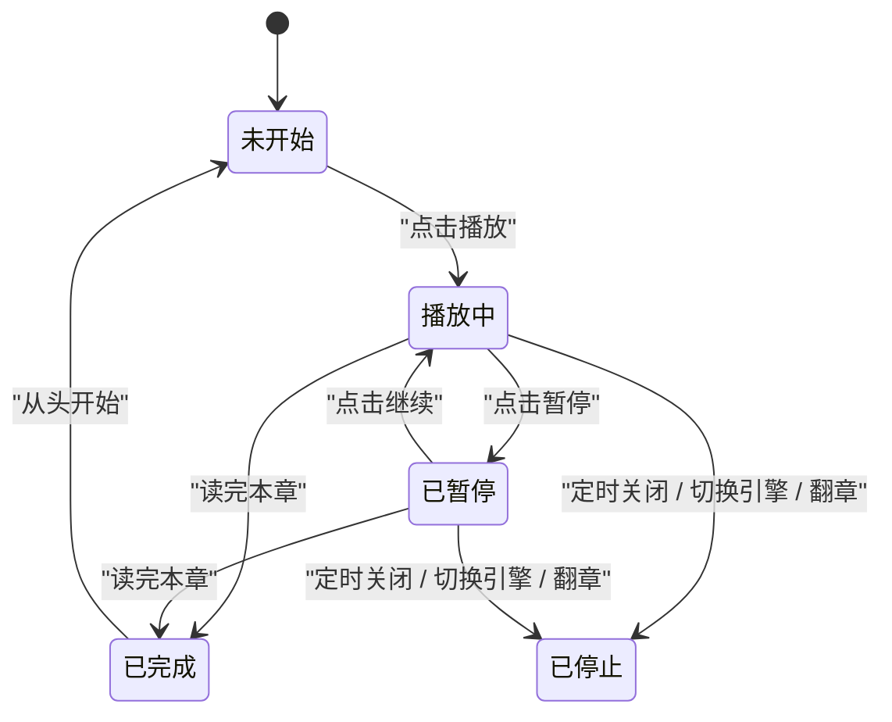

**图表来源**
- [reader.core.js:574-611](file://public/tts/reader.core.js#L574-L611)
- [reader.core.js:857-900](file://public/tts/reader.core.js#L857-L900)
- [reader.core.js:901-928](file://public/tts/reader.core.js#L901-L928)
- [reader.core.js:1301-1324](file://public/tts/reader.core.js#L1301-L1324)

#### 双引擎朗读
阅读器支持两种朗读引擎：
- 网页版：使用浏览器内置 `speechSynthesis`。
- 语音版：调用服务端 `/api/tts/sentence` 返回 mp3，再通过 `<audio>` 播放。

语音版还实现了“预取下一句音频”机制，以降低句间停顿感。

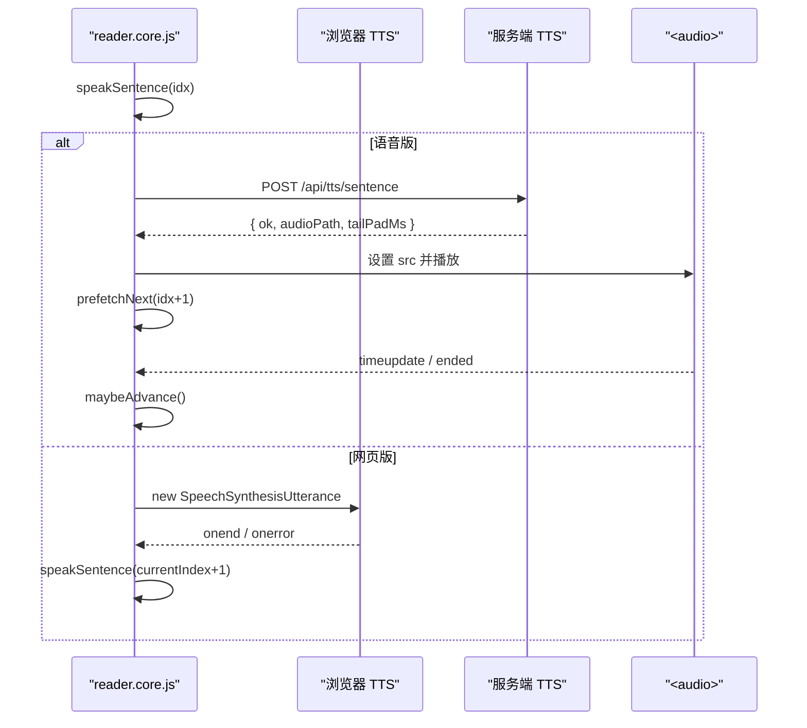

**图表来源**
- [reader.core.js:574-611](file://public/tts/reader.core.js#L574-L611)
- [reader.core.js:613-797](file://public/tts/reader.core.js#L613-L797)

**章节来源**
- [reader.core.js:327-383](file://public/tts/reader.core.js#L327-L383)
- [reader.core.js:574-611](file://public/tts/reader.core.js#L574-L611)
- [reader.core.js:613-797](file://public/tts/reader.core.js#L613-L797)
- [reader.core.js:831-855](file://public/tts/reader.core.js#L831-L855)
- [reader.core.js:857-928](file://public/tts/reader.core.js#L857-L928)
- [reader.core.js:1094-1127](file://public/tts/reader.core.js#L1094-L1127)
- [reader.core.js:1219-1299](file://public/tts/reader.core.js#L1219-L1299)

### 章节目录面板
章节目录面板用于承载页面原有的内联章节导航，并把它们从正文中隐藏：
- 启动时把所有 `.chapter-nav` 隐藏。
- 将第一个导航容器的 HTML 复制到悬浮面板中。
- 提供关闭按钮。
- 左右翻页箭头只在桌面端显示，触屏读者使用滑动和方向键。

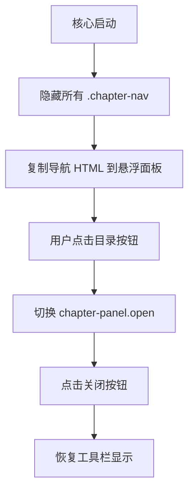

**图表来源**
- [reader.core.js:235-240](file://public/tts/reader.core.js#L235-L240)
- [reader.core.js:1331-1338](file://public/tts/reader.core.js#L1331-L1338)
- [reader.core.js:1072-1086](file://public/tts/reader.core.js#L1072-L1086)

**章节来源**
- [reader.core.js:235-240](file://public/tts/reader.core.js#L235-L240)
- [reader.core.js:1331-1338](file://public/tts/reader.core.js#L1331-L1338)
- [reader.core.js:1060-1086](file://public/tts/reader.core.js#L1060-L1086)
- [reader.css:161-185](file://public/tts/reader.css#L161-L185)
- [reader.css:342-384](file://public/tts/reader.css#L342-L384)

### AI 问答面板
AI 问答面板允许读者基于当前章节内容提问：
- 文本输入框支持回车发送。
- 语音输入按钮使用浏览器语音识别 API。
- 发送问题后调用 `/api/reader/ask`。
- 支持朗读最新 AI 回答。
- 关闭面板时停止正在朗读的回答。

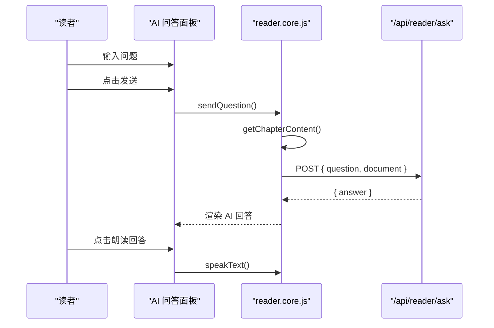

**图表来源**
- [reader.core.js:1341-1425](file://public/tts/reader.core.js#L1341-L1425)
- [reader.core.js:1427-1475](file://public/tts/reader.core.js#L1427-L1475)

**章节来源**
- [reader.core.js:114-128](file://public/tts/reader.core.js#L114-L128)
- [reader.core.js:1341-1425](file://public/tts/reader.core.js#L1341-L1425)
- [reader.core.js:1427-1475](file://public/tts/reader.core.js#L1427-L1475)
- [reader.css:187-243](file://public/tts/reader.css#L187-L243)

### 学习设置面板
学习设置面板管理学习相关偏好：
- 学习模式开关：开启后正文会标注生词，点击句子或词语进入讲解。
- 自动生成词义：开启后后台依次补齐缺失词义。
- 学习语言：影响讲解文本语种与 TTS 音色。
- 年龄：决定哪些词被视作“可学”。

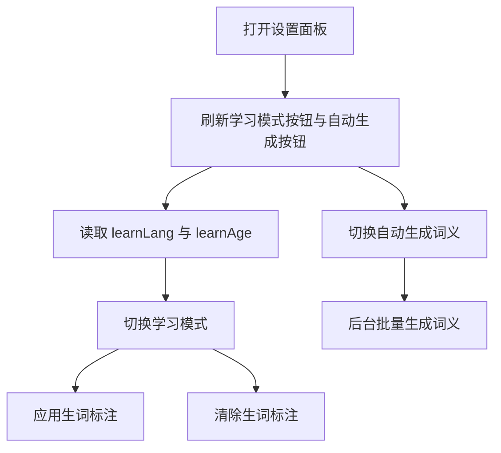

**图表来源**
- [reader.core.js:1593-1627](file://public/tts/reader.core.js#L1593-L1627)
- [reader.core.js:1769-1788](file://public/tts/reader.core.js#L1769-L1788)

**章节来源**
- [reader.core.js:129-164](file://public/tts/reader.core.js#L129-L164)
- [reader.core.js:1569-1627](file://public/tts/reader.core.js#L1569-L1627)
- [reader.core.js:1769-1788](file://public/tts/reader.core.js#L1769-L1788)
- [reader.css:245-256](file://public/tts/reader.css#L245-L256)

### 词汇讲解与生词标注
学习模式下，正文中的“可学词语”会被加粗并带有虚线下划线：
- 点击加粗词会调用 `/api/reader/explain-word`。
- 已有讲解的词显示为“完成态”，未生成的词显示为“待生成态”。
- 自动生成模式下，系统会依次请求讲解并更新颜色。
- 讲解内容可通过讲解面板中的朗读按钮播放。

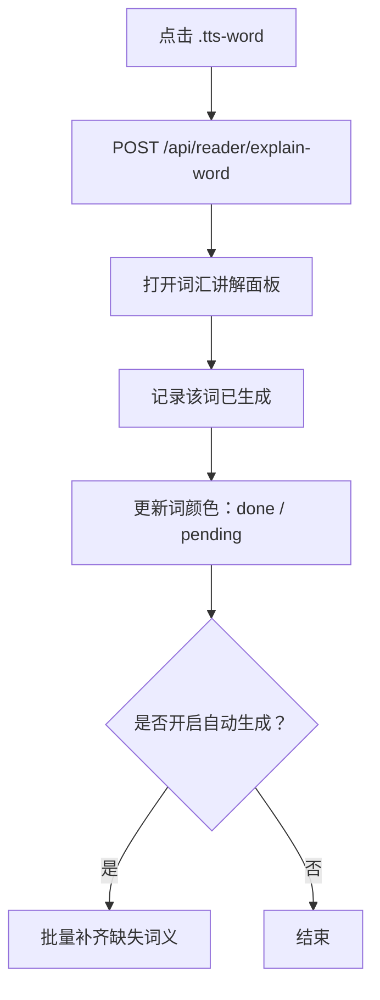

**图表来源**
- [reader.core.js:1650-1676](file://public/tts/reader.core.js#L1650-L1676)
- [reader.core.js:1756-1788](file://public/tts/reader.core.js#L1756-L1788)
- [reader.core.js:1790-1885](file://public/tts/reader.core.js#L1790-L1885)

**章节来源**
- [reader.core.js:1650-1676](file://public/tts/reader.core.js#L1650-L1676)
- [reader.core.js:1678-1754](file://public/tts/reader.core.js#L1678-L1754)
- [reader.core.js:1756-1885](file://public/tts/reader.core.js#L1756-L1885)
- [reader.css:303-314](file://public/tts/reader.css#L303-L314)

### 章节测试
章节测试提供选择题形式的阅读理解练习：
- 优先使用页面内嵌的预生成题目。
- 如果没有缓存或用户主动换题，则调用 `/api/reader/quiz`。
- 每道题提交后即时显示正确与否，并异步请求讲解反馈。
- 完成后显示得分和鼓励语，支持再测一次或换一组新题。

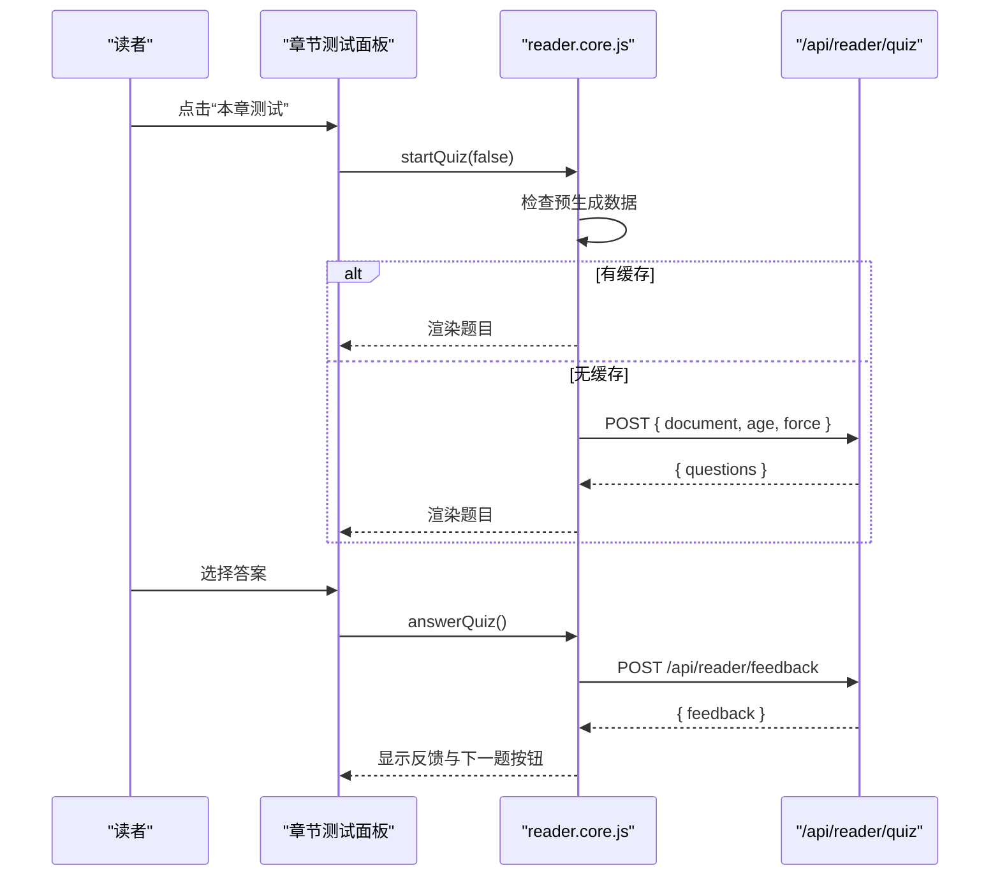

**图表来源**
- [reader.core.js:1896-2043](file://public/tts/reader.core.js#L1896-L2043)

**章节来源**
- [reader.core.js:175-184](file://public/tts/reader.core.js#L175-L184)
- [reader.core.js:1896-2043](file://public/tts/reader.core.js#L1896-L2043)
- [reader.css:270-298](file://public/tts/reader.css#L270-L298)

### 拼音模式
拼音模式为汉字段落添加 `<ruby>` 标注，帮助儿童或初学者阅读：
- 从页面内嵌数据读取拼音数组。
- 对每个段落按字符顺序插入拼音。
- 切换模式时保留或恢复原始 HTML。
- 激活时增大段落行高，给上方拼音留空间。

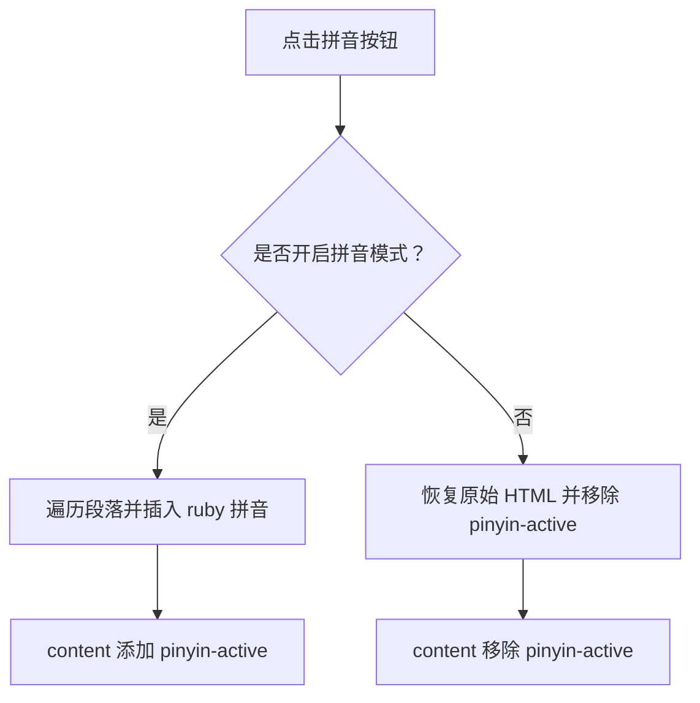

**图表来源**
- [reader.core.js:1477-1567](file://public/tts/reader.core.js#L1477-L1567)

**章节来源**
- [reader.core.js:1477-1567](file://public/tts/reader.core.js#L1477-L1567)
- [reader.css:316-340](file://public/tts/reader.css#L316-L340)

### 用户交互流程

#### 手势操作
- 左右滑动：水平位移主导且达到阈值时触发上一章/下一章。
- 左边缘起手不接管，避免与系统返回手势冲突。
- 控件区域内触摸不触发翻页。
- 滑动过程中显示方向提示。

#### 键盘快捷键
- 桌面端：左箭头切上一章，右箭头切下一章。
- 输入框、文本域、下拉框中方向键归光标移动，不触发翻页。

#### 正文点击与长按
- 学习模式下：点击加粗词查词。
- 非学习模式下：双击句子或长按句子从该句开始朗读。

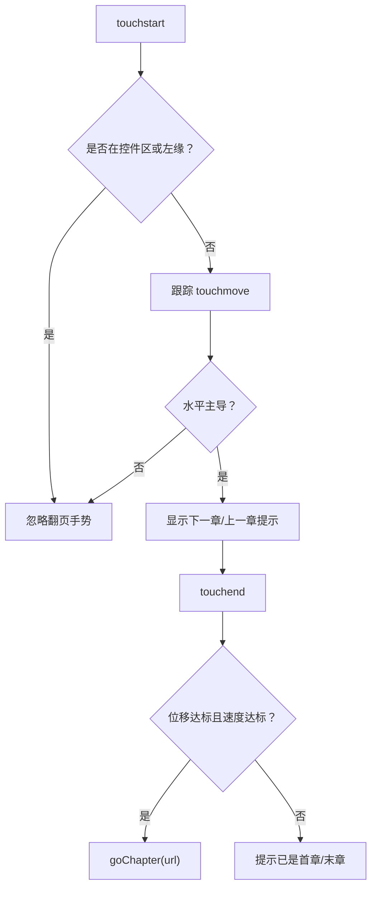

**图表来源**
- [reader.core.js:965-1086](file://public/tts/reader.core.js#L965-L1086)

**章节来源**
- [reader.core.js:930-963](file://public/tts/reader.core.js#L930-L963)
- [reader.core.js:965-1086](file://public/tts/reader.core.js#L965-L1086)
- [reader.css:137-159](file://public/tts/reader.css#L137-L159)

## 依赖关系分析
阅读器前端与后端的主要依赖如下：

| 依赖 | 用途 | 行为 |
|---|---|---|
| `speechSynthesis` | 网页版朗读 | 不支持时显示提示并退出阅读模式 |
| `/api/tts/sentence` | 语音版逐句合成 | 失败时回落到网页版 |
| `/api/tts/explain` | 讲解内容语音合成 | 失败时回落到浏览器 TTS |
| `/api/reader/ask` | AI 问答 | 返回问题回答 |
| `/api/reader/explain` | 句子讲解 | 返回讲解文本 |
| `/api/reader/explain-word` | 词语讲解 | 返回词语讲解并持久化 |
| `/api/reader/vocab` | 生词表 | 返回可标注词语 |
| `/api/reader/word-status` | 词义状态 | 返回已有讲解的词集合 |
| `/api/reader/quiz` | 章节测试 | 返回题目 |
| `/api/reader/feedback` | 答题反馈 | 返回鼓励性讲解 |

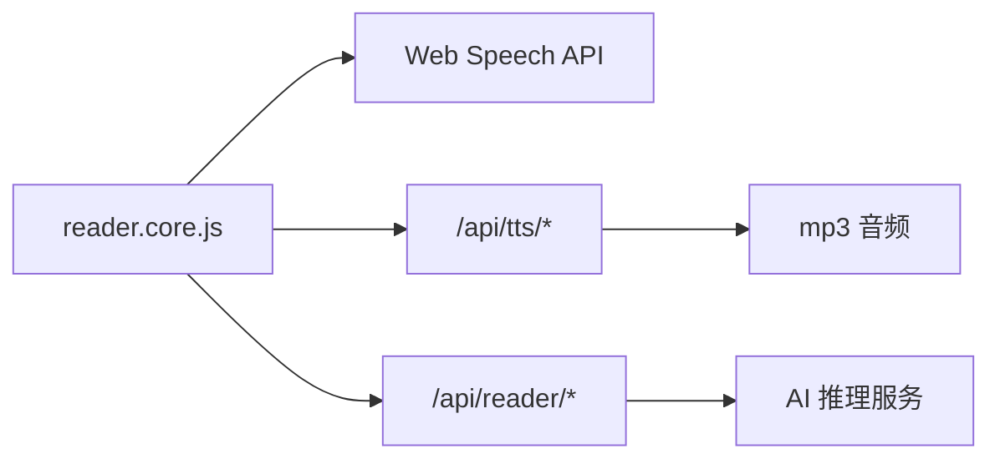

**图表来源**
- [reader.core.js:43-54](file://public/tts/reader.core.js#L43-L54)
- [reader.core.js:712-718](file://public/tts/reader.core.js#L712-L718)
- [reader.core.js:1369-1382](file://public/tts/reader.core.js#L1369-L1382)
- [reader.core.js:1669-1675](file://public/tts/reader.core.js#L1669-L1675)
- [reader.core.js:1717-1737](file://public/tts/reader.core.js#L1717-L1737)

**章节来源**
- [reader.core.js:43-54](file://public/tts/reader.core.js#L43-L54)
- [reader.core.js:712-718](file://public/tts/reader.core.js#L712-L718)
- [reader.core.js:1369-1382](file://public/tts/reader.core.js#L1369-L1382)
- [reader.core.js:1669-1675](file://public/tts/reader.core.js#L1669-L1675)
- [reader.core.js:1717-1737](file://public/tts/reader.core.js#L1717-L1737)

## 性能与体验优化
阅读器在界面与交互层面做了多项优化：

| 优化点 | 实现方式 | 收益 |
|---|---|---|
| 稳定入口 | `reader.js` 长期不变，`reader.core.js` 带时间戳 | 历史章节无需重新发布即可获得更新 |
| 导航闪烁抑制 | 加载器提前用 CSS 隐藏原始导航，core 启动后再撤销临时类 | 减少首屏闪动 |
| 正文切句 | TreeWalker 跳过 pre/code 和 tts-skip 元素 | 避免朗读无关内容 |
| 语音版预取 | 播一句的同时预取下一句 blob | 降低句间停顿 |
| 并发控制 | 全章生成最多 3 个并发请求 | 避免限流与服务器压力 |
| 重试退避 | 429/503 按 Retry-After 或短退避重试 | 提升生成成功率 |
| 屏幕常亮 | Wake Lock + 静音保活 | 息屏朗读更可靠 |
| 定时关闭 | 绝对时间戳 + 句子边界兜底 | 跨页定时不断 |
| 本地偏好 | localStorage 保存音色、语速、引擎、屏幕常亮、拼音模式等 | 用户偏好持久化 |
| 媒体会话 | Media Session 注册播放/暂停/上一曲/下一曲/跳转 | 锁屏与耳机控件可用 |

**章节来源**
- [reader.js:1-47](file://public/tts/reader.js#L1-L47)
- [reader.core.js:348-383](file://public/tts/reader.core.js#L348-L383)
- [reader.core.js:613-797](file://public/tts/reader.core.js#L613-L797)
- [reader.core.js:1219-1299](file://public/tts/reader.core.js#L1219-L1299)
- [reader.core.js:1301-1324](file://public/tts/reader.core.js#L1301-L1324)
- [reader.core.js:1089-1180](file://public/tts/reader.core.js#L1089-L1180)
- [reader.core.js:798-829](file://public/tts/reader.core.js#L798-L829)

## 故障排查指南

| 现象 | 可能原因 | 排查建议 |
|---|---|---|
| 页面顶部出现“浏览器不支持语音合成”提示 | 浏览器缺少 `speechSynthesis` | 改用 Chrome、Edge 或 Safari |
| 点击朗读无声音 | 浏览器要求手势触发 | 手动点击播放按钮 |
| 语音版合成失败 | 服务端接口不可用或参数错误 | 查看控制台提示，确认网络与服务端 |
| 全章生成大量失败 | 服务端限流或网络异常 | 观察 Retry-After、状态码与错误信息 |
| 息屏后无声 | 网页版 TTS 在移动端息屏可能被挂起 | 切换到语音版或开启屏幕常亮 |
| 定时关闭没生效 | 后台标签页定时器节流 | 依靠句子边界兜底，回到前台校准 |
| 章节测试没有题目 | 预生成数据缺失或服务端返回为空 | 检查页面内嵌数据与 `/api/reader/quiz` |
| 词汇讲解一直加载中 | 服务端接口错误或返回格式不符 | 检查 `/api/reader/explain-word` 响应 |

**章节来源**
- [reader.core.js:43-54](file://public/tts/reader.core.js#L43-L54)
- [reader.core.js:548-555](file://public/tts/reader.core.js#L548-L555)
- [reader.core.js:777-796](file://public/tts/reader.core.js#L777-L796)
- [reader.core.js:1245-1299](file://public/tts/reader.core.js#L1245-L1299)
- [reader.core.js:1641-1675](file://public/tts/reader.core.js#L1641-L1675)
- [reader.core.js:1935-1954](file://public/tts/reader.core.js#L1935-L1954)

## 扩展与集成指南

### 自定义样式
所有界面样式集中在 `reader.css`，可按需覆盖：
- 工具栏与按钮：`.reader-toolbar`、`.toolbar-btn`、`.toolbar-actions`。
- 控制面板：`.tts-panel`、`.tts-row`、`.tts-btn`。
- 章节面板：`.chapter-panel`、`.chapter-panel-row`。
- AI 面板：`.ai-panel`、`.ai-messages`、`.ai-input-row`。
- 设置面板：`.settings-panel`、`.settings-body`、`.settings-row`。
- 讲解面板：`.explain-panel`、`.explain-body`。
- 测试面板：`.quiz-panel`、`.quiz-body`、`.quiz-option`。
- 正文增强：`.tts-sentence`、`.tts-word`、`.pinyin-active`。
- 翻页箭头：`.page-arrow.prev`、`.page-arrow.next`。

修改样式后只需同步 `reader.css`，所有历史章节页都会立即生效。

**章节来源**
- [reader.css:4-118](file://public/tts/reader.css#L4-L118)
- [reader.css:161-298](file://public/tts/reader.css#L161-L298)
- [reader.css:303-384](file://public/tts/reader.css#L303-L384)

### 主题定制
当前主题以深色背景为主，主色为蓝色，强调色为绿色。若需要品牌化主题，可以：
- 替换按钮背景色与悬停色。
- 调整面板背景色与文字色。
- 修改高亮阅读句的颜色。
- 调整生词标注颜色与虚线颜色。
- 根据 `prefers-reduced-motion` 禁用动画。

注意：样式文件由 `reader.js` 动态注入，因此主题变更不需要重新发布小说。

**章节来源**
- [reader.css:1-3](file://public/tts/reader.css#L1-L3)
- [reader.css:4-39](file://public/tts/reader.css#L4-L39)
- [reader.css:50-118](file://public/tts/reader.css#L50-L118)
- [reader.css:156-159](file://public/tts/reader.css#L156-L159)

### 国际化支持
当前界面文案以中文为主，但部分交互具备可扩展基础：
- 学习语言选项支持英语、日语、韩语、中文。
- 讲解与测试反馈通过服务端 AI 生成，理论上可接入多语言模型。
- 如果希望完整国际化，可在 `reader.core.js` 中集中维护文案映射，并在构建 UI 时替换硬编码文本。

**章节来源**
- [reader.core.js:144-161](file://public/tts/reader.core.js#L144-L161)
- [reader.core.js:1683-1690](file://public/tts/reader.core.js#L1683-L1690)
- [reader.core.js:1999-2008](file://public/tts/reader.core.js#L1999-L2008)

### 第三方集成
阅读器可通过以下方式与第三方系统集成：
- 语音合成：对接 Edge TTS、Azure TTS 或其他服务端 TTS 服务。
- AI 问答：对接任意 `/api/reader/ask` 实现。
- 词汇讲解：对接任意 `/api/reader/explain-word` 实现。
- 章节测试：对接任意 `/api/reader/quiz` 实现。
- 媒体会话：利用 `navigator.mediaSession` 与系统播放器集成。
- 屏幕唤醒：利用 `navigator.wakeLock` 与移动端电源管理集成。

**章节来源**
- [reader.core.js:798-829](file://public/tts/reader.core.js#L798-L829)
- [reader.core.js:1369-1382](file://public/tts/reader.core.js#L1369-L1382)
- [reader.core.js:1669-1675](file://public/tts/reader.core.js#L1669-L1675)
- [reader.core.js:1946-1953](file://public/tts/reader.core.js#L1946-L1953)

### 开发注意事项
- 不要直接修改章节页内联脚本，应通过 `reader.core.js` 扩展。
- 新增面板时，确保关闭按钮能恢复工具栏显示。
- 新增交互时，考虑手势冲突与无障碍属性。
- 新增本地存储字段时，做好兼容旧值与异常捕获。
- 新增服务端接口时，保持错误信息可读，便于读者定位问题。

**章节来源**
- [reader.core.js:242-270](file://public/tts/reader.core.js#L242-L270)
- [reader.core.js:1089-1180](file://public/tts/reader.core.js#L1089-L1180)
- [reader.core.js:1369-1382](file://public/tts/reader.core.js#L1369-L1382)

## 结论
阅读器用户界面以“稳定入口 + 动态核心 + 集中样式”的方式，实现了悬浮工具栏、朗读控制面板、章节导航、AI 问答、学习模式、章节测试、拼音标注等完整功能。其设计兼顾了移动端手势、桌面端键盘、屏幕常亮、息屏省电、定时关闭、预取优化、本地偏好持久化与媒体会话集成。对于扩展场景，开发者可以通过覆盖样式、扩展核心逻辑、对接服务端接口来定制主题、语言、语音与学习内容。