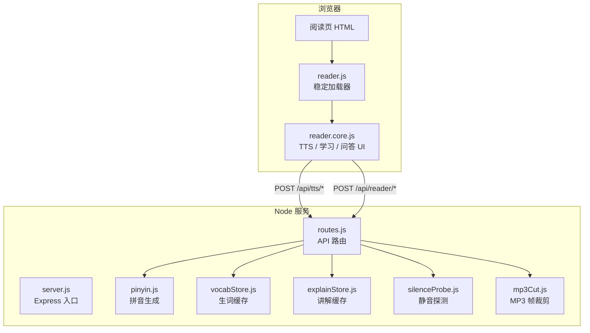
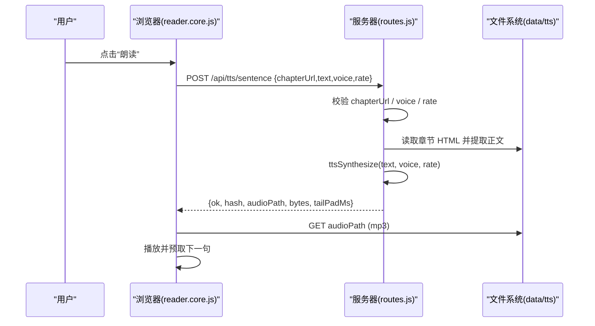
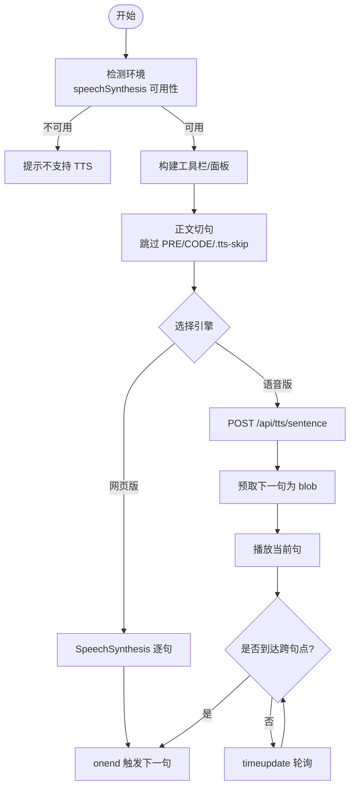
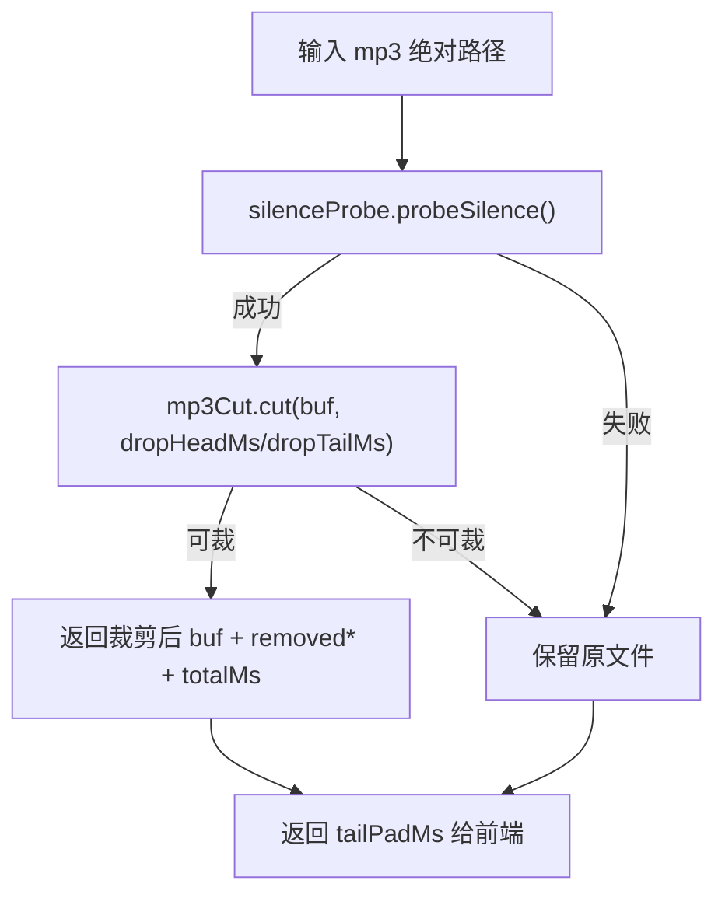
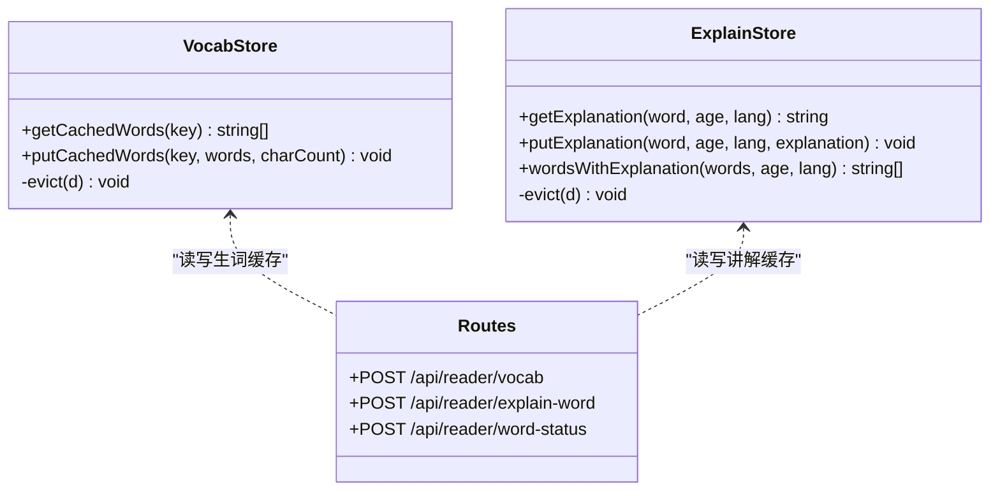
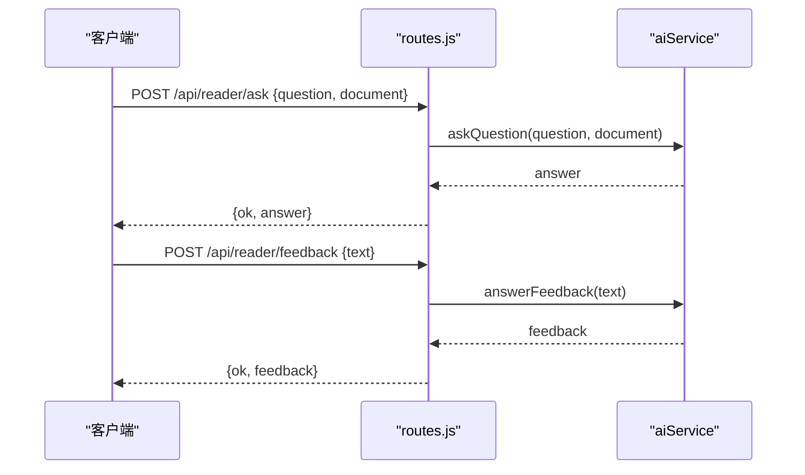
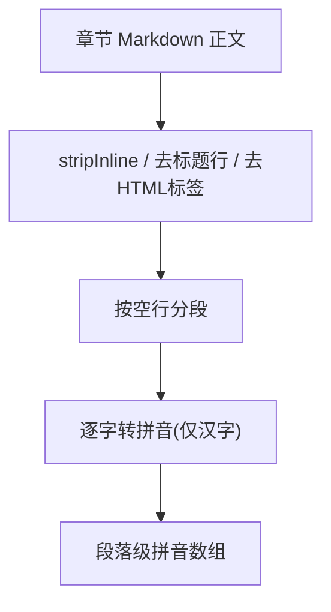
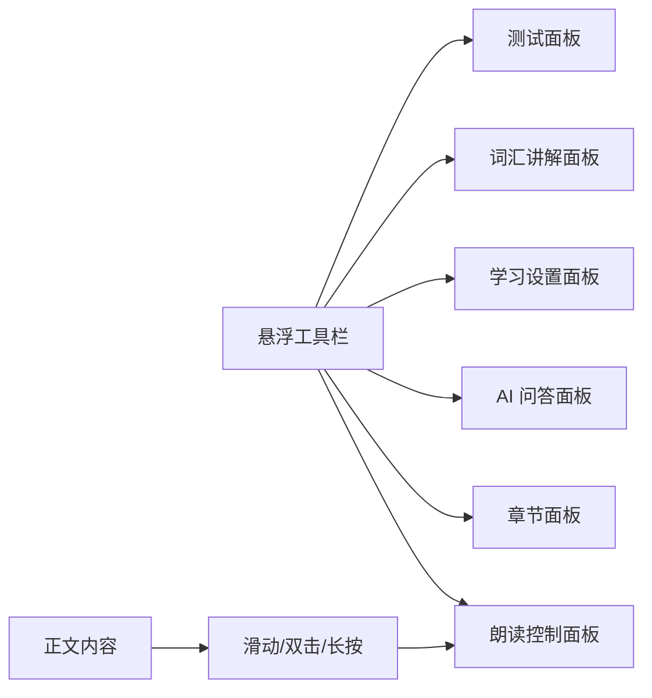
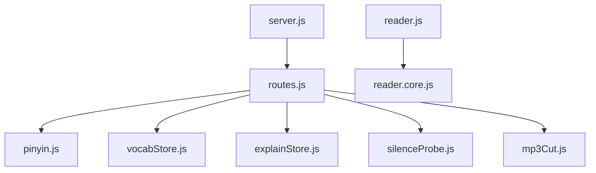

# 阅读器系统

<cite>
**本文引用的文件**   
- [server.js](file://server.js)
- [routes.js](file://src/routes.js)
- [reader.core.js](file://public/tts/reader.core.js)
- [reader.js](file://public/tts/reader.js)
- [pinyin.js](file://src/reader/pinyin.js)
- [vocabStore.js](file://src/reader/vocabStore.js)
- [explainStore.js](file://src/reader/explainStore.js)
- [silenceProbe.js](file://src/reader/silenceProbe.js)
- [mp3Cut.js](file://src/reader/mp3Cut.js)
- [README.md](file://README.md)
</cite>

## 目录
1. [简介](#简介)
2. [项目结构](#项目结构)
3. [核心组件](#核心组件)
4. [架构总览](#架构总览)
5. [详细组件分析](#详细组件分析)
6. [依赖关系分析](#依赖关系分析)
7. [性能与容量规划](#性能与容量规划)
8. [故障排查指南](#故障排查指南)
9. [结论](#结论)
10. [附录：关键接口与缓存键口径](#附录关键接口与缓存键口径)

## 简介
本技术文档聚焦“阅读器系统”，围绕以下目标展开：
- TTS 文本转语音：Web Speech API 与后端 mp3 合成双引擎、音频文件管理、多语言音色与语速。
- 词汇学习系统：生词识别算法、词汇解释服务、学习进度追踪与持久化缓存。
- 交互问答功能：问题理解与回答、上下文保持、反馈机制。
- 拼音处理、文本解析、缓存策略等技术细节。
- 前端界面组件实现与用户体验优化（悬浮工具栏、章节导航、滑动翻页、定时关闭朗读等）。

## 项目结构
阅读器系统由服务端路由与静态资源两部分组成：
- 服务端提供 TTS 合成、学习者 AI 能力（测试题、讲解、生词标注、问答、反馈）以及公开限流保护。
- 前端 reader.js 作为稳定加载器，动态引入 reader.core.js 与样式，避免历史页面重新发布。

**图示来源**
- [server.js:25-53](file://server.js#L25-L53)
- [routes.js:352-513](file://src/routes.js#L352-L513)
- [reader.js:11-46](file://public/tts/reader.js#L11-L46)
- [reader.core.js:18-31](file://public/tts/reader.core.js#L18-L31)

**章节来源**
- [README.md:166-192](file://README.md#L166-L192)
- [server.js:25-53](file://server.js#L25-L53)
- [reader.js:11-46](file://public/tts/reader.js#L11-L46)

## 核心组件
- TTS 双引擎：网页端 Web Speech API 与服务端 Edge 音色 mp3 合成；自动回退与预取下一句，保证连读流畅。
- 词汇学习：按年龄与正文哈希选择生词；词义讲解按（词, 年龄, 语言）全局复用；进度状态查询零 LLM。
- 交互问答：基于章节内容的问答与反馈接口，公开限流保护。
- 拼音与文本解析：发布时生成逐段拼音数据；正文切句、跳过代码块与特定标记。
- 音频管理：ffmpeg 静音探测 + MP3 帧级无损裁剪，返回尾静音长度以精确跨句。
- 前端交互：悬浮工具栏、章节面板、AI 问答面板、设置面板、词汇讲解面板、测试面板；支持滑动翻页、方向键、双击/长按朗读。

**章节来源**
- [reader.core.js:18-184](file://public/tts/reader.core.js#L18-L184)
- [routes.js:352-513](file://src/routes.js#L352-L513)
- [pinyin.js:1-57](file://src/reader/pinyin.js#L1-L57)
- [silenceProbe.js:1-100](file://src/reader/silenceProbe.js#L1-L100)
- [mp3Cut.js:1-120](file://src/reader/mp3Cut.js#L1-L120)

## 架构总览
阅读器系统采用“前端轻量 + 服务端可缓存”的架构：
- 前端负责渲染、交互与播放控制，通过 reader.js 动态加载 reader.core.js，确保更新即时生效。
- 服务端集中处理 TTS 合成、学习者 AI 能力与持久化缓存，所有公开读者接口均带限流。
- 音频产物落盘到 data/tts，并通过 /tts-audio 静态目录暴露给浏览器。

**图示来源**
- [routes.js:456-513](file://src/routes.js#L456-L513)
- [reader.core.js:712-797](file://public/tts/reader.core.js#L712-L797)

## 详细组件分析

### TTS 文本转语音
- 双引擎切换：网页版使用 Web Speech API；语音版调用服务端 Edge 音色合成 mp3。失败时自动回落到网页版。
- 预取下一句：当前句播放时即预取下一句为本地 blob，换源播放几乎无等待，提升连读体验。
- 跨句精度：服务端返回 tailPadMs，前端根据音频时长与 gap 设置精确跨句，避免吞字或过长停顿。
- 媒体会话：Media Session 集成锁屏控件，支持播放/暂停/上一首/下一首/seek。
- 屏幕常亮与息屏省电：Wake Lock 与静音保活结合，保障移动端息屏朗读。

**图示来源**
- [reader.core.js:43-54](file://public/tts/reader.core.js#L43-L54)
- [reader.core.js:272-320](file://public/tts/reader.core.js#L272-L320)
- [reader.core.js:574-611](file://public/tts/reader.core.js#L574-L611)
- [reader.core.js:613-797](file://public/tts/reader.core.js#L613-L797)
- [routes.js:456-513](file://src/routes.js#L456-L513)

**章节来源**
- [reader.core.js:43-54](file://public/tts/reader.core.js#L43-L54)
- [reader.core.js:272-320](file://public/tts/reader.core.js#L272-L320)
- [reader.core.js:574-611](file://public/tts/reader.core.js#L574-L611)
- [reader.core.js:613-797](file://public/tts/reader.core.js#L613-L797)
- [routes.js:456-513](file://src/routes.js#L456-L513)

### 音频文件管理与静音裁剪
- 静音探测：通过 ffmpeg silencedetect 获取头尾静音区间，兼容旧版/新版输出差异。
- 帧级裁剪：对 MP3 进行无损整帧丢弃，不重编码，避免音质损失；若无法安全裁剪则保留原文件。
- 结果回传：返回 tailPadMs，前端据此计算跨句时机，保证听感自然。

**图示来源**
- [silenceProbe.js:17-99](file://src/reader/silenceProbe.js#L17-L99)
- [mp3Cut.js:55-119](file://src/reader/mp3Cut.js#L55-L119)

**章节来源**
- [silenceProbe.js:1-100](file://src/reader/silenceProbe.js#L1-L100)
- [mp3Cut.js:1-120](file://src/reader/mp3Cut.js#L1-L120)

### 词汇学习系统
- 生词识别：按（章节+年龄）哈希作为缓存键，正文变化即失效；有界淘汰防止无限增长。
- 词汇解释：按（词, 年龄, 语言）持久化，全站复用；首次生成携带上下文，后续纯查库。
- 进度追踪：批量查询哪些词已有讲解，用于正文着色（黑体/灰体），零 LLM。

**图示来源**
- [vocabStore.js:1-101](file://src/reader/vocabStore.js#L1-L101)
- [explainStore.js:1-113](file://src/reader/explainStore.js#L1-L113)
- [routes.js:368-382](file://src/routes.js#L368-L382)

**章节来源**
- [vocabStore.js:1-101](file://src/reader/vocabStore.js#L1-L101)
- [explainStore.js:1-113](file://src/reader/explainStore.js#L1-L113)
- [routes.js:368-382](file://src/routes.js#L368-L382)

### 交互问答功能
- 问答接口：POST /api/reader/ask 接收问题与章节上下文，返回答案。
- 反馈接口：POST /api/reader/feedback 接收反馈文本，返回反馈结果。
- 公开限流：所有 /api/reader/* 注册在 requireAuth 之前，统一使用 readerRateLimit 限流。

**图示来源**
- [routes.js:383-390](file://src/routes.js#L383-L390)

**章节来源**
- [routes.js:352-390](file://src/routes.js#L352-L390)

### 拼音处理与文本解析
- 拼音生成：发布时调用 pinyin.js，将 Markdown 正文去标题/去标签后分段，逐字转为带声调拼音数组。
- 正文切句：reader.core.js 使用 TreeWalker 遍历 .content，跳过 PRE/CODE 与 .tts-skip，按中文标点切分句子。

**图示来源**
- [pinyin.js:10-56](file://src/reader/pinyin.js#L10-L56)
- [reader.core.js:272-320](file://public/tts/reader.core.js#L272-L320)

**章节来源**
- [pinyin.js:1-57](file://src/reader/pinyin.js#L1-L57)
- [reader.core.js:272-320](file://public/tts/reader.core.js#L272-L320)

### 前端界面组件与用户体验
- 悬浮工具栏：设置、测试、拼音、问答、目录、朗读按钮；二级菜单收起/展开。
- 控制面板：播放/从头/进度条/音色/语速/连续朗读/定时关闭/引擎切换/句间停顿。
- 章节面板：内联导航迁移至悬浮面板，隐藏原始导航。
- AI 问答面板：消息列表、语音输入、朗读最新回答。
- 设置面板：学习模式开关、自动生成词义、学习语言、年龄档。
- 词汇讲解面板：展示讲解文本，支持朗读。
- 测试面板：本章小测试，支持换一组新题。
- 手势与键盘：左右滑动翻页、方向键翻页、双击/长按从该句朗读。
- 媒体会话：锁屏控件、耳机按键控制。

**图示来源**
- [reader.core.js:56-184](file://public/tts/reader.core.js#L56-L184)
- [reader.core.js:857-1200](file://public/tts/reader.core.js#L857-L1200)
- [reader.core.js:965-1087](file://public/tts/reader.core.js#L965-L1087)

**章节来源**
- [reader.core.js:56-184](file://public/tts/reader.core.js#L56-L184)
- [reader.core.js:857-1200](file://public/tts/reader.core.js#L857-L1200)
- [reader.core.js:965-1087](file://public/tts/reader.core.js#L965-L1087)

## 依赖关系分析
- server.js 启动 Express，挂载静态资源与路由，初始化桥接服务。
- routes.js 定义所有 API，包括 TTS、学习者 AI、VIP 闸门、长任务进度等。
- reader.js 作为稳定加载器，动态引入 reader.core.js 与样式。
- reader.core.js 依赖 Web Speech API、Media Session、Wake Lock 等浏览器能力。
- pinyin.js 依赖 pinyin-pro 生成拼音。
- vocabStore.js 与 explainStore.js 依赖 better-sqlite3 与 global.db。
- silenceProbe.js 与 mp3Cut.js 协同完成音频静音探测与无损裁剪。

**图示来源**
- [server.js:1-64](file://server.js#L1-L64)
- [routes.js:1-29](file://src/routes.js#L1-L29)
- [reader.js:11-46](file://public/tts/reader.js#L11-L46)
- [reader.core.js:18-31](file://public/tts/reader.core.js#L18-L31)

**章节来源**
- [server.js:1-64](file://server.js#L1-L64)
- [routes.js:1-29](file://src/routes.js#L1-L29)
- [reader.js:11-46](file://public/tts/reader.js#L11-L46)

## 性能与容量规划
- 公开接口限流：/api/reader/* 与 /api/tts/* 分别使用 60s 窗口限流，避免并发刷接口导致上游压力。
- 音频缓存：data/tts 下 mp3 文件长期缓存（immutable, maxAge=1y），减少重复合成。
- 词汇与讲解缓存：global.db 中 reader_vocab 与 reader_word_explain 表有界淘汰，默认上限分别为 3000 与 5000 行。
- 预取优化：语音版提前拉取下一句为本地 blob，降低跨句延迟。
- 发布预生成：发布时预生成拼音、章节测试、生词表并内嵌书页，读者打开零 LLM。

[本节为通用指导，无需具体文件引用]

## 故障排查指南
- TTS 合成失败：检查 voice/rate 是否在白名单；确认 chapterUrl 能定位到章节 HTML 且包含正文；查看服务端日志中的 ttsFail 详情。
- 浏览器 TTS 不可用：reader.core.js 会提示不支持 Web Speech API，建议改用 Chrome/Edge/Safari。
- 语音版无声：确认已切换到“语音版”引擎且有网络；若合成失败会自动回落到网页版。
- 词汇讲解未命中：检查缓存键口径（词, 年龄, 语言）是否正确；确认讲解已生成并持久化。
- 生词表未更新：确认正文变化后缓存键已变更；检查 reader_vocab 表是否有记录。
- 音频跨句不准：检查 tailPadMs 是否返回；确认句间停顿设置与 timeupdate 逻辑。

**章节来源**
- [routes.js:456-513](file://src/routes.js#L456-L513)
- [reader.core.js:43-54](file://public/tts/reader.core.js#L43-L54)
- [reader.core.js:777-797](file://public/tts/reader.core.js#L777-L797)
- [vocabStore.js:1-101](file://src/reader/vocabStore.js#L1-L101)
- [explainStore.js:1-113](file://src/reader/explainStore.js#L1-L113)

## 结论
阅读器系统通过前后端协作实现了高质量的 TTS 朗读、词汇学习与交互问答能力。前端注重交互体验与播放连续性，服务端提供稳定的合成与缓存服务。通过严格的限流、有界缓存与音频无损裁剪，系统在性能与可靠性之间取得平衡。未来可继续优化多语言音色覆盖、离线播放与更精细的学习进度统计。

[本节为总结性内容，无需具体文件引用]

## 附录：关键接口与缓存键口径
- TTS 接口
  - POST /api/tts/sentence：参数 chapterUrl, text, voice, rate；返回 hash, audioPath, bytes, tailPadMs。
  - POST /api/tts/explain：参数 text, voice, rate；返回 hash, audioPath, bytes, tailPadMs。
- 学习者 AI 接口
  - POST /api/reader/quiz：document, age, force。
  - POST /api/reader/explain：sentence, age, lang。
  - POST /api/reader/vocab：document, age。
  - POST /api/reader/explain-word：word, age, lang, context。
  - POST /api/reader/word-status：words, age, lang。
  - POST /api/reader/ask：question, document。
  - POST /api/reader/feedback：text。
- 缓存键口径
  - 生词表：sha1('vocab' + 年龄 + 正文)。
  - 词汇讲解：(word, age, lang)，不含原句。
  - 章节测试：sha1('quiz' + 年龄 + 正文)。

**章节来源**
- [routes.js:352-513](file://src/routes.js#L352-L513)
- [vocabStore.js:1-101](file://src/reader/vocabStore.js#L1-L101)
- [explainStore.js:1-113](file://src/reader/explainStore.js#L1-L113)