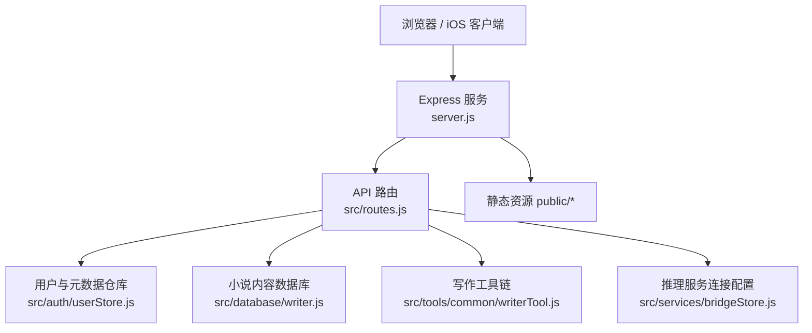
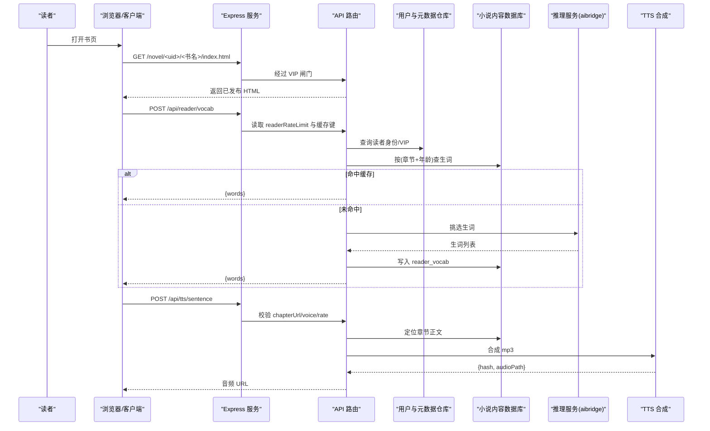
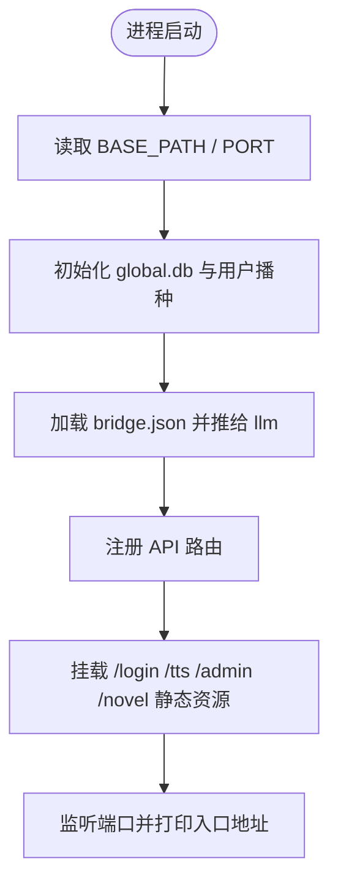
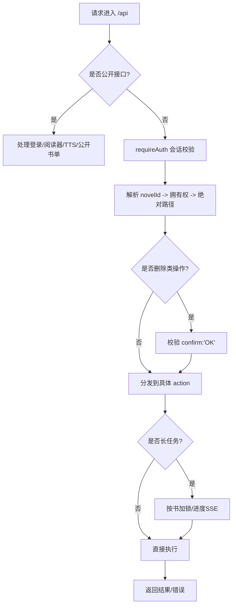
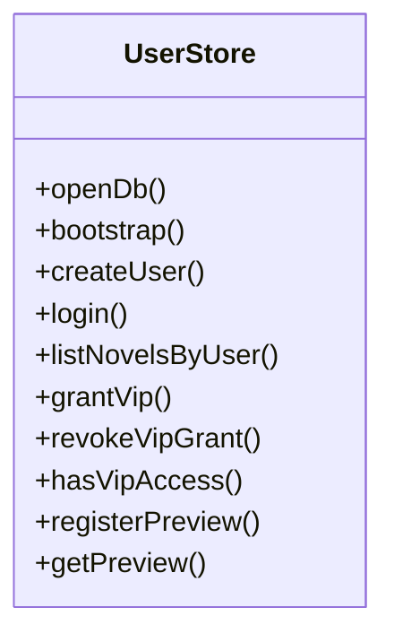
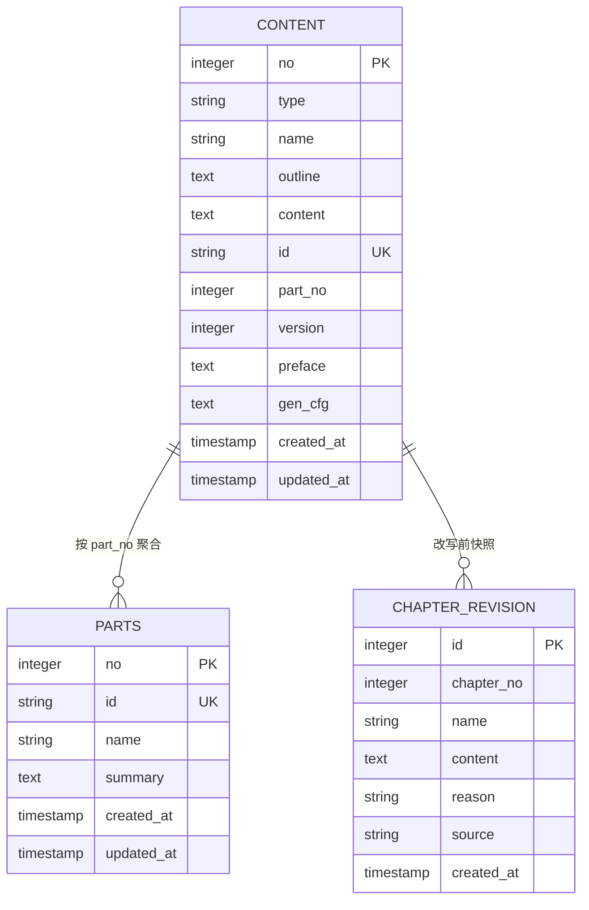
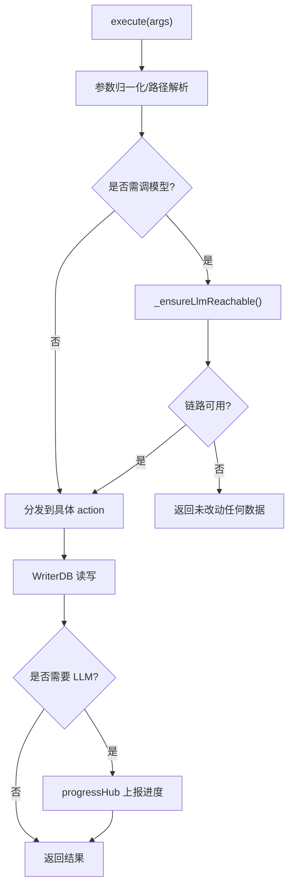
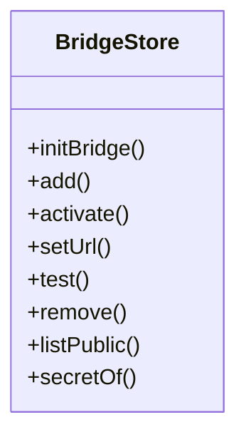
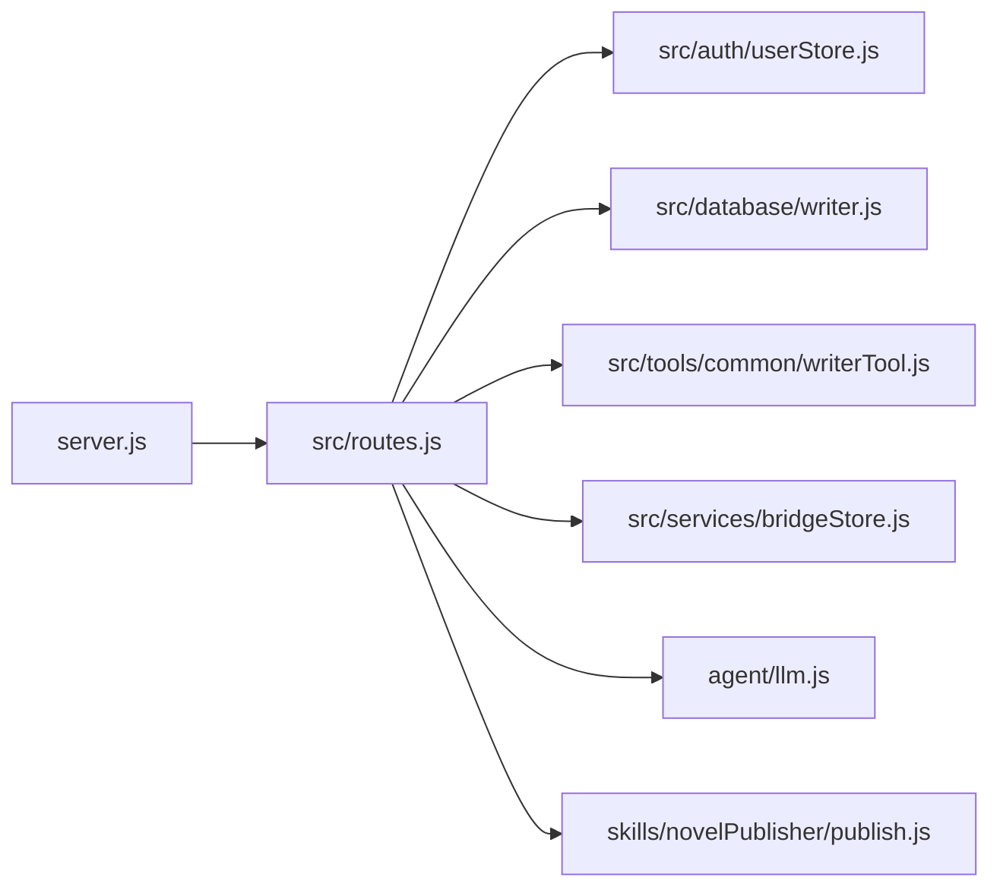

# 项目概述

<cite>
**本文引用的文件**   
- [README.md](file://README.md)
- [package.json](file://package.json)
- [server.js](file://server.js)
- [src/base.js](file://src/base.js)
- [src/routes.js](file://src/routes.js)
- [src/auth/userStore.js](file://src/auth/userStore.js)
- [src/database/writer.js](file://src/database/writer.js)
- [src/tools/common/writerTool.js](file://src/tools/common/writerTool.js)
- [src/services/bridgeStore.js](file://src/services/bridgeStore.js)
</cite>

## 目录
1. [简介](#简介)
2. [项目结构](#项目结构)
3. [核心组件](#核心组件)
4. [架构总览](#架构总览)
5. [关键组件详解](#关键组件详解)
6. [依赖关系分析](#依赖关系分析)
7. [性能与稳定性要点](#性能与稳定性要点)
8. [故障排查指南](#故障排查指南)
9. [结论](#结论)
10. [附录：快速开始与访问地址](#附录快速开始与访问地址)

## 简介
AINovel AI 小说平台是一个“阅读 + 管理 + 学习”一体化的 AI 驱动创作与阅读系统。它面向两类用户：
- 初学者与读者：通过网页或 iOS 客户端阅读小说，使用 TTS 朗读、AI 问答、词汇讲解、章节测试等学习功能。
- 创作者与管理者：在管理后台完成小说登记、章节增删改、批量加章、大纲补写、正文生成、分部划分、发布预览、VIP 授权、推理服务连接等全流程工作。

平台的核心价值在于把“内容生产（AI 辅助）—内容治理（字数/结构一致性）—内容分发（本地站点/预览站）—读者体验（TTS/学习模式）”串成一条可审计、可回滚、可观测的流水线，同时提供多租户隔离与 VIP 账号授权机制。

**章节来源**
- [README.md:1-17](file://README.md#L1-L17)

## 项目结构
仓库采用“后端 Express API + 静态页面 + SQLite 数据层 + iOS SwiftUI 客户端”的分层组织方式：
- 后端入口：`server.js` 启动 Express，挂载前缀 `/novel`，注册路由并暴露静态资源。
- 路由与业务编排：`src/routes.js` 负责鉴权、租户隔离、VIP 闸门、长任务进度、TTS、阅读器 AI、发布与预览、管理端接口等。
- 元数据仓库：`src/auth/userStore.js` 维护 `global.db`（用户、小说登记、VIP 授权、预览登记）。
- 小说内容库：`src/database/writer.js` 基于 SQLite 管理每本小说的 `content`、`parts`、`chapter_revision` 等表。
- 写作工具链：`src/tools/common/writerTool.js` 统一调度 WriterDB、LLM、进度推送、字数治理、分部与发布等能力。
- 桥接配置：`src/services/bridgeStore.js` 管理 aibridge API Key 与运行时切换。
- 前端静态资源：`public/` 下包含登录页、管理页、控制台、阅读器资源；iOS 客户端位于 `ios/`。

**图表来源**
- [server.js:1-64](file://server.js#L1-L64)
- [src/routes.js:1-800](file://src/routes.js#L1-L800)
- [src/auth/userStore.js:1-120](file://src/auth/userStore.js#L1-L120)
- [src/database/writer.js:1-140](file://src/database/writer.js#L1-L140)
- [src/tools/common/writerTool.js:1-120](file://src/tools/common/writerTool.js#L1-L120)
- [src/services/bridgeStore.js:1-60](file://src/services/bridgeStore.js#L1-L60)

**章节来源**
- [README.md:166-202](file://README.md#L166-L202)
- [server.js:1-64](file://server.js#L1-L64)

## 核心组件
- Express 服务与静态资源挂载：负责端口监听、CORS、JSON 解析、BASE_PATH 前缀平移、静态目录挂载与启动日志。
- API 路由层：统一处理登录、会话、租户隔离、VIP 闸门、阅读器 AI、TTS、长任务 SSE、发布/预览、管理端 CRUD。
- 用户与元数据仓库：维护用户、小说登记、VIP 授权、预览暂存站生命周期，并提供超管管理接口。
- 小说内容数据库：以 SQLite 存储每本小说的概要、章节、分部、修订快照与生成设定。
- 写作工具链：封装 WriterDB 操作、LLM 调用、进度上报、字数治理、分部导言、发布钩子等。
- 推理服务连接：持久化 aibridge API Key，支持运行时启用、测活、地址覆盖，并输出当前链路归属。

**章节来源**
- [server.js:1-64](file://server.js#L1-L64)
- [src/routes.js:1-120](file://src/routes.js#L1-L120)
- [src/auth/userStore.js:1-120](file://src/auth/userStore.js#L1-L120)
- [src/database/writer.js:1-140](file://src/database/writer.js#L1-L140)
- [src/tools/common/writerTool.js:1-120](file://src/tools/common/writerTool.js#L1-L120)
- [src/services/bridgeStore.js:1-60](file://src/services/bridgeStore.js#L1-L60)

## 架构总览
下图展示一次“阅读 + 学习 + TTS”的典型请求路径：读者打开书页后，前端按需发起词汇、讲解、问答与 TTS 合成请求，服务端校验 VIP 授权与限流，命中缓存则秒级返回，否则调用 LLM 或外部 TTS 服务，结果落库并返回给前端。

**图表来源**
- [src/routes.js:331-560](file://src/routes.js#L331-L560)
- [src/routes.js:456-513](file://src/routes.js#L456-L513)
- [src/auth/userStore.js:335-349](file://src/auth/userStore.js#L335-L349)

## 关键组件详解

### 服务入口与前缀挂载
- 启动 Express，加载 CORS、JSON 解析器。
- 根据 `BASE_PATH`（默认 `/novel`）对 `api/login/tts/admin` 等命名空间做前缀平移，书页路径保持内部 `/novel` 挂载点不变。
- 初始化全局元数据库与 bridge 配置，再注册路由与静态资源。
- 启动日志输出端口、前缀、登录/管理/阅读入口、当前 LLM 链路来源。

**图表来源**
- [server.js:1-64](file://server.js#L1-L64)
- [src/base.js:17-41](file://src/base.js#L17-L41)

**章节来源**
- [server.js:1-64](file://server.js#L1-L64)
- [src/base.js:1-42](file://src/base.js#L1-L42)

### API 路由与鉴权
- 公开接口：登录、登出、当前用户、阅读器 AI、公开书单、TTS 白名单与限流。
- 受保护接口：除登录相关外，全部需有效会话；小说操作以 `global.db` 中的 `novel.id` 定位，避免路径穿越。
- VIP 闸门：对 `/novel` 子树进行实时权限判定；首页过滤 VIP 书条目，子树未授权返回无权页。
- 删除二次确认：删除整本、单章、区间删除均要求 `confirm:"OK"`，并在 REST、命令行、AI 执行三处统一拦截。
- 长任务互斥：按书加锁，同一本书并发提交生成类 action 返回 409。
- SSE 进度：为长任务提供逐章日志通道，带缓冲补发与心跳。

**图表来源**
- [src/routes.js:331-560](file://src/routes.js#L331-L560)
- [src/routes.js:914-973](file://src/routes.js#L914-L973)
- [src/routes.js:1035-1094](file://src/routes.js#L1035-L1094)

**章节来源**
- [src/routes.js:1-120](file://src/routes.js#L1-L120)
- [src/routes.js:331-560](file://src/routes.js#L331-L560)
- [src/routes.js:914-973](file://src/routes.js#L914-L973)
- [src/routes.js:1035-1094](file://src/routes.js#L1035-L1094)

### 用户与元数据仓库
- 使用 `global.db` 维护用户、小说登记、VIP 授权、预览登记。
- 密码使用 scrypt 哈希 + 随机 salt；支持禁用、重置密码、最后登录时间。
- VIP 授权支持按书或全站范围、到期时间与撤销；`hasVipAccess` 是读者侧唯一口径。
- 首次启动从 `config/users.json` 播种超管，并把存量 `.db` 迁移到 `data/<userId>/` 并登记。

**图表来源**
- [src/auth/userStore.js:1-120](file://src/auth/userStore.js#L1-L120)
- [src/auth/userStore.js:380-422](file://src/auth/userStore.js#L380-L422)
- [src/auth/userStore.js:442-481](file://src/auth/userStore.js#L442-L481)

**章节来源**
- [src/auth/userStore.js:1-120](file://src/auth/userStore.js#L1-L120)
- [src/auth/userStore.js:380-422](file://src/auth/userStore.js#L380-L422)
- [src/auth/userStore.js:442-481](file://src/auth/userStore.js#L442-L481)

### 小说内容数据库
- 统一 `content` 表：no=0 为小说概要，no≥1 为章节；新增 `id`（稳定章节 ID）、`part_no`（部归属）、`preface`（设定说明）、`gen_cfg`（全书生成设定）。
- `parts` 表：记录部名与导言，起止章由 `content.part_no` 聚合派生。
- `chapter_revision` 表：改写前快照，用于大纲重建、字数治理等破坏性操作的回滚依据。
- 提供批量加章、区间查询、重编号、更新大纲、获取章节正文等能力，且列表查询支持只读 `contentLength` 避免内存膨胀。

**图表来源**
- [src/database/writer.js:55-137](file://src/database/writer.js#L55-L137)

**章节来源**
- [src/database/writer.js:1-140](file://src/database/writer.js#L1-L140)
- [src/database/writer.js:355-401](file://src/database/writer.js#L355-L401)
- [src/database/writer.js:645-724](file://src/database/writer.js#L645-L724)

### 写作工具链与长任务
- 统一 `WriterTool.execute` 分发所有动作：生成、添加、修改、删除、批量加章、区间补大纲、分部导言、字数治理等。
- 动笔前预检：需要调模型的 action 先探桥接服务可达性与密钥配置，失败不写库。
- 进度上报：通过 `progressHub` 推送逐章日志，SSE 在前端显示遮罩、计时与状态。
- 字数治理：按目标字数分类 short/long/split/ok/no_body，拆章算法保证段落边界与内容守恒，并修正「第X章」引用。

**图表来源**
- [src/tools/common/writerTool.js:217-262](file://src/tools/common/writerTool.js#L217-L262)
- [src/tools/common/writerTool.js:471-672](file://src/tools/common/writerTool.js#L471-L672)
- [src/tools/common/writerTool.js:760-800](file://src/tools/common/writerTool.js#L760-L800)

**章节来源**
- [src/tools/common/writerTool.js:1-120](file://src/tools/common/writerTool.js#L1-L120)
- [src/tools/common/writerTool.js:217-262](file://src/tools/common/writerTool.js#L217-L262)
- [src/tools/common/writerTool.js:471-672](file://src/tools/common/writerTool.js#L471-L672)
- [src/tools/common/writerTool.js:760-800](file://src/tools/common/writerTool.js#L760-L800)

### 推理服务连接（aibridge）
- 明文密钥仅存 `data/system/bridge.json`（权限 0600），对外一律脱敏为 keyPrefix。
- 支持多条 Key 登记、启用切换、地址覆盖、whoami 探测；优先级：控制台启用项 > 环境变量 > .env。
- 启动时显式 `initBridge()`，打印当前链路、上游模型与桥接侧确认结果。

**图表来源**
- [src/services/bridgeStore.js:1-60](file://src/services/bridgeStore.js#L1-L60)
- [src/services/bridgeStore.js:85-99](file://src/services/bridgeStore.js#L85-L99)
- [src/services/bridgeStore.js:126-221](file://src/services/bridgeStore.js#L126-L221)

**章节来源**
- [src/services/bridgeStore.js:1-60](file://src/services/bridgeStore.js#L1-L60)
- [src/services/bridgeStore.js:85-99](file://src/services/bridgeStore.js#L85-L99)
- [src/services/bridgeStore.js:126-221](file://src/services/bridgeStore.js#L126-L221)

## 依赖关系分析
- 低耦合：Express 仅负责 HTTP 与静态资源；路由层协调各模块；数据层与工具链通过函数接口交互。
- 高内聚：userStore 专注元数据；writer.js 专注内容库；bridgeStore 专注桥接配置。
- 外部依赖：better-sqlite3、express、cors、fs-extra、marked、msedge-tts、pinyin-pro；iOS 客户端使用 SwiftUI。
- 潜在风险：SSE 与长任务并发、LLM 超时、TTS 批量请求限流、VIP 授权实时判定开销。

**图表来源**
- [server.js:1-64](file://server.js#L1-L64)
- [src/routes.js:1-800](file://src/routes.js#L1-L800)

**章节来源**
- [package.json:1-29](file://package.json#L1-L29)
- [server.js:1-64](file://server.js#L1-L64)
- [src/routes.js:1-800](file://src/routes.js#L1-L800)

## 性能与稳定性要点
- 列表查询优化：`getAllChapters(includeContent=false)` 只返回 `contentLength`，避免整本正文入内存。
- 长任务互斥：按书加锁，防止重复提交压垮推理服务；SSE 提供逐章进度与心跳。
- 限流策略：阅读器 AI 与 TTS 分别限流，避免批量请求导致 429 风暴。
- 缓存设计：生词表、讲解文本、章节测试按内容哈希建键，发布时预生成，读者零 LLM 即时呈现。
- 超时预算：按产出量计算 `_chapterCallMs`，钳制在 10–280s，避免被上游硬切 120s。

**章节来源**
- [src/routes.js:331-560](file://src/routes.js#L331-L560)
- [src/routes.js:914-973](file://src/routes.js#L914-L973)
- [README.md:82-107](file://README.md#L82-L107)

## 故障排查指南
- 无法登录或无权限：检查 `global.db` 中用户是否被禁用、密码是否正确；超管可通过控制台重置密码。
- VIP 无法阅读：确认该书标记为 VIP，且读者账号有有效授权；撤销与到期每次请求实时生效。
- 生成很慢或 502：查看控制台“推理服务连接”，确认当前 Key 与上游模型；必要时测活并观察吞吐。
- 发布后章节缺失：核对磁盘 `public/novel/<userId>/<书名>/index.html` 与 `chapter_*.html`，或使用内置体检脚本。
- TTS 合成失败：检查音色与语速是否在白名单；章节正文是否存在；关注 503 返回中的 detail。

**章节来源**
- [src/auth/userStore.js:147-188](file://src/auth/userStore.js#L147-L188)
- [src/routes.js:1035-1094](file://src/routes.js#L1035-L1094)
- [src/services/bridgeStore.js:85-99](file://src/services/bridgeStore.js#L85-L99)
- [README.md:41-42](file://README.md#L41-L42)
- [src/routes.js:456-513](file://src/routes.js#L456-L513)

## 结论
AINovel 将 AI 辅助创作、内容治理、发布预览与读者学习体验整合在一个可运维、可审计的平台中。其技术选型简洁明确：Node.js + Express + SQLite，配合 Web Speech API 与 aibridge 兼容接口，既能满足初学者快速上手，也能为有经验开发者提供清晰的扩展点与可观测性。

## 附录：快速开始与访问地址
- 安装与启动：
  - 运行 `npm install` 与 `npm start`。
  - 默认端口 3400，默认挂在 `/novel` 前缀下。
- 常用入口：
  - 登录页：`http://localhost:3400/novel/login/`
  - 小说管理页：`http://localhost:3400/novel/admin/`
  - 控制台（超管）：`http://localhost:3400/novel/admin/dashboard.html`
  - 阅读首页（当前用户作品站）：`http://localhost:3400/novel/`
- 技术栈：
  - Node.js + Express
  - SQLite (better-sqlite3)
  - Web Speech API（TTS + 语音识别）
  - Screen Wake Lock API
  - AI Bridge（OpenAI Compatible）

**章节来源**
- [README.md:155-202](file://README.md#L155-L202)